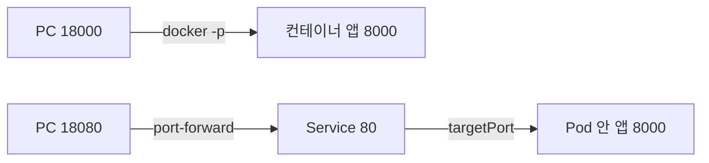

[03. Kubernetes 위에 ML 애플리케이션의 기반 놓기](/docs/tech/machine-learning-platform-engineering/03-kubernetes-foundation/)에서 정리한 내용을 작은 API로 직접 실행한 기록이다. 이미지를 만들고 Kubernetes에 올려 요청 경로와 지표를 확인하는 과정을 모았다.

## Docker 이미지 만들기

### 3.2.1 애플리케이션 코드 작성

책의 예제는 요청을 받아 응답을 돌려주는 FastAPI 서비스다. 입력 경로와 응답 형식, 의존성을 로컬에서 확인한 뒤 컨테이너로 옮긴다.

실행 명령, 환경 변수, 포트는 코드 밖에서도 보여야 한다. 프로세스가 루프백 주소에만 바인딩되어 있으면 포트를 매핑해도 바깥 요청이 닿지 않을 수 있다.

앱의 오류와 실행 환경의 오류는 나눠서 본다. 같은 요청이 로컬에서도 실패하면 앱의 입력 처리와 의존성을 먼저 의심한다. 컨테이너에서만 실패한다면 파일 경로, 설치된 패키지, 실행 명령, 환경 변수 중 무엇이 달라졌는지 찾는다.

### 3.2.2 Dockerfile 작성

| 주요 지시어 | 의미 | 점검할 사항 |
| --- | --- | --- |
| `FROM` | 기반 이미지 선택 | 버전, 아키텍처, 보안 업데이트 |
| `WORKDIR` | 작업 경로 지정 | 코드와 상대 경로의 일관성 |
| `COPY` | 빌드 문맥의 파일 복사 | 비밀, 불필요한 데이터 제외 |
| `RUN` | 빌드 중 명령 실행 | 시스템, Python 의존성의 재현성 |
| `ARG` / `ENV` | 빌드 인자 / 환경 변수 | 자격 증명을 이미지에 남기지 않기 |
| `ENTRYPOINT` / `CMD` | 기본 실행 방식 | 정상 기동, 종료와 인자 전달 |

Python 패키지를 설치했다고 OS 라이브러리나 GPU 런타임까지 따라오지는 않는다. 호스트와 이미지의 역할을 나누고, 환경별 비밀은 실행 시점에 승인된 비밀 관리 방식으로 넘긴다.

`RUN`은 이미지를 만드는 동안 실행된다. `ENTRYPOINT`와 `CMD`는 컨테이너가 시작될 때 무엇을 실행할지 정한다. 빌드가 성공해도 API가 제대로 뜨는지는 이미지를 띄워 요청을 보내 봐야 안다.

의존성 파일을 먼저 복사해 설치하고 앱 코드를 나중에 복사하면 코드만 바뀐 빌드에서 설치 계층을 재사용할 수 있다. 비밀 파일이나 대용량 학습 데이터를 무심코 복사하면 이미지가 커지고 배포 속도와 보안에도 영향을 준다.

### 3.2.3 이미지 빌드와 푸시

순서는 로컬 빌드, 로컬 컨테이너 실행 확인, 레지스트리 푸시, 배포 환경에서 가져오기다. 단계를 나눠 두면 앱, 포트 전달, 레지스트리 인증 중 어디가 잘못됐는지 가려낼 수 있다.

이미지 태그는 다른 이미지에 다시 붙일 수 있다. 그래서 실제 빌드와 배포에 쓴 커밋, 불변 digest를 함께 남긴다. [Kubernetes 이미지 문서](https://kubernetes.io/docs/concepts/containers/images/)도 tag는 옮겨 붙일 수 있는 이름, digest는 이미지 내용을 식별하는 해시로 구분한다. `latest`라는 이름은 실제로 배포한 내용을 말해 주지 않는다.

컨테이너가 환경 차이를 전부 없애 주지는 않는다. CPU 아키텍처, GPU 드라이버, 외부 서비스, 런타임 설정은 여전히 영향을 준다.

포트도 호스트 쪽과 컨테이너 쪽을 나눠 본다. 컨테이너 안의 앱이 8083 포트에서 듣고 있고 호스트의 8081을 그 포트에 연결했다면, 브라우저는 호스트의 8081로 요청한다. 이미지의 포트 선언, 프로세스가 실제로 듣는 포트, 바깥 포트 연결은 각각 다른 설정이다.

## kubectl로 상태 확인하기

### 3.3.2 kubectl

`kubectl`은 API server와 주고받는 명령행 도구다. context는 어느 클러스터에 어떤 인증 정보와 기본 Namespace로 붙을지 고르는 설정이다. 대상이 맞는지부터 확인하고 상태, 이벤트, 로그 순으로 보면 안전하다.

아래는 상태를 볼 때 쓰는 명령이다. `<namespace>`와 `<pod-name>`은 환경에 맞게 바꾼다.

```shell
kubectl config current-context
kubectl get nodes
kubectl get pods -n <namespace> -o wide
kubectl describe pod <pod-name> -n <namespace>
kubectl logs <pod-name> -n <namespace> --previous
kubectl get services,endpointslices -n <namespace>
```

`--previous`는 이전에 종료된 컨테이너의 로그를 볼 때 쓰고, 컨테이너가 여럿인 Pod라면 대상 컨테이너도 지정한다. `Pending`이면 배치, 볼륨, 자원을, `ImagePullBackOff`면 이미지 경로와 접근 권한을, 반복 재시작이면 프로세스, 설정, probe를 먼저 본다. EndpointSlice는 Service 뒤에 붙은 접속 대상과 그 준비 상태를 담는 자원이다.

## 실습: API 배포와 요청 경로 연결

책의 FastAPI 예제 대신 모델 없는 작은 앱을 쓴다. 모델을 넣기 전에 이미지와 네트워크 문제부터 떼어 보려는 것이다.

Python 3.12, 실행 가능한 Docker Engine, 개인 학습용 Kubernetes 클러스터가 필요하다. Windows에서는 Docker를 Linux 컨테이너 모드로 쓴다. 아래 클러스터 명령은 이미 준비된 Minikube를 전제로 하며, 이 글을 쓰면서 클러스터 실행까지 확인한 예제는 아니다. 운영 클러스터에는 적용하지 않는다.

### 1. 앱의 주소와 포트 고정하기

빈 실습 폴더에 `app.py`를 만든다.

```python
from fastapi import FastAPI

app = FastAPI()


@app.get("/")
def index():
    return {"service": "ml-book-study", "version": "v1"}


@app.get("/health")
def health():
    return {"status": "alive"}


@app.get("/ready")
def ready():
    return {"status": "ready"}
```

이 예제의 readiness는 항상 성공한다. 실제 모델 서비스라면 모델 로딩과 필수 초기화가 끝났을 때만 성공하게 바꿔야 한다. 외부 시스템이 느리다고 liveness까지 실패시키면 재시작이 부하를 더 키울 수 있다.

`requirements.txt`에는 학습용 버전을 고정한다.

```text
fastapi==0.115.5
uvicorn==0.32.1
```

같은 폴더에 `Dockerfile`을 둔다.

```dockerfile
FROM python:3.12-slim-bookworm
WORKDIR /app
COPY requirements.txt .
RUN pip install --no-cache-dir -r requirements.txt
COPY app.py .
CMD ["uvicorn", "app:app", "--host", "0.0.0.0", "--port", "8000"]
```

`COPY . .` 대신 필요한 두 파일만 복사한다. 폴더에 토큰 파일이 있어도 이미지에 들어가지 않는다. 기반 이미지는 읽기 쉬운 태그로 적었지만 실제 출시에서는 검증한 digest까지 고정한다.

```powershell
docker build -t income-api:study-v1 .
docker run --rm --name ml-book-api -p 127.0.0.1:18000:8000 income-api:study-v1
```

두 번째 명령은 터미널을 점유한다. 다른 터미널에서 `curl.exe http://127.0.0.1:18000/`로 확인하고, 끝낼 때는 실행 중인 터미널에서 Ctrl+C를 누른다. `18000`은 PC의 포트, `8000`은 컨테이너 안의 앱 포트다.

### API를 실행하고 요청 보내기

Docker와 Kubernetes 없이 앱만 먼저 띄워 본다. 위 패키지가 설치된 가상환경에서 같은 `app.py`를 실행한다.

```powershell
python -m uvicorn app:app --host 127.0.0.1 --port 15300
```

`http://127.0.0.1:15300/docs`에서 `GET /ready`를 펼치고 **Try it out → Execute**를 누른다. Swagger UI에서는 Execute를 눌러야 실제 요청이 나간다.


위쪽의 Request URL, 아래 Server response의 `200`, Response body의 `"status": "ready"`를 함께 본다. 그 아래 Example Value는 문서용 예시다. 여기서 문제가 생기면 앱 로직과 컨테이너, 네트워크 설정을 나눠서 조사한다.

이 앱에는 모델이 없으므로 `/ready`의 200 응답이 모델 준비 완료를 뜻하지 않는다. 실제 서비스라면 로딩한 모델 버전과 초기화 상태를 readiness에 반영해야 한다.

### 세 포트를 택배 경로처럼 읽기

호스트 포트를 건물 출입구, Service 포트를 안내 창구, `targetPort`를 실제 작업실 문이라고 생각하면 쉽다. 창구가 있다고 작업실이 생기지는 않는다. 앱은 8000번 문에서 기다리는데 안내가 8001번으로 되어 있으면 요청은 도착하지 못한다.



`0.0.0.0`은 앱이 컨테이너 안의 모든 네트워크 인터페이스에서 요청을 받겠다는 바인딩 설정이다. 브라우저에 입력할 주소가 아니다. 로컬에서 접속할 때는 위 명령에 적은 호스트 주소 `127.0.0.1`을 쓴다.

### 2. Deployment와 Service의 연결 만들기

다음 내용을 `deployment.yaml`로 저장한다.

```yaml
apiVersion: apps/v1
kind: Deployment
metadata:
  name: income-api
  namespace: ml-book-study
spec:
  replicas: 2
  selector:
    matchLabels:
      app: income-api
  template:
    metadata:
      labels:
        app: income-api
    spec:
      containers:
        - name: api
          image: income-api:study-v1
          imagePullPolicy: IfNotPresent
          ports:
            - containerPort: 8000
          resources:
            requests:
              cpu: 100m
              memory: 128Mi
            limits:
              cpu: 500m
              memory: 256Mi
          readinessProbe:
            httpGet:
              path: /ready
              port: 8000
            periodSeconds: 5
          livenessProbe:
            httpGet:
              path: /health
              port: 8000
            periodSeconds: 10
---
apiVersion: v1
kind: Service
metadata:
  name: income-api
  namespace: ml-book-study
spec:
  selector:
    app: income-api
  ports:
    - port: 80
      targetPort: 8000
```

맞물려야 하는 곳은 세 군데다. Deployment의 selector와 Pod template의 label이 같아야 하고, Service의 selector도 그 label을 골라야 한다. 그리고 `targetPort: 8000`이 프로세스가 실제로 듣는 포트와 일치해야 한다. `containerPort`를 선언한다고 포트가 열리지는 않는다.

적용하기 전에 context가 개인 Minikube를 가리키는지 확인한다. `minikube image load`는 로컬 이미지를 그 클러스터가 쓸 수 있게 옮겨 주는 단계다. 다른 클러스터라면 접근 가능한 레지스트리에 푸시한 이미지 주소와 인증을 쓴다.

```powershell
kubectl config current-context
minikube image load income-api:study-v1
kubectl create namespace ml-book-study
kubectl apply -f deployment.yaml
kubectl rollout status deployment/income-api -n ml-book-study --timeout=120s
kubectl get pods -n ml-book-study -o wide
kubectl get endpointslices -n ml-book-study
kubectl port-forward service/income-api -n ml-book-study 18080:80
```

마지막 명령을 띄워 둔 채 다른 터미널에서 `curl.exe http://127.0.0.1:18080/`를 보내 `v1` 응답이 오는지 본다. Service가 고른 Pod에 붙어 보는 점검이라 부하 분산이나 외부 네트워크 경로까지 검증하지는 못한다.

### 3. 성공 화면 대신 실패의 차이를 관찰하기

한 번에 한 곳만 바꾸고, 테스트가 끝나면 YAML을 원래 값으로 되돌려 다시 적용한다. 여러 곳을 한꺼번에 바꾸면 원인을 가를 수 없다.

| 바꿀 곳 | 예상 증상 | 확인할 증거 |
| --- | --- | --- |
| 이미지 태그를 존재하지 않는 값으로 변경 | 새 Pod에서 이미지 pull 실패 | `kubectl describe pod`의 Events |
| Service selector를 `app: missing`으로 변경 | 준비된 앱이 있어도 대상이 없음 | Service와 EndpointSlice의 대상 |
| readiness 경로를 `/not-found`로 변경 | 앱 프로세스는 살아도 Ready가 아님 | Pod의 Ready 조건과 probe 실패 이벤트 |
| `targetPort`를 8001로 변경 | 일반 Service 접속은 앱 포트에 도달하지 못함 | 앱의 수신 포트와 Service 설정 비교 |

Pod가 Running인데 Ready가 아닐 수 있다. 롤링 업데이트 중에는 이전 버전 Pod가 계속 응답하면서 새 버전의 실패를 가리기도 한다. 응답만 보지 말고 rollout 상태와 실행 중인 이미지도 확인한다.

점검이 끝나면 port-forward를 Ctrl+C로 멈추고 `kubectl delete -f deployment.yaml`로 이 예제의 Deployment와 Service만 지운다. Namespace나 클러스터 전체를 지울 필요는 없다.

## 메트릭을 요청 수로 직접 읽어 보기

Prometheus가 `http_requests_total`이라는 Counter를 수집한다고 해 보자. 다음 질의는 최근 5분 동안의 평균 초당 요청 수다. 실제 메트릭과 label 이름은 쓰는 계측 라이브러리에 맞춰 확인한다.

```promql
sum(rate(http_requests_total{job="income-api"}[5m]))
```

오류율은 5xx 요청의 증가율을 전체 요청의 증가율로 나눠 구한다. 전체 요청이 없는 구간을 정상 0%로 읽으면 안 된다. 트래픽이 없었던 것인지, 수집이 실패한 것인지 가려야 한다.

```promql
sum(rate(http_requests_total{job="income-api",status=~"5.."}[5m]))
/
sum(rate(http_requests_total{job="income-api"}[5m]))
```

두 질의가 정상이어도 모델의 분류는 틀릴 수 있다. 메트릭 수집 성공, HTTP 요청 성공, 예측의 정답 여부는 서로 다른 층이다. 다음 장에서 MLflow와 Feast를 붙이는 이유도 여기에 있다.
