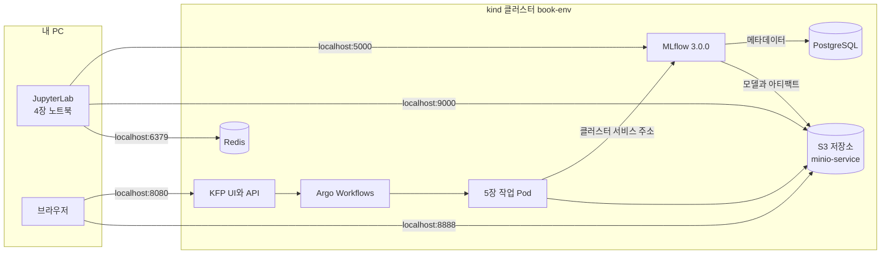
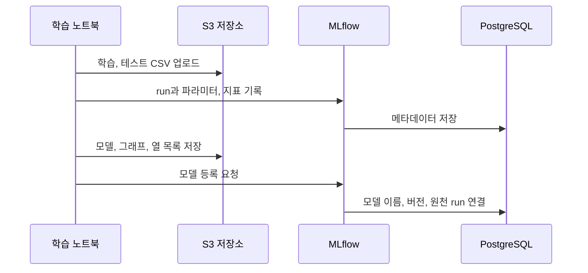
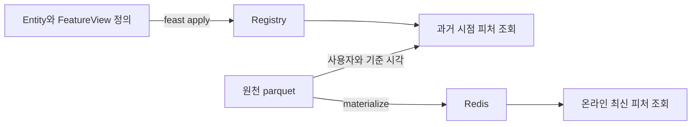
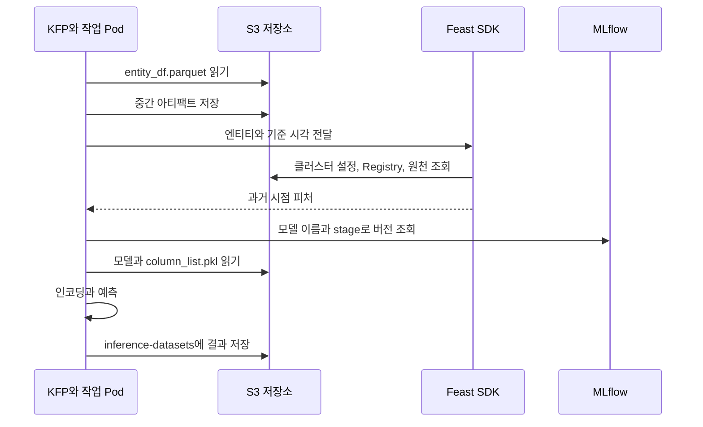

[04~05. 실험, 피처, 파이프라인 연결하기](/docs/tech/machine-learning-platform-engineering/04-experiments-features-pipelines/)에서 정리한 내용을 책의 코드로 직접 실행한 기록이다. 개념과 요점은 본문에 두고, 여기에는 명령, 실제 출력과 화면만 모았다.

## 실습 순서 {#book-lab-sop}

5장의 파이프라인은 모델을 학습하지 않는다. 4장에서 등록한 모델과 Feast 정의를 가져다 배치 추론을 하므로, 모델 등록과 피처 준비부터 끝내야 한다.


| 구간 | 끝났을 때 남는 것 |
| --- | --- |
| A. 환경 세팅 | KFP, S3 저장소, PostgreSQL, Redis, MLflow 서버와 버킷 다섯 개 |
| B. MLflow | 실험 `income-classifier`, 모델 `random-forest-classifier`의 Production 버전 |
| C. Feast | 원천 parquet, 로컬용 Registry, Redis의 온라인 피처 |
| D. KFP | 클러스터용 Registry와 설정, 파이프라인 실행 기록 |
| E. 결과 확인 | `inference-datasets/income_predictions.parquet` |

표의 오른쪽 칸이 갖춰졌으면 다음 단계로 넘어간다. 명령은 저장소 최상위 폴더에서 실행하며, `cd`가 있는 단계만 위치가 바뀐다.

## A. 환경 세팅

### 먼저 볼 구성: 무엇이 함께 설치되는가

책의 부록 A는 k3s나 MicroK8s 클러스터에 [kubeflow-argo](https://github.com/vmallya-123/kubeflow-argo)를 내려받아 Argo CD부터 설치한다. `kubectl apply -k argocd/`에 이어 `kubectl apply -f kubeflow.yaml`을 실행하면 Argo CD가 Kubeflow의 구성 요소별 Application을 배포하고 동기화한다.

이름이 비슷한 Argo CD와 Argo Workflows는 하는 일이 다르다. Argo CD는 책이 Kubeflow 설치에 고른 GitOps 도구이고, Argo Workflows는 KFP가 파이프라인 작업을 Pod로 돌리는 엔진이다. Kubeflow를 설치한다고 Argo CD가 따라 설치되지는 않는다.

| 구성 요소 | 책의 설치 방식 | 이 실습 |
| --- | --- | --- |
| Kubeflow | Argo CD로 전체 설치. Istio, 인증, 대시보드, Notebooks 등 포함 | kind에 KFP standalone 2.4.1만 설치 |
| KFP의 저장소와 실행 기반 | MySQL, MinIO, Argo Workflows가 함께 배포됨 | 같은 구성에서 MinIO 이미지를 SeaweedFS로 교체 |
| PostgreSQL, Redis | 부록 A의 Bitnami Helm 차트로 별도 설치 | 같은 서비스 이름의 매니페스트로 설치 |
| MLflow 서버 | 이미지 빌드 후 Deployment와 Service를 별도 적용 | MLflow 3.0.0 이미지를 빌드해 설치 |
| 업무용 버킷 | MinIO에서 직접 생성 | 저장소 화면에서 직접 생성 |

KFP에 MinIO가 들어 있어도 실습용 버킷까지 생기지는 않는다. KFP가 쓰는 `mlpipeline`을 빼면 학습 데이터, 모델 파일, 피처, 예측 결과를 담을 버킷은 직접 만들어야 한다.



책의 4장은 PC에서 `mlflow ui`를 띄우지만 5장은 Pod에서도 닿는 MLflow 서버가 필요하다. 그래서 처음부터 클러스터에 서버를 하나 두고 PC에서는 `localhost:5000`으로 붙어, 노트북과 파이프라인이 같은 모델을 보게 했다.

### A-1. 도구 확인

Docker(메모리 8GB 이상 할당), kind 0.27, kubectl, git, Python 3.11, uv와 디스크 여유 40GB가 필요하다. 아래 절차는 Windows 11 PowerShell 기준이다. macOS나 Linux라면 가상환경 활성화와 PowerShell 전용 명령을 쓰는 셸에 맞게 바꾼다.

1. 저장소를 내려받고 도구를 확인한다.
   ```powershell
   git clone https://github.com/johklo/ml-platform-book-env.git
   cd ml-platform-book-env
   python bookenv.py check
   ```
2. 마지막 줄에 `All required tools are available.`이 나오면 된다. PATH에 없는 도구는 `$env:KIND = "C:\tools\kind.exe"`처럼 경로를 직접 지정한다. `KUBECTL`, `DOCKER`, `GIT`도 같다.

### A-2. 클러스터 설치

1. 클러스터와 서비스를 설치한다.
   ```powershell
   python bookenv.py up
   ```
2. `The environment is ready. Next: python bookenv.py forward`가 나오면 끝이다. 이미지 캐시가 있을 때 약 8분 걸렸다. 처음이라면 다운로드와 빌드 때문에 20분을 넘길 수 있다.

설치 중 `metadata-grpc-deployment`와 `ml-pipeline`이 MySQL을 기다리며 재시작하기도 한다. 설치가 시간 초과로 끝나면 `python bookenv.py status`로 준비되지 않은 Pod를 찾는다. 원인을 고친 뒤 `up`을 다시 실행하면 기존 클러스터를 그대로 쓴다.

### A-3. 포트포워딩과 화면 확인

1. 두 번째 터미널에서 실행하고, 실습이 끝날 때까지 켜 둔다.
   ```powershell
   python bookenv.py forward
   ```
2. 브라우저에서 다음 세 화면을 연다.

   | 주소 | 확인할 화면 |
   | --- | --- |
   | http://localhost:8080 | Pipelines, Experiments, Runs 메뉴가 있는 KFP |
   | http://localhost:5000 | 왼쪽 위에 `mlflow 3.0.0`이 표시되는 MLflow |
   | http://localhost:8888/buckets/ | `mlpipeline` 폴더가 있는 저장소 |

   

포트가 이미 쓰이고 있다면 로컬 MLflow나 예전 forward 창이 남았는지 본다. 실행 중 잠깐 보이는 `Reconnecting ...`은 Pod가 재시작돼 터널을 다시 연다는 메시지다. 계속 반복되거나 화면이 열리지 않으면 Pod 상태와 포트 충돌을 확인한다.

책의 MinIO 콘솔은 `minio` / `minio123`으로 로그인한다. 그런데 KFP 2.4.1이 쓰는 구형 MinIO 이미지를 받을 수 없어서 이 환경은 SeaweedFS로 바꿨다. S3 API의 서비스 이름과 계정은 그대로 두고, 웹 화면만 로그인이 없는 Filer를 쓴다. 이 화면에서는 `/buckets/` 아래 폴더 하나가 S3 버킷 하나다. [KFP 공식 문서](https://www.kubeflow.org/docs/components/pipelines/operator-guides/configure-object-store/)도 2.15부터 기본 저장소로 SeaweedFS를 안내한다.

### A-4. 버킷 만들기

같은 저장소라도 버킷을 나눠 두면 데이터마다 어느 도구가 책임지는지 눈에 들어온다.

| 버킷 | 저장할 것 | 사용하는 단계 |
| --- | --- | --- |
| `mlflow-datasets` | 학습, 테스트 CSV | B |
| `mlflow-artifacts` | 모델, 그래프, `column_list.pkl` | B, D |
| `feature-data-sets` | 피처 원천 parquet와 예측 대상 `entity_df.parquet` | C, D |
| `feature-registry` | Feast Registry와 설정 파일 | C, D |
| `inference-datasets` | 최종 예측 parquet | D, E |
| `mlpipeline` | KFP 작업 사이에 전달할 아티팩트 | KFP가 준비 |

1. http://localhost:8888/buckets/ 를 연다.
2. 오른쪽 위 **New Folder**를 누르고 `mlflow-datasets`를 입력한 뒤 **확인**을 누른다.

   

3. 같은 방법으로 `mlflow-artifacts`, `feature-data-sets`, `feature-registry`, `inference-datasets`를 차례로 만든다.
4. 목록에 다섯 개와 `mlpipeline`이 함께 보이면 된다.

   

책 본문에 나오는 `feature_data_sets`는 밑줄 때문에 S3 버킷 이름으로 쓸 수 없다. 저자 README와 코드에 있는 `feature-data-sets`를 따른다. 화면에서 하나씩 만드는 대신 `python bookenv.py buckets`로 한 번에 만들어도 된다.

### A-5. 책 코드와 가상환경

1. 노트북과 스크립트가 읽을 저자 코드를 `upstream/`에 받는다.
   ```powershell
   git clone https://github.com/practical-mlops/chapter-4.git upstream/chapter-4
   git clone https://github.com/practical-mlops/chapter-5.git upstream/chapter-5
   ```
   확인한 커밋은 chapter-4 `b67a822`, chapter-5 `332915b`이고 둘 다 2025-07-23 시점이다.
2. 패키지를 설치하고 가상환경을 활성화한다.
   ```powershell
   uv venv .venv-book --python 3.11
   uv pip install --python .venv-book -r book/requirements.txt
   .\.venv-book\Scripts\Activate.ps1
   ```
   macOS와 Linux의 활성화 명령은 `source .venv-book/bin/activate`다.
3. 버전을 확인한다.
   ```powershell
   python -c "import mlflow, feast, kfp, sklearn; print(mlflow.__version__, feast.__version__, kfp.__version__, sklearn.__version__)"
   ```
   `3.0.0 0.40.1 2.9.0 1.5.2`가 나오면 된다.

책 본문은 `mlflow==2.6.0`을 쓰지만 공식 저장소와 부록은 3.0.0이다. 여기서는 서버와 클라이언트를 모두 3.0.0으로 맞췄다. KFP 서버 2.4.1과 Python SDK 2.9.0은 서로 다른 구성 요소라서 번호가 달라도 괜찮다.

### A-6. JupyterLab

1. 저장소 화면이 쓰는 8888을 피해 8890으로 띄운다.
   ```powershell
   jupyter lab --notebook-dir book --port 8890
   ```
2. 출력된 `http://127.0.0.1:8890/lab?token=...` 주소로 들어가 `ch04` 폴더의 노트북 두 개를 확인한다. 이후 터미널 명령은 새 창에서 같은 가상환경을 활성화한 뒤 실행한다.

## B. MLflow로 학습과 모델 등록

MLflow는 학습 자체가 아니라 실험 기록과 모델을 나중에 다시 찾는 일을 맡는다. `start_run()`으로 기록 범위를 열고, 그 안에서 `fit()`으로 학습한 다음 메트릭과 모델을 남긴다.

| 개념 | 역할 | 이번 실습 |
| --- | --- | --- |
| Experiment | 관련 run을 묶음 | `income-classifier` |
| Run | 한 번의 실행 기록 | 데이터 탐색, Decision Tree, Random Forest, XGBoost |
| Parameter | 실행 설정 | 트리 깊이 등 모델 설정 |
| Metric | 측정 결과 | `roc_auc_score_test`, 정확도 |
| Artifact | 실행에서 남긴 파일 | 모델, 그래프, `column_list.pkl` |
| Model Registry | 관리할 모델의 이름과 버전 | `random-forest-classifier` v1 |

MLflow 서버가 PostgreSQL에 넣는 것은 run과 모델 버전의 메타데이터다. 모델 파일은 `mlflow-artifacts`에 있다. 그래서 서버 화면은 잘 열리는데 S3 연결이 끊겨 모델 업로드나 다운로드만 실패하는 일이 생긴다.



### B-1. 노트북과 준비 셀

1. `ch04/01_mlflow_tracking.ipynb`를 열고 커널이 `Python 3 (ipykernel)`인지 본다. JupyterLab을 `.venv-book`에서 띄웠다면 그 환경의 커널이다.
2. 맨 위부터 `import pandas as pd ...`까지 네 셀을 `Shift+Enter`로 실행한다. 데이터 경로와 S3 주소, 계정을 준비하는 셀이다.

   

이 노트북은 저자의 `chapter-4/mlflow/data_exploration_and_model_training.ipynb`를 바탕으로 했고, 환경에 맞춰 넣은 셀에는 `[환경]` 표시를 달았다. 첫 셀이 `AssertionError`로 끝나면 A-5에서 받은 코드 위치부터 확인한다.

### B-2. 데이터 탐색과 첫 run

1. `2. 데이터 탐색` 아래 셀 세 개를 실행한다. `df.info()`에 30,162행과 9개 열이 나오고 변수별 그래프가 `categorical_variable_plots/`에 저장된다.
2. `3. MLflow 연결` 아래 셀 세 개를 실행한다. `income-classifier` 실험이 만들어지고 `artifact_location='s3://mlflow-artifacts/1'`이 출력된다.
3. MLflow 화면에서 `income-classifier`를 열고, `eda-`로 시작하는 run의 Artifacts 탭에 PNG가 있는지 본다.

탐색 단계에서는 결측 표기와 범주별 표본 수, 정답 비율을 본다. 그때 데이터가 어떤 상태였는지 남겨 둬야 다음 실험과 비교가 된다. 연결 오류가 나면 forward 창을, `NoSuchBucket`이 나오면 `mlflow-artifacts` 버킷을 확인한다.

### B-3. 데이터 분할과 모델 학습

1. `4. 학습 데이터 분할`과 `5. MinIO 버킷 확인` 셀을 실행한다. `mlflow-datasets bucket found`가 나오면 된다.
2. `6. Decision Tree`, `7. Random Forest`, `8. XGBoost` 셀을 차례로 실행한다. 각각 1분 정도 걸린다.
3. MLflow에 run 네 개(탐색 1개, 모델 3개)가 보이면 된다.

   

소득 분류 예제는 직업이나 학력 같은 범주형 열을 원-핫 인코딩한다. 추론에서도 열 순서가 같아야 하므로 학습할 때 `column_list.pkl`을 모델과 함께 기록하고, 5장의 추론 컴포넌트가 이 파일을 내려받는다. 서비스에서 입력이 올 때마다 인코딩 열을 새로 만들면 모델은 그대로인데 입력의 의미가 달라진다.

이번 실행의 테스트 ROC AUC는 Decision Tree 약 0.817, Random Forest 0.855, XGBoost 0.714였다. 데이터를 무작위로 나누기 때문에 다시 돌리면 같은 수치가 나오지 않는다. `log_input()`도 데이터 출처를 기록할 뿐, 원천 CSV를 복사해 두지는 않는다.

### B-4. 모델 등록

1. `9. 가장 좋은 run을 찾아 모델 레지스트리에 등록` 셀을 실행한다.
2. 바로 아래 `[환경]` 셀로 등록 버전을 `Production`으로 지정한다.
   ```text
   bold-moose-377 0.8552045821993023 random-forest-classifier 1
   1 Production 30627206bc81449bad0da833f4e8d210
   ```
3. **Models → random-forest-classifier**에서 버전과 원천 run을 본다.

   

책에는 stage를 지정하는 과정이 없다. 하지만 5장의 `model_stage` 파라미터가 이 값으로 모델을 찾기 때문에 여기서 지정해 둔다. MLflow 3에서 뜨는 `FutureWarning`은 stage 기능이 deprecated라는 안내다. Production으로 지정했다고 API가 배포되는 것도 아니다.

출시 기준은 책과 다르게 잡는 편이 맞다. 책은 테스트 점수로 모델을 고르지만, 운영이라면 검증셋으로 후보를 고르고 테스트셋은 마지막 확인에만 쓴다. stage나 alias는 나중에 다른 버전을 가리킬 수 있으니 실제 배치에서는 시작할 때 구체 버전을 확정하고 `models:/이름/숫자` 형태로 남긴다.

## C. Feast로 피처 정의와 조회

MLflow가 어떤 모델을 만들었는지 기록한다면, Feast는 모델이 쓸 피처를 어디서 어떤 기준으로 가져올지 관리한다.


| 구성 요소 | 저장하거나 정의하는 것 | 이번 실습 |
| --- | --- | --- |
| Entity | 누구의 값인지 식별할 조인 키 | `user_id` |
| Data source | 원천 위치, 시간 필드와 접속 정보 | S3의 parquet |
| FeatureView | 피처 이름, 타입, Entity와 TTL | demographic, relationship, occupation |
| Registry | 위 정의들의 메타데이터 | `feature-registry`의 Registry 파일 |
| Offline store | 과거 피처 이력 | `feature-data-sets`의 parquet |
| Online store | 빠르게 조회할 최신 피처 | Redis |

**`feast apply`와 `materialize`는 다른 작업**이다. apply는 정의를 등록하고, materialize는 피처 값을 온라인 저장소로 옮긴다. Registry에 FeatureView가 보여도 Redis에는 아직 값이 없을 수 있다.



### C-1. 준비와 원천 파일 업로드

1. `ch04/02_feast_feature_store.ipynb`를 열고 `[환경] 경로와 명령 실행 도우미`, `1. 환경 변수` 셀을 실행한다.
2. `2. 피처 원천 파일을 feature-data-sets 버킷으로 옮기기` 셀을 실행한다.
   ```text
   ['demographic_features.parquet', 'occupational_features.parquet', 'relationship_features.parquet']
   ```
3. `3. 피처 저장소 폴더 준비` 셀 두 개를 실행한다. 저자의 `entity.py`, `features.py`, `feature_store.yaml`을 `feature_repo/`로 복사하면서 Redis 비밀번호를 `redis123`으로 바꾼다.

이 노트북은 저자의 `chapter-4/Readme.md`에 있는 명령을 셀에서 실행하도록 옮긴 것이다. S3와 Redis를 모두 쓰니 forward의 9000, 6379 터널이 열려 있어야 한다.

### C-2. 정의 등록

`4. feast apply` 셀을 실행하면 `s3://feature-registry/registry_local.db`에 정의가 기록되고 Redis가 준비된다.

```text
Deploying infrastructure for relationship
Deploying infrastructure for demographic
Deploying infrastructure for occupation
```

`NoSuchBucket`이 나오면 `feature-registry` 버킷을, Redis 인증 오류가 나면 비밀번호 치환과 6379 터널을 본다. 아직 온라인 피처 값은 적재하지 않은 상태다.

### C-3. 과거 시점 피처 조회

`5. 과거 시점 피처 조회` 셀을 실행하면 사용자와 `event_timestamp`, `Sex`가 함께 나온다.

```text
                                user_id           event_timestamp    Sex
0  9f2ac416-06e1-44a0-87bd-d4787c85bf66 2023-01-30 10:59:42+00:00   Male
```

과거 조회는 사용자 ID에 값을 붙이되, **그 시점에 알 수 있었던 값**을 붙인다. 사용자 42의 근무 시간이 5월 21일에 36, 6월 4일에 52였다고 하자. 5월 22일 예측에는 36을 써야 한다. 최신값 52를 가져오면 미래 정보가 섞인다.

TTL이 2일이면 5월 25일 조회에서 21일 값은 너무 오래돼 빠진다. 21일에 발생한 데이터가 23일에야 도착했다면 22일에는 알 수 없던 값이다. 지연 도착이나 보정 이력이 있는 원천은 시간 필드 하나로 끝나지 않고, 실제로 쓸 수 있게 된 시점까지 따져야 한다.

### C-4. 온라인 저장소 적재와 조회

1. `6. 온라인 저장소로 적재` 셀을 실행한다. `feast materialize`가 README의 기간인 `2022-09-16T00:00:00`부터 `2023-09-17T00:00:00`까지 원천을 읽어 Redis에 최신값을 적재한다.
2. `7. 온라인 피처 조회` 셀을 실행해 `Sex` 값이 비어 있지 않으면 된다.

온라인 조회는 최신값을 빠르게 읽는 데 맞춰져 있다. 5장처럼 과거 시각을 기준으로 배치 추론을 할 때는 `get_historical_features()`를 쓴다.

`None`이 나오면 적재 여부와 그 사용자의 원천 데이터를 본다. HTTP 요청이 성공하고 적재 기간이 찍혀도 모든 사용자에게 유효한 피처가 있다는 보장은 없다.

### C-5. 설정 파일 업로드

`8. feature_store.yaml을 feature-registry 버킷에 올리기` 셀을 실행한다. 버킷에 `feature_store.yaml`과 `registry_local.db`가 보이면 C는 끝이다.

이 설정은 PC에서 쓰는 localhost용이다. Pod 안에서 `localhost`는 그 Pod 자신이라서, D에서는 클러스터 주소를 쓰는 정의와 설정을 따로 준비한다.

### 학습과 추론에서 같은 피처를 쓴다는 것

앞의 학습 노트북은 Feast에서 학습 피처를 조회하지 않고, FeatureService를 MLflow에 기록하지도 않는다. 책의 흐름을 끝까지 돌린 것과 학습부터 추론까지 피처 계약을 고정한 것은 별개의 일이다.

연결을 실제로 만들려면 필요한 FeatureView를 `income_model_v1` 같은 FeatureService로 묶고, 학습 코드가 그 서비스로 과거 피처를 조회하게 한다. 이때 MLflow run과 모델 버전에 서비스 이름, 피처 목록, 정의 파일 해시, 데이터 스냅샷을 남겨 두면 추론 때 같은 계약인지 대조할 수 있다. 이 부분은 글 끝의 보충 예제로 따로 뺐다.

## D. Kubeflow Pipelines로 배치 추론


그림은 작업 순서와 데이터 이동을 나눠 보면 읽기 쉽다. KFP는 단계의 순서와 의존성을 관리한다. 데이터는 작업 Pod가 파일로 저장해 다음 Pod로 넘기며, Pod끼리 파이썬 객체나 메모리를 공유하지 않는다.

| 컴포넌트 | 입력 | 출력과 접속 대상 |
| --- | --- | --- |
| read-data-from-minio | `entity_df.parquet` 위치 | S3에서 읽은 예측 대상 사용자와 기준 시각 |
| retrieve-features-from-feast | 대상 엔티티, Feast 설정과 피처 목록 | S3 Registry와 원천에서 조회한 과거 피처 |
| model-inference | 피처, 모델 이름과 stage | MLflow에서 찾은 모델의 예측값 |
| write-data-to-minio | 예측 결과와 목적지 | `inference-datasets`의 최종 parquet |



모델 이름이나 처리 설정 같은 작은 값은 파라미터로, 대상 목록과 피처 테이블은 파일 아티팩트로 넘긴다. `Input[Dataset]`과 `Output[Dataset]`은 파일을 주고받는 약속이고, 열 타입이나 결측까지 검사하지는 않는다. 스키마와 업무 키 검사는 컴포넌트 코드에서 직접 해야 한다.

### D-1. 책 코드를 환경에 맞추기

가상환경을 활성화한 새 터미널에서 실행한다.

```powershell
python book/ch05/prepare.py
```

저자 README에서 바꾸라고 한 컴포넌트 이미지 이름과 Redis 비밀번호를 고치는 단계다. 이미지 네 개의 참조가 `book-ch5/components:0.1`로 바뀌었다는 줄과 `Redis password set`이 출력되면 된다.

### D-2. 이미지 빌드와 적재

책은 이미지를 Docker Hub에 push하지만, 여기서는 로컬에서 빌드해 kind 노드에 바로 넣는다. 저자의 `python:3.10-slim-buster`는 패키지 설치 중 404가 나서 bookworm으로 바꿨다. 컴포넌트의 scikit-learn도 모델을 저장한 노트북과 같은 1.5.2로 맞췄다.

1. 이미지를 빌드한다. 처음에는 두 개 합쳐 10분 넘게 걸릴 수 있다.
   ```powershell
   docker build -t book-ch5/feast-job:0.1 -f book/ch05/Dockerfile.feast-job upstream/chapter-5/scripts/feast
   docker build -t book-ch5/components:0.1 -f book/ch05/Dockerfile.components upstream/chapter-5
   ```
2. 클러스터에 적재한다.
   ```powershell
   python bookenv.py load book-ch5/feast-job:0.1
   python bookenv.py load book-ch5/components:0.1
   ```

PC에 이미지가 있어도 kind 노드에는 없을 수 있다. 이미지를 다시 빌드했다면 적재도 다시 한다.

### D-3. 클러스터에서 Feast 정의 등록

```powershell
kubectl apply -f book/ch05/feast-job.yaml
kubectl -n kubeflow wait --for=condition=complete --timeout=300s job/feast-job
kubectl -n kubeflow logs job/feast-job
```

저자의 Job에서 이미지 이름과 네임스페이스만 바꿨다. 이 Job이 클러스터 주소를 쓰는 `s3://feature-registry/registry.db`를 만들고, 로그에 `Deploying infrastructure` 세 줄이 나오면 된다.

`entity_key_serialization_version` 경고는 저자 설정에 이 값이 명시되지 않아서 나온다. `ErrImageNeverPull`이 뜨면 D-2의 적재부터 확인한다. 다시 실행할 때는 `kubectl -n kubeflow delete job feast-job`으로 기존 Job을 지운 뒤 적용한다.

### D-4. 입력 파일 업로드와 컴파일

1. 파이프라인 입력 파일을 올린다.
   ```powershell
   python book/ch05/upload_inputs.py
   ```

   | 원본 | 업로드 위치 |
   | --- | --- |
   | `upstream/chapter-5/scripts/feast/feature_store.yaml` | `feature-registry/feature_store_k8s.yaml` |
   | `upstream/chapter-4/feast/data/entity_df.parquet` | `feature-data-sets/entity_df.parquet` |

   4장의 localhost용 `feature_store.yaml`을 덮어쓰지 않으려고 클러스터용 파일에는 다른 이름을 붙였다.
2. 컴파일하고 이미지 참조를 확인한다.
   ```powershell
   cd upstream/chapter-5
   python inference_pipeline.py
   cd ../..
   Select-String -Path upstream/chapter-5/income_classifier_pipeline.yaml -Pattern "image:"
   ```
   macOS와 Linux에서는 마지막 줄 대신 `grep "image:" upstream/chapter-5/income_classifier_pipeline.yaml`을 쓴다. 이미지는 모두 `book-ch5/components:0.1`이어야 한다. `varunmallya/...`가 보이면 D-1을 실행하고 다시 컴파일한다.

컴파일은 정의를 실행 명세 YAML로 바꾸기만 한다. 이 시점에는 Pod도 뜨지 않고 데이터도 읽지 않는다. 이미지와 서비스 주소, 권한이 맞는지는 실제로 실행해 봐야 안다.

### D-5. 파이프라인 업로드

1. http://localhost:8080 에서 **Pipelines → + Upload pipeline**을 누른다.

   

2. **Pipeline Name**에 `income-classifier-pipeline`, 설명에 `Chapter 5 income classifier batch inference`를 입력한다.
3. **Upload a file** 라디오 버튼을 먼저 누른 다음 **Choose file**로 `upstream/chapter-5/income_classifier_pipeline.yaml`을 고른다.

   

4. **Create**를 누르면 컴포넌트 네 개가 이어진 그래프가 나온다.

   

라디오 버튼을 건너뛰면 `Package URL is empty` 오류가 나기도 한다. 빈 파이프라인이 남았다면 목록에서 지우고 다시 올린다.

### D-6. 실험 만들고 실행하기

1. **Experiments → + Create experiment**에서 이름 `income-classifier`, 설명 `Chapter 5 batch inference runs`를 입력하고 **Next**를 누른다.

   

   MLflow의 Experiment와 이름만 같고 서로 관계는 없다. KFP 실험은 파이프라인 실행을, MLflow 실험은 학습 run을 묶는다.
2. 실행 화면에서 **Pipeline → Choose**로 `income-classifier-pipeline`을 고르고 **Use this pipeline**을 누른다. 실험 목록으로 돌아왔다면 해당 실험의 **Create run**으로 들어간다.
3. **Run name**에 `income-classifier-run-1`을 넣고 파라미터를 채운다. 같은 값이 `book/ch05/run-parameters.json`에도 있다.

   | 파라미터 | 값 |
   | --- | --- |
   | access_key | `minio` |
   | secret_key | `minio123` |
   | entity_df_bucket | `feature-data-sets` |
   | entity_df_filename | `entity_df.parquet` |
   | feature_list | `demographic:Sex,demographic:Race,demographic:Native_country,relationship:Relationship,relationship:Marital-Status,occupation:Workclass,occupation:Education,occupation:Occupation` |
   | feature_store_bucket_name | `feature-registry` |
   | feature_store_config_file_name | `feature_store_k8s.yaml` |
   | minio_host | `minio-service.kubeflow.svc.cluster.local:9000` |
   | mlflow_host | `http://mlflow-service.mlflow.svc.cluster.local:5000` |
   | model_name | `random-forest-classifier` |
   | model_stage | `Production` |
   | model_type | `sklearn` |
   | output_bucket | `inference-datasets` |
   | output_file_name | `income_predictions.parquet` |

   

4. **Start**를 누른다. 이번 실행은 2분 정도 걸렸고, 네 작업이 차례로 성공 표시로 바뀌었다.

   

작업이 Pod에서 돌기 때문에 서비스 주소에 `localhost`를 쓰지 않는다. 책처럼 키를 파라미터로 넘기면 UI에도 그대로 보이니, 운영에서는 Secret과 서비스 계정 권한으로 넘긴다.

### D-7. 결과 확인

1. 그래프에서 **model-inference → Logs**를 열어 모델 조회와 추론 로그를 본다.

   

2. **write-data-to-minio → Input/Output**에서 앞 단계의 예측 파일이 입력으로 연결됐는지 확인한다.

   

   주소가 `minio://mlpipeline/...`로 보이는 것은 이 구성에서 KFP가 S3 호환 아티팩트 위치를 그렇게 표시하기 때문이다. 실제 저장소 이미지는 SeaweedFS다.
3. http://localhost:8888/buckets/inference-datasets/ 에 `income_predictions.parquet`가 있으면 된다.

   

4. 파일 내용을 읽어 본다.
   ```powershell
   python book/ch05/show_predictions.py
   ```
   ```text
   rows, columns: (30162, 92)
   user_id in output: False
   ```

이제 작업 성공만이 아니라 파일 전달과 결과 저장까지 확인했다. parquet 미리보기에 `PAR1`이나 깨진 문자가 보이는 것은 파일을 텍스트로 띄웠기 때문이라 내용 문제는 아니다.

## E. 결과 해석과 오류 대응

### 실행 성공과 예측 품질은 다르다

책 코드의 결과에는 `user_id`가 없다. 추론 코드가 인코딩 전에 이 열을 지우기 때문이다. 실제 서비스라면 누구의 예측인지 알 수 있게 결과에 다시 붙여야 한다. 모델 입력에서 ID를 빼는 것과 결과에서 ID를 버리는 것은 다른 문제다.

확률과 클래스도 섞이기 쉽다. `predict_proba()`가 돌려주는 값은 클래스 확률 추정치이고 클래스 번호가 아니다. 열 순서는 `classes_`로 확인하고, 임계값은 오탐과 미탐의 업무 비용에 맞춰 검증한다.

재실행을 추적하려면 대상 사용자와 기준 시각, 구체 모델 버전, 피처 정의, 코드와 데이터 스냅샷을 함께 남긴다. KFP run ID만으로는 같은 날짜의 결과가 중복 저장되는 것을 막지 못한다.

### 실패한 단계에서 확인할 것

실패한 상자의 **Logs**를 열고 그 단계의 입력과 접속 대상부터 본다. PC는 포트포워딩으로, Pod는 클러스터 서비스 주소로 통신하니 둘을 나눠 생각하면 원인이 빨리 좁혀진다.

| 실패 위치나 증상 | 확인할 것 |
| --- | --- |
| read-data-from-minio의 `NoSuchKey` | D-4의 `entity_df.parquet` 업로드 |
| retrieve-features-from-feast의 Registry 오류 | D-3 Job 성공 여부와 `feature_store_k8s.yaml` 선택 |
| model-inference에서 모델을 찾지 못함 | B-4의 Production 지정, 모델 이름과 MLflow 주소 |
| write-data-to-minio의 `NoSuchBucket` | `inference-datasets` 버킷 |
| `ErrImagePull`, `ErrImageNeverPull` | 로컬 이미지 빌드와 kind 적재, 컴파일한 이미지 이름 |
| MLflow의 `FallbackAsyncAdaptedQueuePool` ImportError | `sqlalchemy<2.1`, `alembic<1.17` 고정 |
| S3의 `InternalError` | 저장소 패치의 `-volume.max=100` 적용 여부 |
| 추론 시 scikit-learn 버전 오류 | 학습 노트북과 컴포넌트 이미지의 1.5.2 일치 |
| `apt-get`의 404 | buster 대신 제공한 bookworm Dockerfile 사용 |

사용자나 피처가 빠지거나 스키마가 틀리거나 엉뚱한 모델 버전이 넘어가는 경우는 따로 시험해 봐야 한다. 없는 값을 전부 0으로 채워 성공시키면 잘못된 예측을 알아채기 어렵다. S3의 일시 장애는 횟수를 제한한 재시도로 넘길 수 있지만, 스키마 오류는 입력을 고치기 전까지 몇 번을 돌려도 그대로다.

### 실습 종료

JupyterLab과 forward 창은 `Ctrl+C`로 끄면 접속만 끊긴다. 다시 시작할 때는 `python bookenv.py status`로 상태를 보고 A-3부터 하면 된다. 클러스터와 실습 기록을 모두 지우려면 다음을 실행한다.

```powershell
python bookenv.py down
docker rmi book-ch5/components:0.1 book-ch5/feast-job:0.1 book-env/mlflow:3.0.0 book-env/runtime:0.1
```

## 보충: 피처 계약을 고정하는 작은 로컬 예제

Feast로 학습 데이터를 조회하고 그때 쓴 FeatureService를 MLflow 모델 버전에 기록하는 방식은 따로 연습해 볼 수 있다. 아래는 예전에 만든 작은 예제이고, 위 `book-env` 실습에 꼭 필요한 단계는 아니다.

| 실행 순서 | 코드 | 확인할 것 |
| --- | --- | --- |
| 1 | [feature_study.py](/downloads/ml-platform-engineering/kfp-cluster/feature_study.py) | `income_model_v1` 등록, 사용자 42의 과거 값 36과 온라인 값 52 구분 |
| 2 | [income_study.py](/downloads/ml-platform-engineering/kfp-cluster/income_study.py) | Feast 조회로 학습, 서비스 이름과 정의 해시 기록, 모델 버전 고정 |
| 3 | [pipeline_study.py](/downloads/ml-platform-engineering/kfp-cluster/pipeline_study.py) | 모델 버전의 FeatureService tag와 추론 계약 비교 |
| 4 | [run_pipeline_study.py](/downloads/ml-platform-engineering/kfp-cluster/run_pipeline_study.py) | 로컬에서 네 작업 실행 |

Python 3.11이 있는 Linux나 WSL2에서 별도 폴더와 가상환경을 만든다. Windows 네이티브에서는 KFP `SubprocessRunner`의 셸과 경로 처리가 달라서 이 예제는 WSL2에서 돌린다.

```bash
python3 -m venv .venv
source .venv/bin/activate
python -m pip install mlflow==2.16.2 scikit-learn==1.5.2 feast==0.40.1 \
    pandas==2.2.3 numpy==1.26.4 pyarrow==17.0.0 \
    kfp==2.10.1 sqlalchemy==2.0.36
python feature_study.py
python income_study.py
python pipeline_study.py
python run_pipeline_study.py
```

이 예제는 MLflow 2.16.2와 로컬 SQLite를 쓰니 위의 MLflow 3.0.0용 가상환경과 섞지 않는다. 실행하면 사용자 `42`, 기준 시각 `2025-05-22`, 근무 시간 `36.0`, FeatureService `income_model_v1`과 고정된 모델 URI가 결과에 남는다. 합성 데이터라서 점수를 책의 소득 데이터 성능과 비교하는 용도는 아니다.

이 작은 예제를 별도 kind 클러스터에 올릴 때 쓰던 [Dockerfile](/downloads/ml-platform-engineering/kfp-cluster/Dockerfile), [제출 스크립트](/downloads/ml-platform-engineering/kfp-cluster/submit_cluster.py), [저장소 패치](/downloads/ml-platform-engineering/kfp-cluster/object-store-patch.yaml), [Executor 패치](/downloads/ml-platform-engineering/kfp-cluster/executor-patch.yaml)도 남겨 두었다. 위 실습의 `book-ch5` 이미지와는 별개다. 처음에는 클러스터를 하나 더 만들지 말고 로컬 실행까지만 해 봐도 충분하다.

책 코드를 돌려 보고 운영에 필요한 보완을 따로 적어 보니, MLflow와 Feast, KFP가 연결을 알아서 챙겨 주지는 않았다. 각 단계가 다음 단계에 무엇을 넘기는지 확인하고 그 연결을 기록으로 남기는 일은 여전히 사람 몫이다.

[이전: 03. Kubernetes 기반](/docs/tech/machine-learning-platform-engineering/03-kubernetes-foundation/), [시리즈 목차](/docs/tech/machine-learning-platform-engineering/), [다음: 06. 모델을 프로덕션으로](/docs/tech/machine-learning-platform-engineering/06-productionizing-models/)
