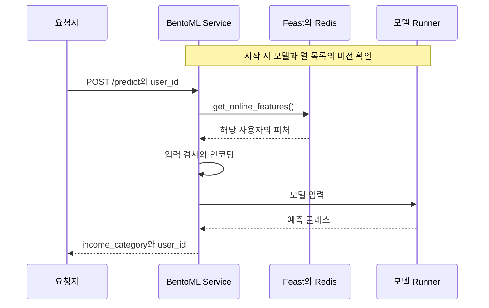

[06. 모델을 프로덕션으로](/docs/tech/machine-learning-platform-engineering/06-productionizing-models/)에서 정리한 내용을 책의 코드로 직접 실행한 기록이다. 개념과 요점은 본문에 두고, 여기에는 명령, 실제 출력과 화면만 모았다.

## 실습 순서 {#book-ch06-sop}

6장의 실습은 4~5장에서 만든 모델과 피처를 그대로 쓰고, 학습은 다시 하지 않는다. 등록된 모델을 요청 기반 API로 옮기고, 그 API와 배치 파이프라인의 입력을 관측하는 것이 목표다. 그래서 MLflow의 Production 모델과 Redis의 온라인 피처가 준비되어 있는지부터 본다.

아래 절차는 2026년 11월 Windows 11 PowerShell에서 [저자의 chapter-6 코드](https://github.com/practical-mlops/chapter-6/tree/890db04409cb3f48c4e493470d79095ec6ab63d6)를 [4~5장 실습](/docs/tech/machine-learning-platform-engineering/04-experiments-features-pipelines/#book-lab-sop)과 같은 kind 클러스터에 붙여 실행한 기록이다. 그대로는 동작하지 않은 곳이 꽤 있었고, 원인과 고친 내용은 해당 단계에 적었다.


| 구간 | 끝났을 때 남는 것 |
| --- | --- |
| A. 앞 장 산출물 | `random-forest-classifier` v1의 Production 지정, 원천 run의 `column_list.pkl`과 입력 기록, Redis의 온라인 피처, 6장 저자 코드와 Python 3.10 가상환경 |
| B. 로컬 API | BentoML 모델 저장소의 `random-forest-classifier`, `http://127.0.0.1:3000/predict`의 실제 응답 |
| C. 배포 | Bento `income_classifier_service`, 컨테이너 이미지, kind의 `ch06-serving` 배포, Yatai에 push한 모델과 Bento |
| D. 드리프트 | Evidently workspace, 드리프트 검사를 넣은 KFP 실행, 보고서와 대시보드 |
| E. 결과 확인 | 성공 조건별 확인 결과와 정리 명령 |

명령은 [4~5장 실습](/docs/tech/machine-learning-platform-engineering/04-experiments-features-pipelines/#book-lab-sop)처럼 `ml-platform-book-env` 저장소 최상위 폴더에서 실행한다. 6장 코드는 `upstream\chapter-6`에 받고, `cd`가 있는 단계만 작업 위치가 바뀐다. 터미널은 세 개를 쓴다. 터미널 1은 `python bookenv.py forward`를 켜 두는 창, 터미널 2는 BentoML 서비스를 띄우는 창, 터미널 3은 나머지 명령용이다.

## A. 앞 장의 산출물 준비와 확인

4장의 노트북이 MLflow, S3, Feast Registry, Redis를 채우는 구간이고, [전체 그림](/docs/tech/machine-learning-platform-engineering/06-productionizing-models/#platform-map)으로는 ①~④다.

### A-1. 클러스터와 포트포워딩

1. [4~5장 실습](/docs/tech/machine-learning-platform-engineering/04-experiments-features-pipelines/#book-lab-sop)의 A-2 클러스터 설치와 A-3 포트포워딩을 마친다. 터미널 1에서 다음을 켜 둔다.
   ```powershell
   python bookenv.py forward
   ```
2. 버킷이 없다면 만든다. 이미 있으면 그대로 두며, 다시 실행해도 결과는 같다.
   ```powershell
   python bookenv.py buckets
   ```

새 클러스터라면 B와 C의 확인 화면은 아직 비어 있다. 6장에 필요한 상태는 A-2를 마쳐야 생긴다.

### A-2. 4장 노트북과 5장 Registry 다시 만들기

클러스터를 새로 만들었다면 4장의 두 노트북과 5장의 클러스터용 Registry 준비를 다시 실행한다. 이미 4~5장 실습을 끝낸 클러스터라면 A-3으로 넘어간다.

1. JupyterLab에서 `ch04/01_mlflow_tracking.ipynb`를 처음부터 끝까지 실행한다. 마지막 두 셀의 출력이 다음과 같으면 된다. run 이름과 ID는 실행마다 다르다.
   ```text
   powerful-kit-773 0.8480364138495673 random-forest-classifier 1
   1 Production 8015f99a55f1487796aaa6382af8ad0e
   ```
2. `ch04/02_feast_feature_store.ipynb`를 처음부터 끝까지 실행한다. `feast apply`에서 `Deploying infrastructure` 세 줄, `materialize`에서 `Materializing 3 feature views`, 마지막 셀에서 `['feature_store.yaml', 'registry_local.db']`가 나오면 된다.
3. 5장의 클러스터용 Registry와 입력 파일을 준비한다. 4~5장 실습의 D-1부터 D-4까지와 같은 명령이다.
   ```powershell
   python book/ch05/prepare.py
   python bookenv.py load book-ch5/feast-job:0.1
   python bookenv.py load book-ch5/components:0.1
   kubectl apply -f book/ch05/feast-job.yaml
   kubectl -n kubeflow wait --for=condition=complete --timeout=300s job/feast-job
   python book/ch05/upload_inputs.py
   ```
   마지막 출력에 `feature-registry ['feature_store.yaml', 'feature_store_k8s.yaml', 'registry.db', 'registry_local.db']`가 보이면 된다.

같은 폴더에서 Feast 노트북을 두 번째 돌리면 `feast apply`가 `Feature view demographic does not exist`로 실패한다. 첫 실행이 `feature_repo`에 복사해 둔 `retrieve_features.py`와 `retrieve_online_features.py`를 `feast apply`가 정의 파일로 import하는데, 이 파일들이 아직 등록되지 않은 FeatureView를 조회하기 때문이다. 두 파일을 지우고 다시 돌리면 된다. 노트북 뒤쪽 셀이 어차피 다시 복사한다.

```powershell
Remove-Item book/ch04/feature_repo/retrieve_features.py, book/ch04/feature_repo/retrieve_online_features.py
```

### A-3. MLflow에서 모델과 원천 run 확인

6장의 서비스는 MLflow에서 두 가지를 다시 찾는다. 모델 파일은 BentoML로 가져가고, 같은 버전의 원천 run에서는 `column_list.pkl`과 기준 데이터 기록을 읽는다.

1. http://localhost:5000 에서 **Models → random-forest-classifier → Version 1**을 연다. Stage가 `Production`이고 Source Run이 연결되어 있는지 확인한다.

   

2. **Source Run**을 눌러 원천 run을 연다. **Datasets used**에 입력 기록이 세 개(training과 +2) 있고, Registered models에 `random-forest-classifier v1`이 보이면 된다.

   

3. **Artifacts** 탭에서 `column_list.pkl`을 확인한다. 경로가 `s3://mlflow-artifacts/...`이므로 이 파일을 받는 쪽은 S3 접속 정보도 필요하다.

   

4. 드리프트 비교에 쓸 기준 데이터의 위치를 API로 확인한다.
   ```powershell
   $mv = Invoke-RestMethod "http://127.0.0.1:5000/api/2.0/mlflow/model-versions/search?filter=name%3D'random-forest-classifier'"
   $run = (Invoke-RestMethod "http://127.0.0.1:5000/api/2.0/mlflow/runs/get?run_id=$($mv.model_versions[0].run_id)").run
   $run.inputs.dataset_inputs | ForEach-Object { $_.tags.value + ' :: ' + $_.dataset.source }
   ```
   ```text
   training :: {"uri": "mlflow-datasets/income-classifier-datasets/train-93b1a894054240b1b3e89f4d24949408.csv"}
   testing :: {"uri": "mlflow-datasets/income-classifier-datasets/test-93b1a894054240b1b3e89f4d24949408.csv"}
   reference_features :: {"uri": "mlflow-datasets/income-classifier-datasets/feature_df-93b1a894054240b1b3e89f4d24949408.csv"}
   ```

결과에서 눈여겨볼 점이 둘 있다. 먼저 모델 버전의 `source`가 run의 아티팩트 경로가 아니라 `models:/m-...`이다. MLflow 3은 `log_model()`의 결과를 run과 별개인 LoggedModel로 저장하므로 원천 run은 모델 버전의 `run_id`로 찾아야 한다. 저자 코드도 `run_id`를 쓰므로 그대로 동작한다.

Random Forest run의 입력 기록은 앞선 Decision Tree run(`93b1a...`)의 파일을 가리킨다. 노트북은 `feature_df`를 기록할 때 `source`에 테스트 CSV 경로를 넣었지만, MLflow는 내용이 같은(digest가 같은) 데이터셋을 이미 기록된 항목으로 재사용했다. 그래서 `reference_features`의 실제 위치는 첫 run이 올린 `feature_df` CSV다. 이번에는 원-핫 인코딩 전 범주형 열이 담긴 파일이라 드리프트 비교에 쓸 수 있었지만, 입력 기록의 경로는 기대와 다를 수 있으니 위처럼 실제 값을 꼭 확인한다.

### A-4. 저자 코드와 Python 3.10 가상환경

1. 저자 코드를 받는다.
   ```powershell
   git clone https://github.com/practical-mlops/chapter-6.git upstream\chapter-6
   git -C upstream\chapter-6 checkout 890db04409cb3f48c4e493470d79095ec6ab63d6
   ```
2. BentoML 1.1.10은 저자 README대로 Python 3.10에서 실행한다. 4~5장의 `.venv-book`(Python 3.11, MLflow 3.0.0)과 섞지 않도록 6장 전용 환경을 만든다.
   ```powershell
   uv venv .venv-ch06 --python 3.10
   uv pip install --python .venv-ch06 "bentoml==1.1.10" -r upstream\chapter-6\bentoml\requirements.txt "setuptools<70" "click==8.1.7" "scikit-learn==1.5.2"
   .\.venv-ch06\Scripts\Activate.ps1
   ```
3. 버전을 확인한다.
   ```powershell
   python -c "import bentoml, mlflow, feast, sklearn; print(bentoml.__version__, mlflow.__version__, feast.__version__, sklearn.__version__)"
   ```
   ```text
   1.1.10 3.0.0 0.40.1 1.5.2
   ```

추가로 고정한 세 패키지는 모두 실제로 오류를 겪고 넣은 것이다.

| 고정 | 고정하지 않았을 때 본 오류 | 이유 |
| --- | --- | --- |
| `setuptools<70` | `import bentoml`에서 `No module named 'pkg_resources'` | BentoML 1.1.10이 쓰는 `fs` 패키지가 최신 setuptools에서 빠진 `pkg_resources`를 import |
| `click==8.1.7` | `bentoml containerize`에서 `NotImplementedError` | click 8.2 이후의 옵션 처리 변경을 BentoML 1.1.10이 지원하지 않음 |
| `scikit-learn==1.5.2` | 정상 동작하지만 버전 불일치 경고 | 4장에서 모델을 저장한 scikit-learn과 맞춤 |

의존성 파일도 하나가 아니다. 기본 서비스의 `requirements.txt`는 MLflow 3.0.0을, 드리프트 서비스의 `requirements_with_drift.txt`는 MLflow 2.7.0과 Evidently 0.5.0을 지정한다. 그래서 D-4에서는 가상환경을 하나 더 만든다.

## B. MLflow 모델을 BentoML API로

MLflow의 모델을 BentoML 모델 저장소로 가져오고, PC에서 API를 띄워 요청 하나가 Redis 조회와 Runner 예측을 거치는지 본다(전체 그림의 ⑤와 ⑩~⑬).

### B-1. 모델 가져오기

터미널 3에서 6장 가상환경을 활성화하고 실행한다.

```powershell
cd upstream\chapter-6\bentoml
python .\scripts\download_model.py
bentoml models list
```

```text
 Tag                            Module          Size       Creation Time
 random-forest-classifier:zv2…  bentoml.mlflow  37.00 MiB  2026-11-07 19:48:44
```

목록에서는 태그가 줄여 표시된다. 전체 태그는 `zv2wqy62tcgfhlaz`였다. `download_model.py`는 `models:/random-forest-classifier/Production`을 내려받아 BentoML 모델 저장소(기본 위치 `~\bentoml\models`)에 새 태그로 저장한다. MLflow의 버전 번호 `1`과 BentoML 태그 `zv2wqy62tcgfhlaz`는 서로 다른 식별자다. 둘을 함께 적어 두어야 나중에 어느 학습 결과를 서비스했는지 거꾸로 찾아갈 수 있다.

MLflow 3에서 stage는 deprecated지만 조회는 아직 된다. 운영이라면 stage나 alias 대신 `models:/random-forest-classifier/1`처럼 구체적인 버전으로 가져오는 편이 안전하다.

### B-2. 설정 파일 맞추기

저자의 `.env`에는 컨테이너에서 PC의 포트포워딩에 닿기 위한 `host.docker.internal`과 저자 환경의 Redis 비밀번호가 들어 있다. PC의 Python으로 바로 실행하려면 두 가지를 바꾼다.

```powershell
(Get-Content .env) -replace 'host\.docker\.internal','localhost' -replace '^FEAST_REDIS_PASSWORD=.*','FEAST_REDIS_PASSWORD=redis123' | Set-Content .env
```

`production.env`는 C-3에서 Pod 안에서 쓸 설정이다. 저자 파일은 `MLFLOW_HOST`에 `http://`가 빠져 있고, Feast 설정은 4장의 localhost용 파일을 가리킨다. 5장에서 올린 클러스터용 파일로 바꾼다.

```powershell
(Get-Content production.env) `
  -replace '^MLFLOW_HOST=.*','MLFLOW_HOST=http://mlflow-service.mlflow.svc.cluster.local:5000' `
  -replace '^FEAST_REDIS_PASSWORD=.*','FEAST_REDIS_PASSWORD=redis123' `
  -replace '^FEATURE_REGSITRY_FILE_NAME=.*','FEATURE_REGSITRY_FILE_NAME=feature_store_k8s.yaml' `
  -replace '^EVIDENTLY_WORKSPACE_URL=.*','EVIDENTLY_WORKSPACE_URL=http://evidently-service-internal.evidently.svc.cluster.local:8000' |
  Set-Content production.env
```

| 설정 | `.env` (PC에서 실행) | `production.env` (Pod에서 실행) |
| --- | --- | --- |
| `MLFLOW_HOST` | `http://localhost:5000` | `http://mlflow-service.mlflow.svc.cluster.local:5000` |
| `MINIO_HOST` | `localhost:9000` | `minio-service.kubeflow.svc.cluster.local:9000` |
| `FEAST_REDIS_HOST` | `localhost` | `redis-deployment-master.redis.svc.cluster.local` |
| `FEATURE_REGSITRY_FILE_NAME` | `feature_store.yaml` | `feature_store_k8s.yaml` |
| `FEAST_REDIS_PASSWORD` | `redis123` | `redis123` |

`src\constants.py`는 `ENV_NAME=production`일 때만 `production.env`를 읽는다. 설정 키 `FEATURE_REGSITRY_FILE_NAME`의 철자는 소스가 쓰는 그대로 둔다.

### B-3. 로컬 서비스 실행과 요청

기본 서비스의 진입점은 `service:svc`다. 요청 하나는 다음 순서로 처리된다.



입력은 사용자 ID 하나다. 피처는 클라이언트가 보내지 않고 서비스가 조회한다. 응답의 `income_category`는 예측 클래스를 `<=50K`, `>50k`로 바꾼 값이라 5장의 확률 열과는 형식이 다르다.

1. 터미널 2에서 같은 가상환경을 활성화하고 `bentoml` 폴더에서 서비스를 띄운다. MLflow 아티팩트를 S3에서 받으므로 S3 자격 증명을 환경 변수로 준다.
   ```powershell
   $env:AWS_ACCESS_KEY_ID = "minio"; $env:AWS_SECRET_ACCESS_KEY = "minio123"
   bentoml serve service:svc --port 3000 --api-workers 1
   ```
   `Starting production HTTP BentoServer ... listening on http://0.0.0.0:3000`이 나온 뒤 30초 정도 지나 초기화 로그가 멈추면 준비된 것이다.
2. 터미널 3에서 요청을 보낸다.
   ```powershell
   $body = @{ user_id = "9f2ac416-06e1-44a0-87bd-d4787c85bf66" } | ConvertTo-Json
   Invoke-RestMethod http://127.0.0.1:3000/predict -Method Post -ContentType application/json -Body $body
   ```
   ```text
   income_category user_id
   --------------- -------
   <=50K           9f2ac416-06e1-44a0-87bd-d4787c85bf66
   ```
3. 브라우저에서 http://127.0.0.1:3000 을 열면 BentoML이 만든 Swagger UI가 나온다. **POST /predict → Try it out**에서 `user_id`를 넣고 **Execute**를 누른다. 아래는 B-4의 수정 뒤에 다른 사용자로 요청한 결과다.

   

`--api-workers 1`은 Windows에서 꼭 필요했다. 기본값은 CPU 수만큼 API worker를 띄우는데, worker마다 시작할 때 같은 작업 폴더에 `feature_store.yaml`을 내려받아 덮어쓴다. 16개 worker가 한 파일을 동시에 쓰다가 `PermissionError: [WinError 32] 다른 프로세스가 파일을 사용 중`으로 전부 시작에 실패했다. Linux 컨테이너에서는 이 오류가 나지 않았다. 그래도 여러 프로세스가 공유 경로에 설정 파일을 쓰는 구조 자체가 경쟁 조건이라 C-3의 Pod에서도 worker를 하나로 지정했다.

### B-4. 단일 요청의 입력 인코딩 확인과 수정

[본문](/docs/tech/machine-learning-platform-engineering/06-productionizing-models/#model-serving)에서 다룬 단일 요청의 원-핫 인코딩 문제가 실제로 나타났다. 같은 사용자의 온라인 피처를 저자의 `InputMapper`로 변환하면 다음과 같다.

```text
Race                     White
Native_country   United-States
Sex                       Male
Marital-Status   Never-married
Relationship     Not-in-family
Education            Bachelors
Occupation        Adm-clerical
Workclass            State-gov
columns: 91 nonzero: 0
without drop_first nonzero: 7 ['Workclass_ State-gov', 'Education_ Bachelors', 'Marital-Status_ Never-married', ...]
```

`get_dummies(drop_first=True)`는 열마다 첫 번째 범주를 버린다. 행이 하나면 범주도 하나뿐이라 모든 열이 사라지고, 학습 열 91개로 맞추면 **모든 값이 0인 입력**이 된다. 저자의 mock 요청 100건을 보내 보니 결과가 전부 `<=50K`였다. 존재하지 않는 사용자 `no-such-user`를 보내도 HTTP 200과 `<=50K`가 돌아왔다. 서비스는 멀쩡히 응답하는데 모델은 사실상 아무것도 보지 못하고 있었다.

학습 때의 `drop_first=True`는 이미 `column_list.pkl`에 반영되어 있다. 추론에서는 모든 범주의 열을 만든 뒤 학습 열 목록으로 재정렬하면, 학습에서 버린 기준 범주 열은 저절로 빠진다. 그래서 `src\data_mapper.py`의 한 줄만 바꾼다.

```python
dummyfied_input_data = pd.get_dummies(
    self.data, drop_first=False, sparse=False, dtype=float
)
```

서비스를 `Ctrl+C`로 멈췄다가 다시 띄우고 같은 mock 요청 100건을 보낸다.

```powershell
$ids = (Import-Csv .\scripts\mock_request_data.csv).user_id
$ids | ForEach-Object { (Invoke-RestMethod http://127.0.0.1:3000/predict -Method Post -ContentType application/json -Body (@{ user_id = $_ } | ConvertTo-Json)).income_category } | Group-Object | Select-Object Name, Count
```

| 입력 변환 | `<=50K` | `>50k` |
| --- | --- | --- |
| 저자 코드 `drop_first=True` | 100 | 0 |
| 수정 `drop_first=False` | 75 | 25 |

이 수정은 최소한의 보완이다. 열 이름이 학습 때와 같은 문자열로 만들어진다는 전제에 기대므로, 피처 값의 앞 공백(`' State-gov'`)까지 같아야 한다. 학습에 없던 범주는 여전히 조용히 0이 되고, 없는 사용자도 여전히 정상 응답을 받는다. 운영이라면 학습에서 fit한 인코더를 모델과 함께 저장해 재사용하고, 온라인 피처가 비어 있으면 예측 대신 오류를 돌려줘야 한다.

## C. Bento 빌드와 클러스터 배포

B에서 로컬로 띄운 서비스를 Bento로 묶고, 이미지를 만들어 클러스터에서 요청을 받게 한다. 전체 그림의 ⑥~⑨에 해당한다. 책은 Yatai를 쓰고, 이 실습은 같은 이미지를 일반 Deployment로도 배포해 둘을 비교한다.

### C-1. Bento 빌드

`bentoml` 폴더에서 실행한다.

```powershell
bentoml build -f .\bento\bentofile.yaml
bentoml list
```

```text
Successfully built Bento(tag="income_classifier_service:aevxrk62tokqzlaz").

 Tag                                Size       Model Size  Creation Time
 income_classifier_service:aevxrk…  21.74 KiB  37.00 MiB   2026-11-07 20:04:30
```

Bento 태그 `aevxrk62tokqzlaz`는 서비스 코드, 설정, 의존성 선언, 모델 참조를 묶은 산출물의 식별자다. B-1의 모델 태그와는 별개라서, 모델이 같아도 서비스 코드를 바꾸면 새 Bento 태그가 생긴다. 크기를 보면 코드는 21.74 KiB이고 모델이 37 MiB다.

저자 README가 말하는 `bentofile_with_drift_detection.yaml`은 저장소에 없다. 드리프트 서비스용 파일은 `bento\bentofile_with_drift.yaml`이다. 그리고 `bentofile.yaml`이 `*.env`를 포함하므로 B-2에서 넣은 접속 정보가 Bento와 이미지 안에 그대로 들어간다. 실습용 계정이라 두었지만, 실제 자격 증명을 쓰는 환경이라면 패키지에서 빼고 Secret으로 전달해야 한다.

### C-2. 컨테이너 이미지 만들기

```powershell
bentoml containerize income_classifier_service:aevxrk62tokqzlaz
```

처음에는 Python 3.10 기반 이미지를 받고 의존성을 설치하느라 약 8분 걸린다. 끝에 `Successfully built Bento container for "income_classifier_service:aevxrk62tokqzlaz"`가 나온다.

README의 다음 단계대로 바로 띄우면 서비스가 시작되지 않는다.

```powershell
docker run --rm -p 3001:3000 income_classifier_service:aevxrk62tokqzlaz
```

```text
[WARNING] [api_server:1] Retrying (...) after connection broken by 'NewConnectionError("HTTPConnection(host='localhost', port=5000): Failed to establish a new connection ...
```

이미지에는 B-2에서 PC용으로 바꾼 `.env`가 들어 있는데, 컨테이너 안의 `localhost`는 PC가 아니라 컨테이너 자신이다. 저자가 `.env`에 `host.docker.internal`을 썼던 이유가 이것이다. 이 실습은 컨테이너를 PC의 Docker가 아니라 클러스터에서 돌리므로, C-3에서 `ENV_NAME=production`으로 클러스터 주소를 쓰게 한다. 여기서는 `Ctrl+C`로 멈춘다.

### C-3. 대안 경로: kind에 일반 Deployment로 배포

Yatai가 하는 일 중 이미지 빌드와 Pod 생성을 손으로 해 보는 경로다. [전체 그림](/docs/tech/machine-learning-platform-engineering/06-productionizing-models/#platform-map)의 ⑨'에 해당한다.

1. 이미지를 kind 노드에 넣는다.
   ```powershell
   kind load docker-image income_classifier_service:aevxrk62tokqzlaz --name book-env
   ```
2. 아래 내용을 `ch06-serving.yaml`로 저장하고 적용한다.
   ```yaml
   apiVersion: v1
   kind: Namespace
   metadata:
     name: ch06-serving
   ---
   apiVersion: apps/v1
   kind: Deployment
   metadata:
     name: income-classifier
     namespace: ch06-serving
   spec:
     replicas: 1
     selector:
       matchLabels:
         app: income-classifier
     template:
       metadata:
         labels:
           app: income-classifier
       spec:
         containers:
           - name: bento
             image: income_classifier_service:aevxrk62tokqzlaz
             imagePullPolicy: Never
             args: ["serve"]
             env:
               - name: ENV_NAME
                 value: production
               - name: BENTOML_CONFIG_OPTIONS
                 value: api_server.workers=1
             ports:
               - containerPort: 3000
             readinessProbe:
               httpGet:
                 path: /readyz
                 port: 3000
               initialDelaySeconds: 20
               periodSeconds: 10
               failureThreshold: 30
   ---
   apiVersion: v1
   kind: Service
   metadata:
     name: income-classifier
     namespace: ch06-serving
   spec:
     selector:
       app: income-classifier
     ports:
       - port: 3000
         targetPort: 3000
   ```
   ```powershell
   kubectl apply -f ch06-serving.yaml
   kubectl -n ch06-serving rollout status deploy/income-classifier --timeout=400s
   kubectl -n ch06-serving get deploy,pod,svc
   ```
   ```text
   NAME                                READY   UP-TO-DATE   AVAILABLE   AGE
   deployment.apps/income-classifier   1/1     1            1           78s

   NAME                                     READY   STATUS    RESTARTS   AGE
   pod/income-classifier-79c5bdbc66-799mc   1/1     Running   0          78s

   NAME                        TYPE        CLUSTER-IP     EXTERNAL-IP   PORT(S)    AGE
   service/income-classifier   ClusterIP   10.96.19.220   <none>        3000/TCP   78s
   ```
3. 새 터미널에서 서비스를 PC의 3002 포트로 연결한다.
   ```powershell
   kubectl -n ch06-serving port-forward svc/income-classifier 3002:3000
   ```
4. http://127.0.0.1:3002 의 Swagger UI에서 B-3처럼 요청한다. mock 요청 100건의 결과도 로컬과 같은 `<=50K` 75건, `>50k` 25건이다.

   

이 Pod는 PC의 포트포워딩을 쓰지 않는다. MLflow, S3, Redis 모두 `production.env`의 클러스터 서비스 주소로 접속한다. Bento 이미지 안에서는 `bentoml serve`가 API 서버와 Runner를 한 컨테이너의 프로세스로 띄운다. 이 경로에서 Runner는 별도 Pod가 아니다.

### C-4. 책의 경로: Yatai로 배포

책은 Bento를 Yatai에 push하고 Yatai UI에서 배포를 만든다. Yatai가 이미지 빌드 Job을 돌리고, 빌드가 끝나면 API Server Pod와 Runner Pod를 띄운다. 문제는 Yatai의 현재 상태다. 2026년 11월 기준 [bentoml/Yatai 저장소](https://github.com/bentoml/Yatai)는 archived 상태이고 마지막 릴리스는 2023년 10월의 v1.1.13이다. README는 BentoML 1.2용 Yatai가 아직 만들어지는 중이라고 안내하므로, Yatai 1.x는 이 책처럼 BentoML 1.1의 Service와 Runner로 만든 Bento에만 맞는다. 다행히 Helm 차트와 이미지는 아직 받을 수 있어서 같은 kind 클러스터에서 책의 경로를 끝까지 따라갈 수 있었다.

책의 부록과 Yatai의 quick-install 스크립트는 PostgreSQL HA와 MinIO operator를 따로 설치한다. 여기서는 클러스터에 이미 있는 PostgreSQL과 S3를 재사용한다. 설치 구성은 다음과 같다.

| 구성 | 버전 | 네임스페이스 | 역할 |
| --- | --- | --- | --- |
| cert-manager | v1.13.3 | `cert-manager` | image builder와 deployment의 webhook 인증서 |
| yatai | 차트 1.1.13 | `yatai-system` | UI, API, 모델과 Bento 저장소 |
| yatai-image-builder | 3.0.48 | `yatai-image-builder` | `BentoRequest`를 받아 kaniko Job으로 이미지 빌드 |
| yatai-deployment | 1.1.21 | `yatai-deployment` | `BentoDeployment`를 Deployment, Service, HPA로 변환 |
| 레지스트리 | `registry:2` | `yatai-image-builder` | 빌드한 이미지를 보관. NodePort 30500 |
| 배포 대상 | | `yatai` | API Server와 Runner Pod |

1. Helm 저장소와 차트를 준비한다. Helm 3가 필요하다.
   ```powershell
   helm repo add bentoml https://bentoml.github.io/helm-charts
   helm repo update bentoml
   kubectl apply -f https://github.com/cert-manager/cert-manager/releases/download/v1.13.3/cert-manager.yaml
   kubectl -n cert-manager rollout status deploy/cert-manager-webhook --timeout=300s
   ```
2. Yatai용 데이터베이스와 버킷을 만들고 Yatai를 설치한다. PostgreSQL 비밀번호는 `postgres` 네임스페이스의 Secret에 있는 실습용 값이다.
   ```powershell
   kubectl -n postgres exec deploy/postgres-release-postgresql -- sh -c 'PGPASSWORD=postgres123 psql -U postgres -h 127.0.0.1 -c "CREATE DATABASE yatai"'
   python -c "from minio import Minio; c=Minio('localhost:9000',access_key='minio',secret_key='minio123',secure=False); [c.make_bucket(b) for b in ('ch06-yatai','ch06-yatai-images') if not c.bucket_exists(b)]"
   helm upgrade --install yatai bentoml/yatai --version 1.1.13 -n yatai-system --create-namespace `
     --set postgresql.host=postgres-release-postgresql.postgres.svc.cluster.local `
     --set postgresql.user=postgres --set postgresql.password=postgres123 --set postgresql.database=yatai `
     --set s3.endpoint=minio-service.kubeflow.svc.cluster.local:9000 --set s3.region=us-east-1 `
     --set s3.bucketName=ch06-yatai --set s3.secure=false --set s3.accessKey=minio --set s3.secretKey=minio123
   ```
3. 새 터미널에서 Yatai를 연다. 8080은 KFP가 쓰고 있으므로 8091을 쓴다.
   ```powershell
   kubectl -n yatai-system port-forward svc/yatai 8091:80
   ```
   초기화 토큰을 읽어 `http://127.0.0.1:8091/setup?token=<토큰>`을 열고 관리자 계정을 만든다.
   ```powershell
   $t = kubectl get secret yatai-env -n yatai-system -o jsonpath="{.data.YATAI_INITIALIZATION_TOKEN}"
   [Text.Encoding]::UTF8.GetString([Convert]::FromBase64String($t))
   ```

   

4. API 토큰을 만들고 BentoML CLI로 로그인해 B-1의 모델과 C-1의 Bento를 push한다. 토큰은 관리자로 로그인한 브라우저 세션에서 UI가 쓰는 `POST /api/v1/api_tokens`를 호출해 만들었고, 권한은 `api`, `read_organization`, `write_organization`, `read_cluster`, `write_cluster`다.
   ```powershell
   bentoml yatai login --api-token <API-토큰> --endpoint http://127.0.0.1:8091
   bentoml push income_classifier_service:aevxrk62tokqzlaz
   ```
   ```text
   Successfully logged in to Cloud for admin in default
   Successfully pushed model "random-forest-classifier:zv2wqy62tcgfhlaz"
   Successfully pushed bento "income_classifier_service:aevxrk62tokqzlaz"
   ```
   **모델**과 **Bentos** 메뉴에 같은 태그가 보이면 된다. 책의 그림 6.3, 6.4에 해당한다.

   

   

5. 이미지 빌더와 배포 컴포넌트를 설치한다. 이미지를 보관할 레지스트리는 kind 노드가 `127.0.0.1:30500`으로 받을 수 있게 NodePort로 띄운다. containerd는 `localhost` 레지스트리를 HTTP로 허용하므로 kind 설정을 바꾸지 않아도 된다.
   ```powershell
   helm upgrade --install yatai-image-builder-crds bentoml/yatai-image-builder-crds --version 3.0.48 -n yatai-image-builder --create-namespace
   kubectl apply -f ch06-registry.yaml
   kubectl create namespace yatai
   helm upgrade --install yatai-deployment-crds bentoml/yatai-deployment-crds --version 1.1.21 -n yatai-deployment --create-namespace
   helm upgrade --install yatai-image-builder bentoml/yatai-image-builder --version 3.0.48 -n yatai-image-builder `
     --set yatai.endpoint=http://yatai.yatai-system.svc.cluster.local --set yatai.apiToken=<API-토큰> `
     --set dockerRegistry.server=127.0.0.1:30500 `
     --set dockerRegistry.inClusterServer=ch06-registry.yatai-image-builder.svc.cluster.local:5000 `
     --set dockerRegistry.secure=false --set internal.disableYataiComponentRegistration=false `
     --set global.s3.endpoint=minio-service.kubeflow.svc.cluster.local:9000 --set global.s3.secure=false `
     --set global.s3.accessKeyId=minio --set global.s3.secretAccessKey=minio123 --set global.s3.bucketName=ch06-yatai-images `
     --set "global.deploymentNamespaces={yatai,yatai-system}"
   helm upgrade --install yatai-deployment bentoml/yatai-deployment --version 1.1.21 -n yatai-deployment `
     --set yatai.endpoint=http://yatai.yatai-system.svc.cluster.local --set yatai.apiToken=<API-토큰> `
     --set layers.network.domainSuffix=ch06.local --set layers.network.automaticDomainSuffixGeneration=false
   ```
   `ch06-registry.yaml`은 다음과 같다. 노드가 Docker Hub에서 `registry:2`를 받지 못하면 PC에서 받아 넣는다. 이때 `kind load docker-image`는 `content digest ... not found`로 실패했고, `docker save --platform linux/amd64 registry:2 -o registry2.tar`와 `kind load image-archive registry2.tar --name book-env`로 대신했다.
   ```yaml
   apiVersion: apps/v1
   kind: Deployment
   metadata:
     name: ch06-registry
     namespace: yatai-image-builder
   spec:
     replicas: 1
     selector:
       matchLabels:
         app: ch06-registry
     template:
       metadata:
         labels:
           app: ch06-registry
       spec:
         containers:
           - name: registry
             image: registry:2
             ports:
               - containerPort: 5000
   ---
   apiVersion: v1
   kind: Service
   metadata:
     name: ch06-registry
     namespace: yatai-image-builder
   spec:
     type: NodePort
     selector:
       app: ch06-registry
     ports:
       - port: 5000
         targetPort: 5000
         nodePort: 30500
   ```
6. 차트를 그대로 설치하면 배포가 시작되지 않는다. 아래 세 가지를 손봐야 한다.

   | 증상 | 원인 | 조치 |
   | --- | --- | --- |
   | image builder가 `Endpoint: does not follow ip address` 오류로 재시작 | 3.0.48은 `global.s3` 설정이 비어 있으면 시작 검사에서 실패 | 위 명령의 `global.s3.*` 지정 |
   | 배포 생성 시 `yatai` 서비스 계정이 `bentorequests`를 `get`할 수 없음 | 차트의 RoleBinding이 주체 네임스페이스를 `yatai-system`이 아니라 배포 네임스페이스로 렌더링 | RoleBinding의 subject 네임스페이스를 `yatai-system`으로 수정 |
   | image builder가 `yatai-system/yatai-common-env`를 읽지 못함 | 감시 네임스페이스에 `yatai-system`이 없으면 Secret 캐시가 비어 있음 | `global.deploymentNamespaces`에 `yatai-system` 추가 |

   게다가 네임스페이스를 둘 지정하면 차트의 range 템플릿이 문서 구분자 없이 렌더링되어 `yatai` 쪽 Role과 RoleBinding이 빠진다. 그래서 `yatai`용만 따로 렌더링해 적용하고 주체를 고친다.
   ```powershell
   helm template yatai-image-builder bentoml/yatai-image-builder --version 3.0.48 -n yatai-image-builder `
     --show-only templates/range-role.yaml --show-only templates/range-rolebinding.yaml `
     --show-only templates/role-yatai-with-bento-request.yaml --show-only templates/rolebinding-yatai-with-bento-request.yaml |
     kubectl apply -f -
   kubectl -n yatai patch rolebinding yatai-with-bento-request --type=json -p '[{\"op\":\"replace\",\"path\":\"/subjects/0/namespace\",\"value\":\"yatai-system\"}]'
   kubectl -n yatai-image-builder rollout restart deploy/yatai-image-builder
   ```
7. 배포를 만든다. 책은 Yatai UI의 **배포 → 생성** 화면에서 이름, Bento와 태그, 복제본과 자원을 입력한다. 여기서는 같은 내용을 UI가 호출하는 `POST /api/v1/clusters/default/deployments`로 보냈다. 핵심 값은 다음과 같다.
   ```json
   {
     "name": "ch06-income-classifier",
     "kube_namespace": "yatai",
     "targets": [{
       "type": "stable",
       "bento_repository": "income_classifier_service",
       "bento": "aevxrk62tokqzlaz",
       "config": {
         "hpa_conf": { "min_replicas": 1, "max_replicas": 1 },
         "resources": { "requests": { "cpu": "200m", "memory": "512Mi" }, "limits": { "cpu": "2000m", "memory": "2Gi" } },
         "envs": [{ "key": "ENV_NAME", "value": "production" }, { "key": "BENTOML_CONFIG_OPTIONS", "value": "api_server.workers=1" }],
         "runners": { "random-forest-classifier": { "hpa_conf": { "min_replicas": 1, "max_replicas": 1 } } },
         "enable_ingress": false
       }
     }]
   }
   ```
   `ENV_NAME=production`이 없으면 Pod가 PC용 `.env`를 읽어 C-2와 같은 `localhost` 연결 오류가 난다.
8. 배포를 만들면 `yatai` 네임스페이스에 `BentoRequest`와 `BentoDeployment`가 생기고 kaniko Job이 실행된다.
   ```powershell
   kubectl -n yatai get bentorequest,bentodeployment,jobs,pods
   ```
   kaniko는 Bento의 Dockerfile대로 Docker Hub에서 `python:3.10-slim`을 받아 의존성을 설치하고, 결과를 클러스터 안 레지스트리로 push한다. 첫 시도는 Docker Hub 연결 시간 초과(`dial tcp ...:443: i/o timeout`)로 실패했다. 실패한 Job을 지우면 image builder가 Job을 다시 만든다. 두 번째 시도는 약 3분 만에 끝났다.
   ```text
   INFO[0190] Pushing image to ch06-registry.yatai-image-builder.svc.cluster.local:5000/yatai-bentos:yatai.income_classifier_service.aevxrk62tokqzlaz
   ```
9. 빌드가 끝나면 Pod 두 개가 뜬다. 책의 그림 6.9처럼 **레플리카** 탭에서 API Server와 Runner가 따로 보인다.
   ```text
   NAME                                               READY   STATUS    RESTARTS   AGE
   ch06-income-classifier-7fd67bd9c6-sj8x4            3/3     Running   0          7m14s
   ch06-income-classifier-runner-0-6ffb5b488b-n662f   2/2     Running   0          7m14s
   ```

   

   

   

10. 서비스를 3003 포트로 연결해 요청한다. mock 요청 100건의 결과도 C-3과 같은 75건과 25건이다.
    ```powershell
    kubectl -n yatai port-forward svc/ch06-income-classifier 3003:3000
    ```

    

C-3과 나란히 놓으면 Yatai가 대신해 준 일이 분명해진다. `bentoml containerize`와 `kind load` 대신 image builder가 클러스터 안에서 이미지를 만들었다. 손으로 쓴 Deployment 대신 yatai-deployment가 API Server와 Runner를 별도 Deployment와 Service로 만들었다. API Pod의 컨테이너가 셋인 것은 본 서비스 외에 메트릭 변환과 프록시 사이드카가 붙기 때문이다. HPA도 함께 생기지만 kind에는 metrics-server가 없어서 `FailedGetResourceMetric` 경고만 남고 복제본은 1로 유지됐다.

배포 도중 Docker Desktop의 디스크가 차서 kind 노드가 재시작된 적이 있다. 그 뒤 Yatai 배포가 같은 user에게 `<=50K`만 돌려줬다. 범인은 Redis였다. 실습 Redis는 영속 볼륨이 없어서 재시작과 함께 온라인 피처가 모두 사라졌고(`dbsize` 0), API는 빈 피처를 0으로 채워 HTTP 200으로 응답했다. B-4와 같은 모양의 실패가 전혀 다른 원인에서 나온 셈이다. 4장 피처 저장소 폴더에서 `feast materialize 2022-09-16T00:00:00 2023-09-17T00:00:00`을 다시 실행해 30,162건을 적재하자 원래 결과로 돌아왔다.

## D. Evidently로 데이터 드리프트 관측

마지막 구간인 ⑭~⑰에서는 같은 기준 데이터를 두 곳에서 비교한다. 배치 파이프라인에서는 KFP 작업이 조회한 피처 전체를, API에서는 최근 요청 윈도우를 current로 쓴다.

기준 데이터는 아무 학습 CSV나 쓰면 안 되고, 서비스 중인 모델의 학습 조건과 연결되어 있어야 한다. 저자 코드는 모델의 원천 run을 찾은 뒤 `run.inputs.dataset_inputs`에서 `REFERENCE_DATASET_NAME`(`reference_features`)과 같은 태그의 입력 기록을 찾아 CSV를 받는다. A-3에서 본 `feature_df-93b1a....csv`가 그 파일이다.

| 확인할 것 | 이유 |
| --- | --- |
| 원천 run과 모델 버전 | 다른 모델의 학습 데이터와 비교하지 않기 위해 |
| 입력 기록의 태그와 dataset source | 이름이 맞아도 파일 위치가 다르거나 형식이 다를 수 있음 |
| 비교할 열과 타입 | 원-핫 인코딩 전 범주형 피처끼리 비교해야 함 |
| 현재 데이터의 기간과 표본 수 | 변화가 어느 구간에서 생겼는지 해석하기 위해 |
| 기준 파일의 버전 | 같은 경로의 파일이 바뀌면 비교 기준도 달라짐 |

### D-1. Evidently workspace와 검사 이미지

저자 README는 클러스터의 `evidently` 네임스페이스에 `evidently-service-internal` 서비스가 있다고 가정한다. 그런데 그 서버를 설치하는 명세는 저장소에 없다. `create_remote_project.py`와 `build_evidently_dashboard.py`는 이미 떠 있는 workspace에 프로젝트와 패널을 만드는 스크립트다. 그래서 검사 작업 이미지를 먼저 만들고, 같은 이미지로 workspace 서버도 띄운다.

1. 검사 이미지를 만든다. 저자 Dockerfile은 `python:3.10-slim-buster` 기반이라 5장과 같은 이유로 그대로는 빌드되지 않는다. bookworm으로 바꿔 의존성을 전부 새로 설치하는 빌드도 해 봤지만 실습 PC의 디스크가 모자랐다. 그래서 5장 컴포넌트 이미지(Python 3.10, MLflow 3.0.0, Feast 0.40.1, KFP 2.9.0)에 Evidently 0.5.0만 얹었다. 저자는 MLflow 2.7.0을 지정했지만 `detect_drift.py`가 쓰는 API는 3.0.0에서도 동작한다.
   ```powershell
   New-Item -ItemType Directory -Force ch06-drift-image | Out-Null
   Copy-Item -Recurse upstream\chapter-6\evidently\kubeflow-pipeline\src ch06-drift-image\
   Set-Content ch06-drift-image\Dockerfile "FROM book-ch5/components:0.1`nRUN pip install --no-cache-dir evidently==0.5.0`nCOPY src/detect_drift /app/src/detect_drift`n"
   docker build -t ch06/detect-drift:0.1 ch06-drift-image
   kind load docker-image ch06/detect-drift:0.1 --name book-env
   ```
2. 아래 내용을 `ch06-evidently.yaml`로 저장하고 적용한다. 저장소가 `emptyDir`이므로 Pod가 재시작되면 보고서도 사라진다. 실습용 구성이다.
   ```yaml
   apiVersion: v1
   kind: Namespace
   metadata:
     name: evidently
   ---
   apiVersion: apps/v1
   kind: Deployment
   metadata:
     name: evidently-ui
     namespace: evidently
   spec:
     replicas: 1
     selector:
       matchLabels:
         app: evidently-ui
     template:
       metadata:
         labels:
           app: evidently-ui
       spec:
         containers:
           - name: evidently
             image: ch06/detect-drift:0.1
             imagePullPolicy: Never
             command: ["evidently", "ui", "--host", "0.0.0.0", "--port", "8000", "--workspace", "/data/workspace"]
             ports:
               - containerPort: 8000
             volumeMounts:
               - name: data
                 mountPath: /data
         volumes:
           - name: data
             emptyDir: {}
   ---
   apiVersion: v1
   kind: Service
   metadata:
     name: evidently-service-internal
     namespace: evidently
   spec:
     selector:
       app: evidently-ui
     ports:
       - port: 8000
         targetPort: 8000
   ```
   ```powershell
   kubectl apply -f ch06-evidently.yaml
   kubectl -n evidently rollout status deploy/evidently-ui --timeout=300s
   kubectl -n evidently port-forward svc/evidently-service-internal 8000:8000
   ```
3. 드리프트 서비스용 가상환경을 따로 만든다. `requirements_with_drift.txt`의 MLflow 2.7.0이 A-4의 3.0.0과 충돌하기 때문이다.
   ```powershell
   uv venv .venv-ch06-drift --python 3.10
   uv pip install --python .venv-ch06-drift "bentoml==1.1.10" -r upstream\chapter-6\bentoml\requirements_with_drift.txt "setuptools<70" "click==8.1.7" "scikit-learn==1.5.2" "litestar==2.12.1"
   uv pip uninstall --python .venv-ch06-drift multipart
   uv pip install --python .venv-ch06-drift --reinstall-package python-multipart "python-multipart==0.0.32"
   ```
   `litestar` 고정과 `multipart` 제거도 실제 충돌 때문이다. Evidently UI가 쓰는 최신 litestar는 `multipart`라는 다른 패키지를 요구하는데, 이 패키지가 BentoML 1.1.10이 쓰는 `python-multipart`와 모듈 이름이 겹친다. 그대로 두면 `import bentoml`이 `No module named 'multipart.multipart'`로 실패하고, 반대쪽에 맞추면 `from evidently.ui.workspace import RemoteWorkspace`가 `cannot import name 'MultipartSegment'`로 실패한다. 자체 multipart 처리를 쓰던 litestar 2.12.1로 내리니 둘 다 import됐다.
4. 같은 가상환경에서 프로젝트와 대시보드를 만든다.
   ```powershell
   cd upstream\chapter-6\evidently
   ..\..\..\.venv-ch06-drift\Scripts\python.exe scripts\build_evidently_dashboard.py
   Invoke-RestMethod http://127.0.0.1:8000/api/projects | Select-Object id, name
   ```
   ```text
   id                                   name
   --                                   ----
   01a1b610-1d4e-76e3-aecc-652f3f24ac2d income-classifier
   ```
   `build_evidently_dashboard.py`는 같은 이름의 프로젝트가 없으면 새로 만들므로, README의 `create_remote_project.py`를 먼저 돌릴 필요가 없다. 오히려 `create_remote_project.py`는 검색 없이 만들기 때문에 여러 번 돌리면 같은 이름의 프로젝트가 늘어난다. 출력된 `id`는 D-4에서 쓴다.

### D-2. 배치 파이프라인에 드리프트 검사 넣기

`evidently\kubeflow-pipeline`의 흐름은 다음과 같다.


1. 다섯 컴포넌트의 이미지를 바꾼다. 대상 읽기, 피처 조회, 추론, 결과 쓰기의 소스는 5장 저장소와 한 줄도 다르지 않으므로 `book-ch5/components:0.1`을 그대로 쓴다.
   ```powershell
   cd upstream\chapter-6\evidently\kubeflow-pipeline\components
   foreach ($c in 'read_data','retrieve_features','run_inference','write_data') {
     (Get-Content "$c\component.yaml") -replace "image: 'varunmallya/[^']+'","image: 'book-ch5/components:0.1'" | Set-Content "$c\component.yaml"
   }
   (Get-Content detect_drift\component.yaml) -replace "image: 'varunmallya/[^']+'","image: 'ch06/detect-drift:0.1'" | Set-Content detect_drift\component.yaml
   cd ..
   ```
2. 4~5장의 `.venv-book`(KFP SDK 2.9.0)으로 컴파일하고 이미지를 확인한다.
   ```powershell
   ..\..\..\..\.venv-book\Scripts\python.exe inference_pipeline.py
   Select-String income_classifier_pipeline_with_drift.yaml -Pattern "image:"
   ```
   ```text
   income_classifier_pipeline_with_drift.yaml:172:        image: ch06/detect-drift:0.1
   income_classifier_pipeline_with_drift.yaml:196:        image: book-ch5/components:0.1
   ...
   ```
3. KFP UI에서 4~5장 실습의 D-5처럼 업로드한다. 5장 파이프라인과 겹치지 않게 이름은 `ch06-income-classifier-drift`, 실험은 `ch06-drift`로 한다.
4. 실행 파라미터는 5장의 표에 세 개를 더하고, 5장 결과를 덮어쓰지 않게 출력 파일 이름을 바꾼다.

   | 파라미터 | 값 |
   | --- | --- |
   | reference_dataset_name | `reference_features` |
   | evidently_workspace_url | `http://evidently-service-internal.evidently.svc.cluster.local:8000` |
   | evidently_ui_project_name | `income-classifier` |
   | output_file_name | `ch06_income_predictions_with_drift.parquet` |

5. 실행 `ch06-drift-run-1`은 약 2분 만에 다섯 작업이 모두 초록색으로 끝났다. 그래프를 보면 `detect-drift`가 `retrieve-features-from-feast`의 `data_output`을 입력으로 받고, `model-inference`는 `detect-drift` 뒤에 실행된다.

   

6. **detect-drift → Logs**에서 `report written`과 `project retreived`를 확인한다.

   

추론 작업의 `.after(detect_drift_task)`는 실행 순서만 정한다. 원본 `detect_drift.py`는 드리프트가 임계치를 넘어도 작업을 실패시키지 않고, 보고서를 workspace에 올린 뒤 그냥 끝난다. 검사 프로세스가 오류로 죽어 후속 작업이 멈추는 것과 데이터 변화를 보고 일부러 막는 것은 다르다. 품질 게이트로 쓰려면 검사 결과를 명시적인 출력으로 내보내고 조건 분기나 실패 정책을 더해야 한다.

### D-3. 배치 보고서와 대시보드 읽기

1. http://127.0.0.1:8000 에서 `income-classifier` 프로젝트를 열면 대시보드가 보인다. **Model Calls**는 보고서들의 current 행 수 합계, **Share of Drifted Features**는 마지막 보고서의 드리프트 열 비율이다.

   

2. **Reports**에서 보고서를 열면 열 8개 중 드리프트가 감지된 열이 0개다.

   

이 결과는 놀랍지 않다. 5장의 `entity_df.parquet`는 학습에 쓴 사용자 30,162명이고, Feast가 돌려준 피처도 같은 원천에서 나왔다. 열별 Jensen-Shannon 거리는 `Workclass`의 0.0034를 빼면 모두 0이었다. 여기서 드리프트가 없다는 것은 파이프라인이 제대로 연결됐다는 확인일 뿐, 운영 데이터가 안정적이라는 증거는 아니다.

current에는 `event_timestamp` 열이 하나 더 있다. reference에 없는 열이라 드리프트 계산에서는 빠지고 결측 표에만 나온다. 비교할 열 목록을 명시하지 않으면 이런 차이가 조용히 묻힌다.

### D-4. API 입력 윈도우 검사

`service_with_drift_detection.py`는 피처를 조회한 뒤 `MonitoringService.iterate()`를 부른다. `data_drift.py`는 입력을 메모리의 DataFrame에 붙이고 최근 `window_size`행만 남긴다.

| 상태 | 원본 코드의 동작 |
| --- | --- |
| 윈도우보다 표본이 적음 | 기다린다는 로그를 남기고 반환 |
| 윈도우를 채움 | reference와 비교해 보고서 생성 |
| 가득 찬 뒤 새 요청이 들어옴 | 최근 윈도우를 유지하고 다시 보고서 생성 |
| 서비스 재시작 또는 worker 분리 | 윈도우는 프로세스 메모리 상태이므로 공유되거나 보존되지 않음 |

1. `bentoml\.env`의 `EVIDENTLY_PROJECT_ID`를 D-1에서 얻은 `id`로 바꾼다. `EVIDENTLY_WORKSPACE_URL`은 B-2에서 이미 `http://localhost:8000`으로 바뀌어 있다.
   ```powershell
   cd upstream\chapter-6\bentoml
   (Get-Content .env) -replace '^EVIDENTLY_PROJECT_ID=.*','EVIDENTLY_PROJECT_ID=01a1b610-1d4e-76e3-aecc-652f3f24ac2d' | Set-Content .env
   ```
2. 터미널 2에서 기본 서비스를 멈추고 드리프트 서비스를 3004 포트로 실행한다.
   ```powershell
   $env:AWS_ACCESS_KEY_ID = "minio"; $env:AWS_SECRET_ACCESS_KEY = "minio123"
   ..\..\..\.venv-ch06-drift\Scripts\bentoml.exe serve service_with_drift_detection:svc --port 3004 --api-workers 1
   ```
   시작 로그에 기준 파일 위치 `mlflow-datasets income-classifier-datasets/feature_df-93b1a....csv`가 찍힌다. MLflow 2.7.0 클라이언트로 3.0.0 서버를 조회하는 것도, MLflow 3.0.0으로 저장한 모델을 Runner가 읽는 것도 문제없었다.
3. 터미널 3에서 저자의 mock 요청 100건을 보낸다.
   ```powershell
   cd scripts
   $env:BENTO_ENDPOINT = "http://127.0.0.1:3004/predict"
   ..\..\..\..\.venv-ch06-drift\Scripts\python.exe generate_mock_requests.py
   ```
   서비스 로그는 99건까지 기다리다가 100번째 요청에서 보고서를 만든다.
   ```text
   [INFO] Not enough data for measurement: 98 of 100. Waiting more data
   [INFO] Not enough data for measurement: 99 of 100. Waiting more data
   [INFO] Running report
   ```
4. 같은 사용자 5명을 더 요청하면 요청마다 보고서가 하나씩 늘어, **Reports**에 API 보고서가 6개 쌓인다.

   

5. 첫 API 보고서를 연다. 열 8개 중 4개에서 드리프트가 감지됐고 데이터셋 드리프트 판정도 참이다.

   

| 열 | Jensen-Shannon 거리 | 판정 (임계값 0.1) |
| --- | --- | --- |
| Native_country | 0.1761 | 드리프트 |
| Education | 0.1670 | 드리프트 |
| Marital-Status | 0.1194 | 드리프트 |
| Occupation | 0.1157 | 드리프트 |
| Relationship | 0.0695 | 정상 |
| Race | 0.0648 | 정상 |
| Workclass | 0.0532 | 정상 |
| Sex | 0.0420 | 정상 |

mock 요청의 사용자도 학습 데이터에서 뽑은 사람들이라 실제 분포는 기준과 같다. 그런데도 드리프트로 판정됐다. 표본 100개로 범주가 많은 열의 분포를 추정했기 때문이다. 국적처럼 범주가 40개를 넘는 열은 100건 안에서 드문 범주가 빠지거나 몰리기 쉽고, 그 우연한 차이가 거리 임계값을 넘는다. D-3의 30,162행 비교와 같은 기준 데이터를 썼는데 결론은 정반대로 나왔다. 윈도우 크기, 검정 방법, 임계값을 정하지 않은 채 이 경고를 운영 대응에 연결하면 이런 판정을 계속 받게 된다.

요청 지연도 눈에 띄게 달라졌다. 윈도우가 차기 전 99건의 API 처리 시간은 평균 67.6ms였는데, 이후 요청은 2,597~2,796ms가 걸렸다. Runner의 예측 시간은 내내 약 10ms였다. 늘어난 시간은 보고서 계산과 workspace 전송이 요청 안에서 돈 몫이다. [본문](/docs/tech/machine-learning-platform-engineering/06-productionizing-models/#production-monitoring)에서 관측 경로를 추론 경로와 떼어 놓으라고 한 이유가 숫자로 드러난 셈이다.

보고서 시각도 서로 다르게 찍혔다. API 보고서는 `datetime.now()`로 PC의 한국 시각(22:06)을, KFP 작업은 Pod의 UTC 시각(12:52)을 썼다. 같은 대시보드에서 시간축으로 비교하려면 시간대부터 맞춰야 한다.

## E. 결과 해석과 정리

### E-1. 서로 다른 성공 조건

| 확인 수준 | 이 실습에서 남긴 결과 |
| --- | --- |
| API 동작 | 로컬과 kind에서 `/predict` HTTP 200, 응답의 `user_id`가 요청과 같음 |
| 입력 의미 | 저자 코드는 모든 요청을 0 벡터로 변환했고, 수정 뒤 예측이 사용자별로 달라짐 |
| 버전 연결 | MLflow v1과 run `8015f99a...`, BentoML 모델 `zv2wqy62tcgfhlaz`, Bento `aevxrk62tokqzlaz` |
| 드리프트 관측 | reference 파일 위치, 현재 데이터의 행 수와 비교 열, 보고서 |
| 모델 품질 | 이 장의 실습에는 정답 연결이 없으므로 판단하지 않음 |

HTTP 200도, 드리프트 없음도 정확도를 보증하지 않는다. B-4에서는 모든 요청이 같은 답을 내도 API가 정상 응답했다. 수집 장애, 사용자 구성 변화, 실제 품질 하락은 [본문](/docs/tech/machine-learning-platform-engineering/06-productionizing-models/#drift-concepts)에서 본 것처럼 각각 구분해서 대응한다.

### E-2. 실패한 연결에서 확인할 것

| 증상 | 확인할 것 |
| --- | --- |
| `No module named 'pkg_resources'` | `setuptools<70` 고정 |
| `bentoml containerize`의 `NotImplementedError` | `click==8.1.7` 고정 |
| `feast apply`의 `Feature view demographic does not exist` | `feature_repo`에 남은 `retrieve_*.py` 삭제 |
| `bentoml serve`의 `PermissionError: [WinError 32]` | `--api-workers 1` |
| BentoML 모델을 찾지 못함 | B-1 실행 여부, 서비스와 같은 사용자와 `BENTOML_HOME` |
| MLflow Production 모델 조회 실패 | 모델 이름, stage 지정과 서버 주소 |
| `column_list.pkl` 다운로드에서 S3 인증 오류 | `AWS_ACCESS_KEY_ID`, `AWS_SECRET_ACCESS_KEY` 환경 변수 |
| 모든 요청이 같은 범주 | 단일 행 인코딩, 사용자 ID와 온라인 적재 |
| 컨테이너에서 `localhost:5000` 연결 재시도 | `ENV_NAME`과 실행 위치에 맞는 설정 파일 |
| Pod의 `ErrImageNeverPull` | `kind load docker-image`를 다시 실행 |
| 드리프트 서비스의 `multipart` import 오류 | `litestar==2.12.1` 고정 |
| 기준 데이터가 없다는 오류 | A-3의 입력 기록 태그와 source URI |
| 보고서는 있는데 추론이 계속됨 | 보고서 작성과 차단 정책이 별개인지 |
| 요청 지연이 검사 후 늘어남 | 요청 안에서 수행하는 보고서 계산과 workspace 전송 |

### E-3. 실습 종료

로컬 서비스는 터미널 2에서, 포트포워딩은 각 창에서 `Ctrl+C`로 끈다. BentoML 모델과 Bento는 `~\bentoml`에 남는다. 앞 장의 모델, 피처, 클러스터는 다음 장에서도 쓰므로 지우지 않는다. 6장에서 만든 클러스터 자원만 지우려면 다음을 실행한다.

```powershell
helm uninstall yatai-deployment yatai-deployment-crds -n yatai-deployment
helm uninstall yatai-image-builder yatai-image-builder-crds -n yatai-image-builder
helm uninstall yatai -n yatai-system
kubectl delete namespace ch06-serving evidently yatai yatai-system yatai-image-builder yatai-deployment
kubectl delete -f https://github.com/cert-manager/cert-manager/releases/download/v1.13.3/cert-manager.yaml
kubectl -n postgres exec deploy/postgres-release-postgresql -- sh -c 'PGPASSWORD=postgres123 psql -U postgres -h 127.0.0.1 -c "DROP DATABASE yatai"'
docker rmi income_classifier_service:aevxrk62tokqzlaz ch06/detect-drift:0.1
```

`ch06-yatai`, `ch06-yatai-images` 버킷과 KFP의 `ch06-income-classifier-drift` 파이프라인, `ch06-drift` 실험은 저장소 화면과 KFP UI에서 지운다. 로컬 BentoML 저장소는 `bentoml delete income_classifier_service`와 `bentoml models delete random-forest-classifier`로 정리한다. 이미지는 2.5GB를 넘으니 디스크가 빠듯하면 kind에 적재한 직후 지워도 된다.
