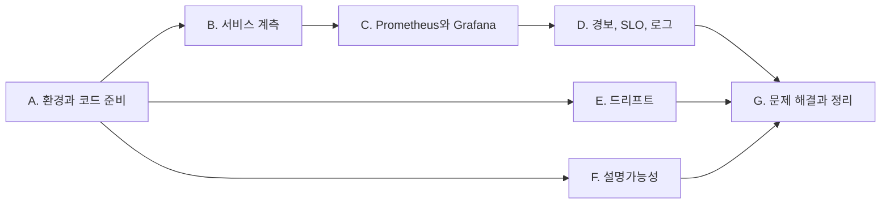

[11. 모니터링과 설명가능성](/docs/tech/machine-learning-platform-engineering/11-monitoring-and-explainability/)에서 정리한 내용을 책의 코드로 직접 실행한 기록이다. 개념과 요점은 본문에 두고, 여기에는 명령, 실제 출력과 화면만 모았다.

## 실습 순서 {#book-ch11-sop}

10장의 두 서비스에 지표를 붙여 Prometheus로 모으고, 대시보드와 경보와 로그를 만든다. 그다음 장애를 일부러 일으켜 경보가 실제로 오는지 본다. 이미지와 평점의 드리프트를 재고, 탐지 모델의 히트맵과 추천 설명을 만드는 것으로 끝난다. 아래 출력과 화면은 2026년 11월 8일 이 순서대로 실행해 얻은 것이다.



| 구간 | 끝났을 때 남는 것 |
| --- | --- |
| A. 환경과 코드 준비 | 저자 코드 두 저장소, `.venv-ch11`, 기준 이미지와 현재 이미지 세 묶음 |
| B. 서비스 계측 | 지표를 내보내는 탐지 서비스(:3111)와 추천 서비스(:3112) |
| C. Prometheus와 Grafana | 수집 대상 두 개가 `UP`인 Prometheus, 대시보드 두 개 |
| D. 경보, SLO, 로그 | 규칙 파일, Alertmanager 경로, 웹훅 수신 기록, Loki에서 검색한 오류 로그 |
| E. 드리프트 | 이미지 속성 드리프트 보고서 세 개, 추천 드리프트 점수 |
| F. 설명가능성 | Eigen-CAM 히트맵, 추천별 이웃 평점 설명 |
| G. 문제 해결과 정리 | 멈춘 서버와 지운 데이터 |

B~D는 순서대로 하고, E와 F는 A만 끝나면 따로 해도 된다. 명령은 [ml-platform-book-env](https://github.com/johklo/ml-platform-book-env) 저장소 최상위 폴더의 PowerShell에서 실행한다고 가정한다. 이 장에서 만드는 파일은 `ch11\`, 저자 코드는 `upstream\`에 둔다. 서버를 띄우는 명령은 각각 별도 터미널에서 실행하고 `Ctrl+C`로 멈춘다.

## A. 환경과 코드 준비 {#ch11-a}

10장의 서비스와 가상환경, 8장의 데이터를 그대로 이어받아 전체 그림의 ①과 ⑨~⑪을 준비한다.

### A-1. 저자 코드 {#ch11-a-1}

탐지 쪽 11장 코드는 `main`이 아닌 `chapter_11_changes` 브랜치에 있다. 추천 쪽은 10장에서 받은 저장소를 그대로 쓴다.

```powershell
git clone https://github.com/practical-mlops/object-detection-project.git upstream/ch11-object-detection
git -C upstream/ch11-object-detection checkout 8fb86af
git -C upstream/ch10-movie-recommender log --oneline -1
```

```text
4e0a808 Technical editor comment fixes (#7)
```

`upstream\ch11-object-detection`에는 `serving\metrics.py`, `data_drift\`(`Dataset.py`, `modify_brightness.py`, `run_deepchecks.py`), `explainability\`(`yolo_cam\` 모듈, 예제 이미지 `CA01_*.tif` 세 장, 노트북)가 있다. `explainability\CA01_*.tif`는 MIDV-500의 견본 신분증 사진이다.

### A-2. 가상환경 {#ch11-a-2}

서비스는 10장 가상환경으로 띄운다. 분석에는 deepchecks와 Eigen-CAM이 더 필요한데, torch와 ultralytics를 다시 설치하면 1GB 가까이 늘어난다. 그래서 10장 탐지 환경의 패키지를 그대로 쓰고 부족한 것만 더하는 환경을 만든다.

1. 새 환경을 만들고 `.pth` 파일로 10장 환경의 `site-packages`를 검색 경로에 넣는다.
   ```powershell
   uv venv ch11\.venv-ch11 --python 3.10
   Set-Content ch11\.venv-ch11\Lib\site-packages\ch10_yolo.pth "$PWD\.venv-ch10-yolo\Lib\site-packages"
   ```
2. 전체 설치 계획을 미리 보고, 10장 환경에 이미 있는 패키지를 뺀 나머지만 의존성 해석 없이 설치한다. `opencv-python-headless`는 같은 `cv2`를 덮어쓰므로 뺀다.
   ```powershell
   $have = uv pip list --python .venv-ch10-yolo --format json | ConvertFrom-Json | ForEach-Object { $_.name.ToLower().Replace('_','-') }
   $plan = uv pip install --python ch11\.venv-ch11 --dry-run "deepchecks[vision]==0.19.1" ttach anywidget `
       torch==2.5.1 torchvision==0.20.1 numpy==1.26.4 "opencv-python<4.12" 2>&1 |
       Select-String '^\s\+ ' | ForEach-Object { $_.Line.Trim().Substring(2) }
   $todo = $plan | Where-Object { ($_ -split '==')[0].ToLower() -notin $have -and $_ -notlike 'opencv-python-headless*' }
   uv pip install --python ch11\.venv-ch11 --no-deps @todo
   ```
   실습 때는 이 과정을 두 번에 나눠 했다. 처음에는 `anywidget` 없이 87개 패키지(272MB)를 설치했는데, [E-1](#ch11-e-1)에서 HTML 저장이 실패해 `anywidget`과 `psygnal`을 더했다.
3. 확인한다.
   ```powershell
   .\ch11\.venv-ch11\Scripts\python.exe -c "import deepchecks, torch, ultralytics, cv2; print(deepchecks.__version__, torch.__version__, ultralytics.__version__, cv2.__version__)"
   ```
   ```text
   0.19.1 2.5.1+cpu 8.3.40 4.11.0
   ```

책 저장소의 `deepchecks==0.18.1`은 `pandas<2.2`를 요구해 10장 환경의 pandas 2.3.3과 함께 쓸 수 없다. 0.19.1은 같은 API로 동작했다.

### A-3. 기준 이미지와 현재 이미지 {#ch11-a-3}

드리프트와 장애 실험에 쓸 이미지를 만든다. 기준은 8장에서 탐지 모델을 학습한 192장이다. 현재 묶음은 세 벌이다. 같은 생성기에서 seed만 바꾼 64장(카드 60장, 빈 배경 4장), 그리고 그 64장을 어둡게 하거나 흐리게 한 두 벌이다. 어두운 사진은 조명이 나쁜 매장을, 흐린 사진은 초점이 맞지 않는 새 카메라를 흉내 낸다.

1. 기준 이미지를 풀고 새 표본을 만든다. 생성기는 8장 [B-2](/docs/tech/machine-learning-platform-engineering/practice/ch08/#b-2-합성-신분증-데이터-만들기)의 `make_synthetic_idcards.py`다.
   ```powershell
   New-Item -ItemType Directory -Force ch11\data\ref | Out-Null
   tar -xzf ch08\DATASET.tar.gz -C ch11\data\ref
   .\.venv-ch10-yolo\Scripts\python.exe ch08\make_synthetic_idcards.py --out ch11\data\prod --clips 10 --frames 6 --negatives 4 --seed 11 --tar ch11\data\prod.tar.gz
   Remove-Item ch11\data\prod.tar.gz
   ```
   ```text
   images=64 clips=10 frames_per_clip=6 negatives=4 tar=ch11\data\prod.tar.gz size=820636
   ```
2. `ch11\make_shifted.py`로 두 벌을 만든다. 라벨은 그대로 복사한다.
   ```python
   import os, shutil
   from PIL import Image, ImageEnhance, ImageFilter

   src = "ch11/data/prod/MINIDATA"
   for name, change in {
       "prod_dark": lambda im: ImageEnhance.Brightness(im).enhance(0.35),
       "prod_blur": lambda im: im.filter(ImageFilter.GaussianBlur(6)),
   }.items():
       dst = f"ch11/data/{name}/MINIDATA"
       os.makedirs(dst + "/images", exist_ok=True)
       shutil.copytree(src + "/labels", dst + "/labels", dirs_exist_ok=True)
       for f in os.listdir(src + "/images"):
           change(Image.open(f"{src}/images/{f}")).save(f"{dst}/images/{f}", quality=88)
   ```
   ```powershell
   .\.venv-ch10-yolo\Scripts\python.exe ch11\make_shifted.py
   ```
3. 세 묶음을 8장 모델(10장 [B-1](/docs/tech/machine-learning-platform-engineering/practice/ch10/#ch10-b-1)에서 받은 `ch10\yolo-fixed\yolov8_custom.pt`)로 미리 돌려 본다. 아래 `ch11\check_sets.py`는 카드가 있는 60장에서 놓친 수, confidence 중앙값, 평균 밝기를 센다.
   ```python
   import glob, numpy as np
   from PIL import Image
   from ultralytics import YOLO

   m = YOLO("ch10/yolo-fixed/yolov8_custom.pt")
   for name in ["prod", "prod_dark", "prod_blur"]:
       files = sorted(glob.glob(f"ch11/data/{name}/MINIDATA/images/clip*.jpg"))
       confs, miss, bright = [], 0, []
       for f in files:
           im = Image.open(f).convert("RGB")
           bright.append(np.asarray(im.convert("L")).mean())
           r = m(np.asarray(im)[..., ::-1], verbose=False)[0]
           miss += len(r.boxes) == 0
           confs += [float(c) for c in r.boxes.conf]
       print(f"{name:10s} card_images={len(files)} missed={miss} median_conf={np.median(confs):.2f} mean_brightness={np.mean(bright):.0f}")
   ```
   ```text
   prod       card_images=60 missed=0 median_conf=0.98 mean_brightness=138
   prod_dark  card_images=60 missed=1 median_conf=0.91 mean_brightness=48
   prod_blur  card_images=60 missed=52 median_conf=0.57 mean_brightness=138
   ```
   이 표가 뒤의 모든 실험의 정답지다. 어두운 사진은 모델이 견디고, 흐린 사진은 견디지 못한다.

완료 기준: `ch11\data\` 아래 `ref`, `prod`, `prod_dark`, `prod_blur` 네 폴더에 각각 `MINIDATA\images`와 `MINIDATA\labels`가 있다.

## B. 서비스 계측 {#ch11-b}

책 11.1.2와 11.1.3을 따라 10장 서비스에 사용자 정의 지표와 로그를 붙인다. 그림의 ②~③이다.

### B-1. 지표 정의 {#ch11-b-1}

10장에서 고친 탐지 서비스(`ch10\yolo-fixed\`)를 복사해 시작한다. 책의 confidence 히스토그램 외에 지표 두 개를 더한다. 박스가 없는 응답 수(모델 신호)와 입력 사진의 평균 밝기(데이터 신호)다.

```powershell
New-Item -ItemType Directory -Force ch11\det | Out-Null
Copy-Item ch10\yolo-fixed\yolov8_custom.pt, ch10\yolo-fixed\model_info.json ch11\det\
```

처음에는 저자 코드처럼 `from bentoml.metrics import Counter, Histogram`으로 가져와 Histogram 두 개를 만들었다. 요청 두 번을 보낸 뒤 `/metrics`는 이랬다.

```text
input_brightness_sum 288.8325931712963
input_brightness_bucket{le="25.0"} 2.0
...
input_brightness_bucket{le="150.0"} 4.0
input_brightness_count 4.0
```

`confidence_score`는 아예 없고, 밝기 히스토그램에 관측이 네 개 있다. 그중 둘이 25 이하다. 0.79와 0.29라는 confidence 값이 밝기 히스토그램에 들어간 것이다.

BentoML 1.1의 `bentoml.metrics`는 속성에 접근할 때마다 지연 생성 객체를 하나 돌려준다. `import`로 이름을 한 번 가져온 뒤 두 번 호출하면 같은 객체의 인자만 바뀐다. 결국 두 변수가 마지막에 정의한 지표 하나를 가리킨다. 책은 Histogram을 하나만 정의해서 이 문제가 드러나지 않았다. 1.4의 추천 서비스에서는 같은 방식으로 만든 카운터 두 개가 따로 동작했다.

`ch11\det\metrics.py`:

```python
import bentoml

# BentoML 1.1: `from bentoml.metrics import Histogram` returns ONE lazy object, and calling it
# twice makes both variables the same metric (the last definition wins).
# Accessing bentoml.metrics.<Type> each time gives a separate lazy object per metric.
confidence_histogram = bentoml.metrics.Histogram(
    name="confidence_score",
    documentation="The confidence score of every predicted box",
    buckets=(0.1, 0.2, 0.3, 0.4, 0.5, 0.6, 0.7, 0.8, 0.9, 1),
)
no_detection_counter = bentoml.metrics.Counter(
    name="no_detection",
    documentation="Images for which the model returned no box",
)
input_brightness = bentoml.metrics.Histogram(
    name="input_brightness",
    documentation="Mean grayscale brightness (0-255) of input images",
    buckets=(25, 50, 75, 100, 125, 150, 175, 200, 225, 255),
)
```

### B-2. 서비스 코드 {#ch11-b-2}

10장 [B-3](/docs/tech/machine-learning-platform-engineering/practice/ch10/#ch10-b-3)의 서비스에 지표 기록, 로깅, 장애 주입 스위치를 더한다. 장애 주입은 실습용이다. 서비스 폴더에 `fault.json`이 있으면 Runner가 그 내용대로 지연하거나 예외를 낸다. 파일을 지우면 재시작 없이 정상으로 돌아온다.

`ch11\det\service.py`:

```python
import io
import json
import logging
import os
import time

import bentoml
import numpy as np
import PIL.Image
from bentoml.exceptions import BadInput
from bentoml.io import JSON, Image
from ultralytics import YOLO

from metrics import confidence_histogram, input_brightness, no_detection_counter

HERE = os.path.dirname(os.path.abspath(__file__))
MODEL_INFO = json.load(open(os.path.join(HERE, "model_info.json")))
MODEL_LABEL = f"{MODEL_INFO['registered_model']}/{MODEL_INFO['version']}"
MAX_PIXELS = 4096 * 4096
FAULT_FILE = os.path.join(HERE, "fault.json")

ch = logging.StreamHandler()
ch.setFormatter(logging.Formatter("%(asctime)s - %(name)s - %(levelname)s - %(message)s"))
bentoml_logger = logging.getLogger("bentoml")
bentoml_logger.addHandler(ch)
bentoml_logger.setLevel(logging.INFO)


def current_fault() -> dict:
    # lab-only switch: write {"delay_ms": 1500} or {"error": true} to fault.json, delete it to recover
    try:
        with open(FAULT_FILE) as f:
            return json.load(f)
    except (FileNotFoundError, ValueError):
        return {}


class YOLOv8Runnable(bentoml.Runnable):
    SUPPORTED_RESOURCES = ("cpu",)
    SUPPORTS_CPU_MULTI_THREADING = True

    def __init__(self):
        self.model = YOLO(os.path.join(HERE, "yolov8_custom.pt"))
        self.model.cpu()

    @bentoml.Runnable.method(batchable=False)
    def inference(self, input_img):
        fault = current_fault()
        if fault.get("delay_ms"):
            time.sleep(fault["delay_ms"] / 1000)
        if fault.get("error"):
            bentoml_logger.error("injected fault: runner raised on purpose")
            raise RuntimeError("injected fault")
        result = self.model(input_img, verbose=False)[0]
        boxes = json.loads(result.to_json())
        if not boxes:
            # not an error: the contract says [] when nothing is found
            no_detection_counter.inc()
            bentoml_logger.warning("no box returned for %d image(s)", len(input_img))
        for box in boxes:
            confidence_histogram.observe(box["confidence"])
        return boxes

    @bentoml.Runnable.method(batchable=False)
    def render(self, input_img):
        result = self.model(input_img, verbose=False)[0]
        buf = io.BytesIO()
        PIL.Image.fromarray(result.plot()[..., ::-1]).save(buf, format="JPEG")
        buf.seek(0)
        return PIL.Image.open(buf)


yolo_v8_runner = bentoml.Runner(YOLOv8Runnable, name="yolov8_runnable")
svc = bentoml.Service("yolo_v8", runners=[yolo_v8_runner])


def check(img: PIL.Image.Image, ctx: bentoml.Context) -> PIL.Image.Image:
    if img.width * img.height > MAX_PIXELS:
        raise BadInput(f"image too large: {img.width}x{img.height}")
    ctx.response.headers["x-model-version"] = MODEL_LABEL
    rgb = img.convert("RGB")
    input_brightness.observe(float(np.asarray(rgb.convert("L")).mean()))
    return rgb


@svc.api(input=Image(), output=JSON())
async def invocation(input_img, ctx: bentoml.Context):
    return await yolo_v8_runner.inference.async_run([check(input_img, ctx)])


@svc.api(input=Image(), output=Image())
async def render(input_img, ctx: bentoml.Context):
    return await yolo_v8_runner.render.async_run([check(input_img, ctx)])
```

밝기는 API 서버에서, confidence와 빈 응답은 Runner에서 기록한다. 서로 다른 프로세스지만 [다중 프로세스 지표](/docs/tech/machine-learning-platform-engineering/11-monitoring-and-explainability/#prometheus-model) 덕분에 같은 `/metrics`에 모인다. 로거 설정은 리스팅 11.1을 그대로 두었고, 그 결과 모든 로그가 두 번 찍힌다([D-5](#ch11-d-5)).

### B-3. 탐지 서비스를 띄우고 지표 확인 {#ch11-b-3}

1. 이 장 전용 BentoML 저장소를 쓰도록 지정하고 띄운다. 로그는 [D-5](#ch11-d-5)에서 Loki로 보내려고 파일로 남긴다.
   ```powershell
   $env:BENTOML_HOME = "$PWD\ch11\bentoml-home"
   $env:YOLO_CONFIG_DIR = "$PWD\ch11\yolo-config"
   $env:PYTHONIOENCODING = "utf-8"
   cd ch11\det
   ..\..\.venv-ch10-yolo\Scripts\bentoml.exe serve service.py:svc --port 3111 --api-workers 2 *> ..\det-serve.log
   ```
2. 다른 터미널에서 카드 두 장짜리 사진과 카드 없는 사진을 보낸다.
   ```powershell
   curl.exe -s -o NUL -X POST -H "Content-Type: image/jpeg" --data-binary "@ch10\two_cards.jpg" http://127.0.0.1:3111/invocation
   curl.exe -s -w " [%{http_code}]`n" -X POST -H "Content-Type: image/jpeg" --data-binary "@ch08\samples\neg01.jpg" http://127.0.0.1:3111/invocation
   curl.exe -s http://127.0.0.1:3111/metrics | Select-String -NotMatch '^# ' | Select-String 'confidence|no_detection|brightness_count|brightness_sum'
   ```
   ```text
   [] [200]
   no_detection_total 1.0
   input_brightness_sum 287.7530931712963
   input_brightness_count 2.0
   confidence_score_sum 1.0795
   confidence_score_bucket{le="0.1"} 0.0
   confidence_score_bucket{le="0.2"} 0.0
   confidence_score_bucket{le="0.3"} 1.0
   ...
   confidence_score_bucket{le="0.8"} 2.0
   confidence_score_bucket{le="1.0"} 2.0
   confidence_score_bucket{le="+Inf"} 2.0
   confidence_score_count 2.0
   ```
   박스 두 개(0.79, 0.29)가 각각 0.3과 0.8 구간에 들어갔고, 빈 응답 하나와 밝기 관측 두 개가 있다. 구간 값은 누적이라 `le="0.8"`이 2다. BentoML 기본 지표도 같은 화면에 있다.
   ```text
   bentoml_api_server_request_total{endpoint="/invocation",http_response_code="200",service_name="yolo_v8",service_version="not available"} 2.0
   bentoml_runner_request_total{endpoint="/inference",http_response_code="200",runner_name="yolov8_runnable",...} 2.0
   ```
   `service_version`이 `not available`인 것은 Bento로 빌드하지 않고 `service.py`로 띄웠기 때문이다. 모델 버전은 10장처럼 응답 헤더에만 있고 지표 라벨에는 없다.

### B-4. 추천 서비스 {#ch11-b-4}

추천 서비스는 10장 [D-3](/docs/tech/machine-learning-platform-engineering/practice/ch10/#ch10-d-3)에서 고친 코드를 그대로 쓴다. `metrics.py`의 카운터 두 개(`ranked_movie_present_counter`, `ranked_movie_absent_counter`)가 책 11.1.2의 추천 지표다.

1. 복사해서 띄운다. 10장 [D-2](/docs/tech/machine-learning-platform-engineering/practice/ch10/#ch10-d-2)와 같은 MLflow, S3 환경 변수가 필요하다.
   ```powershell
   New-Item -ItemType Directory -Force ch11\rec | Out-Null
   Copy-Item ch10\rec-fixed\service.py, ch10\rec-fixed\metrics.py ch11\rec\
   $env:BENTOML_HOME = "$PWD\ch11\bentoml-home-rec"
   $env:MLFLOW_TRACKING_URI = "http://127.0.0.1:5000"
   $env:MLFLOW_S3_ENDPOINT_URL = "http://127.0.0.1:9000"
   $env:AWS_ACCESS_KEY_ID = "minio"; $env:AWS_SECRET_ACCESS_KEY = "minio123"
   cd ch11\rec
   ..\..\.venv-ch10-rec\Scripts\bentoml.exe serve service:RecommenderService --port 3112 *> ..\rec-serve.log
   ```
   ```text
   loading ch10-recommender/2 (alias=prod, pinned=None) run=c1252d6c9f944228a7a93c26585708c4
   ready: users=610 catalog_items=9742
   ```
2. `ranked_movies`가 없는 요청 하나와 있는 요청 둘을 보내고 카운터를 본다.
   ```powershell
   '{"user_id": 50, "top_k": 5}' | Set-Content -NoNewline ch11\u50.json
   '{"user_id": 50, "top_k": 5, "ranked_movies": [3968, 2865]}' | Set-Content -NoNewline ch11\u50r.json
   foreach ($f in 'u50','u50r','u50r') { curl.exe -s -X POST -H "Content-Type: application/json" --data-binary "@ch11\$f.json" http://127.0.0.1:3112/predict; "" }
   curl.exe -s http://127.0.0.1:3112/metrics | Select-String -NotMatch '^# ' | Select-String 'ranked|bentoml_service_request_total'
   ```
   ```text
   [3968, 2865, 2478, 45722, 7347]
   [2478, 45722, 7347, 2538, 31422]
   [2478, 45722, 7347, 2538, 31422]
   ranked_movie_present_counter_total 2.0
   ranked_movie_absent_counter_total 1.0
   bentoml_service_request_total{endpoint="/predict",http_response_code="200",runner_name="RecommenderService",service_name="RecommenderService",service_version="not available"} 3.0
   ```
   이미 본 영화 두 편을 빼 달라고 하면 그 둘이 빠진 목록이 온다. 기본 지표 이름이 탐지 서비스와 다른 `bentoml_service_*`인 것에 주의한다.

완료 기준: 두 서비스의 `/metrics`에 `confidence_score_bucket`, `no_detection_total`, `input_brightness_bucket`, `ranked_movie_present_counter_total`이 보인다.

## C. Prometheus와 Grafana {#ch11-c}

지금 위치는 전체 그림의 ③~④다. 책 11.1.1은 3장에서 클러스터에 설치한 Prometheus와 Grafana를 쓰지만, 이 실습은 같은 프로그램을 PC에서 띄운다. 수집 대상이 PC의 서비스이고, 두 프로그램과 Loki를 합쳐도 클러스터용 이미지보다 디스크를 덜 쓰기 때문이다.

### C-1. Prometheus {#ch11-c-1}

1. 실행 파일을 받는다. 압축 파일에는 `promtool.exe`도 있지만 `prometheus.exe`만 꺼낸다.
   ```powershell
   New-Item -ItemType Directory -Force ch11\bin, ch11\mon | Out-Null
   curl.exe -sSL -o ch11\prom.zip https://github.com/prometheus/prometheus/releases/download/v3.16.0/prometheus-3.16.0.windows-amd64.zip
   Expand-Archive ch11\prom.zip ch11\prom-tmp; Copy-Item ch11\prom-tmp\*\prometheus.exe ch11\bin\
   Remove-Item -Recurse ch11\prom.zip, ch11\prom-tmp
   ```
2. `ch11\mon\prometheus.yml`을 만든다. 클러스터에서 Yatai PodMonitor가 붙이는 라벨을 수집 대상에 정적으로 붙인다. `endpoint` 라벨을 붙이면 서비스가 내보낸 `endpoint`가 클러스터에서처럼 `exported_endpoint`로 바뀐다.
   ```yaml
   global:
     scrape_interval: 5s
     evaluation_interval: 5s

   rule_files:
     - rules.yml

   alerting:
     alertmanagers:
       - static_configs:
           - targets: ["127.0.0.1:9093"]

   scrape_configs:
     - job_name: ch11/bento-deployment
       static_configs:
         # labels below imitate what the Yatai PodMonitor attaches in the cluster
         - targets: ["127.0.0.1:3111"]
           labels:
             namespace: ch11-local
             yatai_ai_bento_deployment: yolo-v8
             yatai_ai_bento_deployment_component_type: api-server
             endpoint: metrics
         - targets: ["127.0.0.1:3112"]
           labels:
             namespace: ch11-local
             yatai_ai_bento_deployment: recommender
             yatai_ai_bento_deployment_component_type: api-server
             endpoint: metrics
   ```
   규칙 파일 `rules.yml`은 [D-1](#ch11-d-1)에서 채운다. 지금은 `groups: []` 한 줄로 만들어 둔다.
3. 띄운다. 9090은 이 PC에서 다른 프로그램이 쓰고 있어 9190을 썼다. `--web.enable-lifecycle`을 붙여야 설정을 바꾼 뒤 재시작 없이 다시 읽힌다.
   ```powershell
   cd ch11\mon
   ..\bin\prometheus.exe --config.file=prometheus.yml --storage.tsdb.path=prom-data --web.listen-address=127.0.0.1:9190 --storage.tsdb.retention.size=200MB --web.enable-lifecycle
   ```
4. http://127.0.0.1:9190/targets 에서 두 대상이 `UP`인지 본다. 책의 그림 11.2(Service Discovery 화면에서 PodMonitor 찾기)에 해당하는 단계다.

   

   Windows에서 Prometheus의 데이터 폴더에는 처음부터 128MB짜리 파일 두 개(`chunks_head`)가 생긴다. 디스크 여유가 적다면 이 크기를 감안한다.

### C-2. 부하를 걸고 그래프 보기 {#ch11-c-2}

지표는 요청이 있어야 움직인다. `ch11\load.py`는 지정한 속도로 요청을 보내고 30초마다 응답 코드와 지연을 요약한다. 서버가 밀려도 클라이언트 대기열이 끝없이 늘지 않도록, 동시에 기다리는 요청은 16개로 제한했다.

```python
"""Send images (detector) or JSON (recommender) at a steady pace and print a summary every 30s.

  python load.py det data/prod/MINIDATA/images --rps 2 --minutes 10
  python load.py rec --rps 1 --minutes 10
"""
import argparse
import collections
import concurrent.futures as cf
import itertools
import json
import os
import random
import time
import urllib.error
import urllib.request

ap = argparse.ArgumentParser()
ap.add_argument("kind", choices=["det", "rec"])
ap.add_argument("folder", nargs="?")
ap.add_argument("--url")
ap.add_argument("--rps", type=float, default=2)
ap.add_argument("--minutes", type=float, default=10)
a = ap.parse_args()

if a.kind == "det":
    url = a.url or "http://127.0.0.1:3111/invocation"
    files = sorted(os.path.join(a.folder, f) for f in os.listdir(a.folder))
    payloads = itertools.cycle([(open(f, "rb").read(), "image/jpeg") for f in files])
else:
    url = a.url or "http://127.0.0.1:3112/predict"
    rng = random.Random(0)

    def gen():
        while True:
            body = {"user_id": rng.randint(1, 610), "top_k": 10}
            if rng.random() < 0.3:
                body["ranked_movies"] = rng.sample(range(1, 5000), 5)
            yield json.dumps(body).encode(), "application/json"
    payloads = gen()


def call(payload):
    data, ctype = payload
    t = time.perf_counter()
    try:
        with urllib.request.urlopen(urllib.request.Request(url, data=data, headers={"Content-Type": ctype}), timeout=30) as r:
            r.read()
            code = r.status
    except urllib.error.HTTPError as e:
        code = e.code
    except Exception:
        code = "conn-error"
    return code, time.perf_counter() - t


stats = collections.Counter()
lat = []
end = time.time() + a.minutes * 60
last = time.time()
ex = cf.ThreadPoolExecutor(8)
futures = []
while time.time() < end:
    if len(futures) < 16:
        futures.append(ex.submit(call, next(payloads)))
    else:
        stats["skipped"] += 1  # the server is saturated; do not build an endless client queue
    time.sleep(1 / a.rps)
    done = [f for f in futures if f.done()]
    futures = [f for f in futures if not f.done()]
    for f in done:
        code, s = f.result()
        stats[code] += 1
        lat.append(s)
    if time.time() - last >= 30 and lat:
        lat.sort()
        print(f"{time.strftime('%H:%M:%S')} {dict(stats)} p50={lat[len(lat)//2]*1000:.0f}ms "
              f"p95={lat[int(len(lat)*0.95)-1]*1000:.0f}ms", flush=True)
        stats.clear()
        lat.clear()
        last = time.time()
ex.shutdown(wait=False, cancel_futures=True)
```

처음 만든 판에는 이 제한이 없었다. [D-4](#ch11-d-4)에서 서버를 느리게 만들자 보내지 못한 요청이 수백 개 쌓였고, 정해진 시간이 지나도 대기열을 비우느라 프로그램이 끝나지 않았다. 부하 발생기도 포화를 만든다.

1. 두 터미널에서 각각 실행한다. 추천은 D 구간이 끝날 때까지 계속 돌린다.
   ```powershell
   cd ch11
   ..\.venv-ch10-yolo\Scripts\python.exe -u load.py det data\prod\MINIDATA\images --rps 2 --minutes 4
   ..\.venv-ch10-yolo\Scripts\python.exe -u load.py rec --rps 1 --minutes 40
   ```
   ```text
   13:08:57 {200: 59} p50=60ms p95=80ms
   ```
   ```text
   12:41:35 {200: 30} p50=15ms p95=24ms
   ```
2. http://127.0.0.1:9190/query 에서 **Graph** 탭을 고르고 질의한다. 책의 그림 11.3처럼 `bento`를 입력하면 자동 완성에 BentoML 지표가 나온다. 아래는 실습 전체(한 시간)의 탐지 요청을 응답 코드별로 나눈 그래프다.
   ```text
   sum by (exported_endpoint, http_response_code) (rate(bentoml_api_server_request_total{yatai_ai_bento_deployment="yolo-v8", exported_endpoint="/invocation"}[1m]))
   ```

   

   시간 축은 UTC다(04:25는 한국 시간 13:25). 03:54~04:08의 빈 구간은 부하를 걸지 않은 시간이다. 04:25~04:31은 [D-4](#ch11-d-4)의 지연 장애로 처리량이 초당 0.6건으로 떨어지고 503이 섞인 구간, 04:35~04:38은 [D-5](#ch11-d-5)의 오류 주입으로 모두 500이 된 구간이다.

### C-3. Grafana 대시보드 {#ch11-c-3}

1. Grafana 12.4.0의 Windows 압축 파일을 받아 푼다. 실습 당시 최신은 13.3.0이었지만 압축 파일만 495MB라, 디스크 여유를 보고 12.4.0을 골랐다. 풀면 약 750MB이고, 소스맵(`*.map`)과 `storybook`, `docs` 폴더를 빼고 풀면 590MB다.
   ```powershell
   curl.exe -sSL -o ch11\grafana.zip https://dl.grafana.com/oss/release/grafana-12.4.0.windows-amd64.zip
   Expand-Archive ch11\grafana.zip ch11\grafana; Remove-Item ch11\grafana.zip
   ```
2. 데이터 소스와 대시보드를 파일로 미리 넣는다(provisioning). 이때 데이터 소스 UID를 `prometheus`로 고정해야 한다. 책이 가져오라는 BentoDeployment 대시보드의 모든 패널이 UID `prometheus`를 가리킨다. 3장처럼 UID 없이 데이터 소스를 만들면 대시보드를 가져와도 패널이 데이터 소스를 찾지 못한다.
   ```powershell
   New-Item -ItemType Directory -Force ch11\grafana-prov\datasources, ch11\grafana-prov\dashboards, ch11\grafana-dash | Out-Null
   @'
   apiVersion: 1
   datasources:
     - name: Prometheus
       uid: prometheus
       type: prometheus
       url: http://127.0.0.1:9190
       isDefault: true
   '@ | Set-Content ch11\grafana-prov\datasources\prometheus.yml
   @"
   apiVersion: 1
   providers:
     - name: ch11
       folder: ch11
       type: file
       options:
         path: $($PWD -replace '\\','/')/ch11/grafana-dash
   "@ | Set-Content ch11\grafana-prov\dashboards\ch11.yml
   curl.exe -sSL -o ch11\grafana-dash\bentodeployment-dashboard.json https://raw.githubusercontent.com/bentoml/yatai/main/scripts/monitoring/bentodeployment-dashboard.json
   ```
3. 이 장의 지표로 대시보드를 하나 더 만든다. `ch11\make_dashboard.py`는 패널 여덟 개짜리 JSON을 쓴다. 책의 그림 11.7(confidence p90 게이지)과 11.8(ranked_movies 카운터)을 포함했다.
   ```python
   import json
   ds = {"type": "prometheus", "uid": "prometheus"}
   def panel(title, targets, x, y, w=12, h=8, unit=None, thresholds=None, ptype="timeseries"):
       p = {"type": ptype, "title": title, "datasource": ds, "gridPos": {"x": x, "y": y, "w": w, "h": h},
            "targets": [{"refId": chr(65 + i), "expr": e, "legendFormat": l, "datasource": ds} for i, (e, l) in enumerate(targets)],
            "fieldConfig": {"defaults": {}, "overrides": []}, "options": {}}
       if unit: p["fieldConfig"]["defaults"]["unit"] = unit
       if thresholds:
           p["fieldConfig"]["defaults"]["thresholds"] = {"mode": "absolute", "steps": thresholds}
           if ptype == "timeseries":
               p["fieldConfig"]["defaults"]["custom"] = {"thresholdsStyle": {"mode": "line"}}
       return p
   det = 'yatai_ai_bento_deployment="yolo-v8"'
   panels = [
       panel("탐지 confidence p90 (책 그림 11.7)", [("histogram_quantile(0.9, sum(rate(confidence_score_bucket[5m])) by (le))", "p90")], 0, 0, 6, 8,
             thresholds=[{"color": "red", "value": None}, {"color": "orange", "value": 0.5}, {"color": "green", "value": 0.8}], ptype="gauge"),
       panel("탐지 confidence 분위수", [(f"histogram_quantile({q}, sum by (le) (rate(confidence_score_bucket{{{det}}}[2m])))", f"p{int(q*100)}") for q in (0.5, 0.1)], 6, 0, 9, 8),
       panel("입력 이미지 평균 밝기 p50", [(f"histogram_quantile(0.5, sum by (le) (rate(input_brightness_bucket{{{det}}}[2m])))", "brightness p50")], 15, 0, 9, 8),
       panel("박스 없는 응답 비율", [(f'sum(rate(no_detection_total{{{det}}}[2m])) / sum(rate(bentoml_api_server_request_total{{{det}, exported_endpoint="/invocation", http_response_code="200"}}[2m]))', "empty ratio")], 0, 8, 8, 8,
             unit="percentunit", thresholds=[{"color": "green", "value": None}, {"color": "red", "value": 0.3}]),
       panel("/invocation 지연 p95", [(f'histogram_quantile(0.95, sum by (le) (rate(bentoml_api_server_request_duration_seconds_bucket{{{det}, exported_endpoint="/invocation"}}[1m])))', "p95")], 8, 8, 8, 8, unit="s",
             thresholds=[{"color": "green", "value": None}, {"color": "red", "value": 1}]),
       panel("오류 예산 소진 속도 (SLO 99%, 1초)", [("ch11:invocation_error_budget_burn:rate5m", "5m"), ("ch11:invocation_error_budget_burn:rate1m", "1m")], 16, 8, 8, 8,
             thresholds=[{"color": "green", "value": None}, {"color": "red", "value": 10}]),
       panel("ranked_movies 유무 (책 그림 11.8)", [("sum(rate(ranked_movie_present_counter_total[2m]))", "present"), ("sum(rate(ranked_movie_absent_counter_total[2m]))", "absent")], 0, 16, 12, 8, unit="reqps"),
       panel("추천 요청 지연 p95", [('histogram_quantile(0.95, sum by (le) (rate(bentoml_service_request_duration_seconds_bucket{yatai_ai_bento_deployment="recommender"}[1m])))', "p95")], 12, 16, 12, 8, unit="s"),
   ]
   json.dump({"title": "ch11 모델 모니터링", "uid": "ch11-model", "schemaVersion": 39, "time": {"from": "now-30m", "to": "now"},
              "refresh": "10s", "panels": panels}, open("ch11/grafana-dash/ch11-model.json", "w", encoding="utf-8"), ensure_ascii=False, indent=1)
   ```
   ```powershell
   .\.venv-ch10-yolo\Scripts\python.exe ch11\make_dashboard.py
   ```
4. 데이터와 로그 폴더를 이 장 안으로 지정하고 3300 포트로 띄운다(3000은 다른 프로그램이 쓰고 있었다).
   ```powershell
   $env:GF_SERVER_HTTP_ADDR = "127.0.0.1"; $env:GF_SERVER_HTTP_PORT = "3300"
   $env:GF_PATHS_DATA = "$PWD\ch11\grafana-data"; $env:GF_PATHS_LOGS = "$PWD\ch11\grafana-data\log"
   $env:GF_PATHS_PLUGINS = "$PWD\ch11\grafana-data\plugins"; $env:GF_PATHS_PROVISIONING = "$PWD\ch11\grafana-prov"
   $env:GF_SECURITY_ADMIN_PASSWORD = "ch11-local-only"
   cd ch11\grafana\grafana-12.4.0
   .\bin\grafana.exe server
   ```
   첫 시작 때 Grafana가 기본 앱 플러그인 몇 개를 내려받아 `grafana-data\plugins`에 48MB가 생겼다.
5. http://127.0.0.1:3300 에 `admin` / `ch11-local-only`로 들어가 **Dashboards → ch11 → BentoDeployment**를 연다. Namespace에 `ch11-local`, BentoDeployment에 `yolo-v8`을 고른다. 책의 그림 11.5에 해당한다.

   

   요청 수, 성공률, 지연 분위수 패널은 동작한다. 아래쪽 네트워크, CPU, 메모리 패널은 "No data"다. 이 패널들은 `namespace_workload_pod:kube_pod_owner:relabel` 같은 kube-prometheus-stack의 기록 규칙과 cAdvisor, kube-state-metrics 지표로 질의하는데, 이 실습뿐 아니라 책이 3장에서 설치한 `prometheus-community/prometheus` 차트에도 이 기록 규칙은 없다. BentoDeployment 목록에 `yolo-v8`만 있고 `recommender`가 없는 것은 [앞에서 설명](/docs/tech/machine-learning-platform-engineering/11-monitoring-and-explainability/#prometheus-model)한 지표 이름 차이 때문이다.
6. **ch11 모델 모니터링** 대시보드를 연다. 아래는 D 구간까지 모두 끝낸 뒤 65분 범위로 본 화면이다.

   

   한 화면에서 세 층이 따로 움직인다. 13:12~13:16 어두운 사진 구간에는 밝기만 떨어진다. confidence p10이 0.8 안팎에서 0.6대로 내려갔을 뿐 빈 응답 비율은 그대로다. 13:16~13:20 흐린 사진 구간에는 밝기가 그대로인데 빈 응답 비율이 90%까지 오르고, 남은 박스의 confidence도 떨어진다. 두 구간 내내 지연과 오류 예산은 조용하다. 13:24 이후의 지연 장애와 13:35의 오류 주입에서는 반대로 모델 신호는 그대로이고 오류 예산만 움직인다. 지연 p95가 10초에 붙어 있는 것은 실제 지연이 30초를 넘었는데 히스토그램의 마지막 구간이 10초이기 때문이다.

완료 기준: Prometheus의 두 대상이 `UP`이고, 두 대시보드의 요청 패널에 값이 있다.

## D. 경보, SLO, 로그 {#ch11-d}

경보가 오가는 ⑤~⑧ 구간이다. 책 11.1.3과 11.1.4를 따라가되 이메일 대신 로컬 웹훅으로 받는다. 장애를 네 가지로 일으켜 각 경보가 실제로 오는지 본다.

### D-1. 경보 규칙 {#ch11-d-1}

규칙은 세 묶음이다. 책의 리스팅 11.2(서비스 중단), [SLO](/docs/tech/machine-learning-platform-engineering/11-monitoring-and-explainability/#dashboards-alerts-slo)에 따른 오류 예산 소진, 그리고 모델 신호인 빈 응답 비율이다. 심각도 라벨을 다르게 붙여 Alertmanager가 수신자를 고르게 한다.

`ch11\mon\rules.yml`:

```yaml
groups:
  # Listing 11.2 with the job renamed for this lab and `for` shortened from 5m to 1m
  - name: BentoDeploymentServiceAlerts
    rules:
      - alert: ServiceDown
        expr: up{job="ch11/bento-deployment", yatai_ai_bento_deployment_component_type=~"api-server|runner"} == 0
        for: 1m
        labels:
          severity: critical
        annotations:
          summary: "Service {{ $labels.job }} on instance {{ $labels.instance }} is down"
          description: "The job {{ $labels.job }} on instance {{ $labels.instance }} has been down for more than 1 minute."
      - alert: MissingUpMetric
        expr: absent(up{job="ch11/bento-deployment", yatai_ai_bento_deployment_component_type=~"api-server|runner"}) == 1
        for: 1m
        labels:
          severity: critical
        annotations:
          summary: "No target left for {{ $labels.job }}"
          description: "The 'up' metric has been missing for more than 1 minute."

  # SLO for the detector: 99% of /invocation requests return non-5xx within 1s
  - name: ch11-detector-slo
    rules:
      - record: ch11:invocation_requests:rate1m
        expr: sum(rate(bentoml_api_server_request_total{yatai_ai_bento_deployment="yolo-v8", exported_endpoint="/invocation"}[1m]))
      - record: ch11:invocation_good:rate1m
        expr: sum(rate(bentoml_api_server_request_duration_seconds_bucket{yatai_ai_bento_deployment="yolo-v8", exported_endpoint="/invocation", http_response_code!~"5..", le="1.0"}[1m]))
      - record: ch11:invocation_error_budget_burn:rate1m
        expr: (1 - ch11:invocation_good:rate1m / ch11:invocation_requests:rate1m) / (1 - 0.99)
      - record: ch11:invocation_requests:rate5m
        expr: sum(rate(bentoml_api_server_request_total{yatai_ai_bento_deployment="yolo-v8", exported_endpoint="/invocation"}[5m]))
      - record: ch11:invocation_good:rate5m
        expr: sum(rate(bentoml_api_server_request_duration_seconds_bucket{yatai_ai_bento_deployment="yolo-v8", exported_endpoint="/invocation", http_response_code!~"5..", le="1.0"}[5m]))
      - record: ch11:invocation_error_budget_burn:rate5m
        expr: (1 - ch11:invocation_good:rate5m / ch11:invocation_requests:rate5m) / (1 - 0.99)
      # two windows: the long one proves it is not a blip, the short one proves it is still happening.
      # Real systems use 1h/5m and 6h/30m; the windows are shrunk so the lab fires in minutes.
      - alert: DetectorErrorBudgetBurn
        expr: ch11:invocation_error_budget_burn:rate5m > 10 and ch11:invocation_error_budget_burn:rate1m > 10
        for: 1m
        labels:
          severity: page
        annotations:
          summary: "Detector is burning its error budget {{ $value | humanize }}x faster than allowed"
          description: "More than 10% of /invocation requests were slow (>1s) or 5xx over both 5m and 1m windows."

  # model-side signal: not a page, a ticket for someone to look at inputs and predictions
  - name: ch11-detector-model
    rules:
      - alert: DetectorEmptyResults
        expr: |
          sum(rate(no_detection_total{yatai_ai_bento_deployment="yolo-v8"}[2m]))
            / sum(rate(bentoml_api_server_request_total{yatai_ai_bento_deployment="yolo-v8", exported_endpoint="/invocation", http_response_code="200"}[2m]))
          > 0.3
        for: 1m
        labels:
          severity: ticket
        annotations:
          summary: "{{ $value | humanizePercentage }} of images returned no box"
          description: "Normal traffic has about 6% empty results. Look at the inputs and explanations before blaming the model."
```

"좋은 요청"은 지연 히스토그램의 `le="1.0"` 구간에서 5xx를 뺀 것이다. 히스토그램 구간이 곧 SLO의 경계가 되므로, SLO 임계치(1초)는 구간 경계 중 하나여야 한다.

처음에는 빈 응답 대신 `histogram_quantile(0.5, ...confidence...) < 0.5`로 confidence 경보를 만들었다. 그런데 [A-3](#ch11-a-3)에서 흐린 사진의 confidence 중앙값은 0.57이었다. 카드 대부분을 놓치는 상황에서도 이 경보는 울리지 않는다. 박스가 없으면 confidence 관측 자체가 없으니, confidence 분포는 실패를 가장 먼저 숨긴다.

Prometheus에 규칙을 읽힌다. 화면의 **Alerts**에 세 묶음이 초록색(inactive)으로 나오면 된다.

```powershell
curl.exe -s -X POST http://127.0.0.1:9190/-/reload
```

### D-2. Alertmanager와 웹훅 수신기 {#ch11-d-2}

책은 Alertmanager가 Gmail로 보내도록 앱 비밀번호를 설정한다. 이 실습은 받은 내용을 출력하는 작은 HTTP 서버를 수신자로 쓴다. 이메일, Slack, PagerDuty도 같은 JSON을 받아 형식만 바꾼다.

1. `ch11\mon\webhook.py`:
   ```python
   import json
   from datetime import datetime
   from http.server import BaseHTTPRequestHandler, HTTPServer


   class Handler(BaseHTTPRequestHandler):
       def do_POST(self):
           body = json.loads(self.rfile.read(int(self.headers["Content-Length"])))
           for a in body["alerts"]:
               print(f"{datetime.now():%H:%M:%S} {self.path:<8} {a['status']:<8} "
                     f"{a['labels']['alertname']:<24} severity={a['labels'].get('severity')} "
                     f"{a['annotations'].get('summary', '')}", flush=True)
           self.send_response(200)
           self.end_headers()

       def log_message(self, *args):
           pass


   HTTPServer(("127.0.0.1", 5011), Handler).serve_forever()
   ```
2. `ch11\mon\alertmanager.yml`. 당직이 봐야 할 `critical`, `page`는 `/oncall`로, 나머지는 `/ticket`으로 보낸다. 책의 경로 예는 `match`를 쓰지만 지금 문법은 `matchers`다. 서비스가 죽었을 때 그 서비스의 지연, 빈 응답 경보를 억제하는 규칙도 넣었다.
   ```yaml
   route:
     receiver: ticket-webhook
     group_by: ["alertname", "job"]
     group_wait: 10s
     group_interval: 1m
     repeat_interval: 3h
     routes:
       - matchers: ['severity=~"critical|page"']
         receiver: oncall-webhook

   receivers:
     # stand-ins for PagerDuty and Gmail: a local HTTP server prints what it receives
     - name: oncall-webhook
       webhook_configs:
         - url: http://127.0.0.1:5011/oncall
           send_resolved: true
     - name: ticket-webhook
       webhook_configs:
         - url: http://127.0.0.1:5011/ticket
           send_resolved: true

   inhibit_rules:
     # while the service is down, latency and confidence alerts for it are noise
     - source_matchers: ['alertname="ServiceDown"']
       target_matchers: ['alertname=~"DetectorErrorBudgetBurn|DetectorEmptyResults"']
   ```
3. Alertmanager를 받아 띄우고, 웹훅 수신기도 띄운다. 클러스터를 이루지 않으므로 `--cluster.listen-address`를 비운다.
   ```powershell
   curl.exe -sSL -o ch11\am.zip https://github.com/prometheus/alertmanager/releases/download/v0.34.2/alertmanager-0.34.2.windows-amd64.zip
   Expand-Archive ch11\am.zip ch11\am-tmp; Copy-Item ch11\am-tmp\*\alertmanager.exe ch11\bin\; Remove-Item -Recurse ch11\am.zip, ch11\am-tmp
   cd ch11\mon
   ..\bin\alertmanager.exe --config.file=alertmanager.yml --storage.path=am-data --web.listen-address=127.0.0.1:9093 --cluster.listen-address=""
   ```
   ```powershell
   cd ch11\mon
   ..\..\.venv-ch10-yolo\Scripts\python.exe -u webhook.py | Tee-Object webhook.log
   ```

### D-3. 모델 신호: 흐린 사진 {#ch11-d-3}

서비스는 멀쩡한데 모델이 실패하는 상황이다. [C-2](#ch11-c-2)의 탐지 부하를 멈추고 흐린 사진으로 바꿔 4분 보낸다. 실습에서는 정상 4분, 어두운 사진 4분, 흐린 사진 4분, 정상 3분을 이어 보냈다.

```powershell
cd ch11
..\.venv-ch10-yolo\Scripts\python.exe -u load.py det data\prod_dark\MINIDATA\images --rps 2 --minutes 4
..\.venv-ch10-yolo\Scripts\python.exe -u load.py det data\prod_blur\MINIDATA\images --rps 2 --minutes 4
```

```text
13:16:58 {200: 59} p50=57ms p95=83ms
13:17:28 {200: 59} p50=56ms p95=81ms
13:17:59 {200: 59} p50=60ms p95=89ms
```

부하 발생기 입장에서는 모든 요청이 200이고 빠르다. 흐린 사진을 보내기 시작한 13:16:28에서 37초 뒤 `DetectorEmptyResults`가 pending(노란색)이 된다. 2분 창의 비율이 0.3을 넘기까지 걸린 시간이다.


1분 뒤 firing(빨간색)이 된다. 이 화면에서 경보를 펼치면 식, `for`, 라벨, 주석과 현재 값 0.89가 보인다. 책의 그림 11.11~11.13이 초록, 노랑, 빨강으로 보여 주는 상태 변화와 같다.


웹훅 수신기에는 `/ticket`으로 왔고, 정상 사진으로 돌아간 뒤 해소 알림이 왔다.

```text
13:18:15 /ticket  firing   DetectorEmptyResults     severity=ticket 74.22% of images returned no box
13:22:15 /ticket  resolved DetectorEmptyResults     severity=ticket 32.14% of images returned no box
```

어두운 사진 4분 동안에는 경보가 하나도 울리지 않았고, 대시보드의 밝기 패널만 내려갔다. 데이터 변화를 경보로 만들지 않은 것은 의도한 것이다. [E-2](#ch11-e-2)에서 보듯 이 변화는 모델을 해치지 않았다. 밝기 변화만으로 당직을 깨우면 그 경보는 곧 무시된다.

### D-4. 서비스 신호: 지연 장애 {#ch11-d-4}

정상 사진을 보내면서 Runner에 1.5초 지연을 넣는다.

```powershell
'{"delay_ms": 1500}' | Set-Content ch11\det\fault.json
..\.venv-ch10-yolo\Scripts\python.exe -u load.py det data\prod\MINIDATA\images --rps 2 --minutes 5
```

```text
13:24:00 {200: 18} p50=3160ms p95=3189ms
13:24:30 {'conn-error': 7, 200: 20} p50=3153ms p95=30013ms
13:25:00 {'conn-error': 7, 200: 19} p50=3167ms p95=30017ms
```

지연을 1.5초 넣었는데 응답은 3.1초 걸렸다. Runner가 요청을 사실상 하나씩 처리해 초당 0.6건만 소화하고, 초당 2건씩 들어오는 나머지는 줄을 섰다. 포화(saturation)가 지연을 키운 것이다.

30초를 기다린 클라이언트는 연결을 끊었다(`conn-error`). 서버 로그에는 49초 뒤 `bentoml.exceptions.ServiceUnavailable: Service Busy`와 함께 503으로 끝난 요청이 남았다. 클라이언트가 포기한 요청을 서버는 계속 처리하고 있었던 셈이다. 오류 주입까지 끝난 13:40 무렵 지난 15분의 `/invocation` 집계는 200이 861건, 503이 71건, 500이 264건이었다(`increase()` 추정값).

소진 속도가 두 창 모두 10을 넘고 1분이 지나자 경보가 firing이 됐고, `/oncall`로 왔다.


```text
13:25:42 /oncall  firing   DetectorErrorBudgetBurn  severity=page Detector is burning its error budget 22.29x faster than allowed
13:31:42 /oncall  resolved DetectorErrorBudgetBurn  severity=page Detector is burning its error budget 99.51x faster than allowed
```

해소 알림의 "99.51x"는 해소 시점이 아니라 마지막으로 firing이었던 때의 값이다. `fault.json`을 지운 시각은 13:30:09였다.

### D-5. 오류 주입과 Loki {#ch11-d-5}

이번에는 Runner가 예외를 내게 하고, 원인을 로그에서 찾는다. 책 11.1.3은 Helm으로 Loki를 설치하고 클러스터의 로그 수집기가 Pod 로그를 보내게 한다. PC에서는 Loki 실행 파일과, 로그 파일을 읽어 보내는 작은 스크립트로 같은 구조를 만든다. 실제 운영이라면 이 스크립트 자리에 Grafana Alloy가 들어간다(Promtail은 2026년 3월 지원이 끝났고 Loki 3.7 릴리스에는 Windows용 Promtail이 없다).

1. Loki를 받는다.
   ```powershell
   curl.exe -sSL -o ch11\loki.zip https://github.com/grafana/loki/releases/download/v3.7.9/loki-windows-amd64.exe.zip
   Expand-Archive ch11\loki.zip ch11\bin -Force; Remove-Item ch11\loki.zip
   ```
2. `ch11\mon\loki.yml`. 단일 프로세스, 파일 저장소 설정이다. 경로는 자신의 폴더로 바꾼다.
   ```yaml
   auth_enabled: false

   server:
     http_listen_address: 127.0.0.1
     http_listen_port: 3110
     grpc_listen_address: 127.0.0.1
     grpc_listen_port: 9196

   common:
     instance_addr: 127.0.0.1
     path_prefix: C:/path/to/ml-platform-book-env/ch11/loki-data
     storage:
       filesystem:
         chunks_directory: C:/path/to/ml-platform-book-env/ch11/loki-data/chunks
         rules_directory: C:/path/to/ml-platform-book-env/ch11/loki-data/rules
     replication_factor: 1
     ring:
       kvstore:
         store: inmemory

   schema_config:
     configs:
       - from: 2024-01-01
         store: tsdb
         object_store: filesystem
         schema: v13
         index:
           prefix: index_
           period: 24h

   limits_config:
     reject_old_samples: false
     allow_structured_metadata: true

   analytics:
     reporting_enabled: false
   ```
3. 띄운다. PowerShell은 `-config.file=...`을 `-config`와 `.file=...`로 쪼개 넘겨 `flag provided but not defined: -config`가 나므로 따옴표로 감싼다. `/ready`가 `ready`를 돌려줄 때까지 15초쯤 걸린다.
   ```powershell
   cd ch11\mon
   ..\bin\loki-windows-amd64.exe "-config.file=loki.yml"
   ```
4. `ch11\mon\ship_logs.py`는 서비스 로그 파일 끝에 새로 붙는 줄을 1초마다 Loki의 push API로 보낸다. 라벨은 `app`과 `job` 두 개뿐이다.
   ```python
   """A tiny stand-in for Promtail/Alloy: tail a log file and push new lines to Loki.

     python ship_logs.py <log file> app=yolo-v8 [key=value ...]
   """
   import json
   import sys
   import time
   import urllib.request

   path, labels = sys.argv[1], dict(kv.split("=", 1) for kv in sys.argv[2:])
   labels.setdefault("job", "ch11")
   LOKI = "http://127.0.0.1:3110/loki/api/v1/push"


   def push(lines):
       now = time.time_ns()
       values = [[str(now + i), line] for i, line in enumerate(lines)]
       body = json.dumps({"streams": [{"stream": labels, "values": values}]}).encode()
       urllib.request.urlopen(urllib.request.Request(LOKI, data=body, headers={"Content-Type": "application/json"}))


   with open(path, encoding="utf-8", errors="replace") as f:
       f.seek(0, 2)  # only new lines, like a fresh agent
       while True:
           batch = [l.rstrip("\n") for l in f.readlines() if l.strip()]
           if batch:
               push(batch)
           time.sleep(1)
   ```
   ```powershell
   cd ch11\mon
   ..\..\.venv-ch10-yolo\Scripts\python.exe -u ship_logs.py ..\det-serve.log app=yolo-v8
   ```
5. Grafana에 Loki 데이터 소스를 더한다. 이미 떠 있는 Grafana에는 API로 넣는 편이 재시작보다 빠르다.
   ```powershell
   '{"name":"Loki","uid":"loki","type":"loki","url":"http://127.0.0.1:3110","access":"proxy"}' | Set-Content -NoNewline ch11\loki-ds.json
   curl.exe -s -u admin:ch11-local-only -H "Content-Type: application/json" -X POST --data-binary "@ch11\loki-ds.json" http://127.0.0.1:3300/api/datasources
   ```
   ```text
   {"datasource":{"id":2,"uid":"loki",...},"id":2,"message":"Datasource added","name":"Loki"}
   ```
6. 오류를 3분 동안 주입한다.
   ```powershell
   '{"error": true}' | Set-Content ch11\det\fault.json
   ..\.venv-ch10-yolo\Scripts\python.exe -u load.py det data\prod\MINIDATA\images --rps 2 --minutes 3
   Remove-Item ch11\det\fault.json
   ```
   ```text
   13:35:36 {500: 59} p50=40ms p95=65ms
   13:36:06 {500: 59} p50=44ms p95=84ms
   ```
   오류 응답은 빠르다. 지연 경보만 있었다면 이 장애를 놓쳤을 것이다. 오류 예산 경보는 다시 firing이 됐다.
   ```text
   13:36:47 /oncall  firing   DetectorErrorBudgetBurn  severity=page Detector is burning its error budget 30.16x faster than allowed
   13:39:47 /oncall  resolved DetectorErrorBudgetBurn  severity=page Detector is burning its error budget 61.02x faster than allowed
   ```
7. Grafana **Explore**에서 데이터 소스 Loki, 질의 모드 **Code**로 아래를 검색한다. 책의 그림 11.9에 해당한다.
   ```text
   {app="yolo-v8"} |= "ERROR" != "Traceback"
   ```

   

   막대 그래프에서 13:35 이후의 덩어리가 오류 주입이고, 13:25~13:30의 드문드문한 막대는 D-4의 `Service Busy` 예외다. 지표로는 둘 다 "5xx 증가"였지만, 로그는 하나는 대기열 포화, 다른 하나는 Runner 예외라고 말한다. 같은 예외가 `2026-11-08T13:36:42+0900 [ERROR] [runner:yolov8_runnable:1]`와 `2026-11-08 13:36:42,528 - bentoml - ERROR` 두 형식으로 나란히 있는 것은 [리스팅 11.1의 중복 처리기](/docs/tech/machine-learning-platform-engineering/11-monitoring-and-explainability/#logging) 때문이다.

### D-6. 서비스 중단과 사라진 대상 {#ch11-d-6}

1. 탐지 서비스 터미널에서 `Ctrl+C`로 멈춘다(13:41:18). 약 70초 뒤 `ServiceDown`이 firing이 된다.

   

   

   ```text
   13:42:30 /oncall  firing   ServiceDown              severity=critical Service ch11/bento-deployment on instance 127.0.0.1:3111 is down
   ```
   서비스가 멈췄는데 `MissingUpMetric`은 울리지 않는다. 수집 대상 목록에 3111이 남아 있어 Prometheus가 `up=0`을 계속 기록하므로 `absent(up{...})`는 비어 있다. 같은 작업에 추천 서비스도 있으니 탐지 대상이 목록에서 사라져도 결과는 같다. 책의 `MissingUpMetric`은 작업 전체의 대상이 모두 사라질 때만 울린다.
2. 클러스터에서 배포를 지웠을 때처럼 대상 자체를 없애 본다. `prometheus.yml`의 `static_configs`를 `[]`로 바꾸고 다시 읽힌다(13:44:13).
   ```powershell
   curl.exe -s -X POST http://127.0.0.1:9190/-/reload
   ```
   ```text
   13:44:30 /oncall  resolved ServiceDown              severity=critical Service ch11/bento-deployment on instance 127.0.0.1:3111 is down
   13:45:35 /oncall  firing   MissingUpMetric          severity=critical No target left for ch11/bento-deployment
   ```
   대상이 사라지자 `ServiceDown`은 "해소"되고 `MissingUpMetric`이 울렸다. 서비스가 살아난 게 아니라 볼 대상이 없어졌을 뿐인데 해소 알림이 간다. 책이 두 규칙을 짝으로 둔 이유가 여기 있다. 배포별로 사라짐을 잡으려면 `absent`의 선택자에 배포 이름까지 넣어 배포마다 규칙을 둔다.
3. 확인이 끝나면 `prometheus.yml`을 원래대로 돌린다.

완료 기준: 웹훅 수신 기록에 `DetectorEmptyResults`(ticket), `DetectorErrorBudgetBurn`(oncall) 두 번, `ServiceDown`, `MissingUpMetric`의 firing과 resolved가 있다. 억제 규칙은 이번 순서에서는 다른 경보와 겹치지 않아 동작을 확인하지 못했다.

## E. 드리프트 {#ch11-e}

책 11.2를 저자 코드 그대로 한 번, 대조군을 둔 비교로 한 번 실행한다. 그림의 ⑨와 ⑪이고, 서비스와 상관없이 A만 끝나면 할 수 있다.

### E-1. 저자 코드 그대로 {#ch11-e-1}

저자의 `download.py`는 Manning의 데이터 주소를 쓰는데, 8장에서 확인한 대로 받을 수 없다. 대신 8장 학습 이미지를 저자 코드가 기대하는 `DATA\images`, `DATA\labels`에 넣는다.

1. 이미지를 넣고 `modify_brightness.py`를 그대로 실행한다. 앞 100장을 TIFF로 바꿔 `unmodified_brightness`와 `modified_brightness`에 나눠 쓴다. 비압축 TIFF라 200장이 102MB다.
   ```powershell
   cd upstream\ch11-object-detection\data_drift
   New-Item -ItemType Directory -Force DATA\images, DATA\labels | Out-Null
   Copy-Item ..\..\..\ch11\data\ref\MINIDATA\images\* DATA\images\
   Copy-Item ..\..\..\ch11\data\ref\MINIDATA\labels\* DATA\labels\
   $env:YOLO_CONFIG_DIR = "$PWD\..\..\..\ch11\yolo-config"
   ..\..\..\ch11\.venv-ch11\Scripts\python.exe modify_brightness.py
   ```
   ```text
   Processed clip16_f03.jpg -> DATA/modified_brightness/images\clip16_f03.tif
   Copied original to DATA/unmodified_brightness/images\clip16_f03.tif
   Copied labels to both directories
   ```
   코드의 `brightness_factor`는 1.5다. 책 본문과 그림 11.16은 밝기를 낮춘다고 하지만 코드는 50% 밝게 만든다. 또 "기준"과 "현재"가 같은 100장의 원본과 변형이라서, 학습 데이터와 운영 데이터를 비교하는 상황과 다르다. 바뀐 것이 밝기 하나뿐이니 검사가 그것을 찾는지만 확인할 수 있다.
2. `run_deepchecks.py`를 실행한다. 저자 `Dataset.py`는 `VisionData`를 만들면서 `../serving/yolov8_custom.pt`로 모든 이미지를 예측하므로 84초 걸렸다. 첫 실행은 결과를 계산한 뒤 HTML 저장에서 실패했다.
   ```powershell
   ..\..\..\ch11\.venv-ch11\Scripts\python.exe run_deepchecks.py
   ```
   ```text
   ImportError: Please install anywidget to use the FigureWidget class
   ```
   plotly 6은 노트북 위젯을 쓰려면 `anywidget`이 필요하다. [A-2](#ch11-a-2)처럼 `anywidget`과 `psygnal`을 더하고 다시 실행했다.
   ```text
   {'domain_classifier_auc': 1.0, 'domain_classifier_drift_score': 1.0, 'domain_classifier_feature_importance': {'Brightness': 1.0, 'Aspect Ratio': 0.0, 'Area': 0.0, 'RMS Contrast': 0.0, 'Mean Red Relative Intensity': 0.0, 'Mean Green Relative Intensity': 0.0, 'Mean Blue Relative Intensity': 0.0}}
   ```
   저자 코드는 책의 `ImagePropertyDrift`가 아니라 `ImageDatasetDrift`를 쓴다. 두 묶음을 구별하는 분류기는 AUC 1.0으로 완벽히 구별했고, 근거는 전부 밝기였다. HTML은 `deepcheck_vision_drift_check (1).html`로 저장됐다. 저장소에 같은 이름의 파일이 이미 있으면 deepchecks가 덮어쓰지 않고 번호를 붙이기 때문이다.
3. 책의 리스팅 11.6처럼 `ImagePropertyDrift`로도 비교한다. 아래 `ch11\image_drift.py`는 모델 예측 없이 이미지 속성만 비교한다. 위젯 대신 일반 HTML로 저장해 인터넷 없이 열리게 했다.
   ```python
   """ImagePropertyDrift (Listing 11.6) between two image folders, without running the model.

     python image_drift.py <reference_images_dir> <current_images_dir> <report.html>
   """
   import glob
   import json
   import os
   import sys

   import numpy as np
   from PIL import Image
   from deepchecks.vision import BatchOutputFormat, VisionData
   from deepchecks.vision.checks import ImagePropertyDrift


   def vision_data(folder, batch=32):
       files = sorted(f for f in glob.glob(os.path.join(folder, "*")) if f.lower().endswith((".jpg", ".png", ".tif")))

       def loader():
           for i in range(0, len(files), batch):
               imgs = [np.asarray(Image.open(f).convert("RGB")) for f in files[i:i + batch]]
               yield BatchOutputFormat(images=imgs)

       return VisionData(batch_loader=list(loader()), task_type="other", reshuffle_data=False), len(files)


   ref, n_ref = vision_data(sys.argv[1])
   cur, n_cur = vision_data(sys.argv[2])
   result = ImagePropertyDrift().run(ref, cur)
   result.save_as_html(sys.argv[3], as_widget=False)  # plain HTML, opens without the ipywidgets CDN
   print(f"reference={n_ref} current={n_cur}")
   print(json.dumps({k: round(v["Drift score"], 3) for k, v in result.value.items()}, indent=1))
   ```
   ```powershell
   New-Item -ItemType Directory -Force ..\..\..\ch11\reports | Out-Null
   ..\..\..\ch11\.venv-ch11\Scripts\python.exe ..\..\..\ch11\image_drift.py DATA\unmodified_brightness\images DATA\modified_brightness\images ..\..\..\ch11\reports\book-brightness.html
   ```
   ```text
   reference=100 current=100
   {
    "Aspect Ratio": 0.0,
    "Area": 0.0,
    "Brightness": 0.94,
    "RMS Contrast": 0.41,
    "Mean Red Relative Intensity": 0.12,
    "Mean Green Relative Intensity": 0.16,
    "Mean Blue Relative Intensity": 0.2
   }
   ```
   책의 결과(밝기 0.62, 대비 0.31, 넓이와 비율 0)와 모양이 같다. 이미지와 밝기 배율이 달라 값은 다르다.

### E-2. 대조군을 둔 비교 {#ch11-e-2}

[A-3](#ch11-a-3)의 세 묶음을 각각 8장 학습 이미지와 비교한다.

```powershell
cd ch11
foreach ($c in 'prod','prod_dark','prod_blur') {
    "== $c"
    .\.venv-ch11\Scripts\python.exe image_drift.py data\ref\MINIDATA\images data\$c\MINIDATA\images reports\$c.html
}
```

```text
== prod
{"Aspect Ratio": 0.0, "Area": 0.0, "Brightness": 0.344, "RMS Contrast": 0.208, "Mean Red Relative Intensity": 0.359, "Mean Green Relative Intensity": 0.276, "Mean Blue Relative Intensity": 0.156}
== prod_dark
{"Aspect Ratio": 0.0, "Area": 0.0, "Brightness": 1.0, "RMS Contrast": 1.0, "Mean Red Relative Intensity": 0.37, "Mean Green Relative Intensity": 0.276, "Mean Blue Relative Intensity": 0.156}
== prod_blur
{"Aspect Ratio": 0.0, "Area": 0.0, "Brightness": 0.344, "RMS Contrast": 0.521, "Mean Red Relative Intensity": 0.375, "Mean Green Relative Intensity": 0.271, "Mean Blue Relative Intensity": 0.146}
```

(출력의 줄바꿈은 줄여서 옮겼다. 각 실행은 `reference=192 current=64`를 먼저 출력한다.)

어두운 사진의 보고서다. 밝기와 대비의 분포가 전혀 겹치지 않아 KS 점수가 1이다. 책의 그림 11.17과 같은 화면이다.


흐린 사진의 보고서는 점수 순으로 정렬되어 RMS 대비(0.52)가 맨 위에 온다. 현재 분포가 왼쪽으로 옮겨갔지만 겹치는 부분이 많다. 그다음인 빨강 강도(0.375)는 대조군(0.359)과 거의 같다.


[A-3](#ch11-a-3)의 정답지와 나란히 놓으면 해석이 정리된다. 대조군의 점수(0.2~0.36)가 이 데이터에서 "아무 일 없음"의 크기다. 어두운 사진은 그보다 훨씬 크지만 모델에 해가 없었다. 흐린 사진은 대비 하나만 대조군을 넘었는데 모델이 87%를 놓쳤다. 실제 운영이라면 [D-3](#ch11-d-3)의 빈 응답 경보가 먼저 울리고, 그 시간대 입력으로 이 보고서를 만들어 "밝기가 아니라 대비가 바뀌었다"는 단서를 얻게 된다.

### E-3. 추천 드리프트 {#ch11-e-3}

저자의 `data_drift\drift.ipynb`를 스크립트로 옮기고, 노트북에 없는 대조 실험 세 개와 입력 분포 비교를 더한다. 모델 구조, 학습률, 배치 크기, epoch, 첫 1만 건만 쓰는 것은 노트북과 같다. 노트북은 DataLoader로 한 행씩 읽고 이 스크립트는 텐서로 한 번에 자른다는 점만 다르다.

`ch11\rec_drift.py`:

```python
"""drift.ipynb from movie-recommender-project (4e0a808) as a script, plus two checks the notebook skips.

  python rec_drift.py
"""
import io
import os
import urllib.request
import zipfile

import numpy as np
import pandas as pd
import torch
from deepchecks.tabular import Dataset
from deepchecks.tabular.checks import FeatureDrift

if not os.path.exists("data/ml-100k/u.data"):
    zipfile.ZipFile(io.BytesIO(urllib.request.urlopen(
        "https://files.grouplens.org/datasets/movielens/ml-100k.zip").read())).extractall("data")


class MF(torch.nn.Module):  # same layers as the notebook's MatrixFactorization
    def __init__(self, n_users, n_items, n_factors=20, hidden_dim=256, dropout_rate=0.2):
        super().__init__()
        self.user_factors = torch.nn.Embedding(n_users + 1, n_factors)
        self.item_factors = torch.nn.Embedding(n_items + 1, n_factors)
        self.linear = torch.nn.Linear(n_factors, hidden_dim)
        self.linear2 = torch.nn.Linear(hidden_dim, 1)
        self.dropout = torch.nn.Dropout(dropout_rate)

    def forward(self, user, item):
        x = torch.relu(self.linear(self.user_factors(user) * self.item_factors(item)))
        return self.linear2(self.dropout(x))


def train_model(df, n_users, n_items, seed, epochs=5):
    torch.manual_seed(seed)
    model = MF(n_users, n_items)
    opt = torch.optim.SGD(model.parameters(), lr=1e-3)
    u = torch.tensor(df.userId.values - 1)
    i = torch.tensor(df.movieId.values - 1)
    r = torch.tensor(df.rating.values, dtype=torch.float32)
    for _ in range(epochs):
        perm = torch.randperm(len(df))
        for s in range(0, len(df), 64):
            idx = perm[s:s + 64]
            loss = torch.nn.functional.l1_loss(model(u[idx], i[idx]).squeeze(1), r[idx])
            opt.zero_grad()
            loss.backward()
            opt.step()
    return model


def item_factor_drift(m1, m2, column="item_factor_2"):
    e1 = m1.item_factors.weight.detach().numpy()
    e2 = m2.item_factors.weight.detach().numpy()
    t1 = pd.DataFrame(e1.T, columns=[f"item_factor_{k}" for k in range(e1.shape[0])])
    t2 = pd.DataFrame(e2.T, columns=[f"item_factor_{k}" for k in range(e2.shape[0])])
    res = FeatureDrift(columns=[column]).run(Dataset(t1, label=None, cat_features=[]), Dataset(t2, label=None, cat_features=[]))
    return res, res.value["train"][column]["Drift score"] if "train" in res.value else res.value[column]["Drift score"]


def introduce_user_drift(df, movie_ids, drift_amount=1):  # verbatim from the notebook
    drift_indices = df["movieId"].isin(movie_ids)
    df.loc[drift_indices, "rating"] = df.loc[drift_indices, "rating"] + drift_amount
    df["rating"] = df["rating"].clip(1, 5)
    return df


ratings_df = pd.read_csv("data/ml-100k/u.data", sep="\t", names=["userId", "movieId", "rating", "timestamp"]).iloc[:10000]
original = ratings_df.copy()
n_users, n_items = ratings_df.userId.max(), ratings_df.movieId.max()

# 1. the notebook as written
movie_ratings_with_drift = introduce_user_drift(ratings_df, list(range(1, 101)))
print("same object:", movie_ratings_with_drift is ratings_df,
      "| mean rating ratings_df:", round(ratings_df.rating.mean(), 3),
      "with_drift:", round(movie_ratings_with_drift.rating.mean(), 3),
      "original:", round(original.rating.mean(), 3))
m_a = train_model(ratings_df, n_users, n_items, seed=1)
m_b = train_model(movie_ratings_with_drift, n_users, n_items, seed=2)
res, score = item_factor_drift(m_a, m_b)
res.save_as_html("reports/rec-item-factor-author.html", as_widget=False)
print("A. notebook as written (both models see drifted data):", round(score, 3))

# 2. no drift at all: same data, different seed
m_c = train_model(original, n_users, n_items, seed=1)
m_d = train_model(original, n_users, n_items, seed=2)
print("B. same clean data, different seed:", round(item_factor_drift(m_c, m_d)[1], 3))

# 3. what was meant: clean vs drifted data, with a different seed (as the notebook would) and with the same seed
m_e = train_model(introduce_user_drift(original.copy(), list(range(1, 101))), n_users, n_items, seed=2)
print("C. clean vs drifted data, different seed:", round(item_factor_drift(m_c, m_e)[1], 3))
m_f = train_model(introduce_user_drift(original.copy(), list(range(1, 101))), n_users, n_items, seed=1)
print("E. clean vs drifted data, same seed:", round(item_factor_drift(m_c, m_f)[1], 3))
torch.manual_seed(1)
init = MF(n_users, n_items).item_factors.weight.detach().numpy()
trained = m_c.item_factors.weight.detach().numpy()
print("relative change of item embeddings during training:",
      f"{np.linalg.norm(trained - init) / np.linalg.norm(init):.6f}")

# 4. look at the input instead of the embeddings: ratings of the touched movies
ref = original[original.movieId <= 100][["rating"]]
cur = movie_ratings_with_drift[movie_ratings_with_drift.movieId <= 100][["rating"]]
res = FeatureDrift(columns=["rating"]).run(Dataset(ref, label=None, cat_features=[]), Dataset(cur, label=None, cat_features=[]))
res.save_as_html("reports/rec-rating-drift.html", as_widget=False)
v = res.value
print("D. rating distribution of movies 1-100:", {k: round(x["Drift score"], 3) for k, x in (v["train"] if "train" in v else v).items()},
      f"rows={len(ref)}", "mean", round(ref.rating.mean(), 2), "->", round(cur.rating.mean(), 2))
```

```powershell
cd ch11
.\.venv-ch11\Scripts\python.exe rec_drift.py
```

```text
same object: True | mean rating ratings_df: 3.676 with_drift: 3.676 original: 3.559
A. notebook as written (both models see drifted data): 0.25
B. same clean data, different seed: 0.25
C. clean vs drifted data, different seed: 0.25
E. clean vs drifted data, same seed: 0.05
relative change of item embeddings during training: 0.000053
D. rating distribution of movies 1-100: {'rating': 0.384} rows=1598 mean 3.76 -> 4.49
```

- 첫 줄이 노트북의 버그다. 두 이름이 같은 객체라 평균 평점도 같다. 노트북은 같은 데이터로 두 번 학습하고 있었다.
- A, B, C가 모두 0.25다. 데이터가 같든 다르든 seed가 다르면 같은 점수가 나온다. E처럼 seed를 맞추면 드리프트가 있어도 0.05다. 이 점수가 재는 것은 학습 데이터가 아니라 초기값이다.
- 임베딩이 학습으로 움직인 정도가 0.005%이니 당연한 결과다. 노트북의 학습 설정(L1 손실, 학습률 0.001, 5 epoch)으로는 임베딩이 거의 학습되지 않는다.
- D처럼 입력을 직접 비교하면 평점이 높은 쪽으로 옮겨간 것이 분명히 보인다.


위 그림이 책의 그림 11.19에 해당한다. 분포가 달라 보이지만, B의 대조 실험에서도 같은 점수가 나오므로 취향 변화의 증거로 볼 수 없다.

완료 기준: `ch11\reports\`에 세 이미지 보고서와 두 추천 보고서가 있고, 대조군 점수를 기준으로 어떤 변화가 의미 있는지 설명할 수 있다.

## F. 설명가능성 {#ch11-f}

책 11.3을 따라 탐지 모델에 Eigen-CAM을, 추천에 EMF를 실행한다(전체 그림의 ⑩~⑪).

### F-1. 저자 Eigen-CAM 그대로 {#ch11-f-1}

저자 `explainability\explainable_object_detection.ipynb`의 셀은 리스팅 11.7과 같다. `plt.show()`를 `plt.savefig()`로 바꾸고 맨 위에 `matplotlib.use("Agg")`를 넣어 `author_listing.py`로 저장한다. 저자가 학습한 `serving\yolov8_custom.pt`와 예제 이미지 세 장으로 실행하고, 활성값 모양을 보려고 한 줄을 더 찍는다.

```powershell
cd upstream\ch11-object-detection\explainability
..\..\..\ch11\.venv-ch11\Scripts\python.exe author_listing.py
```

```text
0: 640x384 1 id_card, 174.5ms
CA01_06.tif (1920, 1080, 3) activations: [(1, 128, 20, 12), (1, 384, 20, 12), (1, 256, 20, 12)]
```

ultralytics 8.3.40에서도 저자의 `yolo_cam` 모듈은 고치지 않고 동작했다. 1080x1920 사진이 384x640으로 줄어 들어가고, 대상 세 층의 활성값은 20x12 격자다. 히트맵은 이 격자를 원본 크기로 늘린 것이다.

결과 그림은 왼쪽처럼 사진의 색이 푸르게 보인다. `cv2.imread`가 읽은 BGR 배열을 `show_cam_on_image(..., use_rgb=True)`에 넣어 빨강과 파랑이 바뀌었기 때문이다. 아래 `run_cam.py`는 RGB로 바꿔 그린다. 모델이 예측한 박스(흰색)와 라벨 박스(초록색)를 겹치고, 열의 몇 %가 박스 안에 있는지도 센다. 예측 전에 빈 이미지로 한 번 예측해 두는 것은 첫 호출의 준비 과정이 히트맵 훅에 섞이지 않게 하려는 것이다.

`ch11\run_cam.py`(저자 폴더의 `yolo_cam`을 가져오므로 `explainability` 폴더에 복사해서 실행한다):

```python
"""Listing 11.7 with plt.show() replaced by saved PNGs, plus the boxes the model predicted.

  python run_cam.py <weights> <out_dir> <image> [<image> ...]
"""
import os
import sys

import cv2
import numpy as np
from ultralytics import YOLO
from yolo_cam.eigen_cam import EigenCAM
from yolo_cam.utils.image import show_cam_on_image

weights, out_dir, images = sys.argv[1], sys.argv[2], sys.argv[3:]
os.makedirs(out_dir, exist_ok=True)
model = YOLO(weights)
model.predict(np.zeros((64, 64, 3), np.uint8), verbose=False)  # warm-up outside the CAM hooks
target_layers = [model.model.model[-2], model.model.model[-3], model.model.model[-4]]
cam = EigenCAM(model, target_layers, task="od")

for path in images:
    bgr = cv2.imread(path)
    grayscale_cam = cam(bgr.copy())[0, :, :]
    n_act = len(cam.activations_and_grads.activations)
    rgb = cv2.cvtColor(bgr, cv2.COLOR_BGR2RGB)
    overlay = show_cam_on_image(np.float32(rgb) / 255, grayscale_cam, use_rgb=True)
    result = model.predict(bgr, verbose=False)[0]
    boxes = [(float(c), [int(v) for v in xyxy]) for c, xyxy in zip(result.boxes.conf, result.boxes.xyxy)]
    for conf, (x1, y1, x2, y2) in boxes:
        cv2.rectangle(overlay, (x1, y1), (x2, y2), (255, 255, 255), 2)
        cv2.putText(overlay, f"id_card {conf:.2f}", (x1, max(15, y1 - 6)), cv2.FONT_HERSHEY_SIMPLEX, 0.5, (255, 255, 255), 2)
    # how much of the heat falls inside the predicted boxes and inside the labelled box
    def heat_in(rects):
        if not rects:
            return 0.0
        m = np.zeros_like(grayscale_cam, dtype=bool)
        for x1, y1, x2, y2 in rects:
            m[y1:y2, x1:x2] = True
        return float(grayscale_cam[m].sum() / grayscale_cam.sum())
    inside = heat_in([b for _, b in boxes])
    label = os.path.splitext(path.replace("images", "labels"))[0] + ".txt"
    gt = []
    if os.path.exists(label):
        h, w = grayscale_cam.shape
        for line in open(label).read().split("\n"):
            if line.strip():
                _, cx, cy, bw, bh = map(float, line.split())
                gt.append((int((cx - bw / 2) * w), int((cy - bh / 2) * h), int((cx + bw / 2) * w), int((cy + bh / 2) * h)))
        for x1, y1, x2, y2 in gt:
            cv2.rectangle(overlay, (x1, y1), (x2, y2), (0, 255, 0), 1)
    name = os.path.splitext(os.path.basename(path))[0]
    cv2.imwrite(os.path.join(out_dir, f"{name}_cam.jpg"), cv2.cvtColor(overlay, cv2.COLOR_RGB2BGR))
    area = sum((x2 - x1) * (y2 - y1) for x1, y1, x2, y2 in gt) / grayscale_cam.size
    print(f"{name}: activations={n_act} boxes={[round(c, 2) for c, _ in boxes]} "
          f"heat_in_pred={inside:.2f} heat_in_label={heat_in(gt):.2f} label_area={area:.2f}")
```

```powershell
Copy-Item ..\..\..\ch11\run_cam.py .
..\..\..\ch11\.venv-ch11\Scripts\python.exe run_cam.py ..\serving\yolov8_custom.pt ..\..\..\ch11\cam\author CA01_06.tif CA01_02.tif CA01_30.tif
```

```text
CA01_06: activations=3 boxes=[0.88] heat_in_pred=0.46 heat_in_label=0.00 label_area=0.00
CA01_02: activations=3 boxes=[0.84] heat_in_pred=0.52 heat_in_label=0.00 label_area=0.00
CA01_30: activations=3 boxes=[0.87] heat_in_pred=0.49 heat_in_label=0.00 label_area=0.00
```

예제 이미지에는 라벨 파일이 없어 라벨 쪽 값은 0이다. 책의 그림 11.20처럼 카드 위가 가장 뜨겁고, 열의 절반 가까이가 예측 박스 안에 있다. 책이 "모서리에도 주의를 기울인다"고 한 위쪽 자와 물건에도 열이 있다.


### F-2. 8장 모델과 실패 사례 {#ch11-f-2}

같은 스크립트를 8장 모델(10장에서 서빙한 가중치)과 [A-3](#ch11-a-3)의 세 묶음에 돌린다. 같은 카드 두 장(`clip01_f00`, `clip05_f00`)과 카드 없는 배경(`neg00`)을 원본, 어둡게, 흐리게 세 조건으로 비교한다.

```powershell
foreach ($s in 'prod','prod_dark','prod_blur') {
    "== $s"
    $d = "..\..\..\ch11\data\$s\MINIDATA\images"
    ..\..\..\ch11\.venv-ch11\Scripts\python.exe run_cam.py ..\..\..\ch10\yolo-fixed\yolov8_custom.pt ..\..\..\ch11\cam\$s "$d\clip01_f00.jpg" "$d\clip05_f00.jpg" "$d\neg00.jpg"
}
```

```text
== prod
clip01_f00: activations=3 boxes=[0.93] heat_in_pred=0.12 heat_in_label=0.13 label_area=0.18
clip05_f00: activations=3 boxes=[1.0] heat_in_pred=0.35 heat_in_label=0.34 label_area=0.21
neg00: activations=3 boxes=[] heat_in_pred=0.00 heat_in_label=0.00 label_area=0.00
== prod_dark
clip01_f00: activations=3 boxes=[0.6] heat_in_pred=0.11 heat_in_label=0.13 label_area=0.18
clip05_f00: activations=3 boxes=[0.91] heat_in_pred=0.30 heat_in_label=0.29 label_area=0.21
neg00: activations=3 boxes=[] heat_in_pred=0.00 heat_in_label=0.00 label_area=0.00
== prod_blur
clip01_f00: activations=3 boxes=[] heat_in_pred=0.00 heat_in_label=0.05 label_area=0.18
clip05_f00: activations=3 boxes=[] heat_in_pred=0.00 heat_in_label=0.15 label_area=0.21
neg00: activations=3 boxes=[] heat_in_pred=0.00 heat_in_label=0.00 label_area=0.00
```

`label_area`는 라벨 박스가 사진에서 차지하는 비율이다. 열이 사진 전체에 고르게 퍼져 있으면 `heat_in_label`이 이 값과 같아진다. 아홉 장의 히트맵을 한 그림에 모았다(`ch11\cam\<묶음>\*_cam.jpg`를 3x3으로 붙인 것).


- `clip05`는 책이 기대한 그림이다. 열의 34%가 면적 21%인 카드에, 특히 글자 줄에 모인다. 어둡게 해도 같은 곳을 본다. 모델이 어두운 사진을 견딘 것과 맞는다.
- `clip01`은 confidence 0.93으로 찾았는데 열의 13%만 카드(면적 18%)에 있고 가장 뜨거운 곳은 배경의 빨간 원이다. 히트맵이 "그 박스를 찾은 이유"를 그리지 않는다는 [앞의 설명](/docs/tech/machine-learning-platform-engineering/11-monitoring-and-explainability/#eigen-cam)이 그대로 드러난다.
- 실패 사례인 흐린 사진에서는 카드 안의 열이 5%와 15%로 면적보다 작고, 열이 사진 가장자리로 옮겨간다. 흐림이 카드의 경계와 글자 줄을 지워 모델의 표현을 배경 무늬가 지배하게 됐다는 가설을 세울 수 있다. 이 가설을 확인하려면 흐림 정도를 단계적으로 바꿔 탐지율이 어디서 꺾이는지 재야 한다.
- 카드가 없는 `neg00`에도 빨간 영역이 생긴다. 히트맵은 이미지마다 0~1로 정규화되므로 "아무것도 없음"을 표현하지 못한다.

### F-3. EMF 추천 설명 {#ch11-f-3}

저자 `explainability\get_explanations.ipynb`의 셀을 순서대로 옮기고, 설명이 무엇으로 만들어지는지 확인하는 몇 줄을 더한다. 저자 코드는 고치지 않는다. 노트북에 seed가 없어 실행마다 순위가 조금 달라지므로 `np.random.seed(0)`을 넣었다.

`run_emf.py`(저자 `explainability` 폴더에 두고 실행한다. MovieLens 100K를 `data\ml-100k\`에 풀어 둔다):

```python
"""get_explanations.ipynb (movie-recommender-project 4e0a808) as a script, plus checks on what the explanation means.

  python run_emf.py
"""
import numpy as np
import pandas as pd

from data_reader.data_reader import DataReader
from explainer.emf import EMFExplainer
from model.emf import EMFModel
from recommender.recommender import Recommender

np.random.seed(0)
pd.set_option("display.width", 120)

# --- notebook cells -----------------------------------------------------------
train_data = DataReader("data/ml-100k/u.data", sep="\t", names=["userId", "itemId", "rating", "timestamp"])
emf = EMFModel(learning_rate=0.01, reg_term=0.001, expl_reg_term=0.0, latent_dim=80, epochs=10, positive_threshold=3, knn=10)
emf.fit(train_data)
recommender = Recommender(train_data, emf)
recommendations = recommender.recommend_all()
explanations = EMFExplainer(emf, recommendations, train_data)
recs = explanations.explain_recommendations()
recs["userId"] = recs["userId"] + 1
recs["itemId"] = recs["itemId"] + 1
print(recs.head(10).to_string())

# --- what the explanation is made of -----------------------------------------
recs.to_pickle("emf_recs.pkl")
n = len(recs)
empty = sum(1 for e in recs.explanations if not e)
pos = sum(1 for e in recs.explanations if sum(c for r, c in e.items() if r >= 4) > 0)
print(f"\nrecommendations={n} empty_explanations={empty} ({empty / n:.0%}) "
      f"at_least_one_neighbor_rated_4plus={pos} ({pos / n:.0%})")

ds = train_data.dataset  # 0-based after fit
popularity = ds.groupby("itemId").size()
recs["n_explaining"] = [sum(e.values()) for e in recs.explanations]
recs["popularity"] = popularity.reindex(recs.itemId - 1).values
print("corr(neighbors who rated it, number of ratings of the movie):",
      round(recs[["n_explaining", "popularity"]].corr().iloc[0, 1], 2))

# expl_reg_term=0.0 multiplies every explainability term by zero, so training ignores it
print("expl_reg_term:", emf.expl_reg_term)

# compute_explainability writes neighbor scores to column itemId - 1, but itemId is already 0-based
u = 0
nbrs = emf.sim_users[u]
liked = ds[(ds.userId.isin(nbrs)) & (ds.rating >= emf.positive_threshold)].itemId.unique()
written = np.flatnonzero(emf.explainability_matrix[u])
print("user 1 neighbours liked item index", sorted(liked)[:5], "| matrix has non-zero at", sorted(written)[:5])
```

```powershell
cd upstream\ch10-movie-recommender\explainability
New-Item -ItemType Directory -Force data | Out-Null
Copy-Item -Recurse ..\..\..\ch11\data\ml-100k data\
..\..\..\ch11\.venv-ch11\Scripts\python.exe run_emf.py
```

학습 10 epoch와 설명 계산까지 2분 7초 걸렸다. 진행 막대 사이로 `FutureWarning: Series.__getitem__ treating keys as positions is deprecated`가 추천마다 찍힌다. `explainer\emf.py`의 `row[0]`이 pandas 3에서는 오류가 될 부분이다.

```text
      userId  itemId  rank        explanations
201      1.0   474.0   1.0  {3: 1, 4: 4, 5: 4}
1176     1.0  1449.0   2.0                  {}
135      1.0   408.0   3.0        {4: 2, 5: 4}
374      1.0   647.0   4.0              {4: 1}
3        1.0   276.0   5.0        {4: 4, 5: 3}
238      1.0   511.0   6.0        {4: 2, 5: 2}
1094     1.0  1367.0   7.0                  {}
12       1.0   285.0   8.0              {5: 1}
210      1.0   483.0   9.0              {5: 6}
84       1.0   357.0  10.0        {4: 3, 5: 5}

recommendations=9430 empty_explanations=4937 (52%) at_least_one_neighbor_rated_4plus=4314 (46%)
corr(neighbors who rated it, number of ratings of the movie): 0.4
expl_reg_term: 0.0
```

- 책의 표와 비교하면 열 개 중 여덟 개가 같은 영화이고 설명도 같다. 다만 책의 475번 `{3: 1, 4: 4, 5: 4}`가 여기서는 474번, 책의 1450번 `{}`가 1449번이다. 책의 번호가 모두 1씩 크고 `userId`도 2.0이니, 노트북의 `+ 1` 셀을 두 번 실행한 결과로 보인다. 순위가 다른 것은 초기값이 무작위이기 때문이다.
- 1번 사용자의 1위 추천 474번은 "비슷한 사용자 9명이 평가했고 8명이 4점 이상"이라고 설명할 수 있다. 2위 1449번은 설명이 없다. 전체로 보면 추천의 52%가 설명 없이 나간다.
- 이웃이 평가한 수는 영화의 전체 평점 수와 상관계수 0.4다. 인기 있는 영화일수록 설명이 붙기 쉽다. 설명이 있는 추천만 보여 주면 추천이 인기작 쪽으로 기운다.

설명 가능성 행렬이 한 칸 어긋나는 것은 같은 폴더에서 아래 코드로 볼 수 있다. 정규화 단계를 잠시 끄고 1번 사용자 행을 이웃이 실제로 준 점수와 비교한다.

```powershell
@'
import numpy as np, warnings
warnings.filterwarnings("ignore")
import model.emf as M
from data_reader.data_reader import DataReader
M.MinMaxScaler = type("Id", (), {"fit_transform": staticmethod(lambda x: x)})
d = DataReader("data/ml-100k/u.data", sep="\t", names=["userId", "itemId", "rating", "timestamp"])
emf = M.EMFModel(0.01, 0.001, 0.0, 3, 80, 10, 10)
emf.dataset_metadata = d; emf.dataset = d.dataset
emf.dataset["userId"] -= 1; emf.dataset["itemId"] -= 1
emf.compute_explainability()
ds = emf.dataset; u = 0
g = ds[ds.userId.isin(emf.sim_users[u]) & (ds.rating >= 3)].groupby("itemId").rating.sum()
row = emf.explainability_matrix[u]
print("neighbours' score for item index 0..4 :", [float(g.get(i, 0)) for i in range(5)])
print("matrix row, item index 0..4          :", row[:5].tolist(), "| last column:", row[-1])
'@ | ..\..\..\ch11\.venv-ch11\Scripts\python.exe -
```

```text
neighbours' score for item index 0..4 : [43.0, 27.0, 12.0, 40.0, 14.0]
matrix row, item index 0..4          : [27.0, 12.0, 40.0, 14.0, 0.0] | last column: 43.0
```

0번 아이템의 점수 43이 마지막 열에 있고 나머지는 한 칸씩 왼쪽으로 밀렸다. `expl_reg_term`이 0이라 지금은 추천에 영향이 없다.

완료 기준: `ch11\cam\`에 히트맵이 있고, EMF 출력에서 설명이 빈 추천의 비율과 설명이 만들어지는 방식을 설명할 수 있다.

## G. 문제 해결과 정리 {#ch11-g}

### G-1. 자주 만나는 실패 {#ch11-g-1}

| 증상 | 위치 | 원인과 조치 |
| --- | --- | --- |
| 사용자 정의 Histogram이 `/metrics`에 없고 다른 Histogram의 개수가 늘어남 | B-1 | BentoML 1.1의 지연 생성 지표. `bentoml.metrics.Histogram(...)`으로 매번 속성 접근 |
| 모든 로그가 형식만 달리 두 번 찍힘 | B-2, D-5 | 리스팅 11.1이 `bentoml` 로거에 처리기를 하나 더 붙인다 |
| `listen tcp 127.0.0.1:9090: bind: Only one usage of each socket address` | C-1 | 다른 프로그램이 9090을 쓴다. 다른 포트로 띄운다 |
| `Lifecycle API is not enabled` | D-1 | `--web.enable-lifecycle` 없이 띄웠다. 붙여서 다시 띄운다 |
| BentoDeployment 대시보드의 CPU, 메모리 패널이 No data | C-3 | kube-prometheus-stack의 기록 규칙과 cAdvisor, kube-state-metrics가 필요 |
| 대시보드 패널이 데이터 소스를 찾지 못함 | C-3 | 데이터 소스 UID가 `prometheus`가 아니다 |
| BentoDeployment 목록에 추천 서비스가 없음 | C-3 | BentoML 1.2 이후는 `bentoml_service_*` 지표를 낸다 |
| 지연 p95가 10초에서 더 오르지 않음 | C-3, D-4 | BentoML 1.1 지연 히스토그램의 마지막 구간이 10초 |
| `kubectl apply`한 PodMonitor가 `no matches for kind "PodMonitor"` | 책 11.1.1 | 3장의 `prometheus-community/prometheus` 차트에는 Operator CRD가 없다 |
| 경보 규칙이 아무것도 고르지 않음 | D-1 | `job="yatai/bento-deployment"`는 Operator의 작업 이름이다. 실제 `job` 라벨을 Targets 화면에서 확인한다 |
| `MissingUpMetric`이 서비스를 멈춰도 울리지 않음 | D-6 | 대상이 목록에 남으면 `up=0`이 기록된다. `absent`는 대상이 사라질 때만 참 |
| 부하 발생기가 정해진 시간이 지나도 끝나지 않음 | C-2 | 동시 대기 제한이 없으면 포화된 서버 앞에 클라이언트 대기열이 쌓인다 |
| `flag provided but not defined: -config` | D-5 | PowerShell이 `-config.file=`을 쪼갠다. 인자를 따옴표로 감싼다 |
| `pandas>=1.1.5,<2.2.0` 충돌 | A-2 | deepchecks 0.18.1. 0.19.1을 쓴다 |
| `Please install anywidget to use the FigureWidget class` | E-1 | plotly 6. `anywidget`을 설치하거나 `as_widget=False` |
| 보고서 파일 이름에 `(1)`이 붙음 | E-1 | deepchecks는 기존 파일을 덮어쓰지 않는다 |
| 위젯 HTML이 빈 화면 | E-2 | 브라우저가 CDN의 위젯 스크립트를 받아야 한다. `as_widget=False`로 저장한다 |
| Eigen-CAM 결과의 사진 색이 푸름 | F-1 | BGR 배열을 RGB로 그렸다 |
| `FutureWarning: Series.__getitem__ treating keys as positions` | F-3 | `explainer\emf.py`의 `row[0]`. `row.iloc[0]` |

### G-2. 정리 {#ch11-g-2}

1. 서비스, Prometheus, Alertmanager, Grafana, Loki, 웹훅 수신기, 로그 전달 스크립트를 모두 `Ctrl+C`로 멈춘다.
2. 데이터와 실행 파일을 지운다. 이번 실습에서 가장 큰 것은 Grafana(590MB), 실행 파일(360MB), 분석 가상환경(280MB), Prometheus 데이터(260MB), 보고서(약 95MB)였다.
   ```powershell
   Remove-Item -Recurse -Force ch11\grafana, ch11\grafana-data, ch11\bin, ch11\.venv-ch11, ch11\reports
   Remove-Item -Recurse -Force ch11\mon\prom-data, ch11\mon\am-data, ch11\loki-data, ch11\bentoml-home, ch11\bentoml-home-rec
   Remove-Item -Recurse -Force upstream\ch11-object-detection\data_drift\DATA
   ```
3. 클러스터에는 이 장에서 만든 리소스가 없다. 추천 서비스가 읽은 MLflow 모델 `ch10-recommender`는 10장의 것이므로 지우지 않는다.
