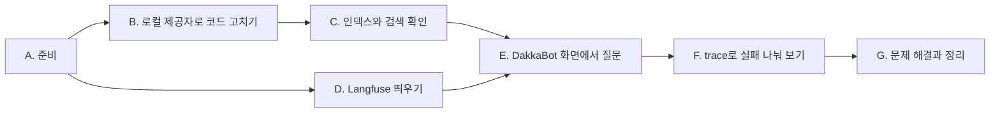

[12. LLM 기반 시스템 설계](/docs/tech/machine-learning-platform-engineering/12-llm-powered-systems/)에서 정리한 내용을 책의 코드로 직접 실행한 기록이다. 개념과 요점은 본문에 두고, 여기에는 명령, 실제 출력과 화면만 모았다.

## 실습 순서 {#book-ch12-sop}

로컬 모델을 준비하고, 저자 코드를 로컬 제공자로 고치고, 인덱스를 만든다. 그다음 Langfuse를 띄우고 Chainlit 화면에서 질문한 뒤, trace에서 검색과 생성을 나눠 본다. 아래 출력과 화면은 2026년 11월 8일 이 순서대로 실행해 얻었다. 실행 환경은 Windows 11 노트북(13세대 Core i7, RAM 64GB, GPU 없음), Docker Desktop, Ollama 0.40.12다. 쿠버네티스 클러스터는 쓰지 않는다.



| 구간 | 끝났을 때 남는 것 |
| --- | --- |
| A. 준비 | Ollama의 `llama3.2`, `nomic-embed-text`, 저자 코드 `ch12\dakkabot`, 가상환경 `ch12\venv` |
| B. 로컬 제공자로 코드 고치기 | 제공자를 고르는 `get_embeddings()`, `get_llm()`, trace span, 출처 표시, `.env` |
| C. 인덱스와 검색 확인 | `DATA\faiss_index`(청크 345개), 질문별 검색 거리 |
| D. Langfuse 띄우기 | `ch12-langfuse` 컨테이너 6개, 프로젝트 `dakkabot`과 API 키 |
| E. DakkaBot 화면에서 질문 | 근거 있는 답과 범위 밖 질문의 화면, 출처 패널 |
| F. trace로 실패 나눠 보기 | 검색 span, generation, 토큰과 비용 화면, 모델 크기 비교 |
| G. 문제 해결과 정리 | 멈춘 서버, 13장에서 다시 켜는 방법 |

명령은 PowerShell에서 실행한다. 작업 폴더 아래 `ch12\`를 만들고, 그 안에 저자 코드(`ch12\dakkabot`), 가상환경(`ch12\venv`), Langfuse 설정(`ch12\langfuse`)을 둔다. 폴더를 따로 적지 않은 명령은 작업 폴더에서 실행한다.

## A. 준비 {#ch12-a}

전체 그림의 ②, ⑤, ⑥이 쓸 모델과 코드를 준비한다.

### A-1. 디스크와 도구 확인 {#ch12-a-1}

1. 남은 디스크를 확인한다. 새로 필요한 공간은 `llama3.2` 2.0GB, `nomic-embed-text` 274MB, Langfuse 이미지 약 3.4GB(langfuse 1.03GB, worker 803MB, ClickHouse 1.19GB, MinIO 236MB, Redis 170MB, Postgres 17-alpine은 이미 있던 것을 썼다), 가상환경 약 250MB다. Docker 이미지는 Docker Desktop의 가상 디스크 파일 안에 쌓이는데, 이미지를 지워도 이 파일은 저절로 줄지 않는다.
   ```powershell
   "{0:N1} GB" -f ((Get-PSDrive C).Free/1GB)
   ```
2. Ollama를 설치하고 버전을 확인한다. 설치가 끝나면 백그라운드 서비스가 `http://127.0.0.1:11434`에서 요청을 기다린다.
   ```powershell
   winget install Ollama.Ollama
   ollama --version
   ```
   ```text
   ollama version is 0.40.12
   ```
3. Docker Desktop이 켜져 있는지 보고, Langfuse가 쓸 포트 3000, 9090과 Chainlit이 쓸 8000이 비어 있는지 확인한다. 아무것도 출력되지 않으면 비어 있다.
   ```powershell
   docker version --format '{{.Server.Version}}'
   Get-NetTCPConnection -State Listen -LocalPort 3000,8000,9090 -ErrorAction SilentlyContinue
   ```

### A-2. 모델 내려받기 {#ch12-a-2}

1. 생성 모델과 임베딩 모델을 받는다. 이번에는 `llama3.2`가 이미 있어서 `nomic-embed-text`만 새로 받았다. 디스크가 부족하면 `llama3.2:1b`(1.3GB)를 받고 B-4의 `OLLAMA_MODEL`을 바꾼다. 1B 모델로는 이 글을 검증하지 않았다.
   ```powershell
   ollama pull llama3.2
   ollama pull nomic-embed-text
   ollama list
   ```
   ```text
   NAME                       ID              SIZE      MODIFIED
   nomic-embed-text:latest    0a109f422b47    274 MB    14 seconds ago
   llama3.2:latest            a80c4f17acd5    2.0 GB    9 months ago
   gemma3:270m                e7d36fb2c3b3    291 MB    10 months ago
   ```
   관련 있는 줄만 남겼다. `gemma3:270m`은 원래 있던 모델이고 [F-5](#ch12-f-5)의 비교에만 쓴다. 따라 할 때는 `ollama pull gemma3:270m`(291MB)으로 받는다.

### A-3. 저자 코드와 가상환경 {#ch12-a-3}

1. 저자 저장소를 받고 이 글에서 확인한 커밋으로 고정한다.
   ```powershell
   git clone https://github.com/practical-mlops/dakkabot.git ch12\dakkabot
   git -C ch12\dakkabot checkout 8d16c23
   ```
   `DATA\docs_1.md`~`docs_5.md`는 DataKrypt라는 가상 회사의 사내 문서로, API 문서, 운영 절차, 보안 규정이 섞여 있다.
2. 가상환경을 만들고 패키지를 설치한다. 버전은 저자 `requirements.txt`를 따르고 `langchain-ollama`와 `tqdm`만 더했다. `guardrails-ai`, `deepeval`, `flashrank`는 13장 몫이라 지금은 설치하지 않는다. Gemini 패키지는 되돌릴 때를 대비해 남겨 둔다.
   ```powershell
   uv venv ch12\venv --python 3.12
   uv pip install --python ch12\venv langchain==0.3.26 langchain-community==0.3.27 langchain-google-genai==2.1.7 google-genai==1.25.0 faiss-cpu==1.11.0 dotenv==0.9.9 langfuse==3.1.3 chainlit==2.6.2 langchain-ollama==0.3.6 tqdm
   ```

완료 기준: `ollama list`에 두 모델이 보이고, `ch12\venv\Scripts\python.exe -c "import langchain_ollama, faiss, chainlit, langfuse; print('ok')"`가 `ok`를 출력한다.

## B. 로컬 제공자로 코드 고치기 {#ch12-b}

임베딩과 생성 제공자를 바꾸고, 관측과 출처 표시의 빈틈을 메운다(전체 그림의 ②, ⑤, ⑥, ⑧). 고칠 파일은 `ch12\dakkabot` 안의 세 개다.

### B-1. 임베딩: index.py {#ch12-b-1}

1. 파일 위쪽의 `from google import genai`, `from google.genai import types`를 지우고 `import os`를 더한다. Google 패키지는 Gemini를 쓸 때만 불러오도록 `GeminiEmbeddings.__init__` 안으로 옮기고, 모델 이름은 환경 변수에서 받는다.
   ```python
   class GeminiEmbeddings(Embeddings):
       def __init__(self):
           from google import genai
           from google.genai import types
           self.types = types
           # text-embedding-004 was shut down on 2026-01-14; set GEMINI_EMBED_MODEL=gemini-embedding-2
           self.model = os.getenv("GEMINI_EMBED_MODEL", "text-embedding-004")
           self.client = genai.Client()
       # embed_documents, embed_query: model=self.model, config=self.types.EmbedContentConfig(...)
   ```
2. 같은 자리에 로컬 임베딩 클래스와 선택 함수를 더한다. 책의 `task_type` 구분을 `nomic-embed-text`의 접두어로 옮긴 것이다.
   ```python
   class OllamaNomicEmbeddings(Embeddings):
       def __init__(self):
           from langchain_ollama import OllamaEmbeddings
           self.model = os.getenv("OLLAMA_EMBED_MODEL", "nomic-embed-text")
           self.client = OllamaEmbeddings(model=self.model)

       def embed_documents(self, texts: List[str]) -> List[List[float]]:
           embeddings = []
           for text in tqdm(texts, desc="Embedding documents"):
               embeddings.append(self.client.embed_query(f"search_document: {text}"))
           return embeddings

       def embed_query(self, text: str) -> List[float]:
           return self.client.embed_query(f"search_query: {text}")


   def get_embeddings() -> Embeddings:
       if os.getenv("EMBEDDING_PROVIDER", "ollama").lower() == "gemini":
           return GeminiEmbeddings()
       return OllamaNomicEmbeddings()


   INDEX_PATH = os.getenv("FAISS_INDEX_PATH", "./DATA/faiss_index")
   ```
3. `create_faiss_index`와 `load_index`의 `GeminiEmbeddings()`를 `get_embeddings()`로, `save_index`와 `load_index`의 기본 경로 `"./DATA/faiss_index"`를 `INDEX_PATH`로 바꾼다.

### B-2. 생성과 trace: dakka_bot_core.py {#ch12-b-2}

1. `ChatGoogleGenerativeAI` import와 `from index import GeminiEmbeddings`를 지우고, 제공자를 고르는 함수를 둔다.
   ```python
   from index import get_embeddings, INDEX_PATH


   def get_llm():
       if os.getenv("LLM_PROVIDER", "ollama").lower() == "gemini":
           from langchain_google_genai import ChatGoogleGenerativeAI
           return ChatGoogleGenerativeAI(
               model=os.getenv("GEMINI_MODEL", "gemini-2.5-flash"),
               temperature=0.0,
               google_api_key=os.environ["GEMINI_API_KEY"],
               convert_system_message_to_human=True
           )
       from langchain_ollama import ChatOllama
       return ChatOllama(
           model=os.getenv("OLLAMA_MODEL", "llama3.2"),
           temperature=0.0,
           # Ollama silently truncates prompts longer than num_ctx
           num_ctx=int(os.getenv("OLLAMA_NUM_CTX", "8192")),
       )
   ```
2. `initialize()`에서 임베딩, 인덱스 경로, 모델, Langfuse 키를 바꾼다. 키는 리스팅 12.19처럼 환경 변수에서 읽는다.
   ```python
   embeddings = get_embeddings()
   self.vector_store = FAISS.load_local(INDEX_PATH, embeddings=embeddings,
                                        allow_dangerous_deserialization=True)
   ...
   self.llm = get_llm()
   self.langfuse = Langfuse(
       public_key=os.environ["LANGFUSE_PUBLIC_KEY"],
       secret_key=os.environ["LANGFUSE_SECRET_KEY"],
       host=os.environ.get("LANGFUSE_HOST", "http://localhost:3000")
   )
   self.langfuse_handler = CallbackHandler()
   ```
3. `process_query_stream`의 본문을 span 하나로 감싸고, retriever에도 콜백을 넘긴다. `done`은 span을 닫은 **뒤에** 보내야 한다. Chainlit은 `done`을 받는 즉시 반복을 멈추므로, span이 그 뒤까지 열려 있으면 닫히지 못하고 OpenTelemetry가 `Failed to detach context` 오류를 낸다. 처음에 실제로 이 오류를 만났다. `process_query`에도 같은 방식으로 span(`dakkabot-query`)을 둔다.
   ```python
   try:
     with self.langfuse.start_as_current_span(name="dakkabot-query-stream", input={"query": query}) as span:
       docs = self.retriever.invoke(query, config={"callbacks": [self.langfuse_handler]})
       ...                                   # sources를 yield, context와 prompt 구성(저자 코드 그대로)
       answer = []
       async for chunk in self.llm.astream(prompt, config={"callbacks": [self.langfuse_handler]}):
           if chunk.content:
               answer.append(chunk.content)
               yield {"type": "token", ...}
       span.update(output="".join(answer))
       span.update_trace(input={"query": query}, output="".join(answer),
                         metadata={"doc_count": len(docs), "context_length": len(context)})
     self.langfuse.flush()
     yield {"type": "done", "content": None, "sources": sources, "doc_count": len(docs)}
   except Exception as e:
       ...
   ```
   들여쓰기가 두 칸인 것은 저자 코드의 나머지 줄을 건드리지 않고 `with`만 끼워 넣었기 때문이다. 새로 쓴다면 본문 전체를 한 단계 들여쓴다.

### B-3. 화면: chainlit_app_streaming.py {#ch12-b-3}

1. `from guardrail_helpers import validate_user_inputs`를 아래로 바꿔, 13장 전까지는 입력을 그대로 통과시킨다. 이 import가 `OTEL_SDK_DISABLED=true`를 설정해 Langfuse 기록을 꺼 버리기 때문이다.
   ```python
   import os

   if os.getenv("ENABLE_GUARDRAILS", "false").lower() == "true":
       from guardrail_helpers import validate_user_inputs
   else:
       def validate_user_inputs(text: str):
           return text, True
   ```
2. `chunk["type"] == "done"` 분기에서 `response_msg.send()` 앞에 출처를 붙인다. 답변 본문에 `cl.Text`의 `name`이 나오면 Chainlit이 그 이름을 원문을 여는 링크로 바꿔 준다.
   ```python
   if sources_info:
       names = []
       for src in sources_info["sources"]:
           name = f"[{src['index']}] {src['source']}"
           names.append(name)
           response_msg.elements.append(
               cl.Text(name=name, content=src["full_content"], display="side"))
       await response_msg.stream_token("\n\n**Sources:** " + ", ".join(names))
   ```

### B-4. 설정 파일 .env {#ch12-b-4}

1. `ch12\dakkabot\.env`를 만든다. 저자 저장소의 `.gitignore`가 이 파일을 제외해 준다. Langfuse 키는 D-1에서 Langfuse가 처음 뜰 때 만들어지게 할 로컬 전용 값이다.
   ```text
   LLM_PROVIDER=ollama
   OLLAMA_MODEL=llama3.2
   OLLAMA_NUM_CTX=8192
   EMBEDDING_PROVIDER=ollama
   OLLAMA_EMBED_MODEL=nomic-embed-text
   FAISS_INDEX_PATH=./DATA/faiss_index
   LANGFUSE_PUBLIC_KEY=pk-lf-ch12-local
   LANGFUSE_SECRET_KEY=sk-lf-ch12-local
   LANGFUSE_HOST=http://localhost:3000
   ```

완료 기준: `ch12\dakkabot`에서 `..\venv\Scripts\python.exe -c "import sys; sys.path.insert(0,'.'); import index, dakka_bot_core; print('import ok')"`가 `import ok`를 출력한다.

## C. 인덱스와 검색 확인 {#ch12-c}

생성 모델 없이 검색부터 확인한다. 그림으로는 ①~③과 ⑤다. 검색이 맞아야 뒤 단계의 결과를 해석할 수 있다.

### C-1. 인덱스 만들기 {#ch12-c-1}

1. 저자 코드 폴더에서 `index.py`를 실행한다. 문서를 읽어 자르고, 청크마다 임베딩을 받아 FAISS 인덱스로 저장한 뒤, 시험 질문 하나로 검색까지 해 본다.
   ```powershell
   cd ch12\dakkabot
   ..\venv\Scripts\python.exe index.py
   ```
   ```text
   INFO:__main__:Loaded 5 documents
   INFO:__main__:Created 345 chunks
   INFO:__main__:Creating FAISS index with OllamaNomicEmbeddings...
   Embedding documents: 100%|##########| 345/345 [01:31<00:00,  3.76it/s]
   INFO:__main__:Created index with 345 chunks
   INFO:__main__:Saved index to ./DATA/faiss_index
   INFO:__main__:Found 3 results:
   INFO:__main__:1. encryption_result, test_data
   INFO:__main__:2. **Diagnosis:**
   INFO:__main__:3. # Key Management
   ```
   httpx 요청 로그는 뺐다. 청크 345개를 하나씩 임베딩하는 데 CPU로 1분 31초가 걸렸다. 책이 "인덱스를 매번 다시 만들 수 없다"며 저장을 강조하는 이유를 여기서 체감한다. 상용 API였다면 시간에 더해 요청 수만큼 비용도 들었을 것이다.
2. 저장된 파일을 확인한다.
   ```powershell
   Get-ChildItem DATA\faiss_index | Select-Object Name, Length
   ```
   ```text
   Name         Length
   ----         ------
   index.faiss 1059885
   index.pkl    294104
   ```
   `index.faiss`의 크기는 345개 × 768차원 × 4바이트(float32)에 머리글을 더한 값이다. `index.pkl`에는 청크 원문과 `source` 메타데이터가 들어 있다.

### C-2. 검색 거리 보기 {#ch12-c-2}

1. 질문마다 상위 5개 청크와 거리를 찍는 `retrieval_probe.py`를 `ch12\dakkabot`에 만든다.
   ```python
   import sys
   sys.stdout.reconfigure(encoding="utf-8")
   from dotenv import load_dotenv; load_dotenv()
   from langchain_community.vectorstores import FAISS
   from index import get_embeddings, INDEX_PATH

   store = FAISS.load_local(INDEX_PATH, get_embeddings(), allow_dangerous_deserialization=True)
   questions = sys.argv[1:] or [
       "How do I rotate encryption keys?",
       "How often should production API keys be rotated?",
       "What is the capital of Australia?",
   ]
   for q in questions:
       print(f"\n## {q}")
       for doc, dist in store.similarity_search_with_score(q, k=5):
           first = doc.page_content.strip().splitlines()[0][:60]
           print(f"  L2={dist:.3f}  {doc.metadata['source']}  | {first}")
   ```
2. 실행한다.
   ```powershell
   ..\venv\Scripts\python.exe retrieval_probe.py
   ```
   ```text
   ## How do I rotate encryption keys?
     L2=0.558  DATA\docs_4.md  | encryption_result, test_data
     L2=0.570  DATA\docs_1.md  | **Diagnosis:**
     L2=0.611  DATA\docs_1.md  | # Key Management
     L2=0.641  DATA\docs_1.md  | #### key-management-service API Reference
     L2=0.648  DATA\docs_1.md  | 5. **Post-Incident (24-72 hours)**

   ## How often should production API keys be rotated?
     L2=0.389  DATA\docs_1.md  | 5. **Post-Incident (24-72 hours)**
     L2=0.629  DATA\docs_1.md  | #### key-management-service API Reference
     L2=0.631  DATA\docs_1.md  | # Key Management
     L2=0.667  DATA\docs_1.md  | **Diagnosis:**
     L2=0.732  DATA\docs_2.md  | **Query Parameters:**

   ## What is the capital of Australia?
     L2=0.936  DATA\docs_5.md  | 'geographic_location': 'US_CA'
     L2=0.951  DATA\docs_1.md  | cpu: "250m"
     L2=0.988  DATA\docs_2.md  | **Query Parameters:**
     L2=0.994  DATA\docs_3.md  | 'estimated_value': current_usage['monthly_spend'] * 0.8,
     L2=0.998  DATA\docs_4.md  | ### ai-service API Reference
   ```
   첫 질문의 4번째 청크에는 키 교체 API(`POST /rotate/{key_id}`)가, 5번째 청크에는 **API 키** 교체 주기와 절차가 들어 있다. 암호화 키를 물었는데 API 키 절차까지 따라 들어간다는 뜻이다. 그 영향은 E-2의 답에서 드러난다. 세 번째 질문은 거리가 모두 0.93 이상인데도 5개가 그대로 돌아온다.

완료 기준: `DATA\faiss_index`에 두 파일이 있고, 문서 안 질문과 범위 밖 질문의 거리 차이를 설명할 수 있다.

## D. Langfuse 띄우기 {#ch12-d}

지금 위치는 전체 그림의 ⑧, ⑨다. 기록을 받을 곳을 만든다. 책처럼 Langfuse 저장소의 `docker-compose.yml`을 쓰되, 이 PC 사정에 맞춰 덮어쓰는 파일을 하나 더 둔다.

### D-1. compose 파일과 덮어쓰기 {#ch12-d-1}

1. 책은 저장소 전체를 `git clone`하지만 실제로 필요한 것은 compose 파일 하나다. 이 글에서 확인한 커밋의 파일만 받는다.
   ```powershell
   mkdir ch12\langfuse
   Invoke-WebRequest https://raw.githubusercontent.com/langfuse/langfuse/b9529a9336d5854d5970b7b1c91b8d92a41db5dd/docker-compose.yml -OutFile ch12\langfuse\docker-compose.yml
   ```
   이 파일은 Langfuse v4 기준이다. web과 worker에 더해 ClickHouse(trace 저장), Postgres(사용자, 프로젝트, 키), Redis(작업 큐), MinIO(원본 이벤트와 미디어)를 함께 띄운다. 책 이후에 생긴 AI gateway 서비스도 들어 있다.
2. 버전을 고정하는 `ch12\langfuse\.env`를 만든다. Postgres는 이미 있던 `17-alpine` 이미지를 쓰게 했다.
   ```text
   POSTGRES_VERSION=17-alpine
   LANGFUSE_IMAGE_TAG=4.76.0
   ```
3. `ch12\langfuse\docker-compose.override.yml`을 만든다. 원본은 ClickHouse를 호스트 9000, Redis를 6379, Postgres를 5432에 연다. 이 PC에서는 앞 장의 클러스터 포트포워딩이 9000과 6379를 차지하고 있어 그대로는 뜨지 않았다. 컨테이너끼리만 쓰는 포트라 호스트에 열 필요가 없으니 지운다(`!reset`, `!override`는 Compose 2.24 이상). 처음 뜰 때 조직, 프로젝트, 관리자, API 키를 만들게 하는 `LANGFUSE_INIT_*` 값도 넣는다. 책처럼 화면에서 가입하고 키를 만들어도 결과는 같다.
   ```yaml
   services:
     langfuse-worker:
       ports: !reset []
       environment:
         TELEMETRY_ENABLED: "false"
     langfuse-web:
       environment:
         TELEMETRY_ENABLED: "false"
         LANGFUSE_INIT_ORG_ID: ch12-org
         LANGFUSE_INIT_ORG_NAME: DataKrypt
         LANGFUSE_INIT_PROJECT_ID: ch12-dakkabot
         LANGFUSE_INIT_PROJECT_NAME: dakkabot
         LANGFUSE_INIT_PROJECT_PUBLIC_KEY: pk-lf-ch12-local
         LANGFUSE_INIT_PROJECT_SECRET_KEY: sk-lf-ch12-local
         LANGFUSE_INIT_USER_EMAIL: admin@datakrypt.local
         LANGFUSE_INIT_USER_NAME: admin
         LANGFUSE_INIT_USER_PASSWORD: ch12-local-password
     clickhouse:
       ports: !reset []
     redis:
       ports: !reset []
     postgres:
       ports: !reset []
     minio:
       ports: !override
         - 127.0.0.1:9090:9000
   ```
   원본 파일에 `# CHANGEME`로 표시된 비밀번호(Postgres, ClickHouse, Redis, MinIO, `NEXTAUTH_SECRET`, `SALT`, `ENCRYPTION_KEY`)는 로컬 실습이라 그대로 뒀다. 다른 사람이 접근할 수 있는 곳에 띄운다면 전부 바꿔야 한다.

### D-2. 실행과 로그인 {#ch12-d-2}

1. web과 worker만 지정해 띄운다. 의존하는 저장소 서비스는 같이 뜨고, AI gateway는 내려받지도 띄우지도 않는다. 프로젝트 이름 `ch12-langfuse`는 컨테이너와 볼륨 이름 앞에 붙는다.
   ```powershell
   cd ch12\langfuse
   docker compose -p ch12-langfuse up -d langfuse-web langfuse-worker
   ```
   ```text
    Container ch12-langfuse-redis-1 Healthy
    Container ch12-langfuse-minio-1 Healthy
    Container ch12-langfuse-clickhouse-1 Healthy
    Container ch12-langfuse-langfuse-worker-1 Started
    Container ch12-langfuse-langfuse-web-1 Started
   ```
   처음에는 이미지를 내려받느라 몇 분 걸린다.
2. 상태를 확인한다.
   ```powershell
   (Invoke-WebRequest http://localhost:3000/api/public/health -UseBasicParsing).Content
   ```
   ```text
   {"status":"OK","version":"4.76.0"}
   ```
3. http://localhost:3000 에 `admin@datakrypt.local`, `ch12-local-password`로 로그인하면 조직 DataKrypt 아래에 프로젝트 `dakkabot`이 보인다. trace는 아직 없다.

완료 기준: health가 `OK`이고 로그인할 수 있다.

## E. DakkaBot 화면에서 질문 {#ch12-e}

질문 하나가 검색, 생성, 스트리밍, 기록을 모두 거친다. 전체 그림의 ④~⑧이 한 번에 지나간다.

### E-1. Chainlit 실행 {#ch12-e-1}

1. 새 터미널에서 저자 코드 폴더로 가서 Chainlit을 띄운다. 책의 `chainlit run`과 같고, `--headless`는 브라우저를 자동으로 열지 않게 하는 옵션이다. 이 터미널은 E와 F를 마칠 때까지 열어 둔다.
   ```powershell
   cd ch12\dakkabot
   ..\venv\Scripts\chainlit.exe run chainlit_app_streaming.py --headless --port 8000
   ```
   ```text
   2026-11-08 10:00:37 - Loaded .env file
   2026-11-08 10:00:39 - Your app is available at http://localhost:8000
   ```
2. http://localhost:8000 을 연다. 저자 코드의 시작 메시지 "DakkaBot is starting up...", "DakkaBot Ready!"가 차례로 뜬다. 그사이 `initialize()`가 FAISS 인덱스를 읽고 Langfuse 클라이언트를 만든다.

### E-2. 문서에 답이 있는 질문 {#ch12-e-2}

1. `How do I rotate encryption keys?`를 보낸다. "Searching DataKrypt documentation..."이 "Found 5 relevant documents. Generating response..."로 바뀌고, 첫 토큰이 오면 그 문구가 사라지며 답이 흘러나온다. 답이 끝나기까지 57초가 걸렸다.

   

   1단계의 엔드포인트와 요청 본문은 C-2의 4번째 청크(`key-management-service API Reference`)에 그대로 있다. 여기까지는 근거가 있다.
2. 답 끝까지 내려 출처를 본다.

   ![DakkaBot 답변 끝부분. 새 키 확인 curl 예시와 Additional Tips 아래에 Sources 줄로 [1] DATA\docs_4.md, [2]~[5] DATA\docs_1.md가 붙어 있다.](/images/ml-platform-engineering/sop/ch12-chat-grounded-sources.png)

   "Sources" 줄은 B-3에서 더한 것이다. 저자 코드 그대로라면 이 줄이 없다.
3. 출처 이름을 누르면 오른쪽 패널에 그 청크 원문이 열린다.

   ![[1] DATA\docs_4.md 출처 패널. 청크 원문은 key-management-service의 rotate_key를 호출하는 통합 테스트 코드다.](/images/ml-platform-engineering/sop/ch12-chat-source-panel.png)

   가장 가까운 청크는 절차 문서가 아니라 **테스트 코드**였다. 사람에게 방법을 알려 주는 문서보다, 같은 단어가 자주 나오는 코드가 더 가깝게 잡힌 것이다. 3단계 "새 키로 애플리케이션 갱신"과 4단계 "새 키 확인"은 5번째 청크의 **API 키** 교체 절차에서 왔다. 3단계에 붙은 Deployment YAML(`apiVersion: v1`)은 어느 청크에도 없다. 화면으로는 출처 5개가 붙은 근거 있는 답이다. 실제로는 근거 있는 부분, 다른 절차가 섞인 부분, 지어낸 부분이 한데 있다. [실패를 나눠 보는 기준](/docs/tech/machine-learning-platform-engineering/12-llm-powered-systems/#failure-taxonomy)의 문맥 구성 오류와 환각에 해당한다.

### E-3. 문서에 답이 없는 질문 {#ch12-e-3}

1. `What is the capital of Australia?`를 보낸다.

   

   이번에는 답하지 않았다. 그래도 C-2에서 본 대로 거리가 0.93 이상인 무관한 청크 5개가 "출처"로 붙었다. 사용자가 이 출처를 근거로 믿으면 오해가 생긴다.
2. 같은 질문을 UI 없이 동기 래퍼로 보낸다. 13장의 테스트 도구가 쓰는 함수다.
   ```powershell
   ..\venv\Scripts\python.exe -c "import sys; sys.path.insert(0,'.'); from dotenv import load_dotenv; load_dotenv('.env'); from dakka_bot_core import dakka_bot_query; print(dakka_bot_query('What is the capital of Australia?'))"
   ```
   이 질문을 UI로 두 번, 동기 래퍼로 두 번 보냈다. 네 번 모두 같은 프롬프트(입력 665토큰)에 temperature 0이었다. 세 번은 위 화면처럼 거절했고, 동기 래퍼로 보낸 한 번은 마지막 문단에서 이렇게 답했다.
   ```text
   If you're looking for general information on Australia's capital, I can try to provide that as well.
   According to my knowledge, the capital of Australia is Canberra.
   ```
   "DataKrypt 정보에 집중하라"는 지시가 있어도 모델의 일반 지식은 새어 나온다. 새어 나올지 말지도 실행마다 다르다. 거절을 보장하려면 거리 임계값으로 생성 전에 막거나, 13장의 가드레일과 평가로 확인해야 한다.

완료 기준: 두 질문의 답과 출처를 화면에서 보았고, 첫 답에서 근거 있는 부분과 섞인 부분을 가려낼 수 있다.

## F. trace로 실패 나눠 보기 {#ch12-f}

D에서 띄운 ⑧, ⑨로 돌아와, E에서 본 답이 어느 단계에서 어떻게 만들어졌는지 Langfuse에서 따라간다.

### F-1. trace 목록과 트리 {#ch12-f-1}

1. Langfuse의 Tracing 화면에서 Name 필터를 `dakkabot-query-stream`으로 고른다. UI에서 보낸 질문은 이 이름으로, 동기 래퍼로 보낸 질문은 `dakkabot-query`로 남는다.

   

2. 암호화 키 질문의 행을 누른다.

   

   57초 가운데 검색은 0.06초이고 나머지는 전부 생성이다. 지연을 줄이려면 검색이 아니라 모델과 프롬프트 길이를 봐야 한다. 저자 코드 그대로였다면 이 트리에는 `ChatOllama` 하나만 있고, 검색이 무엇을 돌려줬는지는 남지 않는다.

### F-2. 검색 span {#ch12-f-2}

1. 트리에서 `VectorStoreRetriever`를 누른다.

   

   출력 문서 5개를 차례로 펼치면 C-2와 같은 청크들이다. 답에 섞여 든 API 키 절차가 다섯 번째 문서에 있다는 것도 여기서 보인다. 필요한 근거를 찾았는지, 즉 검색 누락인지는 이 span에서 판단한다.

### F-3. generation {#ch12-f-3}

1. 트리에서 `ChatOllama`를 누른다.

   

   모델이 실제로 받은 프롬프트다. 검색 결과가 프롬프트에 제대로 들어갔는지, 즉 문맥 구성 오류인지는 여기서 본다. `**Documentation Context:**`가 코드 블록으로 보이는 것은 [문맥 구성](/docs/tech/machine-learning-platform-engineering/12-llm-powered-systems/#augmentation-grounding)에서 말한 f-string 들여쓰기 탓이다. Gemini에서는 시스템 지시를 사람 메시지로 바꾸는 `convert_system_message_to_human=True`가 필요했다. 이 코드는 처음부터 프롬프트 전체를 사용자 메시지 하나로 보내므로 Ollama에서도 구조가 같다.
2. 트리의 1,854 tokens는 입력과 출력을 합한 값이다. 단계별 시간, 첫 토큰 시간, 토큰 수를 한눈에 보려면 Langfuse가 쓰는 ClickHouse 표를 직접 조회한다. Langfuse v4는 예전 `GET /api/public/traces` 대신 이 이벤트 표를 쓴다. 아래는 E-2, E-3의 두 trace다(출력 앞 6줄).
   ```powershell
   docker exec ch12-langfuse-clickhouse-1 clickhouse-client --user clickhouse --password clickhouse -q "SELECT substring(trace_id,1,8), name, round(dateDiff('millisecond', start_time, end_time)/1000,2) sec, round(dateDiff('millisecond', start_time, completion_start_time)/1000,2) ttft, usage_details FROM events_core WHERE start_time > '2026-11-08 01:05:00' ORDER BY start_time FORMAT PrettyCompact"
   ```
   ```text
       ┌─substring(trace_id, 1, 8)─┬─name──────────────────┬───sec─┬──ttft─┬─usage_details────────────────────────────┐
    1. │ 581073be                  │ dakkabot-query-stream │ 57.27 │  ᴺᵁᴸᴸ │ {}                                       │
    2. │ 581073be                  │ VectorStoreRetriever  │  0.06 │  ᴺᵁᴸᴸ │ {}                                       │
    3. │ 581073be                  │ ChatOllama            │ 57.21 │   0.2 │ {'input':1244,'output':610,'total':1854} │
    4. │ 2ed557d5                  │ dakkabot-query-stream │ 13.04 │  ᴺᵁᴸᴸ │ {}                                       │
    5. │ 2ed557d5                  │ VectorStoreRetriever  │  0.05 │  ᴺᵁᴸᴸ │ {}                                       │
    6. │ 2ed557d5                  │ ChatOllama            │ 12.99 │  0.26 │ {'input':665,'output':155,'total':820}   │
   ```
   시간대는 UTC다. 범위 밖 질문(665토큰)이 문서 질문(1,244토큰)보다 입력이 짧은 것은 짧은 청크들이 검색됐기 때문이다. 첫 토큰 시간(`ttft`)이 0.2초대로 나온 것은 직전에 같은 프롬프트를 처리한 Ollama가 앞부분 계산을 재사용했기 때문으로 보인다. 처음 받는 질문의 대기 시간으로 읽으면 안 된다.

### F-4. 토큰과 비용 {#ch12-f-4}

1. 왼쪽 메뉴 Home을 연다.

   

   책의 그림 12.8은 Gemini 호출이라 비용이 달러로 쌓인다. 여기서는 `llama3.2`의 단가가 없어 토큰 7.76K에 $0이다. 로컬 모델에도 비교용 비용을 매기고 싶다면 Settings의 Models에서 모델 이름과 토큰 단가를 직접 등록한다. 이번에는 등록하지 않았다.

### F-5. 모델만 바꿔 생성 오류 만들기 {#ch12-f-5}

1. Chainlit은 그대로 두고 다른 터미널에서, 모델만 `gemma3:270m`으로 바꿔 같은 질문을 보낸다. `load_dotenv`는 이미 있는 환경 변수를 덮어쓰지 않으므로 터미널에서 지정한 값이 이긴다.
   ```powershell
   cd ch12\dakkabot
   $env:OLLAMA_MODEL = "gemma3:270m"
   ..\venv\Scripts\python.exe -c "import sys; sys.path.insert(0,'.'); from dotenv import load_dotenv; load_dotenv('.env'); from dakka_bot_core import dakka_bot_query; print(dakka_bot_query('How often should production API keys be rotated?'))"
   Remove-Item Env:OLLAMA_MODEL
   ```
   ````text
   ```json
   {
     "activities": [
       {
         "activity_id": "string",
         "user_id": "string",
         "activity_type": "api_call",
   ...
   ````
   `llama3.2`는 같은 질문에 "every 90 days"라고 답했다. 두 trace의 `VectorStoreRetriever` 출력은 같고 generation 출력만 다르다. 검색은 맞고 생성이 틀린 경우는 trace에서 이렇게 보인다. 두 모델의 결과는 [생성](/docs/tech/machine-learning-platform-engineering/12-llm-powered-systems/#generation)의 표에 정리했다.

완료 기준: trace 하나에서 검색 span과 generation을 열어, E-2 답의 각 부분이 어느 청크에서 왔는지, 혹은 어디에도 없는지 짚을 수 있다.

## G. 문제 해결과 정리 {#ch12-g}

### G-1. 자주 만나는 실패 {#ch12-g-1}

| 증상 | 위치 | 원인과 조치 |
| --- | --- | --- |
| `ModuleNotFoundError: No module named 'tqdm'` | `index.py` | 저자 `requirements.txt`에 없다. `uv pip install tqdm` |
| `ModuleNotFoundError: No module named 'guardrails'` | Chainlit 시작 | `guardrail_helpers` import. B-3처럼 13장 전까지 import하지 않는다 |
| 스크립트로는 trace가 남는데 Chainlit에서만 안 남음 | Langfuse | `guardrail_helpers`가 `OTEL_SDK_DISABLED=true`를 설정했다. B-3 |
| trace에 `ChatOllama`만 있고 검색이 없음 | Langfuse | retriever에 콜백을 넘기지 않았다. B-2 |
| `Failed to detach context`, 스트리밍 trace가 늦게 또는 오류와 함께 도착 | Chainlit 터미널 | span이 `done` 뒤까지 열려 있다. B-2 |
| `Failed to export spans batch due to timeout` | Python 터미널 | Langfuse가 꺼져 있다. 답은 정상으로 나오고 기록만 빠진다. D-2 |
| `docker compose up`에서 포트 할당 실패 | Langfuse | 9000(ClickHouse), 6379(Redis), 5432(Postgres)가 이미 쓰인다. D-1의 override |
| `GET /api/public/traces`가 "events_only mode" 오류 | Langfuse API | v4는 예전 조회 API를 막았다. 화면이나 ClickHouse로 본다 |
| 답이 엉뚱한 문서를 근거로 함, 오류 없음 | 검색 | 인덱스를 만든 임베딩과 검색 임베딩이 다르다. 차원이 같으면 오류가 안 난다. 인덱스를 다시 만든다 |
| 긴 문맥에서 답이 앞부분 지시를 무시함 | Ollama | `num_ctx`보다 긴 프롬프트가 잘렸다. `OLLAMA_NUM_CTX` 확인 |
| Gemini로 바꾸자 인덱싱에서 모델 없음 오류 | Gemini | `text-embedding-004` 종료. `GEMINI_EMBED_MODEL` 지정. 이번 실습에서는 키가 없어 실행하지 않았다 |

이번 실행에서 실제로 부딪힌 것은 `tqdm`, Chainlit에서만 trace가 없던 문제, 검색 없는 trace, `Failed to detach context`, Langfuse가 꺼졌을 때의 export 오류, `events_only mode` 응답이다. 포트 충돌은 실행 전에 열린 포트를 보고 override로 피했다. 임베딩 불일치, `num_ctx` 잘림, Gemini 오류는 코드와 문서를 읽고 판단한 것이다.

### G-2. 정리 {#ch12-g-2}

1. Chainlit 터미널을 `Ctrl+C`로 멈춘다.
2. Langfuse를 멈춘다. `stop`은 데이터를 남기고, `down -v`는 컨테이너와 볼륨(trace)까지 지운다.
   ```powershell
   cd ch12\langfuse
   docker compose -p ch12-langfuse stop
   ```
3. 13장은 이 DakkaBot과 Langfuse를 그대로 이어 쓴다. 다시 켤 때는 D-2의 `docker compose -p ch12-langfuse up -d langfuse-web langfuse-worker`와 E-1의 `chainlit run`을 실행한다. 메모리에 올라간 Ollama 모델은 몇 분 뒤 저절로 내려가고, 바로 내리려면 `ollama stop llama3.2`를 실행한다.
4. 완전히 지우려면 아래를 실행한다. `llama3.2`를 다른 데서 쓰지 않는다면 함께 지운다.
   ```powershell
   docker compose -p ch12-langfuse down -v
   docker image rm docker.langfuse.com/langfuse/langfuse:4.76.0 docker.langfuse.com/langfuse/langfuse-worker:4.76.0 clickhouse/clickhouse-server:26.3.62.3 cgr.dev/chainguard/minio:latest redis:7
   ollama rm nomic-embed-text
   ```
