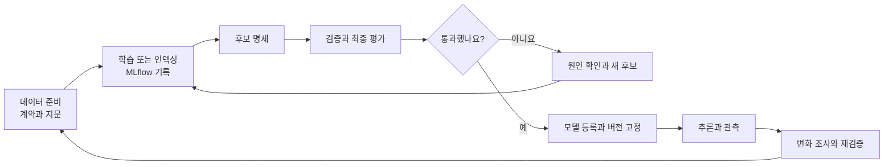

『Machine Learning Platform Engineering』을 읽으면서 도구가 맡는 역할은 이해해도, 직접 조건을 바꾸거나 오류를 만났을 때 어디부터 확인해야 할지는 별도로 연습해야겠다고 느꼈습니다. 책에서 다루는 흐름을 실제 코드로 이어서 실행할 수 있도록 [실습 저장소](https://github.com/johklo/ml-platform-engineering-labs)를 만들었습니다.

책은 도구 이름만 소개하는 수준은 아닙니다. MLflow와 Feast, Kubeflow Pipelines와 BentoML을 연결하고, 객체 탐지와 추천, RAG로 확장합니다. 다만 안내된 경로를 따라 실행하는 것과 요구사항이 바뀌어도 스스로 설계하고 복구하는 것은 다른 단계입니다. 이번 실습은 그 사이를 연습하는 자료입니다.

## 기존 글에서 이어지는 부분

Bookway라는 별도 가상 서점의 도구별 설계는 [MLOps](../mlops/), [LLMOps](../llmops/) 가이드에 정리했습니다. 아래 실행 프로젝트의 데이터와 결과는 그대로 구분합니다.

[MLflow와 Azure Machine Learning 기초 과정](../../mlflow-azure-machine-learning/)은 Wine 분류 모델 하나로 실험 기록, 모델 로딩과 등록을 익히는 출발점으로 그대로 활용합니다.

새 저장소에서는 복사해야 하는 코드 조각 대신 실행 가능한 패키지를 제공합니다. 데이터 계약과 지문, 후보 명세와 평가 보고서, 등록 버전이 서로 연결됩니다. 정상 실행 이후에는 잘못된 데이터나 통과하지 못한 평가를 넣어 어디서 차단되는지도 확인합니다.

## 세 프로젝트로 나눈 이유

| 프로젝트 | 배우는 흐름 | 구분할 점 |
| --- | --- | --- |
| 영화 추천 | 시간 분할, SVD, MLflow, 등록과 추천 API | 평점 오차와 추천 순위 품질은 다릅니다 |
| 합성 카드 탐지 | 이미지와 라벨, 기준선, YOLO, 검증과 추론 | 카드 위치 탐지는 OCR이 아닙니다 |
| 문서 검색과 RAG | 검색 인덱스, 근거 인용, 생성 연결과 평가 | 검색 성공과 답변의 사실성은 다릅니다 |

처음에는 작은 합성 데이터로 전체 연결을 확인합니다. 영화 추천은 직접 내려받은 MovieLens를 가져오는 과정도 제공합니다. 합성 카드의 높은 점수를 실제 신분증 사진의 성능으로 해석하거나, 짧은 합성 문서의 검색 결과를 업무용 RAG 품질로 해석하지는 않습니다.



## 먼저 실행해 보기

Python 3.11 또는 3.12, Git과 uv를 준비합니다. PowerShell에서는 다음 순서로 시작합니다.

```powershell
git clone https://github.com/johklo/ml-platform-engineering-labs.git
Set-Location ml-platform-engineering-labs
uv sync --locked --extra dev
uv run ml-labs smoke --work .ml-labs/first-run
```

GPU나 클라우드 계정 없이 세 프로젝트의 준비, 모델 저장, 평가와 등록을 연결합니다. `.ml-labs/first-run`에 후보 명세와 보고서가 남고 등록된 모델 URI가 출력됩니다. 다시 실행할 때는 새로운 작업 경로를 사용합니다.

여기서 기본 카드 모델은 색상 규칙 기준선이고, 로컬 문서 응답은 LLM 생성이 아닌 검색 문장 인용입니다. 빠른 연결 확인과 실제 도구 학습을 혼동하지 않도록 별도 과정으로 나눴습니다.

## 도구별로 이어서 실습하기

| 순서 | 가이드 |
| --- | --- |
| 00 | [실행 구조와 출처 기록](ml-platform-labs-00-foundation/) |
| 01 | [영화 추천과 MovieLens](ml-platform-labs-01-movies/) |
| 02 | [합성 카드 탐지와 YOLO](ml-platform-labs-02-cards/) |
| 03 | [Feast의 과거 시점과 온라인 피처](ml-platform-labs-03-feast/) |
| 04 | [Kubeflow와 Azure ML 파이프라인](ml-platform-labs-04-pipelines/) |
| 05 | [BentoML, HTTP 서빙과 Evidently](ml-platform-labs-05-serving-monitoring/) |
| 06 | [RAG와 LLMOps 도구 연결](ml-platform-labs-06-rag-llmops/) |
| 07 | [Azure 구성과 실행 절차](ml-platform-labs-07-azure/) |
| 08 | [책과의 대응 및 검증 범위](ml-platform-labs-08-coverage/) |
| 09 | [피처 조회, 출시와 장애 복구 통합 실험](ml-platform-labs-09-integrated-operations/) |
| 10 | [RAG 변경 평가와 출시 및 복구](ml-platform-labs-10-rag-release/) |

각 과정은 이 통합 실습 페이지 아래의 하위 아티클로 게시합니다. 한 번에 모든 도구를 설치하지 않고 필요한 단계에서 선택 의존성을 추가합니다. 도구마다 입력, 출력과 실패 기준을 확인한 뒤 다음 단계로 넘어가는 순서입니다.

09편에서는 MLflow 후보 비교에서 실제 Feast 기반 요청 분기, 배치 재시도와 출시 복구까지 하나로 실행합니다. 단순히 도구가 설치되었는지를 확인하는 대신 피처 공급 전후의 응답과 실패 이후 상태가 어떻게 달라지는지 근거를 남깁니다.

## Azure에서 달라지는 부분

Azure ML 작업은 독립된 실행 환경에서 데이터를 주고받습니다. 내 PC의 파일 경로나 SQLite 주소를 그대로 넘기는 방식으로는 연결되지 않습니다. 작업의 입력과 출력, workspace의 tracking URI와 코드 커밋을 명시하도록 구성했습니다.

파이프라인 YAML과 Bicep을 로컬에서 생성하고 검토하는 단계와, 실제 리소스를 배포하거나 작업을 제출하는 단계는 구분합니다. Azure ML managed endpoint용 모델 내보내기와 배포 스크립트도 제공합니다.

이번 작업에서는 Azure 리소스를 생성하지 않았습니다. 클라우드 배포 성공을 확인한 환경으로 소개하지 않으며, 실행 시에는 지역별 모델 지원, quota, 권한과 비용을 먼저 확인해야 합니다.

## 학습 범위의 경계

이 자료는 책 전체 도구의 모든 기능을 구현한 운영 플랫폼은 아닙니다. 무중단 트래픽 전환, 문서별 접근 통제, 의미 기반 답변 캐시와 운영용 대시보드처럼 추가 구현이 필요한 부분은 [대응표](ml-platform-labs-08-coverage/)에 구분했습니다.

로컬 출시 과정에서는 평가를 통과한 후보만 활성화하고, 포인터 전환 실패에서 기존 버전이 유지되는지 확인합니다. RAG도 프롬프트, 문서와 검색 설정을 고정한 후보를 평가하고, 품질이 떨어지는 변경은 거절합니다. 이 로컬 게이트는 조직의 승인 절차나 클라우드의 무중단 운영을 대신하지 않습니다.

목표는 도구를 많이 설치하는 것이 아니라, 어떤 변경이 어떤 결과를 만들었는지 근거를 남기고 설명하는 것입니다. 정상 동작을 본 다음 실패 원인과 복구까지 확인하면 책에서 읽은 구조를 더 구체적으로 이해할 수 있습니다.

[책 읽기 지도](../../machine-learning-platform-engineering/00-overview/) / [실습 저장소](https://github.com/johklo/ml-platform-engineering-labs)
