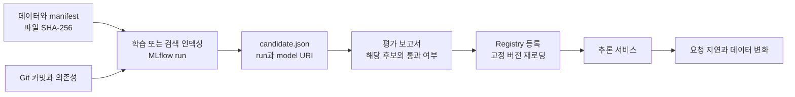

실험을 요리라고 생각하면 모델은 완성된 음식이고, 코드와 데이터, 환경은 조리법과 재료입니다. 음식 사진만 남겨서는 같은 요리를 다시 만들기 어렵습니다. MLflow의 run은 이 재료와 결과를 연결하는 실행 기록입니다.

이번 과정의 목표는 모델 점수를 높이는 것에 앞서, 결과 하나에서 어떤 데이터와 설정을 사용했는지 되짚을 수 있게 만드는 것입니다.

## 준비와 환경

README의 설치를 마치고 저장소 루트에서 작업합니다. Python 3.13은 지원하지 않습니다. 환경을 다시 만들려면 `uv sync --locked --extra dev`를 사용합니다. `uv.lock`은 선택 도구의 버전까지 고정하지만, 서로 충돌하는 extras를 동시에 설치할 수 있다는 뜻은 아닙니다.

Windows에서는 기본 CPU 과정을 PowerShell에서 실행할 수 있습니다. Kubernetes 클러스터와 컨테이너 빌드는 Docker Desktop의 Linux 컨테이너 환경이나 별도 Linux 호스트가 필요합니다. Python 환경이 동작한다고 Docker 엔진도 실행되는 것은 아닙니다.

데이터 준비 명령은 비어 있지 않은 출력 폴더를 덮어쓰지 않습니다. 이전 이미지가 섞이거나 데이터 출처가 바뀌는 일을 막기 위한 동작입니다. 다시 실행할 때는 새 데이터 경로나 새 `--work` 경로를 사용하세요.

```powershell
uv run ml-labs --help
uv run ml-labs smoke --work .ml-labs/first-run
Get-Content .ml-labs/first-run/runs/movies/candidate.json
Get-Content .ml-labs/first-run/reports/movies.json
```

작업 디렉터리에는 아래 관계가 만들어집니다.



`manifest.json`은 파일 내용의 지문입니다. `candidate.json`은 모델 파일 자체가 아니라 모델을 찾는 주소와 평가 전 정보를 담은 명세입니다. 평가 보고서는 특정 후보에 연결됩니다. 다른 실행의 통과 보고서를 가져와도 등록되면 안 됩니다.

## MLflow 화면에서 확인하기

```powershell
$db = (Resolve-Path .ml-labs/first-run/tracking/tracking.db).Path.Replace('\', '/')
uv run mlflow ui --backend-store-uri "sqlite:///$db" --host 127.0.0.1 --port 5000
```

브라우저에서 `http://127.0.0.1:5000`을 엽니다. `ml-platform-labs` 실험에서 세 프로젝트의 run을 찾습니다. 파라미터, 검증 지표, `lineage/dataset.json`, `model/MLmodel`, 평가 보고서가 서로 어떤 질문에 답하는지 확인합니다.

실험 화면을 닫을 때는 실행 터미널에서 Ctrl+C를 누릅니다. SQLite와 `mlruns`의 모델 파일은 별개이므로 DB만 복사하면 모델이 따라오는 것은 아닙니다. 학습용 저장소 전체의 위치를 유지하세요.

## 환경을 바꿀 때 주의할 점

`MLFLOW_TRACKING_URI`가 설정되어 있으면 로컬 SQLite 대신 해당 서버를 사용합니다. 의도하지 않은 서버에 기록하지 않도록 먼저 확인합니다.

```powershell
Get-Item Env:MLFLOW_TRACKING_URI -ErrorAction SilentlyContinue
```

로컬 과정에서 필요 없는 값이라면 현재 PowerShell 세션에서만 제거합니다.

```powershell
Remove-Item Env:MLFLOW_TRACKING_URI -ErrorAction SilentlyContinue
```

Git 커밋을 기록할 수 없는 컨테이너나 업로드 환경에서는 `ML_LABS_CODE_REVISION`으로 빌드한 정확한 커밋을 전달해야 합니다. 출처를 알 수 없는데 정상 기록처럼 채우지는 않습니다. 실제 재현에는 커밋 외에 dirty working tree 여부와 데이터 보존도 필요하므로 변경한 코드는 커밋한 뒤 비교 실험을 실행하세요.

## 직접 확인하기

1. 같은 데이터에서 두 번 학습하면 run ID와 모델 버전은 어떻게 달라지는지 확인합니다.
2. 평가를 통과하지 않은 후보를 등록해 보고 오류 메시지를 읽습니다.
3. 데이터 CSV를 변경한 뒤 평가해 봅니다. 기존 manifest와 지문이 달라졌다는 오류가 나야 합니다.

한 줄 정리: 모델 주소만 남기지 말고 데이터, 코드, 평가와 등록 버전까지 이어져야 실험을 설명할 수 있습니다.

[다음: 영화 추천](../ml-platform-labs-01-movies/) / [전체 과정](../)


실행 코드는 [실습 저장소](https://github.com/johklo/ml-platform-engineering-labs)에서 내려받습니다. [원본 가이드](https://github.com/johklo/ml-platform-engineering-labs/blob/main/docs/00-foundation.md)
