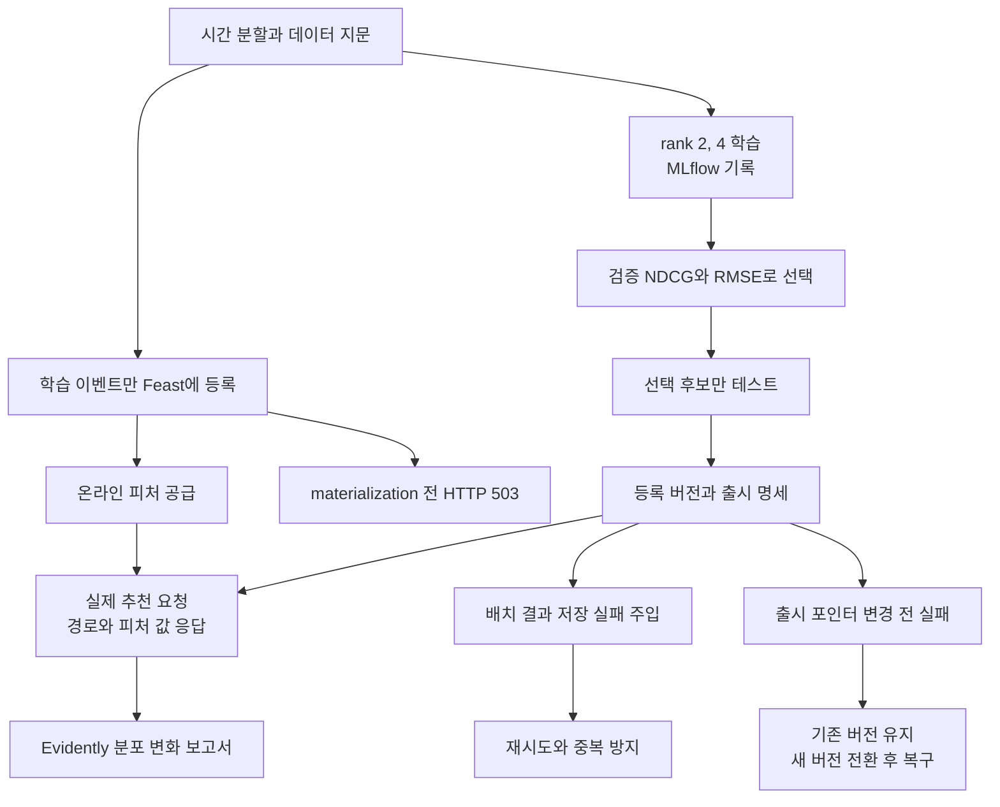

전등 스위치를 설치하는 것과 실제 전등에 연결하는 것은 다릅니다. 앞의 과정에서 각각 익힌 도구도 실제 요청과 실패 상황에 연결되어야 역할을 이해할 수 있습니다.

이번 과정에서는 영화 추천을 기준으로 MLflow, Feast, HTTP 추론과 Evidently를 연결합니다. 검증 데이터로 후보를 고르고, 온라인 피처의 유무에 따라 응답이 달라지는 것을 확인한 뒤, 결과 저장 실패와 출시 실패에서 복구합니다.

## 전체 실험을 먼저 실행하기

```powershell
uv run --locked --extra dev --extra feast --extra monitor ml-labs exercise --work .ml-labs/integrated-01
```

매번 비어 있는 새 작업 경로를 사용합니다. 외부 API나 Azure 없이 CPU에서 실행하며 실제 Feast의 SQLite 온라인 저장소와 실제 Evidently 보고서를 사용합니다.



`.ml-labs/integrated-01/evidence.json`은 실제 실행의 결과입니다. 정해진 성공 문구를 적어 둔 파일이 아닙니다. 아래 항목을 확인합니다.

| 근거 | 정상적으로 확인할 내용 |
| --- | --- |
| `selection` | 테스트가 아니라 검증 NDCG@5로 후보를 선택했는지 |
| `feature_failure_http` | 피처가 아직 없을 때 503이었는지 |
| `feature_recovery` | 공급 후 추천이 성공하고 사용한 피처와 경로가 나오는지 |
| `batch.retried.reused` | 같은 업무 키의 재시도가 기존 결과를 재사용했는지 |
| `releases` | 새 버전으로 바뀌었다가 최초 release ID로 복구되었는지 |
| `drift` | 실제 HTML과 JSON 보고서가 생성되었는지 |

이 예제의 두 출시 버전은 같은 학습 모델을 두 번 등록한 버전입니다. 버전 고정과 복구 동작을 분리해서 시험하기 위한 것으로, 두 모델의 품질 차이를 입증하지는 않습니다.

## 1. 추천 순위로 후보 선택하기

이전의 RMSE만으로는 상위 추천의 품질을 판단하기 어렵습니다. 현재 학습은 검증 데이터의 모델과 인기 기준선에 대해 Recall@5, NDCG@5를 함께 기록합니다.

NDCG는 관련 영화를 앞쪽에 추천했는지에 가중치를 주는 점수입니다. 모든 사용자에게 정답 영화가 같은 개수는 아니므로 이상적인 순위의 점수로 나누어 비교합니다. 여기서는 평점 4 이상을 관련 영화로 정의합니다.

관련 영화가 있는 사용자들의 지표를 평균하며, 관련 영화가 없는 사용자는 ranking 평균에서 제외합니다. 보고서의 `ranking_users`도 함께 봐야 평균의 분모를 알 수 있습니다. 기존 `checks.test_recall_at_5`는 전체 관련 영화 수로 합산한 micro 지표라 새 macro 평균과 다를 수 있습니다.

선택적으로 기준선 대비 NDCG 개선 폭을 출시 조건에 넣습니다.

```powershell
uv run ml-labs movies evaluate --candidate .ml-labs/runs/movies/candidate.json --data data/movies --report .ml-labs/reports/ranking-gate.json --min-ndcg-lift 0.01
```

통과를 보장하는 숫자가 아닙니다. 작은 합성 데이터에서 SVD가 인기 기준선보다 나쁠 수도 있으며, 그때는 평가가 실패하는 것이 정상입니다. 임계치를 낮추어 무조건 통과시키기보다 기준선이 강한 이유와 데이터 특성을 확인합니다.

## 2. Feast가 실제 추천 경로를 바꾸는지 확인하기

기존에 만든 모델은 새 선택 입력 `strategy`와 피처 시점 계약이 없을 수 있습니다. 최신 코드로 모델을 다시 학습하고 새 Feast 폴더를 만듭니다. 기존 폴더는 덮어쓰지 않습니다.

```powershell
uv run ml-labs movies prepare --output data/movies-live
uv run ml-labs movies train --data data/movies-live --output .ml-labs/runs/movies-live
uv run ml-labs movies evaluate --candidate .ml-labs/runs/movies-live/candidate.json --data data/movies-live --report .ml-labs/reports/movies-live.json
uv run ml-labs register --candidate .ml-labs/runs/movies-live/candidate.json --report .ml-labs/reports/movies-live.json --name movie-live
uv run --extra feast ml-labs tools feast init --data data/movies-live --output integrations/feast-live
uv run --extra feast ml-labs tools feast run --repo integrations/feast-live --action apply
uv run --extra feast ml-labs serve --movies .ml-labs/runs/movies-live/candidate.json --feast-repo integrations/feast-live --feature-as-of "2025-01-15T00:00:00Z"
```

과거 합성 데이터를 재생하므로 서버의 시계를 명시적으로 지정합니다. 실제 시계로 실행하면 2025년 피처는 오래된 값으로 거절됩니다. 오래된 값을 최신처럼 보이게 만들기 위한 자동 예외는 없습니다.

다른 터미널에서 조회합니다.

```powershell
$body = @{ user_id = "u007" } | ConvertTo-Json
Invoke-RestMethod http://127.0.0.1:8000/recommend -Method Post -ContentType application/json -Body $body
```

아직 온라인 값이 없으므로 HTTP 503입니다. 아래 명령으로 다섯 건까지만 공급한 뒤 다시 조회합니다.

```powershell
uv run --extra feast ml-labs tools feast run --repo integrations/feast-live --action materialize --end-date "2025-01-05T01:00:00Z"
```

응답은 `feature_routed_popularity`이고 `feature_routing.features.ratings_count`는 5입니다. 기본 기준 10건보다 적어서 인기 추천으로 보낸 것입니다. 이후 전체 피처를 공급하고 다시 호출합니다.

```powershell
uv run --extra feast ml-labs tools feast run --repo integrations/feast-live --action materialize
```

이제 14건의 학습 평점이 반영되고 `personalized`가 됩니다. 실제 조회한 값으로 서비스 분기가 바뀐 것입니다. SVD의 사용자 벡터를 온라인 평균으로 다시 학습한 것은 아니며, 평균과 피처 관측 시점은 함께 기록됩니다.

모델과 Feast 원천 데이터 지문이 다르면 시작을 거절합니다. 누락, 미래 시점과 오래된 피처는 기본적으로 503으로 처리합니다. `--feature-unavailable popularity`를 명시하면 인기 추천으로 대체하지만 `degraded: true`와 원인을 응답에 남깁니다. 장애를 정상 개인화 응답으로 숨기지 않습니다.

## 3. 출시를 실패시키고 복구하기

```powershell
uv run ml-labs release activate --candidate .ml-labs/runs/movies-live/candidate.json --report .ml-labs/reports/movies-live.json --store .ml-labs/movie-releases
uv run ml-labs release show --store .ml-labs/movie-releases
```

출시 기록에는 구체 등록 버전, 평가 보고서 지문과 데이터 지문이 들어갑니다. 모델을 다시 읽고 추론한 뒤에만 active pointer를 바꿉니다.

같은 후보를 새 등록 버전으로 만들고 전환 직전에 실패시킵니다.

```powershell
uv run ml-labs register --candidate .ml-labs/runs/movies-live/candidate.json --report .ml-labs/reports/movies-live.json --name movie-live
uv run ml-labs release activate --candidate .ml-labs/runs/movies-live/candidate.json --report .ml-labs/reports/movies-live.json --store .ml-labs/movie-releases --fail-before-switch
uv run ml-labs release show --store .ml-labs/movie-releases
```

실패 뒤에도 최초 release ID가 유지되어야 합니다. 이어서 정상 전환하고 이전 버전으로 복구합니다.

```powershell
uv run ml-labs release activate --candidate .ml-labs/runs/movies-live/candidate.json --report .ml-labs/reports/movies-live.json --store .ml-labs/movie-releases
uv run ml-labs release rollback --store .ml-labs/movie-releases
uv run --extra feast ml-labs serve --movie-release .ml-labs/movie-releases --feast-repo integrations/feast-live --feature-as-of "2025-01-15T00:00:00Z"
```

서버는 시작 시 선택한 버전을 고정합니다. 실행 중 포인터를 바꿨다면 서버를 재시작해야 반영됩니다. 모델 파일을 메모리에 읽은 프로세스에 무중단 hot reload를 구현했다고 주장하지 않습니다.

## 4. 배치 추론을 재시도해도 중복되지 않게 하기

`user_id` 열만 있는 사용자 파일을 만듭니다.

```powershell
@("user_id", "u000", "new-user") | Set-Content .ml-labs/batch-users.csv
uv run ml-labs batch --candidate .ml-labs/runs/movies-live/candidate.json --report .ml-labs/reports/movies-live.json --users .ml-labs/batch-users.csv --output .ml-labs/batch-results --job-key "2025-01-15" --fail-before-commit
```

추론은 실행했지만 완료 결과를 노출하기 전에 실패합니다. 같은 명령에서 실패 옵션만 빼고 다시 실행하면 완성된 예측과 manifest가 함께 게시됩니다.

```powershell
uv run ml-labs batch --candidate .ml-labs/runs/movies-live/candidate.json --report .ml-labs/reports/movies-live.json --users .ml-labs/batch-users.csv --output .ml-labs/batch-results --job-key "2025-01-15"
```

같은 명령을 다시 실행하면 `reused: true`이며 새 결과가 중복 생성되지 않습니다. 같은 업무 키에 다른 사용자 파일이나 모델을 넘기면 오류입니다. 수정 작업은 새로운 업무 키로 명시해야 합니다.

이는 같은 파일시스템에서 임시 디렉터리를 완성한 뒤 rename하는 단일 호스트 패턴입니다. 여러 worker의 분산 transaction이나 클라우드 object store의 원자적 rename을 보장하는 구현은 아닙니다. writer가 비정상 종료해 lock 파일이 남으면 실제 writer가 없는지 확인하고 그 단일 파일만 제거해야 합니다.

## 어디까지 확인한 것인가요

로컬에서 데이터 계약, 후보 비교, 실제 피처 공급, 요청 분기, 실패한 결과의 비노출, 재시도와 이전 버전 복구를 확인하는 과정입니다. KFP 클러스터 장애, 네트워크 분리와 Azure 고가용성을 검증한 과정은 아닙니다.

한 줄 정리: 도구의 설치 상태가 아니라 요청 결과와 실패 이후의 상태가 바뀌는지로 통합 여부를 확인합니다.

[이전: 책과의 대응](../ml-platform-labs-08-coverage/) / [전체 과정](../)


실행 코드는 [실습 저장소](https://github.com/johklo/ml-platform-engineering-labs)에서 내려받습니다. [원본 가이드](https://github.com/johklo/ml-platform-engineering-labs/blob/main/docs/09-integrated-operations.md)
