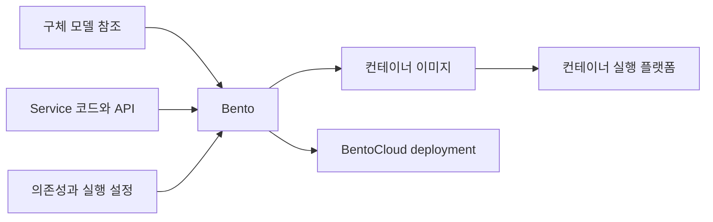

BentoML을 모델을 API로 감싸는 도구라고만 이해하면 요청 처리, 여러 모델의 연결, 실행 환경과 배포 패키지의 역할이 빠진다. 모델 파일을 읽은 뒤 어떤 서비스를 만들고 운영할지에 관한 기능으로 나누어 정리했다.

이 글은 최신 공식 문서의 기능을 살펴보는 참고 글이다. BentoML을 기존 AML 실습 환경에 추가 설치하거나 두 도구를 반드시 함께 쓰도록 바꾸는 내용은 아니다. 책의 예전 Service와 Runner 예제, 최신 클래스 기반 Service API는 버전을 구분해 읽는다.

## 기본 구성 단위

| 단위 | 의미 | 다른 단위와의 관계 |
| --- | --- | --- |
| 모델과 모델 참조 | 서비스에서 사용할 학습 결과 | 로컬 Model Store나 외부 모델 출처에서 로딩 |
| Service | 모델을 사용하는 처리와 API의 구현 | 모델 로딩, 전처리, 예측과 후처리를 구성 |
| API | 외부에 노출할 호출 계약 | 입력과 출력, 경로와 처리 방식을 정의 |
| Bento | 배포할 서비스의 패키지 | 코드, 의존성, 모델 관련 정보와 설정을 연결 |
| 컨테이너 이미지 | Bento를 실행할 수 있게 구성한 배포 형식 | 컨테이너 플랫폼에서 실행 |
| Deployment | 실제 실행하는 서비스와 자원 설정 | BentoCloud나 직접 운영하는 플랫폼에서 관리 |

모델 버전, Bento 버전과 deployment는 같은 식별자가 아니다. 모델은 그대로여도 API 코드나 의존성을 바꾸면 다른 서비스 패키지가 될 수 있다.

## 기능 지도

| 기능군 | 다루는 내용 | 확인할 결과 |
| --- | --- | --- |
| 모델 로딩과 관리 | 저장, 참조, 가져오기와 내보내기 | 사용할 모델 파일과 구체 버전 |
| Service와 API | 전처리, 추론과 후처리의 서비스화 | 외부 호출이 가능한 API |
| 입력과 출력 타입 | Python, Pydantic과 ML 데이터 타입 | 요청 검증과 응답 계약 |
| 여러 모델의 조합 | 순차 및 병렬 호출, 서비스 간 의존성 | 여러 모델을 연결한 추론 흐름 |
| Workers와 동시 처리 | 프로세스, 요청 처리와 자원 사용 | 처리량, 지연과 메모리 사용 |
| Adaptive batching | 요청을 모아 묶음 추론 | 배치 크기와 대기 시간의 균형 |
| Async task | 오래 걸리는 추론을 제출하고 나중에 조회 | 작업 ID, 상태와 결과 |
| Streaming과 ASGI 연동 | 점진적 응답과 다른 웹 기능의 결합 | 스트리밍 응답이나 WebSocket 등의 접점 |
| 환경과 패키징 | Python 및 시스템 의존성, Bento와 이미지 | 배포할 코드와 환경의 조합 |
| 관측 | 서비스 메트릭과 trace 등 | 요청 지연, 오류와 단계별 동작 |
| 관리형 배포 | BentoCloud의 배포와 확장 | 실행 자원과 replica, 큐 및 배포 설정 |

일부 설정은 프레임워크에서 정의하더라도 실제 자원 배치나 자동 확장은 배포 플랫폼이 수행한다. 로컬 실행과 BentoCloud, 직접 운영하는 컨테이너 환경을 동일한 운영 방식으로 보지 않는다.

## 기능과 인터페이스의 연결

| 다룰 작업 | 문서에서 만나는 대표 이름 |
| --- | --- |
| 서비스와 API 정의 | `bentoml.service`, `bentoml.api` |
| 모델 참조 | `BentoModel`, `HuggingFaceModel` |
| 서비스 의존성 | `bentoml.depends` |
| 오래 걸리는 작업 | `bentoml.task`와 작업 상태 및 결과 조회 |
| 추론 데이터 수집 | `bentoml.monitor` |
| 로컬 서비스 실행 | `bentoml serve` |
| 패키징과 컨테이너 | `bentoml build`, `bentoml containerize` |
| BentoCloud 배포 | `bentoml deploy`와 deployment 관리 |

같은 기능 이름이어도 버전에 따라 인자와 구성 방식이 달라질 수 있다. 이 글의 개념을 확인한 뒤 실제로 사용할 SDK 버전의 예제로 연결할 부분이다.

## 모델 로딩과 Model Store

Model Store는 BentoML이 관리하는 모델 저장 공간이다. 모델을 저장하거나 가져오고, tag로 특정 모델을 참조할 수 있다. 모델 파일의 가져오기와 내보내기, BentoCloud로의 push와 pull 같은 관리 경로도 제공한다.

Hugging Face 같은 외부 모델을 참조하는 경로도 있다. 모델 참조를 선언한 것과 실제 추론 라이브러리로 파일을 읽는 것은 다르다. 모델의 가중치, tokenizer, 전처리 정보와 의존성이 함께 맞아야 한다.

최신 문서는 `BentoModel`이나 `HuggingFaceModel`을 Service의 클래스 범위에 선언해 모델 의존성을 식별하도록 설명한다. 임의의 위치에서 파일을 읽었다고 패키징 과정이 그 모델을 항상 발견한다고 가정하지 않는다.

모델 출처의 인증, 다운로드 경로, 라이선스와 사용 범위도 확인할 대상이다. 저장소에서 모델을 찾았다는 사실과 운영에서 사용할 권한이 있다는 사실은 다르다.

## Service와 API

Service는 모델을 읽고 실행하는 코드를 외부 요청과 연결한다. 최신 API는 클래스에 Service를 정의하고, 공개할 메서드를 API로 지정하는 방식을 사용한다.

예를 들어 이미지 분류 서비스는 이미지 읽기, 크기 변경, 모델 예측, 클래스 이름 변환을 하나의 호출로 묶을 수 있다. 이런 처리 중 무엇을 모델 패키지 안에 넣고 무엇을 서비스 코드에 둘지는 별도의 설계 결정이다.

| 결정할 항목 | 예 |
| --- | --- |
| 입력 | JSON, 표 데이터, 이미지와 파일 |
| 처리 | 전처리, 하나 또는 여러 모델 호출, 후처리 |
| 출력 | 클래스, 확률, 생성 텍스트나 파일 |
| 실행 조건 | 시간 제한, 동시 처리와 필요한 자원 |
| 실패 계약 | 잘못된 입력, 모델 로딩 실패와 처리 시간 초과 |

Python 타입과 Pydantic 모델, NumPy나 DataFrame 같은 ML 데이터 타입으로 입력과 출력을 표현할 수 있다. 이 정보는 검증과 API 문서 및 클라이언트의 계약에 연결된다.

타입 검사가 정상이어도 값의 의미가 맞는 것은 아니다. 이미지 크기, 허용 범위, 요청 크기와 업무 규칙은 실제 서비스에 맞춰 정할 부분이다.

## 여러 모델과 서비스의 조합

한 요청에서 여러 모델을 사용할 수 있다. 하나의 Service 안에서 여러 모델을 실행하거나, 별도 Service를 의존성으로 연결해 순서대로 또는 병렬로 호출할 수 있다.

| 구성 | 사용할 상황 | 함께 볼 비용 |
| --- | --- | --- |
| 한 Service에 여러 모델 | 같은 자원에서 단순한 호출 흐름 구성 | 메모리 합계와 공유 자원의 병목 |
| 순차 Service 호출 | 앞 결과를 다음 처리에 사용 | 단계별 지연과 실패 전파 |
| 병렬 Service 호출 | 독립 결과를 모아 응답 | 동시 자원 사용과 결과 대기 |
| 서로 다른 CPU 및 GPU 배치 | 단계별 자원 요구가 다름 | 플랫폼의 배치와 확장 설정 |

예를 들어 문서를 임베딩하고 검색 결과로 답변을 생성하는 흐름을 서비스로 구성할 수 있다. 이것이 학습 데이터 준비, 학습과 승인까지 포함한 전체 MLOps 파이프라인을 대신하는 것은 아니다.

## 동시 처리와 자원 사용

Worker는 Service의 코드를 실행하는 프로세스다. Worker 수와 동시에 처리할 요청 수, replica 수는 구분한다.

| 값 | 다루는 범위 | 늘릴 때 확인할 것 |
| --- | --- | --- |
| Worker 수 | Service 안의 실행 프로세스 | 모델의 중복 로딩과 메모리 |
| 동시 요청 설정 | 처리하거나 수용할 요청의 양 | 포화 지점, 대기와 요청 제한 |
| Replica 수 | 플랫폼에서 실행하는 서비스 복제본 | 총용량, 배치 자원과 비용 |
| GPU와 메모리 요구 | 모델과 실행에 필요한 자원 | 실제 장치 할당과 여러 프로세스의 경합 |

Worker를 늘리면 모델이 프로세스마다 로딩되어 메모리 사용이 늘 수 있다. `async` 함수를 사용한다고 CPU나 GPU 연산 자체가 자동으로 빨라지는 것도 아니다.

자원 요구를 코드에 표시하는 것과 실제 인프라의 자원 제한을 적용하는 것은 다르다. BentoCloud에서는 해당 플랫폼의 배치와 확장 설정을 사용하고, 직접 운영하는 환경에서는 컨테이너나 클러스터의 설정도 함께 확인한다.

## 배칭과 비동기 작업

기능 이름에 batch나 async가 들어가더라도 해결하는 문제는 다르다.

| 방식 | 동작 | 사용자가 받는 것 |
| --- | --- | --- |
| 일반 동기 API | 호출 처리 후 응답 | 추론 결과 |
| 비동기 함수 | 대기 작업 동안 다른 요청 처리가 가능하도록 구현 | API 계약에 따른 응답 |
| Adaptive batching | 여러 요청을 서버에서 모아 한 묶음으로 추론 | 각 요청의 결과 |
| Async task | 작업을 제출하고 상태와 결과를 나중에 조회 | 작업 ID와 이후 조회 결과 |
| 오프라인 배치 Job | 데이터 묶음을 작업으로 처리 | Job 상태와 결과 파일 등 |

Adaptive batching에서는 모델이 묶음 입력을 처리할 수 있어야 한다. 최대 배치 크기와 허용 지연 등을 기준으로 요청을 모으므로 처리량과 대기 시간의 절충이 생긴다. 입력 순서와 출력 결과의 대응도 확인할 대상이다.

Async task는 오래 걸리는 추론을 제출한 뒤 ID로 상태와 결과를 조회하는 기능이다. 결과 보존 기간과 취소 및 재시도 조건을 함께 확인해야 한다.

공식 문서는 로컬 task 큐와 임시 저장소가 개발용 메모리 기반이라고 설명한다. 로컬에서 동작했다는 사실만으로 재시작 후 작업과 결과가 유지되는 운영용 큐를 확인했다고 보지 않는다.

AML의 batch endpoint나 BentoCloud의 배치 작업도 이름만 보고 adaptive batching과 같은 것으로 읽지 않는다. 요청을 모으는 런타임 최적화와 데이터 묶음의 비동기 실행은 다른 범위다.

## Streaming과 웹 기능 연동

Streaming은 결과가 완성될 때까지 기다리는 대신 텍스트나 오디오 등의 일부를 차례로 전달하는 방식이다. LLM 토큰을 점진적으로 반환하거나 ASGI 애플리케이션과 결합해 WebSocket 같은 접점을 구성할 수 있다.

이 경우 전체 처리 시간 외에 첫 응답까지의 시간, 연결 종료, 취소와 중간 오류를 어떻게 표현할지도 필요하다. 응답 전송이 시작된 뒤 발생한 오류는 일반적인 단일 JSON 오류 응답과 다르게 처리할 수 있다.

서비스를 여러 개 연결한다고 스트리밍 연결도 원하는 방식으로 자동 조합된다고 가정하지 않는다. 실제 모델과 서비스의 입출력 계약에 맞춰 확인할 부분이다.

## 실행 환경, Bento와 컨테이너

런타임 환경에는 Python 버전과 패키지뿐 아니라 운영체제, 시스템 패키지와 추가 빌드 작업이 포함될 수 있다. 현재 공식 문서는 Python SDK의 Image 정의와 기존 `bentofile.yaml` 등의 구성 방식을 구분한다.

코드와 모델이 같아도 Python이나 시스템 라이브러리가 달라지면 다른 결과나 로딩 오류가 생길 수 있다. 모델 버전만 남기지 않고 서비스 코드, 환경과 패키지 버전의 조합도 남기는 이유다.

패키징할 폴더에는 필요한 파일만 포함한다. `.bentoignore`와 빌드 대상 범위를 확인하고, 자격 증명이나 고객 데이터를 패키지와 이미지에 넣지 않는다. 실행 시 필요한 비밀은 배포 환경의 비밀 관리 방식으로 전달한다.

## 운영 관측

BentoML은 서비스 메트릭과 OpenTelemetry 기반 tracing 등을 구성할 수 있다. 메트릭 수집 지점과 실제 저장 및 분석 시스템은 구분한다.

| 관측 | 확인할 질문 |
| --- | --- |
| 요청 수와 상태 코드 | 어떤 요청이 얼마나 실패하는가 |
| 요청 시간과 진행 중 요청 | 처리 지연이나 포화가 생겼는가 |
| 실제 배치 크기 | Adaptive batching이 기대한 방식으로 동작하는가 |
| Trace | 여러 서비스 중 어디에서 시간이 걸렸는가 |
| 개별 오류와 실행 정보 | 어떤 모델 및 서비스 버전에서 문제가 났는가 |

Prometheus로 메트릭을 수집하고 Grafana 등에서 분석하거나, trace를 별도 수집기로 보낼 수 있다. 추적을 제공한다는 사실과 수집 대상, sampling, 전송 경로가 설정되어 있다는 사실은 다르다.

서비스가 살아 있고 빠르게 응답해도 모델이 올바른 예측을 한다는 뜻은 아니다. 정답이 필요한 품질 평가, 데이터 변화와 업무 성과는 별도로 연결한다.

`bentoml.monitor`로 추론 입력, 예측과 정답 등의 데이터를 구조화해 수집하는 기능도 있다. 이를 별도 분석 저장소나 모니터링 시스템에 연결해 품질과 분포 변화를 조사할 수 있다. 수집 API를 추가한 것과 실제 드리프트 판단 및 대응 정책을 검증한 것은 다르다.

입력과 출력을 관측 데이터로 남길 때에는 민감한 내용의 저장 범위와 보존 기간을 확인한다.

## BentoML과 BentoCloud의 경계

| 구분 | BentoML 중심의 구현 | BentoCloud의 관리형 운영 |
| --- | --- | --- |
| 서비스 작성 | API와 모델 로딩 및 처리 코드 | 작성한 서비스의 배포와 실행 |
| 패키징 | Bento와 컨테이너 구성 | 패키지와 모델의 공유 및 배포 연결 |
| 확장 | Worker와 처리 방식 정의 | Replica 자동 확장과 관리형 큐 설정 |
| 관측 | 메트릭과 trace 수집 지점 구성 | 플랫폼의 운영 기능과 연결 |
| 비용과 자원 | 직접 운영하는 플랫폼의 책임 | 관리형 서비스의 배포 및 컴퓨팅 정책 |

BentoCloud 문서에는 최소 및 최대 replica, scale-to-zero, 동시 요청 기준의 확장과 외부 큐 같은 기능이 나온다. 이를 사용하지 않는 로컬 서버나 다른 컨테이너 플랫폼에도 같은 운영 동작이 자동 적용되는 것은 아니다.

요청 대기, 콜드 스타트와 최대 replica 제한을 함께 봐야 한다. Replica를 0으로 줄이는 설정 하나로 모든 관련 비용이나 보존 데이터가 사라지는 것도 아니다.

## MLflow와 연결할 때의 흐름

MLflow와 BentoML은 모델을 다루는 부분에서 겹치지만 관리 단위가 다르다. 연결 시에는 다음 관계가 남아야 한다.

| 연결할 정보 | 설명하는 것 |
| --- | --- |
| MLflow run ID | 어떤 학습 실행에서 나왔는가 |
| MLflow 모델 이름과 버전 | 어떤 후보를 관리 대상으로 선택했는가 |
| BentoML 모델 참조 | 서비스에서 어느 모델을 읽는가 |
| Bento tag와 서비스 코드 | 모델을 어떤 코드와 환경으로 패키징했는가 |
| 실제 deployment | 어느 패키지를 어떤 자원과 설정으로 실행하는가 |

공식 연동 예제는 MLflow 모델을 가져와 BentoML Model Store와 Service에서 사용하는 흐름을 보여 준다. AML에 등록된 모델을 연결하는 경우에도 인증, 모델 접근과 버전 선택은 별도로 구성할 대상이다.

이 시리즈의 01~06편은 AML의 관리형 추론 경로다. BentoML 기능을 이해하기 위해 기존 가상환경에 최신 BentoML이나 다른 MLflow 버전을 함께 설치하도록 바꾸지는 않았다.

## 기능을 연결해 볼 사례

| 상황 | 살펴볼 기능 | 남길 확인 |
| --- | --- | --- |
| 여러 모델이 필요한 API | Service 조합과 순차 또는 병렬 호출 | 단계별 입력, 지연과 실패 경계 |
| 높은 요청량에서 처리량 부족 | Worker, 동시 요청과 배칭 | 메모리, 요청 대기와 처리량 |
| 긴 생성 작업 | Async task 또는 streaming | 작업 보존과 재시도, 연결 종료의 동작 |
| 로컬에서는 되지만 배포 후 실패 | 모델 참조, 환경과 패키징 | 빠진 파일, 의존성, 인증과 자원 차이 |
| 같은 모델인데 응답이 달라짐 | 서비스 코드와 Bento 및 deployment 이력 | 전처리, 후처리와 환경의 변경 |

서빙 프레임워크를 사용해도 서비스 계약과 운영 책임은 남는다. 기능을 많이 사용하는 것보다 모델, 서비스 패키지와 실제 실행의 관계를 다시 설명할 수 있는지가 중요했다.

## 참고 자료

- [Service와 API](https://docs.bentoml.com/en/latest/build-with-bentoml/services.html)
- [모델 로딩과 관리](https://docs.bentoml.com/en/latest/build-with-bentoml/model-loading-and-management.html)
- [입력과 출력 타입](https://docs.bentoml.com/en/latest/build-with-bentoml/iotypes.html)
- [여러 모델의 조합](https://docs.bentoml.com/en/latest/get-started/model-composition.html)
- [Worker와 요청 처리](https://docs.bentoml.com/en/latest/build-with-bentoml/parallelize-requests.html)
- [Adaptive batching](https://docs.bentoml.com/en/latest/get-started/adaptive-batching.html)
- [Async task](https://docs.bentoml.com/en/latest/get-started/async-task-queues.html)
- [Streaming](https://docs.bentoml.com/en/latest/build-with-bentoml/streaming.html)
- [런타임 환경](https://docs.bentoml.com/en/latest/build-with-bentoml/runtime-environment.html)
- [패키징과 컨테이너](https://docs.bentoml.com/en/latest/get-started/packaging-for-deployment.html)
- [서비스 메트릭](https://docs.bentoml.com/en/latest/build-with-bentoml/observability/metrics.html)
- [모니터링과 추론 데이터 수집](https://docs.bentoml.com/en/latest/build-with-bentoml/observability/monitoring-and-data-collection.html)
- [Tracing](https://docs.bentoml.com/en/latest/build-with-bentoml/observability/tracing.html)
- [BentoCloud의 동시 처리와 자동 확장](https://docs.bentoml.com/en/latest/scale-with-bentocloud/scaling/autoscaling.html)
- [MLflow 연동](https://docs.bentoml.com/en/latest/examples/mlflow.html)
- [BentoCloud 배포](https://docs.bentoml.com/en/latest/get-started/cloud-deployment.html)

[MLflow 기능과 구성](../mlflow-capabilities/), [시리즈 목차](../), [01. 로컬 실습 시작](../01-local-tracking/)
