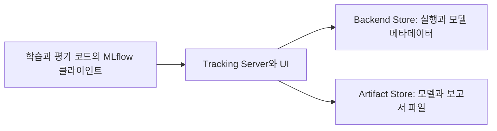

MLflow를 실험 결과를 저장하는 도구로만 보면 모델 형식, 버전 관리, 평가와 배포 기능이 따로 있는 이유를 놓치기 쉽다. 기능을 나누어 읽으니 실행을 기록하는 부분과 모델을 재사용하는 부분, 서비스를 관측하는 부분이 서로 연결되어 있었다.

이 글은 공식 문서의 기능 범위를 살펴보는 참고 글이다. 01~06편의 AML 실습은 MLflow 2.16.2를 기준으로 유지한다. 아래의 MLflow 3.x 기능과 최신 GenAI API를 그 환경에 그대로 적용한다는 뜻은 아니다.

## 기능 지도

| 기능군 | 다루는 내용 | 남는 정보나 결과물 |
| --- | --- | --- |
| Tracking | 실행, 설정, 지표, 파일과 코드 정보 기록 | experiment, run, 메트릭 이력과 아티팩트 |
| Dataset Tracking | 사용한 데이터의 식별 정보와 출처 연결 | 이름, digest, source, schema와 사용 문맥 |
| Models | 모델의 로딩과 추론 계약을 패키징 | `MLmodel`, flavor, signature와 환경 파일 |
| Model Registry | 관리할 모델의 이름과 버전, 참조와 설명 | 등록 모델, 버전, alias, tag와 계보 |
| Evaluation | 평가 데이터와 기준에 따라 결과 산출 | 평가 메트릭, 결과 표와 시각화 |
| Projects | 코드를 어떤 입력과 환경으로 실행할지 정의 | entry point, 파라미터와 실행 환경 |
| Serving과 배포 연동 | 저장한 모델을 추론 프로세스나 서비스로 실행 | 추론 서버, 컨테이너와 배포 설정 |
| Tracking Server와 저장소 | 여러 클라이언트의 기록과 조회를 제공 | API와 UI, 메타데이터 DB와 파일 저장소 |
| GenAI 기능 | LLM과 에이전트의 실행, 평가와 프롬프트 관리 | trace, 평가 결과와 프롬프트 버전 |
| AI Gateway | 여러 모델 제공자에 대한 호출 경로 관리 | 제공자 연결, 라우팅과 사용량 정보 |

모든 기능을 한꺼번에 도입할 필요는 없다. 어떤 결정을 설명할 기록이 부족한지, 모델을 어떤 방식으로 소비할지를 기준으로 필요한 부분을 연결할 수 있다.

## 기능과 인터페이스의 연결

| 다룰 작업 | 문서에서 만나는 대표 이름 |
| --- | --- |
| 실행 시작과 기록 | `start_run()`, `log_params()`, `log_metrics()`, `autolog()` |
| 데이터 정보 연결 | `mlflow.data`, `log_input()` |
| 모델 저장과 로딩 | `save_model()`, `log_model()`, `load_model()` |
| 실행 조회와 등록 | `search_runs()`, `MlflowClient`, `register_model()` |
| 평가 | `mlflow.models.evaluate()`, `mlflow.genai.evaluate()` |
| 프로젝트 실행 | `MLproject`, `mlflow run` |
| 모델 서빙 | `mlflow models serve`, 배포 대상별 연동 |
| LLM 실행과 프롬프트 | `mlflow.trace`, Prompt Registry와 GenAI API |

이 이름들은 기능을 찾는 출발점이다. 모든 API가 같은 버전이나 AML의 같은 backend에서 제공된다는 뜻은 아니다.

## 실험 기록과 비교

Tracking의 기본 단위는 한 번의 실행인 run이다. 관련 실행은 experiment로 묶고, run에는 설정인 parameter, 수치 결과인 metric, 분류용 tag와 파일인 artifact를 남긴다.

| 기록 | 질문 | Wine 실습의 예 |
| --- | --- | --- |
| Parameter | 무엇을 바꾸었는가 | `C`, 분할 시드 |
| Metric | 어떤 결과가 나왔는가 | 검증 정확도, log loss |
| Artifact | 숫자 외에 무엇을 남겼는가 | 검증 보고서, 학습 코드와 모델 |
| Tag | 어떤 실행끼리 묶을 것인가 | 학습 주제와 모델 유형 |

같은 metric을 여러 step에 남기면 학습 곡선처럼 시간에 따른 변화를 조회할 수 있다. 실행 목록에서 보는 마지막 값과 전체 이력은 다르다. 하위 run은 큰 작업과 개별 시도를 연결할 때 사용할 수 있다.

Autologging은 프레임워크의 학습 호출에서 파라미터, 지표와 모델 등을 자동으로 기록한다. 기록 항목은 라이브러리와 버전에 따라 다르다. 데이터 이용 조건이나 모델 선택의 업무상 근거까지 자동으로 채워 주지는 않는다.

UI와 API는 같은 기록을 서로 다른 방식으로 소비한다. UI는 비교와 탐색에, API는 반복 조회와 자동화에 사용할 수 있다. 후보 선택의 기준을 코드로 남기는 실습은 [02편](../02-query-and-compare/)에 두었다.

## 데이터 추적

Dataset Tracking은 모델이 어떤 데이터를 사용했는지 실행에 연결하는 기능이다. 데이터 이름과 출처, digest, schema나 profile 같은 정보를 남기고, 학습용인지 평가용인지 사용 문맥도 구분할 수 있다.

예를 들어 정확도가 바뀌었을 때 모델 설정뿐 아니라 데이터셋이나 분할이 바뀌었는지도 확인할 수 있어야 한다. 실행과 데이터의 연결이 그 조사의 출발점이 된다.

이 기능이 원본 데이터의 보존 정책이나 모든 변환 이력을 대신 설계하는 것은 아니다. 출처 경로가 같아도 내용이 덮어써지면 이전 입력을 다시 얻지 못할 수 있다. 원본의 스냅샷, 접근 권한, 보존 기간은 데이터 저장소와 함께 관리할 대상이다.

01편은 이 개념을 익히기 위해 표 데이터의 지문을 직접 기록한다. `mlflow.data`의 Dataset 객체와 `log_input()`을 사용하는 방식까지 구현한 예제는 아니라는 점을 구분했다.

## 모델 패키징과 공통 추론 인터페이스

MLflow Model은 학습된 객체 하나보다 넓은 단위다. 모델 파일, 로딩 방법, 입출력 signature와 의존성을 함께 표현한다.

| 구성 | 역할 |
| --- | --- |
| Flavor | 해당 프레임워크의 모델을 저장하고 읽는 방법 |
| PyFunc | 공통 `predict()` 인터페이스로 모델을 소비하는 방식 |
| Signature | 입력과 출력의 열, 타입 또는 tensor 형태에 대한 계약 |
| 입력 예시 | 실제로 어떤 모양의 데이터를 넘길지 보여 주는 자료 |
| 환경 정보 | 모델을 로딩하고 추론할 때 필요한 의존성 |

원래 프레임워크의 객체로 읽으면 해당 라이브러리의 인터페이스를 사용한다. PyFunc로 읽으면 공통 추론 인터페이스를 사용한다. PyFunc가 클래스 예측을 자동으로 확률 예측으로 바꾸는 것은 아니다.

기본 flavor로 표현하기 어려운 모델은 사용자 정의 PyFunc로 감쌀 수 있다. 전처리, 후처리와 추가 파일의 로딩도 패키지의 일부로 만들 수 있다. 이 경우에는 어떤 입력을 받고 무엇을 반환하는지 직접 정의해야 한다.

같은 파일을 다시 읽었다는 확인과 다른 환경에서 재현된다는 확인도 다르다. Signature 검사와 환경 비교는 [03편](../03-model-format-and-loading/)에서 연결한다.

## Logged Model과 등록 모델

최신 문서를 읽을 때는 실행, 기록된 모델, 등록 버전을 구분할 필요가 있다.

| 단위 | 의미 |
| --- | --- |
| Run | 학습이나 평가 코드의 실행 |
| Logged Model | 기록한 모델 자체. MLflow 3에서는 모델 ID를 중심으로 추적하는 경로도 제공 |
| Registered Model Version | 관리할 모델 이름 아래에 등록한 구체 버전 |

MLflow 3의 모델 추적은 한 run에서 여러 체크포인트를 기록하고, 각 모델에 데이터셋별 메트릭을 연결하는 기능을 포함한다. 실행 하나에 모델 하나만 있다는 가정으로 읽으면 이런 관계를 놓칠 수 있다.

반면 Registry는 모델을 어떤 이름과 버전으로 관리할지 다룬다. 버전별 설명, tag와 원천 실행을 연결하고, alias로 특정 버전을 참조할 수도 있다.

Alias는 변경 가능한 참조다. `champion`이 같은 이름이어도 가리키는 버전은 바뀔 수 있다. 재현이나 장애 조사를 위해서는 실제 사용한 구체 버전도 남아야 한다. Alias를 바꾸는 것과 이미 실행 중인 서비스가 새 모델을 로딩하는 것은 배포 방식에 따른 별도 동작이다.

AML의 모델 관리 API가 오픈소스 Registry의 모든 기능과 같다고 가정하지 않는다. 이 시리즈의 [05편](../05-model-registration/)은 같은 AML workspace의 run에서 모델을 선택하고 구체 버전으로 등록하는 경로를 사용한다.

## 평가와 검증

Tracking이 결과를 기록하는 기능이라면 Evaluation은 정한 데이터와 평가 기준으로 결과를 계산하는 기능이다. 계산된 결과를 다시 run과 모델에 연결한다.

분류나 회귀에서는 지표, 혼동행렬이나 곡선, 평가 결과 표 등을 남길 수 있다. 기본 메트릭 외에 업무에 맞는 평가 기준을 추가할 수도 있다. 임계치 검증을 구성할 때에도 기준선, 평가셋과 승인 조건을 누가 정했는지가 필요하다.

| 평가 경로 | 중심 대상 | 구분할 인터페이스 |
| --- | --- | --- |
| 전통적인 ML 평가 | 분류, 회귀, 모델 또는 미리 계산한 예측 | `mlflow.models.evaluate()`와 평가 메트릭 |
| 최신 GenAI 평가 | LLM 답변, 에이전트의 실행 결과와 기대 조건 | `mlflow.genai.evaluate()`와 scorer |

공식 문서는 두 평가 체계의 메트릭 객체를 서로 교환해서 쓰는 것으로 설명하지 않는다. 전통적인 ML 평가 예제를 GenAI 평가 코드에 그대로 넣는 식으로 섞지 않는다.

LLM 평가에는 모델 기반 평가자와 사람이 남기는 피드백도 사용할 수 있다. 평가 모델의 오류, 질문 집합의 대표성, 반복 실행의 변동은 남는다. 높은 평가 점수만으로 보안이나 업무상 정확성이 보증되지는 않는다.

## 실행 환경과 MLflow Projects

Projects는 실행할 코드를 entry point, 파라미터, 환경으로 정의하고 공유하는 형식이다. 같은 프로젝트를 어떤 명령과 입력으로 실행할지 설명하는 데 쓰인다.

이 환경 정의와 MLflow 모델의 추론 환경은 다르다. 프로젝트는 학습 코드를 실행하는 단위이고 모델 환경은 저장한 모델을 읽는 단위다.

MLflow Projects 기능과 AML의 Projects 연동 경로도 구분한다. [AML 공식 개요](https://learn.microsoft.com/en-us/azure/machine-learning/concept-mlflow?view=azureml-api-2#training-with-mlflow-projects-preview)는 `MLproject`를 사용한 AML 학습 제출 지원의 2026년 9월 종료와 Jobs로의 전환을 안내한다. 오픈소스 MLflow Projects 전체나 MLflow Tracking이 종료되었다는 뜻은 아니다.

이 시리즈의 원격 학습은 [04편](../04-azureml-tracking-and-jobs/)의 AML command Job으로 제출한다.

## 서버와 저장소

기록을 남기는 클라이언트, 메타데이터를 보관하는 저장소, 파일을 보관하는 저장소는 별도 역할이다.

| 구성 | 보관하거나 제공하는 것 | 운영할 때 확인할 것 |
| --- | --- | --- |
| Tracking Server | API와 UI, 저장소 접근 경로 | 인증, 접근 경로, 동시 사용과 서비스 운영 |
| Backend Store | 실행, 메트릭, 모델 등의 메타데이터 | DB의 백업, 변경과 복구 |
| Artifact Store | 모델 가중치, 이미지와 보고서 | 파일 접근 권한, 보존과 실제 용량 |

직접 로컬 DB를 사용할 때는 서버 없이 클라이언트가 기록할 수도 있다. AML에 연결하는 경우는 관리형 호환 API를 사용하는 것이며 workspace의 내부 DB에 직접 접속하는 실습이 아니다.

MLflow 자체의 최신 workspace 기능과 Azure 리소스인 AML workspace도 같은 객체가 아니다. 이름이 같다는 이유로 권한이나 자산의 범위를 동일하게 해석하지 않는다.

최신 self-hosting 문서는 기본 HTTP 인증, SSO와 사용자 정의 인증 플러그인도 다룬다. 기능을 제공한다는 것과 실제 서버의 인증 및 권한 구성이 완료되었다는 것은 다르다. 저장소와 API의 접근 제어, 백업과 복구를 함께 확인한다.

## 서빙과 배포 연동

MLflow에는 저장 모델을 추론 서버로 실행하고 컨테이너 이미지로 만드는 도구가 있다. 관리형 서비스에 배포하는 연동 경로도 제공한다.

모델 패키지가 같아도 배포 대상의 요청 형식, 인증, 컴퓨팅과 자원 관리까지 같아지는 것은 아니다. 로컬 MLflow 서버의 요청 본문과 AML endpoint의 요청 본문을 구분하는 이유다.

BentoML과 비교하면 모델 로딩과 서빙에서 기능이 겹친다. MLflow 모델 계약을 그대로 소비할지, 별도 서비스 코드로 여러 모델과 전후처리를 구성할지에 따라 경로를 나눌 수 있다. [06편](../06-online-and-batch-inference/)은 AML의 온라인 및 배치 추론을 다룬다.

## LLM과 에이전트 기능

최신 MLflow는 전통적인 모델 관리 외에 LLM과 에이전트의 관측, 평가와 프롬프트 관리도 다룬다.

| 기능 | 확인하려는 것 | 남는 정보 |
| --- | --- | --- |
| Tracing | 한 요청의 어느 단계에서 문제가 생겼는가 | 모델 호출, 검색, 도구 실행 등의 span과 입출력 |
| Evaluation | 변경 전후에 답변과 실행 품질이 어떻게 달라졌는가 | 평가 데이터, scorer와 결과 |
| Prompt Registry | 어떤 지침을 사용했는가 | 프롬프트 버전, alias와 사용 관계 |
| AI Gateway | 어떤 제공자와 모델로 요청을 보낼 것인가 | 연결과 라우팅 설정, 사용 정보 |

Tracing은 OpenTelemetry와 연결해 요청의 여러 단계를 추적하는 데 사용할 수 있다. 전체 응답 시간 하나로 보이지 않던 검색, 모델 호출이나 도구 실행의 맥락을 조사할 수 있다.

Prompt Registry는 코드 안의 문자열과 별개로 프롬프트를 버전 관리한다. 다만 프롬프트 버전만 남기고 모델 설정, 검색 자료와 실행 문맥을 남기지 않으면 같은 답변을 재현하는 근거는 부족하다.

AI Gateway는 여러 모델 제공자의 호출 경로, 분산과 대체 경로 등을 관리한다. 이 기능을 쓴다고 애플리케이션의 입력 검증이나 제공자별 데이터 처리 조건이 자동으로 해결되는 것은 아니다.

프롬프트, 검색 내용과 응답을 trace에 남기면 민감한 데이터도 저장될 수 있다. 수집 범위, 마스킹, 접근 권한, 보존 기간과 평가 호출의 비용은 별도로 정할 항목이다.

## 기능 소개와 AML 실습의 경계

| 구분 | 이 시리즈에서의 취급 |
| --- | --- |
| 실행 추적, 모델 패키징과 Registry | 01~05편의 기본 학습 경로 |
| AML 학습과 모델 소비 | 04~06편의 CLI와 관리형 서비스 경로 |
| MLflow 3의 모델 ID 중심 추적 | 기능을 이해하되 2.16.2 예제와 API를 섞지 않음 |
| 최신 Prompt Registry와 GenAI 평가 및 Gateway | 후속 학습 범위이며 현재 Wine 실습에 추가하지 않음 |
| Registry의 alias와 관리 기능 | AML 지원 표와 설치 버전을 확인하며 구체 버전 참조는 유지 |

기본 저장 방식도 버전에 따라 달라진다. 최신 self-hosting 문서는 MLflow 3.7부터 새 서버의 기본 backend가 SQLite로 바뀌었다고 안내한다. 01편은 기본값에 기대지 않고 SQLite URI를 명시하므로 이 차이와 구분해 읽을 수 있다.

최신 기능을 살펴보기 위해 기존 AML 실습 환경의 패키지를 바로 업그레이드하지는 않는다. 모델 로깅의 버전 조건과 연결하려는 서비스의 지원 범위를 함께 확인한다.

## 기능을 연결해 볼 사례

| 상황 | 연결할 기능 | 남겨야 할 확인 |
| --- | --- | --- |
| 같은 코드의 점수가 달라짐 | Tracking과 Dataset Tracking | 설정, 데이터와 환경 중 달라진 것 |
| 선택 모델을 다른 팀에 전달 | Models와 Registry | 구체 버전, 입력 계약, 의존성과 원천 실행 |
| RAG 답변 품질이 나빠짐 | Tracing과 GenAI 평가 | 검색과 생성 단계의 원인, 질문 집합과 평가 기준 |
| 팀이 같은 결과를 함께 사용 | 서버와 저장소, API | 접근 권한, 파일 보존과 재조회 가능성 |

MLflow가 기록한 정보를 실제 의사결정으로 연결하는 일은 남는다. 실험 수가 많다는 사실보다 어떤 변경의 근거를 다시 찾을 수 있는지가 이 도구를 이해하는 기준으로 남았다.

## 참고 자료

- [Tracking](https://mlflow.org/docs/latest/ml/tracking/)
- [Dataset Tracking](https://mlflow.org/docs/latest/ml/dataset/)
- [Models](https://mlflow.org/docs/latest/ml/model/)
- [Model Registry](https://mlflow.org/docs/latest/ml/model-registry/)
- [전통적인 ML 평가](https://mlflow.org/docs/latest/ml/evaluation/)
- [Projects](https://mlflow.org/docs/latest/ml/projects/)
- [Self-hosting과 구성 요소](https://mlflow.org/docs/latest/self-hosting/)
- [서빙과 배포](https://mlflow.org/docs/latest/ml/deployment/)
- [LLM 및 에이전트 기능](https://mlflow.org/docs/latest/genai/)
- [Tracing](https://mlflow.org/docs/latest/genai/tracing/)
- [GenAI 평가](https://mlflow.org/docs/latest/genai/eval-monitor/)
- [Prompt Registry](https://mlflow.org/docs/latest/genai/prompt-registry/)
- [AI Gateway](https://mlflow.org/docs/latest/genai/governance/ai-gateway/)

[시리즈 목차](../), [BentoML 기능과 구성](../bentoml-capabilities/), [01. 로컬 실습 시작](../01-local-tracking/)
