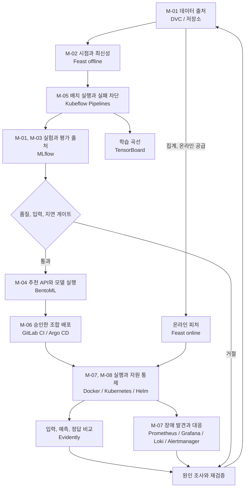

식당에서 새 요리를 내놓을 때 레시피만 보관하지는 않습니다. 재료의 입고 시점, 조리 과정, 검사 결과와 실제 손님의 반응까지 연결되어야 같은 품질을 유지할 수 있습니다. MLOps도 모델 파일뿐 아니라 **데이터에서 운영 결과로 이어지는 변경 경로**를 관리합니다.

이 시리즈는 가상의 온라인 서점 **Bookway**를 기준으로 정리했습니다. 추천 모델은 최근 행동을 이용해 도서 후보의 순위를 정하고, [LLMOps의 안내 도우미](../llmops/)는 도서, 배송, 반품 정책을 근거로 답합니다. 두 서비스는 같은 서점을 다루지만 추천 점수와 자연어 답변은 다른 기준으로 평가합니다.

## 시나리오와 범위 {#scenario}

Bookway는 로그인한 고객에게 **현재 구매할 수 있는 도서 중 최대 10권**을 추천합니다. 상품 카탈로그가 판매 가능한 후보를 제공하고, 추천 서비스는 최근 30일 행동으로 그 후보를 정렬합니다. 결제와 재고 예약은 기존 주문 시스템의 책임이며 추천 모델이 수행하지 않습니다.

| 상황 | 입력과 전제 | 서비스가 해야 할 일 | 남기는 결과 |
| --- | --- | --- | --- |
| 기존 고객의 홈 화면 | 인증 고객 `c-001`, 후보에 `b-101` 포함 | 피처 v1을 조회하고 모델 17로 점수 계산 후 판매 상태 재검사 | 최대 10개 도서 ID, `rec-r17`, 처리 경로 |
| 행동 이력이 없는 고객 | 조회 성공, 사용 가능한 고객 피처 없음 | 승인된 인기순 기준선을 사용 | 실제 baseline 버전과 `fallback_reason=cold_start` |
| 피처 저장소 장애 | 조회 timeout 또는 연결 실패 | 신규 고객으로 가장하지 않고 명시적인 일시 오류 반환 | 오류 상태와 trace, 장애 지표 |
| 다음 추천 모델 준비 | 고정 데이터와 시간 분할 | 기준선과 후보 비교 후 통과한 조합만 출시 | 평가 보고서와 불변 release |
| 출시 직후 오류 증가 | 새 release에서만 오류 발생 | 확대를 중단하고 호환되는 이전 조합으로 복구 | 배포 선언, 모델과 피처 계약의 복구 기록 |

정상 응답의 `rec-r17`은 **서비스 조합**을 식별합니다. 실제 사용한 `model_version` 또는 `baseline_version`을 별도 기록해 fallback을 모델 17의 예측처럼 보이지 않게 합니다. 후보가 10권보다 적으면 존재하는 도서만 반환하며 개수를 채우려고 품절 도서를 넣지 않습니다.

설명용 운영 조건은 카탈로그 10만 권, 일별 재학습 후보 생성, 시간당 피처 공급입니다. 이는 도구 선택을 구체화하기 위한 가정입니다. 실제 배포 규모나 성능 측정값이 아니며 아래 수치는 **프로젝트의 목표 인수 기준**입니다.

## 요구사항과 인수 기준 {#requirements}

| ID | 요구사항 | 충족 여부를 판단할 기준 | 주요 담당 |
| --- | --- | --- | --- |
| M-01 | 학습 입력과 평가를 다시 추적할 수 있어야 함 | release에서 데이터 지문, 코드, 시간 분할, 피처 정의, 모델 artifact를 역추적하고 별도 환경에서 복원 | DVC, MLflow, 저장소 |
| M-02 | 학습에 미래 정보가 없고 온라인 피처가 최신이어야 함 | 예측 시각 뒤 이벤트가 학습 행에 미포함, 가용 시점도 검사. 온라인 집계 기준 시각이 요청보다 2시간 넘게 뒤처지면 사용 중단 | 변환 작업, Feast |
| M-03 | 인기순보다 나쁜 후보를 출시하지 않음 | 같은 시간 분할과 후보 집합의 NDCG@10이 기준선 이상. cold-start와 이력 보유 집단을 따로 평가 | 평가 코드, MLflow |
| M-04 | 권한과 도서 상태를 지키는 추천 API | 인증 고객만 조회, 중복과 품절 도서 0개, 결과 최대 10개. 이력 없음과 의존성 장애를 다른 상태로 반환 | 앱, BentoML, 카탈로그 |
| M-05 | 배치 실패가 잘못된 출시로 이어지지 않음 | 검사 실패 시 후속 등록과 출시 중단. 같은 업무 키로 재시도해도 중복 출시를 생성하지 않음 | KFP, 등록 코드 |
| M-06 | 검증한 조합만 배포하고 복구 가능해야 함 | 이미지 digest, 모델, 전처리, 피처 계약을 고정. 시험 환경에서 `rec-r17` 장애 후 `rec-r16` 조합을 10분 안에 복구 | CI, Argo CD, 배포 담당 |
| M-07 | 요청 지연과 장애를 조기에 파악 | 준비된 서비스에 후보 100개 이하, 50 RPS, 15분 부하에서 p95 300ms 이하와 5xx 1% 미만. 운영은 5분 창의 오류율과 트래픽을 함께 감시 | BentoML, 실행 환경, 관측 |
| M-08 | 개인정보와 자원을 통제 | 공개 artifact와 메트릭 label에 고객 원문과 식별자 없음. 서빙은 필요한 읽기 권한만 가지며 자원과 과부하 한도를 명시 | 앱, 저장소, Kubernetes |

M-02의 2시간은 Feast의 TTL과 동일하지 않습니다. 공급 작업이 기록한 **집계 완료 기준 시각**으로 확인하며, 해당 시각이 없거나 너무 오래되면 정상 피처로 취급하지 않습니다. M-07은 API와 피처 조회, 모델 실행, 판매 상태 검사를 포함한 서버 응답 시간이며 브라우저의 화면 그리기 시간은 제외합니다.

## 한 요청과 한 출시에서 요구사항이 이어지는 방식

`c-001`의 요청에서 서버가 고객을 확인하면 M-04가 시작됩니다. Feast에서 v1 값과 최신성 정보를 읽어 M-02를 검사하고, BentoML 서비스가 모델 실행과 판매 상태 필터를 수행합니다. 요청 종료 시 release, 실행 경로와 지연을 남겨 M-07을 관측합니다. 어느 도구 하나의 설치만으로 이 경로가 완성되지는 않습니다.

배치는 M-01의 스냅샷을 읽고 KFP가 검사, 피처 준비, 학습과 평가를 순서대로 실행합니다. M-03을 통과한 **동일 후보 지문**만 M-06의 출시 명세로 넘깁니다. 실패한 평가를 성공 보고서로 바꾸거나 Registry 등록 자체를 승인으로 간주하지 않는 것이 M-05입니다.

검증 자료는 `data-manifest.json`, `evaluation.json`, `release.json`, API 계약 시험, 부하 보고서와 복구 기록입니다. 각각이 어떤 입력 지문을 검사했는지 연결되어야 합니다. 아래 하위 글의 표는 이 자료를 **어떻게 만들어 충족을 확인할지** 설명하며 현재 Bookway가 인수 시험을 통과했다는 뜻은 아닙니다.

## Bookway의 공통 계약

고객, 주문, 정책은 모두 설명을 위한 합성 자료입니다. 아래 ID는 프로젝트 전체에서 연결 관계를 설명하기 위한 값이며 실제 배포 결과가 아닙니다.

| 대상 | 예시 계약 | 바뀔 때 함께 확인할 것 |
| --- | --- | --- |
| 고객 | `customer_id=c-001`, 서버가 확인한 소유자 | 인증, 추천 피처, 주문 접근 범위 |
| 도서 | `book_id=b-101`, 판매 가능 여부 | 후보 생성, 품절 제외, 설명 문서 |
| 행동 데이터 | `events-20261024`, `event_time`과 수집 시점 | 시간 분할, 중복 이벤트, 삭제 요청 |
| 추천 피처 | `bookway_customer_v1`, 최근 30일 집계 | Feast 정의, 학습 시점, 온라인 최신성 |
| 추천 모델 | `bookway-ranker/17` | MLflow run, 평가 보고서, 서빙 입력 |
| 추천 출시 | `rec-r17` | 모델 버전, 이미지 digest, 피처 계약 |
| 안내 출시 | `help-r8` | 정책 `policy-v3`, 인덱스, 프롬프트, 모델 |

추천 요청은 `customer_id`와 후보 도서를 받고, 순위가 있는 도서 ID와 `release_id`를 반환합니다. 사용자 ID를 요청 본문에서 믿지 않고 인증 주체와 연결합니다. 클릭, 구매는 나중에 도착할 수 있으므로 요청 성공률과 추천 품질을 같은 실시간 지표로 취급하지 않습니다.

## 전체 흐름과 도구 위치

화살표가 모두 즉시 실행되는 것은 아닙니다. 학습은 배치, 온라인 피처 공급은 별도 작업, 추천 API는 요청 경로입니다. KFP가 요청마다 학습하지 않고 Feast가 모델을 학습하지도 않습니다. Registry의 모델 등록은 출시 승인을 대신하지 않습니다.

## 역할별 하위 가이드

| 운영 구간 | 도구와 가이드 | Bookway에서 남기는 결과 |
| --- | --- | --- |
| 데이터 출처 | [DVC와 데이터 버전](data-versioning/) | 데이터 지문, 시간 분할, 복원 가능한 스냅샷 |
| 실험, 모델 관리 | [MLflow](mlflow/) | run → 평가 → 구체 모델 버전 |
| 학습 내부 분석 | [TensorBoard](tensorboard/) | step별 손실, 검증 곡선 |
| 학습, 서빙 피처 | [Feast](feast/) | 시점에 맞는 학습 값과 온라인 값 |
| 배치 오케스트레이션 | [Kubeflow Pipelines](kubeflow/) | 작업 DAG, 아티팩트, 재시도 경계 |
| 추론 서비스 | [BentoML](bentoml/) | 모델을 읽는 API와 배포 패키지 |
| 실행 기반 | [Docker, Kubernetes, Helm](runtime/) | 자원, 상태 검사, 롤아웃 |
| 변경 경로 | [GitLab CI, Argo CD](gitops/) | 검사된 이미지와 선언 상태 |
| 운영 상태 | [Prometheus, Grafana, Loki, Alertmanager](monitoring/) | 지연, 오류, 로그, 대응 |
| 데이터와 품질 변화 | [Evidently](evidently/) | 기준/현재 데이터 비교와 조사 근거 |

MLflow, Feast, KFP, BentoML, Evidently와 기반 도구는 책에서 다루는 축입니다. DVC는 데이터 버전의 빈틈을 보완한 선택지입니다. 특정 도구를 모두 설치하는 것이 목적은 아닙니다. 작은 팀은 배치 스크립트와 관리형 DB로 시작하고, 반복, 권한, 복구 부담이 커지는 지점에서 도구를 추가할 수 있습니다.

## 실무에서 이어지는 순서

먼저 시점과 평가 계약을 고정한 뒤 MLflow에 기준선과 후보를 기록합니다. Feast로 피처 정의를 공유하고 KFP에 같은 단계들을 연결합니다. 검증을 통과한 **구체 모델 버전**을 BentoML이 읽게 하며, 배포에서는 이미지와 피처 계약까지 `rec-r17`에 묶습니다.

출시 후 오류율이 높으면 서비스 경로를, 데이터 분포가 바뀌면 수집, 피처 경로를 먼저 조사합니다. 정답이 늦게 도착한 추천 품질 저하는 별도 창으로 평가합니다. 드리프트 하나로 재학습하거나 모델만 롤백하면 원인이 남을 수 있습니다.

클라우드에서는 같은 책임을 [Azure Machine Learning](../mlflow-azure-machine-learning/)으로 일부 통합할 수 있습니다. 이는 KFP, MLflow, Kubernetes를 반드시 동시에 운영해야 한다는 뜻이 아닙니다.

## 기존 기록과의 연결

[책 독서노트](../machine-learning-platform-engineering/)는 챕터 순서, [기존 통합 실습](../ml-platform-engineering-labs/)은 실행했던 영화 추천, 탐지, RAG 중심입니다. 여기서는 그 기록을 이동하거나 Bookway의 실행 결과로 바꾸지 않고, **실무 책임별로 재구성한 설계, 구현 가이드**로 연결합니다. 각 코드 조각의 입력 파일과 서비스 전제는 해당 글에 명시합니다.

[LLMOps 전체 흐름](../llmops/) / [Bookway 출시 계약](../llmops/release/)
