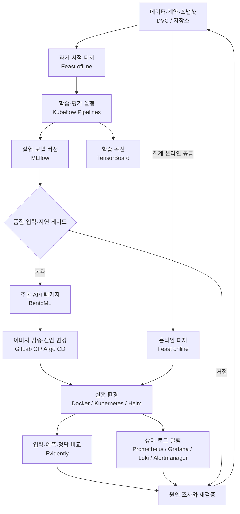

식당에서 새 요리를 내놓을 때 레시피만 보관하지는 않습니다. 재료의 입고 시점, 조리 과정, 검사 결과와 실제 손님의 반응까지 연결되어야 같은 품질을 유지할 수 있습니다. MLOps도 모델 파일뿐 아니라 **데이터에서 운영 결과로 이어지는 변경 경로**를 관리합니다.

이 시리즈는 가상의 온라인 서점 **Bookway**를 기준으로 정리했습니다. 추천 모델은 최근 행동을 이용해 도서 후보의 순위를 정하고, [LLMOps의 안내 도우미](../llmops/)는 도서·배송·반품 정책을 근거로 답합니다. 두 서비스는 같은 서점을 다루지만 추천 점수와 자연어 답변은 다른 기준으로 평가합니다.

## Bookway의 공통 계약

고객·주문·정책은 모두 설명을 위한 합성 자료입니다. 아래 ID는 프로젝트 전체에서 연결 관계를 설명하기 위한 값이며 실제 배포 결과가 아닙니다.

| 대상 | 예시 계약 | 바뀔 때 함께 확인할 것 |
| --- | --- | --- |
| 고객 | `customer_id=c-001`, 서버가 확인한 소유자 | 인증, 추천 피처, 주문 접근 범위 |
| 도서 | `book_id=b-101`, 판매 가능 여부 | 후보 생성, 품절 제외, 설명 문서 |
| 행동 데이터 | `events-20261024`, `event_time`과 수집 시점 | 시간 분할, 중복 이벤트, 삭제 요청 |
| 추천 피처 | `bookway_customer_v1`, 최근 30일 집계 | Feast 정의, 학습 시점, 온라인 최신성 |
| 추천 모델 | `bookway-ranker/17` | MLflow run, 평가 보고서, 서빙 입력 |
| 추천 출시 | `rec-r17` | 모델 버전, 이미지 digest, 피처 계약 |
| 안내 출시 | `help-r8` | 정책 `policy-v3`, 인덱스·프롬프트·모델 |

추천 요청은 `customer_id`와 후보 도서를 받고, 순위가 있는 도서 ID와 `release_id`를 반환합니다. 사용자 ID를 요청 본문에서 믿지 않고 인증 주체와 연결합니다. 클릭·구매는 나중에 도착할 수 있으므로 요청 성공률과 추천 품질을 같은 실시간 지표로 취급하지 않습니다.

## 전체 흐름과 도구 위치

화살표가 모두 즉시 실행되는 것은 아닙니다. 학습은 배치, 온라인 피처 공급은 별도 작업, 추천 API는 요청 경로입니다. KFP가 요청마다 학습하지 않고 Feast가 모델을 학습하지도 않습니다. Registry의 모델 등록은 출시 승인을 대신하지 않습니다.

## 역할별 하위 가이드

| 운영 구간 | 도구와 가이드 | Bookway에서 남기는 결과 |
| --- | --- | --- |
| 데이터 출처 | [DVC와 데이터 버전](data-versioning/) | 데이터 지문, 시간 분할, 복원 가능한 스냅샷 |
| 실험·모델 관리 | [MLflow](mlflow/) | run → 평가 → 구체 모델 버전 |
| 학습 내부 분석 | [TensorBoard](tensorboard/) | step별 손실·검증 곡선 |
| 학습·서빙 피처 | [Feast](feast/) | 시점에 맞는 학습 값과 온라인 값 |
| 배치 오케스트레이션 | [Kubeflow Pipelines](kubeflow/) | 작업 DAG, 아티팩트, 재시도 경계 |
| 추론 서비스 | [BentoML](bentoml/) | 모델을 읽는 API와 배포 패키지 |
| 실행 기반 | [Docker·Kubernetes·Helm](runtime/) | 자원·상태 검사·롤아웃 |
| 변경 경로 | [GitLab CI·Argo CD](gitops/) | 검사된 이미지와 선언 상태 |
| 운영 상태 | [Prometheus·Grafana·Loki·Alertmanager](monitoring/) | 지연·오류·로그·대응 |
| 데이터와 품질 변화 | [Evidently](evidently/) | 기준/현재 데이터 비교와 조사 근거 |

MLflow·Feast·KFP·BentoML·Evidently와 기반 도구는 책에서 다루는 축입니다. DVC는 데이터 버전의 빈틈을 보완한 선택지입니다. 특정 도구를 모두 설치하는 것이 목적은 아닙니다. 작은 팀은 배치 스크립트와 관리형 DB로 시작하고, 반복·권한·복구 부담이 커지는 지점에서 도구를 추가할 수 있습니다.

## 실무에서 이어지는 순서

먼저 시점과 평가 계약을 고정한 뒤 MLflow에 기준선과 후보를 기록합니다. Feast로 피처 정의를 공유하고 KFP에 같은 단계들을 연결합니다. 검증을 통과한 **구체 모델 버전**을 BentoML이 읽게 하며, 배포에서는 이미지와 피처 계약까지 `rec-r17`에 묶습니다.

출시 후 오류율이 높으면 서비스 경로를, 데이터 분포가 바뀌면 수집·피처 경로를 먼저 조사합니다. 정답이 늦게 도착한 추천 품질 저하는 별도 창으로 평가합니다. 드리프트 하나로 재학습하거나 모델만 롤백하면 원인이 남을 수 있습니다.

클라우드에서는 같은 책임을 [Azure Machine Learning](../mlflow-azure-machine-learning/)으로 일부 통합할 수 있습니다. 이는 KFP·MLflow·Kubernetes를 반드시 동시에 운영해야 한다는 뜻이 아닙니다.

## 기존 기록과의 연결

[책 독서노트](../machine-learning-platform-engineering/)는 챕터 순서, [기존 통합 실습](../ml-platform-engineering-labs/)은 실행했던 영화 추천·탐지·RAG 중심입니다. 여기서는 그 기록을 이동하거나 Bookway의 실행 결과로 바꾸지 않고, **실무 책임별로 재구성한 설계·구현 가이드**로 연결합니다. 각 코드 조각의 입력 파일과 서비스 전제는 해당 글에 명시합니다.

[LLMOps 전체 흐름](../llmops/) / [Bookway 출시 계약](../llmops/release/)
