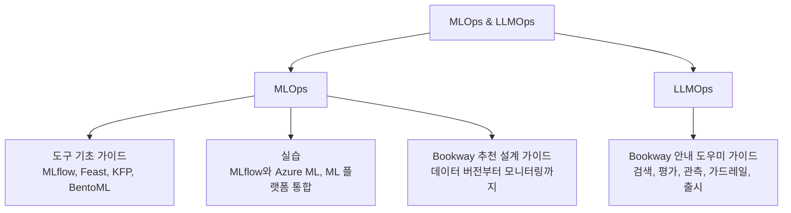

이 섹션은 도구 기초, 실습, 운영 설계로 나뉜다. 모델 학습, 서빙을 다루는 MLOps와 검색, 생성, 도구 실행을 다루는 LLMOps를 연결한다.

| 하위 섹션 | 담은 내용 | 시작하기 좋은 글 |
| --- | --- | --- |
| [MLOps](mlops/) | 가상 서점 Bookway의 추천 모델 기준 운영 설계, 도구별 역할 | [MLOps 전체 흐름](mlops/) |
| [MLOps > 도구 기초 가이드](mlops/basics/) | MLflow, Feast, Kubeflow Pipelines, BentoML의 설치부터 중간 수준 활용 | [MLflow 기초](mlops/basics/mlflow/) |
| [MLOps > 실습](mlops/labs/) | MLflow와 Azure ML 01~06, ML 플랫폼 통합 실습 00~10 | [실습 목차](mlops/labs/) |
| [LLMOps](llmops/) | Bookway 안내 도우미 기준 RAG, 평가, 관측, 가드레일, 출시 | [LLMOps 전체 흐름](llmops/) |

도구 기초, 실습, 요구사항별 설계 순으로 읽을 수 있다. 책 독서노트는 [Machine Learning Platform Engineering](/docs/tech/machine-learning-platform-engineering/)과 [AI Agents and Applications](/docs/tech/ai-agents-and-applications/)에 있다.


