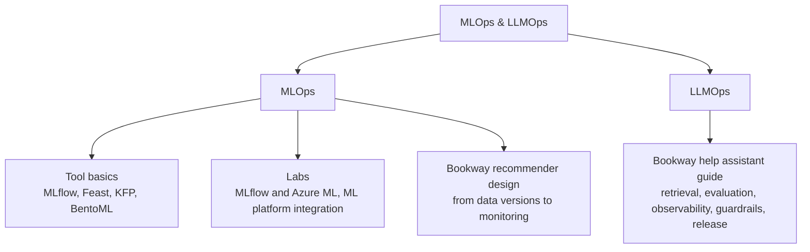

This section splits into tool basics, labs and operational design. It connects MLOps (model training and serving) with LLMOps (retrieval, generation and tool calls). The guides are written in Korean.

| Subsection | What it covers | Good place to start |
| --- | --- | --- |
| [MLOps](mlops/) | Operational design and tool roles for the Bookway bookstore recommender | [MLOps overview](mlops/) |
| [MLOps > Tool basics](mlops/basics/) | MLflow, Feast, Kubeflow Pipelines and BentoML from install to intermediate use | [MLflow basics](mlops/basics/mlflow/) |
| [MLOps > Labs](mlops/labs/) | MLflow and Azure ML 01-06, ML platform labs 00-10 | [Lab index](mlops/labs/) |
| [LLMOps](llmops/) | RAG, evaluation, observability, guardrails and release for the Bookway help assistant | [LLMOps overview](llmops/) |

Read in order: tool basics, labs, then design by requirement. The related book notes are [Machine Learning Platform Engineering](/docs/tech/machine-learning-platform-engineering/) and [AI Agents and Applications](/docs/tech/ai-agents-and-applications/).


