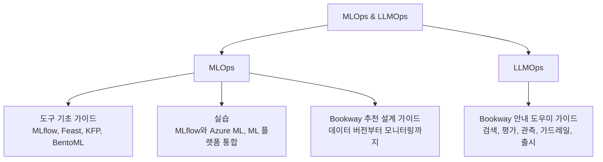

식당 운영을 배운다면 조리 도구 사용법, 실제 코스 요리 실습, 메뉴 기획과 주방 운영 설계를 따로 익힙니다. 이 섹션도 같은 방식으로 나눴습니다. 모델을 학습하고 서비스하는 MLOps와, 검색과 생성, 도구 실행이 더해지는 LLMOps를 하위에 두었습니다.

| 하위 섹션 | 담은 내용 | 시작하기 좋은 글 |
| --- | --- | --- |
| [MLOps](mlops/) | 가상 서점 Bookway의 추천 모델 기준 운영 설계, 도구별 역할 | [MLOps 전체 흐름](mlops/) |
| [MLOps > 도구 기초 가이드](mlops/basics/) | MLflow, Feast, Kubeflow Pipelines, BentoML의 설치부터 중간 수준 활용 | [MLflow 기초](mlops/basics/mlflow/) |
| [MLOps > 실습](mlops/labs/) | MLflow와 Azure ML 01~06, ML 플랫폼 통합 실습 00~10 | [실습 목차](mlops/labs/) |
| [LLMOps](llmops/) | Bookway 안내 도우미 기준 RAG, 평가, 관측, 가드레일, 출시 | [LLMOps 전체 흐름](llmops/) |

처음이라면 도구 기초 가이드로 사용법을 익히고, 실습으로 여러 도구를 묶어 본 뒤, 설계 가이드에서 요구사항에 따라 도구를 배치하는 방법을 보는 순서를 권합니다. 책 독서노트는 [Machine Learning Platform Engineering](/docs/tech/machine-learning-platform-engineering/)과 [AI Agents and Applications](/docs/tech/ai-agents-and-applications/)에 따로 정리했습니다.


