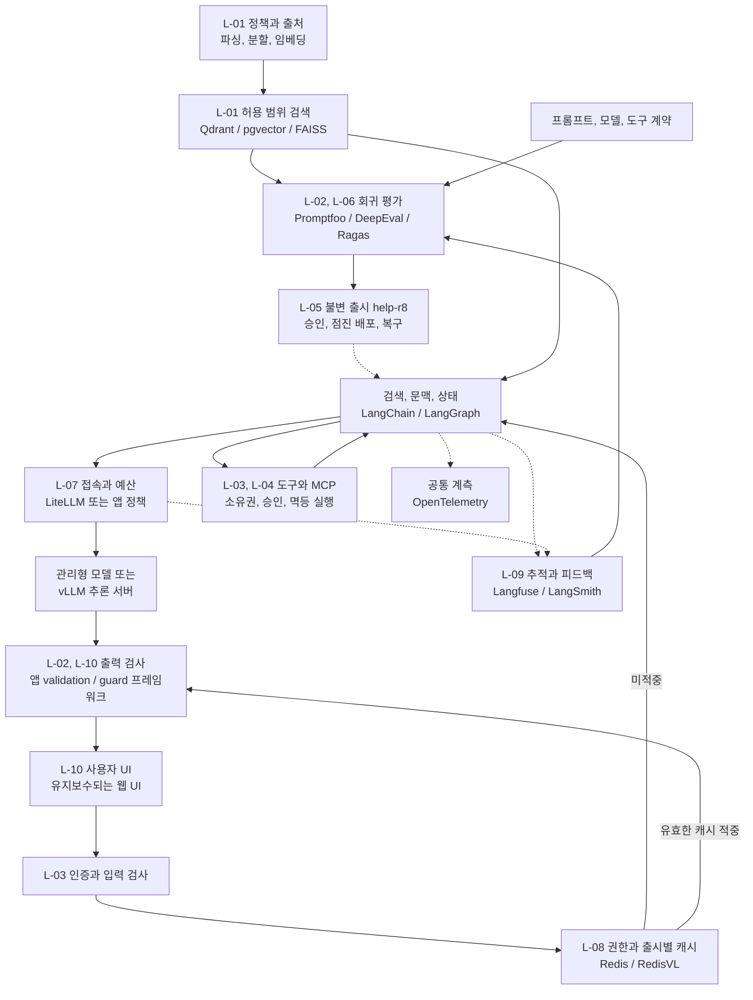

LLMOps는 정책 검색, 고객별 권한, 답변 근거와 도구 실행을 관리한다. 문제가 생겼을 때 사용한 자료와 변경을 추적할 수 있어야 한다.

**Bookway** 안내 도우미는 `policy-v3`에서 배송, 반품 조건을 찾고 인증된 주문 API로 상태를 조회한다. 추천은 [MLOps의 추천 모델](/docs/tech/ops/mlops/)의 책임이며 반품 신청은 별도 승인을 거친다.

## 시나리오와 범위 {#scenario}

도우미는 **공개 정책 안내, 내 주문 조회, 승인된 반품 신청**을 지원한다. 주문 변경은 별도 권한 경로를 거치며 환불 계산, 결제 취소, 송금은 제외한다.

합성 `policy-v3`는 수령 후 7일 이내 조건을 만족한 종이책만 반품 신청을 허용하고 전자책은 제외한다. 예외를 만들지 않으며 범위는 한국 `ko-KR`로 제한한다. 확장 시 평가와 캐시 계약을 갱신한다.

| 상황 | 입력과 전제 | 기대하는 동작 | 허용하지 않는 동작 |
| --- | --- | --- | --- |
| 정책 문의 | “종이책 반품은 언제까지인가요?” | 적용 정책 검색 후 7일 조건과 출처 안내 | 기억에 의존해 기간 생성 |
| 전자책 문의 | “전자책도 7일 안에 반품되나요?” | 종이책 규칙과 구분하고 제외 조건 설명 | 비슷한 질문의 종이책 캐시 재사용 |
| 내 주문 조회 | 로그인 `c-001`, 자신의 주문 `o-101` | 서버가 소유권 확인 후 최신 주문 API 조회 | 질문에 적힌 고객 ID로 접근 범위 변경 |
| 다른 고객 주문 | `c-001`이 `c-002`의 주문 요청 | 원문과 상태를 노출하지 않고 접근 거절 | 조회 결과를 모델 문맥에 먼저 전달 |
| 반품 신청 | 조건을 만족한 `o-101`의 `b-101` 1권 | 대상을 제시하고 승인 후 신청 1건 생성 | 안내만 요청했는데 자동 신청 |
| 정책이나 도구 장애 | 검색 timeout 또는 주문 API 오류 | 장애와 근거 부족을 구분해 표시 | 장애를 “주문 없음”이나 “반품 불가”로 해석 |

`o-101`은 설명용 주문이다. 반품 예제는 서버가 수령일과 조건을 확인한 경우를 전제로 하며, 정책 문장만 검색했다고 개별 주문의 반품 자격이 확정되지는 않는다.

기본 경로는 웹 UI, LangChain RAG, LangGraph 승인 상태, MCP 주문 어댑터, 관리형 모델이다. 검색은 Qdrant를 기본으로 pgvector, FAISS와 비교하고 추적은 Langfuse, LangSmith를 검토한다. Redis, LiteLLM, vLLM은 필요할 때만 추가한다.

## 요구사항과 인수 기준 {#requirements}

아래는 측정 결과가 아닌 **가상 프로젝트 목표**다. 검토한 합성 사례 100개로 정책 일반, 예외, 근거 없음, 주문 권한, 승인, 장애를 구분한다.

| ID | 요구사항 | 충족 여부를 판단할 기준 | 주요 담당 |
| --- | --- | --- | --- |
| L-01 | 유효하고 접근 가능한 문서만 검색 | 청크에 source와 적용 정책, embedding revision을 보존. 평가집에서 만료되거나 권한 밖인 source 노출 0건 | 수집 코드, 검색 저장소 |
| L-02 | 근거를 지키고 모르면 답을 만들지 않음 | 정책 답변 100%에 유효 source 또는 명시적 근거 부족 상태. 검토 판정 기준의 정책 정답률 95% 이상, 전자책 예외 위반 0건 | RAG 앱, 의미 평가, 검토 |
| L-03 | 고객과 주문의 접근 범위를 서버가 결정 | 다른 고객의 주문과 thread 접근 시험에서 조회와 노출 0건. 모델 인자가 서버 고객 ID를 변경하지 못함 | 인증, 앱, 주문 API |
| L-04 | 반품은 정확히 승인한 대상으로만 실행 | 승인 전 거래 0건. 대상과 수량 변경 시 재승인. 같은 업무 키의 재연결과 응답 유실 시험에서 신청 1건만 존재 | LangGraph, 업무 API |
| L-05 | 평가한 실행 조합을 재현하고 복구 | 문서, 색인, embedding, prompt 12, 모델, 도구와 guard 설정을 `help-r8`에 고정. 호환되고 정책상 유효한 이전 조합으로 10분 안에 복구 시험 | release 명세, CI, 배포 |
| L-06 | 회귀와 평가 실패가 출시를 막음 | 모든 필수 권한과 승인 시험 통과, 정책 정답률 기준 충족, 평가 미완료와 호출 오류도 차단. 후보와 보고서 지문 일치 | Promptfoo, 평가 코드 |
| L-07 | 지연과 요청당 비용을 예산 안에 유지 | 준비된 서비스의 동시 요청 10개, 15분 부하에서 성공 생성 응답의 p95 TTFT 2초 이하, 전체 8초 이하. 요청당 합산 모델 비용 상한 US$0.02 | gateway, 앱, 추론 서버 |
| L-08 | 재사용 답변이 권한과 정책을 넘지 않음 | 다른 권한, 다른 release, 만료 source의 cache hit 0건. 개인 주문과 거래 결과는 완성 답변 공용 캐시에서 제외 | 앱, Redis |
| L-09 | 실패를 추적하되 고객 원문을 무단 수집하지 않음 | API부터 검색, 모델, 도구까지 trace와 release 연결. 수집 시험에서 비밀과 주문 원문 외부 전송 0건. 관측 전송 실패도 계측 | OTel, Langfuse 또는 LangSmith |
| L-10 | 오류와 검증 상태를 사용자에게 정확히 전달 | 근거 부족, 접근 거절, 의존성 오류, 승인 대기, 완료를 구분. 검증 전 값을 거래 실행이나 확정 결과로 표시하지 않음 | UI, 앱, validator |

L-07 TTFT는 요청부터 첫 생성 토큰까지며 대기 애니메이션은 제외한다. 요청 비용은 생성, 질의 embedding, 재정렬, 실시간 guard를 합산하고 오프라인 평가, GPU 고정비는 별도다. 요청 유형별 성공률과 지연도 함께 본다.

토큰, 호출 한도와 잔여 예산으로 초과 호출을 사전에 차단한다. provider 정산이 늦는 사후 대시보드는 L-07 예산 통제를 대신하지 않는다.

## 요구사항이 실제 경로에 적용되는 순서

정책 질문은 서버가 범위를 정한 뒤 L-08 캐시를 조회한다. 미적중이면 L-01 근거 검색과 L-02 생성을 거친다. 근거 없음과 검색 장애는 각각 L-10에 구분해 전달하고 답을 만들지 않는다.

주문 상태는 RAG가 아닌 L-03 소유권 검사 뒤 도구로 조회한다. 반품은 L-04 승인 대기 후 서버가 고정한 대상, 수량으로만 재개한다. 모든 경로는 L-09 trace와 L-07 예산에 연결한다.

출시 자료는 source별 검색, case 판정, 권한, 멱등, 부하, 비용 시험과 release manifest다. L-06 통과 후 L-05를 배포한다. 하위 글은 도구별 책임을 설명하며 SDK 예제 실행이 서비스 인수 통과를 뜻하지 않는다.

## MLOps와 다른 책임, 공유하는 기반

LLMOps가 학습을 하지 않고 MLOps가 항상 직접 학습하는 것은 아니다. 둘 다 데이터, 평가, 배포, 권한, 관측을 다룬다. 여기서 차이는 출시 단위이다. 추천은 데이터, 피처, 모델, 서비스의 조합이고, 안내 도우미는 **문서, 임베딩, 검색, 프롬프트, 모델, 도구 계약**까지 함께 바뀐다.

| 요청 | 경로 | 정답과 권한의 기준 |
| --- | --- | --- |
| 반품 기간 안내 | 정책 검색 → 근거 기반 답변 | 정책 버전, 적용 조건, 출처 |
| 추천 도서 설명 | 추천 API → 도서 설명 조회 → 답변 | 추천 release, 판매 상태, 설명의 사실성 |
| 내 주문 배송 상태 | 인증 → 소유권 검사 → 주문 도구 | 서버가 확인한 고객, 주문 관계 |
| 반품 신청 | 대상, 조건 확인 → 승인 → 실행 | 승인한 인자, 멱등 키, 거래 결과 |

`help-r8` 등은 설명용 ID이며 실제 고객 정보나 실행 기록이 아니다.

## 구축, 평가, 운영을 잇는 도식

그림의 `/`는 선택지다. 검색 저장소와 추적 경로를 하나씩 고르고 vLLM은 자체 운영이 필요할 때만 추가한다.

## 도구별 실무 가이드

| 계층 | 하위 아티클 | Bookway에서 연결하는 값 |
| --- | --- | --- |
| 문서, 검색 | [문서 파이프라인과 FAISS](/docs/tech/ops/llmops/ingestion-faiss/) | `policy-v3` → 청크, 원문 ID, 임베딩 계약 |
| 벡터 서비스 | [Qdrant](/docs/tech/ops/llmops/qdrant/) | 컬렉션, payload 필터, 색인 교체 |
| 관계형 검색 | [pgvector](/docs/tech/ops/llmops/pgvector/) | 정책 행, 권한 조건, 벡터 질의 |
| 앱, 에이전트 | [LangChain, LangGraph, MCP](/docs/tech/ops/llmops/application/) | 질문 → 검색 → 도구 → 승인, 재개 |
| 사용자 접점 | [Chainlit과 대화 UI](/docs/tech/ops/llmops/conversation-ui/) | 세션, 스트리밍, 출처, 오류 표시 |
| 추적, 프롬프트 | [Langfuse](/docs/tech/ops/llmops/langfuse/) | 프롬프트 버전, trace, 품질 score |
| 추적, 실험 | [LangSmith](/docs/tech/ops/llmops/langsmith/) | 실행 트리, 데이터셋, 실험 비교 |
| 회귀 평가 | [Promptfoo](/docs/tech/ops/llmops/promptfoo/) | 고정 질문, assertion → CI 판정 |
| 의미 평가 | [DeepEval](/docs/tech/ops/llmops/deepeval/) | 응답, 문맥 → 근거성, 업무 기준 |
| 검색 진단 | [Ragas](/docs/tech/ops/llmops/ragas/) | 기대 근거, 검색 문맥, 답변의 분리 |
| 모델 접속 | [LiteLLM](/docs/tech/ops/llmops/litellm/) | 모델 alias, 라우팅, 예산, 호출 제한 |
| 자체 추론 | [vLLM](/docs/tech/ops/llmops/vllm/) | 고정 가중치, 토크나이저 → 생성 API |
| 재사용 | [Redis, RedisVL](/docs/tech/ops/llmops/redis/) | 권한, 정책, 출시에 묶인 캐시 |
| 입출력 검증 | [Guardrails AI](/docs/tech/ops/llmops/guardrails/) | 구조, 도메인 규칙, 검증 실패 |
| 대화 통제 | [NeMo Guardrails](/docs/tech/ops/llmops/nemo-guardrails/) | 입력, 검색, 행동, 출력 경계의 정책 |
| 공통 관측 | [OpenTelemetry](/docs/tech/ops/llmops/opentelemetry/) | API, 검색, 모델, 도구 span 연결 |
| 출시 운영 | [평가, 승인, 배포, 복구 계약](/docs/tech/ops/llmops/release/) | `help-r8`의 불변 명세와 복구 절차 |

Langfuse, DeepEval, Promptfoo, Guardrails AI, RedisVL에 **Ragas, Qdrant, pgvector, LiteLLM, vLLM, NeMo Guardrails, OpenTelemetry**를 보완 도구로 연결한다. LangSmith, LangGraph, MCP는 [AI Agents 독서노트](/docs/tech/ai-agents-and-applications/)와 이어진다.

공식 문서의 유지보수 중단 안내에 따라 Chainlit은 책의 UI 사례로만 다룬다. 도입 시 유지보수, 보안 업데이트, 데이터 반출도 확인한다.

## 도구가 많아져도 지켜야 할 경계

프롬프트 registry와 trace는 승인, 사실 검증이 아니며 높은 평가 점수도 권한 위반을 면제하지 않는다. 근거 없음, 검색 장애, guardrail 장애를 구분한다.

비용에 검색, 재정렬, 평가, guardrail을 포함하고 지연은 TTFT와 전체 시간으로 나눈다. temperature 0도 버전, 환경 차이를 없애지 않으므로 평가와 실패 사례를 보존한다.

운영 trace에서 합성 회귀 사례를 만들고 후보를 평가한다. 동의 없이 고객 대화를 외부로 보내지 않으며 예시는 합성 입력과 로컬, 승인 endpoint를 전제로 한다.

## 기존 글에서 이어지는 내용

기존 LLMOps의 모델, 프롬프트, 품질, 비용, 지연, 추적, 팀 책임을 통합하고 `/docs/tech/llmops/` 주소를 유지한다. Observatory는 [관측에서 개선 루프로 이어지는 사례](/docs/tech/ops/llmops/observatory/)로 분리했다.

[MLOps 전체 흐름](/docs/tech/ops/mlops/) / [실행했던 RAG 출시 기록](/docs/tech/ops/mlops/labs/ml-platform-labs-10-rag-release/)
