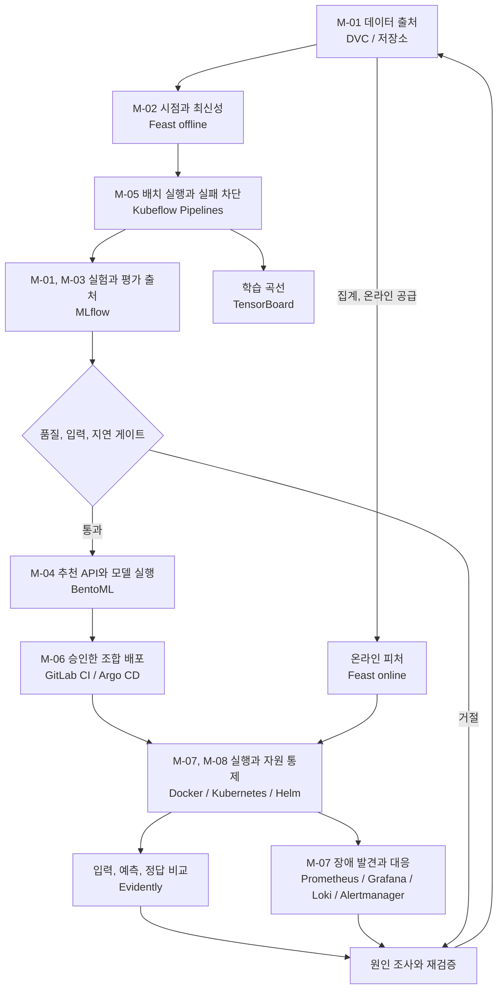

MLOps는 모델 파일뿐 아니라 **데이터에서 운영 결과까지의 변경 경로**를 관리한다.

가상 서점 **Bookway**에서 추천 모델은 최근 행동으로 도서 순위를 매기고 [LLMOps의 안내 도우미](/docs/tech/ops/llmops/)는 도서, 배송, 반품 정책에 답한다. 두 서비스는 별도 기준으로 평가한다.

| 이 섹션의 구성 | 내용 |
| --- | --- |
| [도구 기초 가이드](/docs/tech/ops/mlops/basics/) | MLflow, Feast, Kubeflow Pipelines, BentoML을 설치부터 중간 수준 활용까지 따라 하는 실행 가이드 |
| [MLOps 실습](/docs/tech/ops/mlops/labs/) | MLflow와 Azure ML 01~06편, ML 플랫폼 통합 실습 00~10편 |
| 이 글과 아래 설계 가이드 | Bookway 추천 서비스의 요구사항을 기준으로 도구를 배치한 운영 설계 |

처음이라면 기초 가이드부터 시작한다.

## 시나리오와 범위 {#scenario}

Bookway는 로그인 고객에게 판매 가능한 도서 중 최대 10권을 추천한다. 카탈로그가 후보를 제공하고 모델은 최근 30일 행동으로 순위를 매긴다. 결제와 재고 예약은 주문 시스템이 맡는다.

| 상황 | 입력과 전제 | 서비스가 해야 할 일 | 남기는 결과 |
| --- | --- | --- | --- |
| 기존 고객의 홈 화면 | 인증 고객 `c-001`, 후보에 `b-101` 포함 | 피처 v1을 조회하고 모델 17로 점수 계산 후 판매 상태 재검사 | 최대 10개 도서 ID, `rec-r17`, 처리 경로 |
| 행동 이력이 없는 고객 | 조회 성공, 사용 가능한 고객 피처 없음 | 승인된 인기순 기준선을 사용 | 실제 baseline 버전과 `fallback_reason=cold_start` |
| 피처 저장소 장애 | 조회 timeout 또는 연결 실패 | 신규 고객으로 가장하지 않고 명시적인 일시 오류 반환 | 오류 상태와 trace, 장애 지표 |
| 다음 추천 모델 준비 | 고정 데이터와 시간 분할 | 기준선과 후보 비교 후 통과한 조합만 출시 | 평가 보고서와 불변 release |
| 출시 직후 오류 증가 | 새 release에서만 오류 발생 | 확대를 중단하고 호환되는 이전 조합으로 복구 | 배포 선언, 모델과 피처 계약의 복구 기록 |

`rec-r17`은 **서비스 조합**을 식별한다. 실제 `model_version` 또는 `baseline_version`도 기록해 fallback을 모델 17의 예측처럼 표시하지 않는다. 후보가 부족하면 품절 도서로 채우지 않는다.

운영 가정은 카탈로그 10만 권, 일별 후보 생성, 시간당 피처 공급이다. 실제 측정값이 아닌 도구 비교 조건이며 아래 수치는 **목표 인수 기준**이다.

## 요구사항과 인수 기준 {#requirements}

| ID | 요구사항 | 충족 여부를 판단할 기준 | 주요 담당 |
| --- | --- | --- | --- |
| M-01 | 학습 입력과 평가를 다시 추적할 수 있어야 함 | release에서 데이터 지문, 코드, 시간 분할, 피처 정의, 모델 artifact를 역추적하고 별도 환경에서 복원 | DVC, MLflow, 저장소 |
| M-02 | 학습에 미래 정보가 없고 온라인 피처가 최신이어야 함 | 예측 시각 뒤 이벤트가 학습 행에 미포함, 가용 시점도 검사. 온라인 집계 기준 시각이 요청보다 2시간 넘게 뒤처지면 사용 중단 | 변환 작업, Feast |
| M-03 | 인기순보다 나쁜 후보를 출시하지 않음 | 같은 시간 분할과 후보 집합의 NDCG@10이 기준선 이상. cold-start와 이력 보유 집단을 따로 평가 | 평가 코드, MLflow |
| M-04 | 권한과 도서 상태를 지키는 추천 API | 인증 고객만 조회, 중복과 품절 도서 0개, 결과 최대 10개. 이력 없음과 의존성 장애를 다른 상태로 반환 | 앱, BentoML, 카탈로그 |
| M-05 | 배치 실패가 잘못된 출시로 이어지지 않음 | 검사 실패 시 후속 등록과 출시 중단. 같은 업무 키로 재시도해도 중복 출시를 생성하지 않음 | KFP, 등록 코드 |
| M-06 | 검증한 조합만 배포하고 복구 가능해야 함 | 이미지 digest, 모델, 전처리, 피처 계약을 고정. 시험 환경에서 `rec-r17` 장애 후 `rec-r16` 조합을 10분 안에 복구 | CI, Argo CD, 배포 담당 |
| M-07 | 요청 지연과 장애를 조기에 파악 | 준비된 서비스에 후보 100개 이하, 50 RPS, 15분 부하에서 p95 300ms 이하와 5xx 1% 미만. 운영은 5분 창의 오류율과 트래픽을 함께 감시 | BentoML, 실행 환경, 관측 |
| M-08 | 개인정보와 자원을 통제 | 공개 artifact와 메트릭 label에 고객 원문과 식별자 없음. 서빙은 필요한 읽기 권한만 가지며 자원과 과부하 한도를 명시 | 앱, 저장소, Kubernetes |

M-02의 2시간은 Feast의 TTL과 동일하지 않는다. 공급 작업이 기록한 **집계 완료 기준 시각**으로 확인하며, 해당 시각이 없거나 너무 오래되면 정상 피처로 취급하지 않는다. M-07은 API와 피처 조회, 모델 실행, 판매 상태 검사를 포함한 서버 응답 시간이며 브라우저의 화면 그리기 시간은 제외한다.

## 한 요청과 한 출시에서 요구사항이 이어지는 방식

`c-001` 요청은 M-04 인증, Feast의 v1 최신성 검사(M-02), BentoML 점수와 판매 상태 필터를 거친다. release, 실행 경로, 지연을 기록해 M-07을 관측한다. 단일 도구 설치로 흐름이 완성되지는 않는다.

KFP는 M-01 스냅샷에서 검사, 피처, 학습, 평가를 실행한다. M-03 통과 후보 지문만 M-06 명세로 넘기며 실패 보고서나 Registry 등록을 승인으로 취급하지 않는다(M-05).

검증 자료는 `data-manifest.json`, `evaluation.json`, `release.json`, API, 부하 시험, 복구 기록이다. 각 자료를 입력 지문에 연결한다. 하위 글은 **충족 확인 방법**을 설명하며 Bookway의 시험 통과를 뜻하지 않는다.

## Bookway의 공통 계약

고객, 주문, 정책과 ID는 흐름 설명용 합성 자료이며 실제 배포 결과가 아니다.

| 대상 | 예시 계약 | 바뀔 때 함께 확인할 것 |
| --- | --- | --- |
| 고객 | `customer_id=c-001`, 서버가 확인한 소유자 | 인증, 추천 피처, 주문 접근 범위 |
| 도서 | `book_id=b-101`, 판매 가능 여부 | 후보 생성, 품절 제외, 설명 문서 |
| 행동 데이터 | `events-20261024`, `event_time`과 수집 시점 | 시간 분할, 중복 이벤트, 삭제 요청 |
| 추천 피처 | `bookway_customer_v1`, 최근 30일 집계 | Feast 정의, 학습 시점, 온라인 최신성 |
| 추천 모델 | `bookway-ranker/17` | MLflow run, 평가 보고서, 서빙 입력 |
| 추천 출시 | `rec-r17` | 모델 버전, 이미지 digest, 피처 계약 |
| 안내 출시 | `help-r8` | 정책 `policy-v3`, 인덱스, 프롬프트, 모델 |

요청은 `customer_id`와 후보를 받고 순위, `release_id`를 반환한다. 사용자 ID는 인증 주체와 연결하며, 지연 도착하는 클릭, 구매 품질을 API 성공률과 혼합하지 않는다.

## 전체 흐름과 도구 위치

학습은 배치, 피처 공급은 별도 작업, 추천은 요청 경로다. KFP는 요청마다 학습하지 않고 Feast도 모델을 학습하지 않는다. Registry 등록은 출시 승인이 아니다.

## 역할별 하위 가이드

| 운영 구간 | 도구와 가이드 | Bookway에서 남기는 결과 |
| --- | --- | --- |
| 데이터 출처 | [DVC와 데이터 버전](/docs/tech/ops/mlops/data-versioning/) | 데이터 지문, 시간 분할, 복원 가능한 스냅샷 |
| 실험, 모델 관리 | [MLflow](/docs/tech/ops/mlops/mlflow/) | run → 평가 → 구체 모델 버전 |
| 학습 내부 분석 | [TensorBoard](/docs/tech/ops/mlops/tensorboard/) | step별 손실, 검증 곡선 |
| 학습, 서빙 피처 | [Feast](/docs/tech/ops/mlops/feast/) | 시점에 맞는 학습 값과 온라인 값 |
| 배치 오케스트레이션 | [Kubeflow Pipelines](/docs/tech/ops/mlops/kubeflow/) | 작업 DAG, 아티팩트, 재시도 경계 |
| 추론 서비스 | [BentoML](/docs/tech/ops/mlops/bentoml/) | 모델을 읽는 API와 배포 패키지 |
| 실행 기반 | [Docker, Kubernetes, Helm](/docs/tech/ops/mlops/runtime/) | 자원, 상태 검사, 롤아웃 |
| 변경 경로 | [GitLab CI, Argo CD](/docs/tech/ops/mlops/gitops/) | 검사된 이미지와 선언 상태 |
| 운영 상태 | [Prometheus, Grafana, Loki, Alertmanager](/docs/tech/ops/mlops/monitoring/) | 지연, 오류, 로그, 대응 |
| 데이터와 품질 변화 | [Evidently](/docs/tech/ops/mlops/evidently/) | 기준/현재 데이터 비교와 조사 근거 |

MLflow, Feast, KFP, BentoML, Evidently는 책의 도구 축이고 DVC는 데이터 버전을 보완한다. 모든 도구를 도입할 필요 없이 배치 스크립트와 관리형 DB에서 시작해 반복, 권한, 복구 부담에 따라 확장한다.

## 실무에서 이어지는 순서

시점, 평가 계약을 고정하고 MLflow에 기준선, 후보를 기록한다. Feast 정의와 KFP 단계를 연결해 검증된 **모델 버전**을 BentoML에 전달하고 이미지, 피처 계약까지 `rec-r17`로 고정한다.

오류율은 서비스 경로, 분포 변화는 수집, 피처 경로부터 조사한다. 지연 정답은 별도 평가하고 drift만으로 재학습하거나 모델만 rollback하지 않는다.

[Azure Machine Learning](/docs/tech/ops/mlops/labs/mlflow-aml-overview/)으로 일부 책임을 통합할 수 있으며 KFP, MLflow, Kubernetes를 모두 운영할 필요는 없다.

## 기존 기록과의 연결

[책 독서노트](/docs/tech/machine-learning-platform-engineering/)는 챕터 순서, [MLOps 실습](/docs/tech/ops/mlops/labs/)은 실행했던 Wine 분류, 영화 추천, 탐지, RAG 중심이다. 여기서는 그 기록을 이동하거나 Bookway의 실행 결과로 바꾸지 않고, **실무 책임별로 재구성한 설계, 구현 가이드**로 연결한다. 각 코드 조각의 입력 파일과 서비스 전제는 해당 글에 명시한다.

[LLMOps 전체 흐름](/docs/tech/ops/llmops/) / [Bookway 출시 계약](/docs/tech/ops/llmops/release/)
