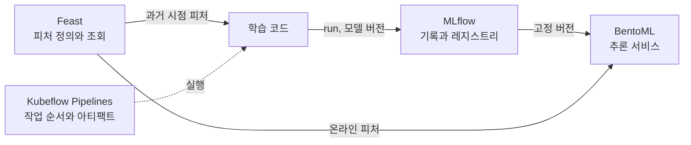

새 주방에 들어가면 칼, 냉장고, 작업 지시서, 배달 창구를 하나씩 써 봐야 코스 요리를 만들 수 있습니다. 이 가이드는 MLOps에서 자주 함께 쓰는 네 도구를 하나씩 설치하고, 기본 사용법에서 실무에서 부딪히는 중간 수준의 설정까지 직접 실행한 순서대로 정리한 것입니다.

| 도구 | 맡는 일 | 가이드 |
| --- | --- | --- |
| MLflow | 실험 기록, 모델 저장과 버전, 레지스트리, 간단한 서빙 | [MLflow 기초](mlflow/) |
| Feast | 피처 정의, 과거 시점 조회, 온라인 저장소와 서빙 | [Feast 기초](feast/) |
| Kubeflow Pipelines | 컨테이너 작업의 순서와 아티팩트 전달, 실행 기록 | [Kubeflow Pipelines 기초](kubeflow-pipelines/) |
| BentoML | 모델을 API 서비스로 만들고 패키징, 컨테이너화 | [BentoML 기초](bentoml/) |

네 도구는 서로를 직접 알지 못합니다. Feast는 어떤 모델이 피처를 쓰는지 모르고, MLflow는 어떤 피처 정의로 학습했는지 스스로 기록하지 않습니다. 둘을 잇는 것은 학습 코드와 그 코드가 남기는 기록입니다. 가이드마다 이 연결 지점을 따로 짚었습니다.

순서는 MLflow, Feast, Kubeflow Pipelines, BentoML을 권합니다. 각 가이드는 독립적으로 따라 할 수 있도록 별도 작업 폴더와 고정 버전을 사용합니다. 명령은 Linux, macOS 또는 Windows의 WSL2를 기준으로 합니다.

기초를 익힌 다음에는 [책 4~5장 로컬 실습 SOP](/docs/tech/ops/mlops/labs/book-ch04-05-sop/)에서 MLflow, Feast, Kubeflow Pipelines를 책의 코드 그대로 한 클러스터에서 이어 보고, [MLOps 실습](/docs/tech/ops/mlops/labs/)에서 Azure ML 연결과 여러 도구를 묶은 프로젝트를, [MLOps 설계 가이드](/docs/tech/ops/mlops/)에서 가상 서점 Bookway의 운영 요구사항을 기준으로 한 도구 배치를 볼 수 있습니다.


