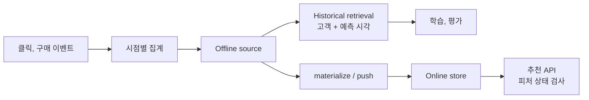

Feast는 학습과 추천 API의 **피처 정의와 조회 기준**을 연결한다. 원천 클릭 로그 정제나 모델 학습은 수행하지 않는다.

Bookway는 `customer_id`를 entity로, 최근 30일 구매 수와 장르 선호도를 피처로 사용한다. 집계 계산은 데이터 작업이 수행하고 Feast는 그 결과의 정의, 등록, 과거/온라인 조회를 맡는다.

## offline과 online의 두 경로



학습 행이 10월 20일의 예측이라면 10월 21일에 생긴 구매를 집계에 넣지 않는다. Point-in-time 조회는 올바른 timestamp가 주어진 자료에서 미래 행을 피하는 데 도움이 되지만, 미리 잘못 집계한 피처 내부의 누수까지 고치지는 못한다.

## 등록에서 요청까지

정의 파일에 entity, 원천 schema, event timestamp, FeatureView를 두고, 모델이 사용하는 묶음을 FeatureService로 고정한다. 예시 이름은 `bookway_customer_v1`이다. `feast apply`는 정의 반영이지 학습이나 온라인 값 공급 완료가 아니다.

집계 후 UTC 범위를 지정해 `feast materialize`를 실행하고 backfill, 정기 공급의 완료 시각, 행 수, 지연을 기록한다. 값의 시점, FeatureView TTL, Redis key 만료도 각각 확인한다.

아래 코드는 `feature_repo`에 위 FeatureService와 값이 이미 등록된 환경의 온라인 조회이다.

```python
from feast import FeatureStore

store = FeatureStore(repo_path="feature_repo")
service = store.get_feature_service("bookway_customer_v1")
response = store.get_online_features(
    features=service,
    entity_rows=[{"customer_id": "c-001"}],
)
print(response.to_dict())
```

SDK 상태, timestamp, source 계약도 검사한다. 누락값을 0으로 바꾸면 피처 없음이 구매 0회로 오해된다. cold-start는 `fallback_reason`과 별도 release로 표시하고 저장소 장애와 구분한다.

## `rec-r17`의 변경과 복구

모델 17이 v1 피처를 요구하는데 온라인에 v2 변환만 덮어쓰면 모델만 롤백해도 복구되지 않는다. FeatureService, 원천 변환, 모델을 같이 버전 관리하고, 새 피처를 병렬 공급한 뒤 비교한다. 필요한 값이 준비된 모델만 트래픽을 받는다.

운영 수치는 online read p95, missing 비율, 공급 지연, entity별 분포이다. 고객 ID는 메트릭 label에 넣지 않고 제한된 접근 로그에만 남긴다. 온라인 저장소, registry, offline source의 권한과 백업은 서로 다르다.

[공식 조회 문서](https://docs.feast.dev/getting-started/concepts/feature-retrieval) / [기존 Feast 실행, 화면 기록](/docs/tech/machine-learning-platform-engineering/04-experiments-features-pipelines/) / [KFP의 공급 작업](/docs/tech/ops/mlops/kubeflow/)
