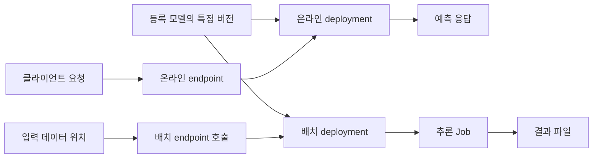

온라인 추론은 요청에 응답하고 배치 추론은 결과 파일을 남긴다. 모델 버전과 서비스를 잇는 deployment, endpoint를 구분한다.

BentoML의 역할은 [도구 비교](/docs/tech/ops/mlops/labs/mlflow-aml-overview/#전체-mlops에서의-역할)와 [기능 안내](/docs/tech/ops/mlops/labs/bentoml-capabilities/)를 참고한다. 여기서는 BentoML 대신 AML의 MLflow 배포를 다룬다.

## 준비 조건과 실습 범위

[05편](/docs/tech/ops/mlops/labs/05-model-registration/)의 모델과 `src\train.py`를 사용한다. 여기서는 로컬 요청 파일만 만들며 실제 endpoint와 deployment는 배포 권한, 자원, 네트워크, 비용을 확인한 뒤 후속 실습으로 진행한다.

## 등록된 모델을 추론에 연결

[배포 지침](https://learn.microsoft.com/en-us/azure/machine-learning/how-to-deploy-mlflow-models?view=azureml-api-2), [온라인](https://learn.microsoft.com/en-us/azure/machine-learning/how-to-deploy-mlflow-models-online-endpoints?view=azureml-api-2), [배치](https://learn.microsoft.com/en-us/azure/machine-learning/how-to-mlflow-batch?view=azureml-api-2) 배포 문서를 참고한다. 앞의 스크립트는 등록까지 수행하며, 여기서는 모델 소비 구조와 후속 검증 조건을 다룬다.

### 등록 모델, deployment, endpoint

| 대상 | 나타내는 것 | 모델을 바꿀 때의 관계 |
| --- | --- | --- |
| 등록 모델 버전 | 특정 모델 패키지 | 배포가 사용할 모델의 구체 버전 |
| Deployment | 모델을 실행하는 구현과 자원 설정 | 모델, 실행 환경, 컴퓨팅 등의 조합 |
| Endpoint | 사용자가 호출하는 접점 | 어떤 deployment로 요청이나 작업을 보낼지 관리 |

새 Registry 버전은 기존 deployment를 자동 교체하지 않는다. 버전을 선택해 배포하고 필요하면 endpoint 연결을 바꾼다.



### No-code 배포에서 자동화되는 범위

No-code는 추론 코드와 환경이 불필요하다는 뜻이 아니라 AML이 모델 계약을 읽어 기본 구성을 만든다는 뜻이다. 자동 추론은 `python_function` PyFunc flavor를 사용한다.

| 자동으로 처리하는 부분 | 여전히 정할 부분 |
| --- | --- |
| MLflow 모델의 로딩과 `predict()` 호출 | 어떤 모델 버전을 사용할지 |
| 모델 의존성을 바탕으로 한 추론 환경 구성 | 자원 크기, 개수, 확장과 네트워크 조건 |
| Signature를 이용한 입력 형식 확인 | 업무상 유효한 입력과 허용할 오류 |
| 기본 요청 처리 코드 | 인증, 배포 권한, 트래픽 전환과 복구 |

직접 정의한 추론 환경에는 서버 패키지도 필요하다. 배포 방식에 따라 `azureml-inference-server-http`, `azureml-ai-monitoring` 요구를 확인하고 학습용 `conda.yml`을 그대로 쓰지 않는다.

모델에 전처리, 후처리가 없거나 다른 flavor가 필요하면 scoring script와 실행 환경을 직접 지정한다.

### 온라인 추론의 흐름

온라인 endpoint는 요청을 받고 예측을 응답하는 경로다. 후속 실습의 작업 순서는 다음과 같이 정리했다.

1. AML Models에서 배포할 이름과 구체 버전을 확인한다.
2. Endpoint의 이름, 인증 방식과 접근 범위를 정한다.
3. 해당 버전의 모델과 컴퓨팅을 사용하는 deployment를 만든다.
4. Deployment 상태와 로그를 확인하고 지정한 deployment에 테스트 요청을 보낸다.
5. 일반 요청이 해당 deployment로 가도록 트래픽을 설정한다.
6. 지연, 오류, 예측 결과를 확인한 뒤 유지 또는 복구를 판단한다.

deployment 직접 테스트와 endpoint 일반 트래픽 수신은 다르다. 배포 완료만으로 서비스 연결을 확인했다고 보지 않는다.

#### 요청 데이터의 형태

로컬 `model.predict(DataFrame)`에는 HTTP 본문이 없다. endpoint 호출에는 서버가 요구하는 JSON 구조를 맞춘다.

| 실행 방식 | 표 데이터 입력의 바깥 구조 |
| --- | --- |
| 로컬 Python `predict()` | DataFrame 객체 |
| MLflow 내장 서버의 표 데이터 요청 | `dataframe_split` 안에 `columns`, `data` 등 |
| AML no-code 온라인 endpoint | `input_data` 안에 `columns`, `data` 등 |

serving 예시가 모든 서버에서 통한다고 가정하지 않는다. 다음 코드는 Wine 테스트 데이터로 AML 요청 파일만 만들며 endpoint를 생성, 호출하지 않는다.

`make_request.py`:

```python
import json
from pathlib import Path

from src.train import load_data


_, _, X_test, _, _, _, _ = load_data()
samples = X_test.head(2)
payload = {
    "input_data": json.loads(
        samples.to_json(orient="split", index=False)
    )
}
Path("sample-request.json").write_text(
    json.dumps(payload, indent=2), encoding="utf-8"
)
print("AML request written to sample-request.json")
```

```powershell
.\.venv\Scripts\python.exe .\make_request.py
```

후속 실습에서 workspace에 온라인 endpoint와 deployment를 만든 뒤에는 다음 형태로 특정 deployment를 테스트할 수 있다. 아래 이름은 실제 생성한 값으로 바꾸며, workspace 변수는 04편의 연결 설정에서 사용한 값과 같다.

```powershell
$endpoint = "<created-endpoint-name>"
$deployment = "<created-deployment-name>"
az ml online-endpoint invoke --name $endpoint --deployment-name $deployment --request-file .\sample-request.json --resource-group $resourceGroup --workspace-name $workspace --subscription $subscription
```

두 행을 등록 모델과 비교해 입력 계약을 확인한다. 동시 요청, 큰 입력, 초기화 지연, 잘못된 입력은 별도로 검증한다.

### 배치 추론의 흐름

배치 endpoint는 데이터 위치를 받아 비동기 추론 Job을 만들고 결과를 저장한다. 몇 행을 즉시 응답하는 온라인 호출과 다르다.

1. 등록한 MLflow 모델 버전과 사용할 compute cluster를 확인한다.
2. Batch endpoint와 model deployment를 만든다.
3. 입력 파일 위치, 접근 권한, 지원 형식과 signature를 확인한다.
4. Endpoint를 호출해 추론 Job ID를 받는다.
5. Job 상태와 실패한 파일, 재시도 결과를 확인한다.
6. 완료 후 결과 파일을 내려받아 입력 파일과 예측을 연결한다.

기본 MLflow 배치는 CSV, Parquet을 DataFrame으로, 지원 이미지 파일을 배열로 읽는다. 다른 형식, 행 단위 분할, 특수 전처리에는 scoring script를 검토한다.

`mini_batch_size`는 행이 아닌 파일 수다. 한 CSV에 행이 많으면 작은 설정도 큰 메모리를 쓸 수 있으므로 파일 분할과 처리 시간을 함께 본다.

Job ID는 완료 결과가 아니다. 입력 파일, 행과 예측 파일을 연결할 기준을 남긴다. Endpoint 삭제도 기존 scoring Job과 결과를 지우지 않는다.

### 배포 도구와 모델 전환

MLflow 형식의 모델을 배포하는 것과 모든 배포를 MLflow SDK로 관리하는 것은 다른 선택이다.

| 배포 작업 | 도구 선택 |
| --- | --- |
| 기본 온라인 배포 | MLflow 배포 클라이언트 또는 AML CLI, SDK, studio |
| 사용자 정의 scoring script를 쓰는 온라인 배포 | AML CLI, SDK, studio |
| 배치 endpoint 배포 | AML CLI, SDK, studio |
| 선언적 설정과 자동화 | YAML을 관리하는 AML CLI 또는 SDK 경로 검토 |

[점진적 전환 문서](https://learn.microsoft.com/en-us/azure/machine-learning/how-to-deploy-mlflow-models-online-progressive?view=azureml-api-2)는 같은 endpoint 아래에 기존 deployment와 새 deployment를 두는 방법을 다룬다. 새 deployment를 일반 트래픽 0% 상태에서 직접 테스트한 뒤 일부 트래픽을 옮기고, 문제가 없으면 비중을 늘린다.

전환 대상은 Registry stage가 아니라 endpoint 트래픽 설정이다. 이전 deployment로 되돌려도 새 자원은 자동 삭제되지 않으므로 유지 비용과 제거 시점을 정한다.

## 확인할 결과

로컬에서는 `sample-request.json`의 `input_data`, 13개 열, 두 행을 확인한다. 온라인은 등록 모델과 예측을 비교하고, 배치는 Job ID, 완료 상태, 결과 파일을 각각 확인한다.

## 오류 확인

| 증상 | 확인할 부분 |
| --- | --- |
| 온라인 요청의 본문을 해석하지 못함 | MLflow 내장 서버용 본문과 AML의 `input_data`를 혼동했는지 |
| Signature 입력 오류 | 열 이름, 타입, shape와 필수 입력 |
| Deployment 시작 또는 모델 로딩 실패 | 모델 환경, 추론 서버 패키지와 네트워크 |
| Deployment는 있지만 일반 요청이 가지 않음 | Endpoint의 트래픽 설정과 직접 테스트의 차이 |
| 배치가 느리거나 메모리 부족 | 파일 수 기준의 mini-batch와 파일 안의 행 수 |
| 새 버전 등록 후 응답이 그대로임 | 기존 deployment가 새 모델로 자동 교체되는 것은 아님 |

## 비용과 정리

01~05편은 온라인 endpoint를 만들지 않으며 모델 등록만으로 HTTP 서비스가 시작되지 않는다. 후속 배포에는 추론 자원과 정리 항목이 추가된다.

| 대상 | 학습 후 확인할 것 |
| --- | --- |
| 로컬 UI | 터미널에서 종료했는지 |
| AML compute cluster | 실행 중인 Job과 노드 수, 최소 노드 수, 축소 설정 |
| Compute instance | 별도로 켰다면 중지할 대상인지 |
| 모델과 아티팩트 | 저장량과 보존 기간, 남겨 둘 비교 결과 |
| 온라인 deployment | 트래픽이 없어도 유지되는 추론 자원, 전환 후 남은 이전 배포 |
| 배치 추론 | 실행 중인 scoring Job, 공유 compute, 입력과 결과 파일 |
| Workspace 관련 리소스 | 스토리지 등 컴퓨팅 중지 후에도 남는 비용 |

Job 완료 후에도 비용이 남을 수 있다. 공유 workspace와 클러스터는 실습 종료만으로 삭제하지 않는다.

## 생각할 점

- 모델 signature와 HTTP 요청의 바깥 구조는 각각 무엇을 정하는가.
- 모델 버전, deployment, endpoint의 변경을 같은 작업으로 보고 있지 않은가.
- 트래픽을 되돌린 뒤에도 남는 자원과 비용은 무엇인가.

## 참고 자료

- [MLflow 모델 배포 지침](https://learn.microsoft.com/en-us/azure/machine-learning/how-to-deploy-mlflow-models?view=azureml-api-2)
- [온라인 endpoint 배포](https://learn.microsoft.com/en-us/azure/machine-learning/how-to-deploy-mlflow-models-online-endpoints?view=azureml-api-2)
- [배치 endpoint 배포](https://learn.microsoft.com/en-us/azure/machine-learning/how-to-mlflow-batch?view=azureml-api-2)
- [점진적 모델 전환](https://learn.microsoft.com/en-us/azure/machine-learning/how-to-deploy-mlflow-models-online-progressive?view=azureml-api-2)

[이전: 05. 모델 등록과 버전 관리](/docs/tech/ops/mlops/labs/05-model-registration/), [시리즈 목차](/docs/tech/ops/mlops/labs/)
