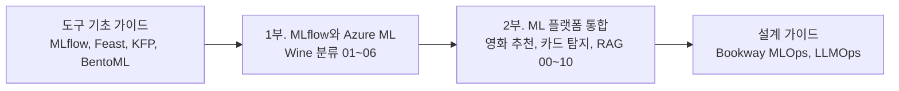
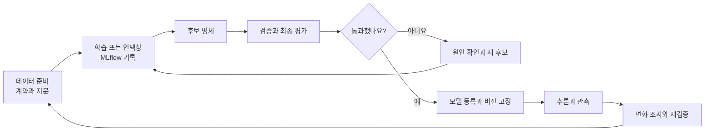

요리를 배울 때 칼 쓰는 법을 먼저 익히고, 그다음 코스 요리를 처음부터 끝까지 만들어 봅니다. 이 실습도 두 부분으로 나눴습니다. 1부는 MLflow 하나로 실험을 기록하고 모델을 등록하는 기본기, 2부는 여러 도구를 이어 한 서비스의 흐름을 완성하는 과정입니다.

원래 따로 있던 「MLflow와 Azure Machine Learning」과 「ML 플랫폼 엔지니어링 통합 실습」을 하나로 묶었습니다. 기존 글의 주소는 모두 이 아래의 새 주소로 연결됩니다. 도구마다 처음 설치부터 따라 하고 싶다면 [도구 기초 가이드](/docs/tech/ops/mlops/basics/)를 먼저 읽는 편이 좋습니다.



## 1부. MLflow와 Azure ML

같은 Wine 분류 모델 하나로 로컬 MLflow 기록, 실행 비교, 모델 형식, Azure ML 연결과 원격 Job, 모델 등록, 온라인과 배치 추론을 차례로 익힙니다. 하나의 `mlflow-aml-lab` 폴더에 파일과 실행 기록을 이어서 추가하는 구성입니다. 도구의 역할, 로컬 Python과 AML 사이의 호출 순서, 참고 문서는 [1부 안내](mlflow-aml-overview/)에 정리했습니다.

| 순서 | 글 | 남길 결과 |
| --- | --- | --- |
| 안내 | [MLflow와 Azure ML 실습 안내](mlflow-aml-overview/) | 1부의 구성, 도구 역할, 참고 문서 |
| 참고 | [MLflow 기능과 구성](mlflow-capabilities/) | Tracking, 모델, Registry, 평가, 서빙의 범위 |
| 참고 | [BentoML 기능과 구성](bentoml-capabilities/) | Service, Bento, 컨테이너와 배포 범위 |
| 01 | [MLflow 기본과 로컬 실험 기록](01-local-tracking/) | 세 번의 학습 run과 보고서, 모델 |
| 02 | [실행 비교와 메트릭 및 아티팩트 조회](02-query-and-compare/) | 비교 결과와 `selected-run.json` |
| 03 | [모델 형식과 재사용](03-model-format-and-loading/) | 모델 계약과 재로딩, 입력 검사 결과 |
| 04 | [AML 연결과 원격 학습 Job](04-azureml-tracking-and-jobs/) | AML에 남은 학습 기록과 원격 Job |
| 05 | [모델 등록과 버전 관리](05-model-registration/) | 모델 이름과 구체 버전 |
| 06 | [온라인 및 배치 추론과 모델 교체](06-online-and-batch-inference/) | 추론 요청 파일과 배포, 전환의 확인 기준 |

04편부터는 Azure 리소스와 비용이 관계됩니다. 01~03편은 로컬 SQLite와 파일 저장소만 사용하므로 구독 없이도 따라 할 수 있습니다.

## 책 4~5장 그대로 따라 하기

『Machine Learning Platform Engineering』 4장의 MLflow, Feast 노트북과 5장의 Kubeflow Pipelines 배치 추론을 책의 코드 그대로 실행하는 절차입니다. 책이 전제하는 Kubeflow, MinIO, PostgreSQL, Redis, MLflow 서버를 kind 클러스터에 한 번에 설치하는 [공개 저장소](https://github.com/johklo/ml-platform-book-env)를 쓰고, 버킷 생성부터 결과 파일 확인까지 번호를 붙여 적었습니다.

| 글 | 남길 결과 |
| --- | --- |
| [책 4~5장 로컬 실습 SOP](/docs/tech/machine-learning-platform-engineering/book-ch04-05-sop/) | MLflow에 등록된 `random-forest-classifier` Production 버전, Feast 레지스트리, KFP 실행 결과 `income_predictions.parquet` |

## 2부. ML 플랫폼 통합

『Machine Learning Platform Engineering』을 읽으면서 도구가 맡는 역할은 이해해도, 조건을 바꾸거나 오류를 만났을 때 어디부터 확인해야 할지는 별도로 연습해야겠다고 느꼈습니다. 책에서 다루는 흐름을 실제 코드로 이어서 실행할 수 있도록 [실습 저장소](https://github.com/johklo/ml-platform-engineering-labs)를 만들었습니다.

책은 MLflow와 Feast, Kubeflow Pipelines와 BentoML을 연결하고 객체 탐지와 추천, RAG로 확장합니다. 다만 안내된 경로를 따라 실행하는 것과 요구사항이 바뀌어도 스스로 설계하고 복구하는 것은 다른 단계입니다. 2부는 그 사이를 연습하는 자료입니다. 복사해야 하는 코드 조각 대신 실행 가능한 패키지를 제공하고, 데이터 계약과 지문, 후보 명세와 평가 보고서, 등록 버전을 서로 연결합니다.

### 세 프로젝트로 나눈 이유

| 프로젝트 | 배우는 흐름 | 구분할 점 |
| --- | --- | --- |
| 영화 추천 | 시간 분할, SVD, MLflow, 등록과 추천 API | 평점 오차와 추천 순위 품질은 다릅니다 |
| 합성 카드 탐지 | 이미지와 라벨, 기준선, YOLO, 검증과 추론 | 카드 위치 탐지는 OCR이 아닙니다 |
| 문서 검색과 RAG | 검색 인덱스, 근거 인용, 생성 연결과 평가 | 검색 성공과 답변의 사실성은 다릅니다 |

처음에는 작은 합성 데이터로 전체 연결을 확인합니다. 영화 추천은 직접 내려받은 MovieLens를 가져오는 과정도 제공합니다. 합성 카드의 높은 점수를 실제 신분증 사진의 성능으로 해석하거나, 짧은 합성 문서의 검색 결과를 업무용 RAG 품질로 해석하지는 않습니다.



### 먼저 실행해 보기

Python 3.11 또는 3.12, Git과 uv를 준비합니다. PowerShell에서는 다음 순서로 시작합니다.

```powershell
git clone https://github.com/johklo/ml-platform-engineering-labs.git
Set-Location ml-platform-engineering-labs
uv sync --locked --extra dev
uv run ml-labs smoke --work .ml-labs/first-run
```

GPU나 클라우드 계정 없이 세 프로젝트의 준비, 모델 저장, 평가와 등록을 연결합니다. `.ml-labs/first-run`에 후보 명세와 보고서가 남고 등록된 모델 URI가 출력됩니다. 다시 실행할 때는 새로운 작업 경로를 사용합니다.

여기서 기본 카드 모델은 색상 규칙 기준선이고, 로컬 문서 응답은 LLM 생성이 아닌 검색 문장 인용입니다. 빠른 연결 확인과 실제 도구 학습을 혼동하지 않도록 별도 과정으로 나눴습니다.

### 도구별로 이어서 실습하기

| 순서 | 가이드 |
| --- | --- |
| 00 | [실행 구조와 출처 기록](ml-platform-labs-00-foundation/) |
| 01 | [영화 추천과 MovieLens](ml-platform-labs-01-movies/) |
| 02 | [합성 카드 탐지와 YOLO](ml-platform-labs-02-cards/) |
| 03 | [Feast의 과거 시점과 온라인 피처](ml-platform-labs-03-feast/) |
| 04 | [Kubeflow와 Azure ML 파이프라인](ml-platform-labs-04-pipelines/) |
| 05 | [BentoML, HTTP 서빙과 Evidently](ml-platform-labs-05-serving-monitoring/) |
| 06 | [RAG와 LLMOps 도구 연결](ml-platform-labs-06-rag-llmops/) |
| 07 | [Azure 구성과 실행 절차](ml-platform-labs-07-azure/) |
| 08 | [책과의 대응 및 검증 범위](ml-platform-labs-08-coverage/) |
| 09 | [피처 조회, 출시와 장애 복구 통합 실험](ml-platform-labs-09-integrated-operations/) |
| 10 | [RAG 변경 평가와 출시 및 복구](ml-platform-labs-10-rag-release/) |

한 번에 모든 도구를 설치하지 않고 필요한 단계에서 선택 의존성을 추가합니다. 도구마다 입력, 출력과 실패 기준을 확인한 뒤 다음 단계로 넘어가는 순서입니다. 09편에서는 MLflow 후보 비교에서 실제 Feast 기반 요청 분기, 배치 재시도와 출시 복구까지 하나로 실행합니다.

### Azure에서 달라지는 부분

Azure ML 작업은 독립된 실행 환경에서 데이터를 주고받습니다. 내 PC의 파일 경로나 SQLite 주소를 그대로 넘기는 방식으로는 연결되지 않습니다. 작업의 입력과 출력, workspace의 tracking URI와 코드 커밋을 명시하도록 구성했습니다.

파이프라인 YAML과 Bicep을 로컬에서 생성하고 검토하는 단계와, 실제 리소스를 배포하거나 작업을 제출하는 단계는 구분합니다. Azure ML managed endpoint용 모델 내보내기와 배포 스크립트도 제공합니다. 2부 작업에서는 Azure 리소스를 생성하지 않았으므로, 실행할 때는 지역별 모델 지원, quota, 권한과 비용을 먼저 확인합니다.

### 학습 범위의 경계

이 자료는 책 전체 도구의 모든 기능을 구현한 운영 플랫폼은 아닙니다. 무중단 트래픽 전환, 문서별 접근 통제, 의미 기반 답변 캐시와 운영용 대시보드처럼 추가 구현이 필요한 부분은 [대응표](ml-platform-labs-08-coverage/)에 구분했습니다.

로컬 출시 과정에서는 평가를 통과한 후보만 활성화하고, 포인터 전환 실패에서 기존 버전이 유지되는지 확인합니다. RAG도 프롬프트, 문서와 검색 설정을 고정한 후보를 평가하고, 품질이 떨어지는 변경은 거절합니다. 이 로컬 게이트는 조직의 승인 절차나 클라우드의 무중단 운영을 대신하지 않습니다.

## 함께 보면 좋은 글

가상 서점 Bookway를 기준으로 도구별 운영 설계를 정리한 [MLOps](/docs/tech/ops/mlops/)와 [LLMOps](/docs/tech/ops/llmops/) 가이드, 책의 흐름을 따라간 [책 읽기 지도](/docs/tech/machine-learning-platform-engineering/00-overview/)가 있습니다. 실습의 데이터와 결과는 Bookway의 가상 시나리오와 구분합니다.


