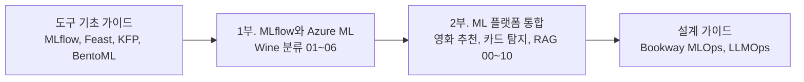
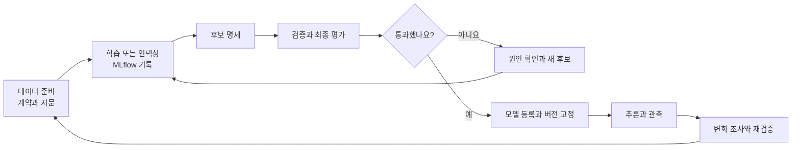

요리 실습처럼 1부에서 MLflow 실험 기록과 모델 등록을 익히고, 2부에서 여러 도구를 연결해 서비스를 완성한다.

「MLflow와 Azure Machine Learning」과 「ML 플랫폼 엔지니어링 통합 실습」을 합쳤다. 기존 주소는 이 아래의 새 주소로 연결되며, 도구 설치부터 익히려면 [도구 기초 가이드](/docs/tech/ops/mlops/basics/)를 먼저 본다.



## 1부. MLflow와 Azure ML

같은 Wine 분류 모델로 로컬 기록, 실행 비교, 모델 형식, AML 연결과 원격 Job, 등록, 온라인 및 배치 추론을 익힌다. 파일과 실행 기록은 `mlflow-aml-lab`에 이어서 추가하고, 도구 역할과 호출 순서는 [1부 안내](mlflow-aml-overview/)에서 확인한다.

| 순서 | 글 | 남길 결과 |
| --- | --- | --- |
| 안내 | [MLflow와 Azure ML 실습 안내](mlflow-aml-overview/) | 1부의 구성, 도구 역할, 참고 문서 |
| 참고 | [MLflow 기능과 구성](mlflow-capabilities/) | Tracking, 모델, Registry, 평가, 서빙의 범위 |
| 참고 | [BentoML 기능과 구성](bentoml-capabilities/) | Service, Bento, 컨테이너와 배포 범위 |
| 01 | [MLflow 기본과 로컬 실험 기록](01-local-tracking/) | 세 번의 학습 run과 보고서, 모델 |
| 02 | [실행 비교와 메트릭 및 아티팩트 조회](02-query-and-compare/) | 비교 결과와 `selected-run.json` |
| 03 | [모델 형식과 재사용](03-model-format-and-loading/) | 모델 계약과 재로딩, 입력 검사 결과 |
| 04 | [AML 연결과 원격 학습 Job](04-azureml-tracking-and-jobs/) | AML에 남은 학습 기록과 원격 Job |
| 05 | [모델 등록과 버전 관리](05-model-registration/) | 모델 이름과 구체 버전 |
| 06 | [온라인 및 배치 추론과 모델 교체](06-online-and-batch-inference/) | 추론 요청 파일과 배포, 전환의 확인 기준 |

04편부터는 Azure 리소스와 비용이 발생할 수 있다. 01~03편은 로컬 SQLite와 파일 저장소만 사용하므로 구독 없이도 따라 할 수 있다.

## 책 4~5장 그대로 따라 하기

『Machine Learning Platform Engineering』 4장의 MLflow, Feast 노트북과 5장의 Kubeflow Pipelines 배치 추론을 원본 코드를 실행하는 절차다. 책의 Kubeflow, MinIO, PostgreSQL, Redis, MLflow 서버를 kind에 설치하는 [공개 저장소](https://github.com/johklo/ml-platform-book-env)를 사용해 버킷부터 결과 확인까지 안내한다.

| 글 | 남길 결과 |
| --- | --- |
| [책 4~5장 로컬 실습 SOP](/docs/tech/machine-learning-platform-engineering/04-experiments-features-pipelines/#book-lab-sop) | MLflow에 등록된 `random-forest-classifier` Production 버전, Feast 레지스트리, KFP 실행 결과 `income_predictions.parquet` |

## 2부. ML 플랫폼 통합

『Machine Learning Platform Engineering』의 도구 역할을 넘어 조건 변경과 오류 복구를 연습하도록 [실습 저장소](https://github.com/johklo/ml-platform-engineering-labs)를 만들었다.

책의 MLflow, Feast, Kubeflow Pipelines, BentoML을 객체 탐지, 추천, RAG로 확장한다. 2부는 요구사항 변경과 오류 복구를 연습하도록 실행 가능한 패키지에서 데이터 계약과 지문, 후보 명세, 평가 보고서, 등록 버전을 연결한다.

### 세 프로젝트로 나눈 이유

| 프로젝트 | 배우는 흐름 | 구분할 점 |
| --- | --- | --- |
| 영화 추천 | 시간 분할, SVD, MLflow, 등록과 추천 API | 평점 오차와 추천 순위 품질은 다르다 |
| 합성 카드 탐지 | 이미지와 라벨, 기준선, YOLO, 검증과 추론 | 카드 위치 탐지는 OCR이 아니다 |
| 문서 검색과 RAG | 검색 인덱스, 근거 인용, 생성 연결과 평가 | 검색 성공과 답변의 사실성은 다르다 |

처음에는 작은 합성 데이터로 전체 연결을 확인한다. 영화 추천은 직접 내려받은 MovieLens를 가져오는 과정도 제공한다. 합성 카드의 높은 점수를 실제 신분증 사진의 성능으로 해석하거나, 짧은 합성 문서의 검색 결과를 업무용 RAG 품질로 해석하지 않는다.



### 먼저 실행해 보기

Python 3.11 또는 3.12, Git, uv를 준비하고 PowerShell에서 실행한다.

```powershell
git clone https://github.com/johklo/ml-platform-engineering-labs.git
Set-Location ml-platform-engineering-labs
uv sync --locked --extra dev
uv run ml-labs smoke --work .ml-labs/first-run
```

GPU나 클라우드 계정 없이 세 프로젝트의 준비, 저장, 평가, 등록을 연결한다. `.ml-labs/first-run`에 후보 명세와 보고서가 남고 모델 URI가 출력된다. 재실행에는 새 작업 경로를 쓴다.

기본 카드 모델은 색상 규칙 기준선이며, 로컬 문서는 LLM 생성 없이 검색 문장을 인용한다. 빠른 연결 확인과 도구 학습은 별도 과정이다.

### 도구별로 이어서 실습하기

| 순서 | 가이드 |
| --- | --- |
| 00 | [실행 구조와 출처 기록](ml-platform-labs-00-foundation/) |
| 01 | [영화 추천과 MovieLens](ml-platform-labs-01-movies/) |
| 02 | [합성 카드 탐지와 YOLO](ml-platform-labs-02-cards/) |
| 03 | [Feast의 과거 시점과 온라인 피처](ml-platform-labs-03-feast/) |
| 04 | [Kubeflow와 Azure ML 파이프라인](ml-platform-labs-04-pipelines/) |
| 05 | [BentoML, HTTP 서빙과 Evidently](ml-platform-labs-05-serving-monitoring/) |
| 06 | [RAG와 LLMOps 도구 연결](ml-platform-labs-06-rag-llmops/) |
| 07 | [Azure 구성과 실행 절차](ml-platform-labs-07-azure/) |
| 08 | [책과의 대응 및 검증 범위](ml-platform-labs-08-coverage/) |
| 09 | [피처 조회, 출시와 장애 복구 통합 실험](ml-platform-labs-09-integrated-operations/) |
| 10 | [RAG 변경 평가와 출시 및 복구](ml-platform-labs-10-rag-release/) |

필요한 단계에서 선택 의존성을 추가하고 도구별 입력, 출력, 실패 기준을 확인한다. 09편은 MLflow 후보 비교부터 Feast 요청 분기, 배치 재시도와 출시 복구까지 연결한다.

### Azure에서 달라지는 부분

Azure ML 작업은 독립된 환경에서 실행되므로 PC 파일 경로나 SQLite 주소를 그대로 사용할 수 없다. 작업의 입력과 출력, workspace tracking URI, 코드 커밋을 명시한다.

파이프라인 YAML과 Bicep의 로컬 생성, 검토와 리소스 배포, 작업 제출은 별도 단계다. Azure ML managed endpoint용 모델 내보내기와 배포 스크립트도 제공한다. 2부에서 Azure 리소스는 만들지 않았으므로 실행 전 지역별 모델 지원, quota, 권한, 비용을 확인한다.

### 학습 범위의 경계

이 자료는 책의 모든 기능을 구현한 운영 플랫폼이 아니다. 무중단 트래픽 전환, 문서별 접근 통제, 의미 기반 답변 캐시, 운영 대시보드 등 추가 구현 항목은 [대응표](ml-platform-labs-08-coverage/)에 구분했다.

로컬 출시에서는 평가 통과 후보만 활성화하고 포인터 전환 실패 시 기존 버전이 유지되는지 확인한다. RAG는 프롬프트, 문서, 검색 설정을 고정해 평가하고 품질 저하 변경을 거절한다. 이 게이트는 조직 승인이나 클라우드 무중단 운영을 대신하지 않는다.

## 함께 보면 좋은 글

가상 서점 Bookway를 기준으로 도구별 운영 설계를 정리한 [MLOps](/docs/tech/ops/mlops/)와 [LLMOps](/docs/tech/ops/llmops/) 가이드, 책의 흐름을 따라간 [책 읽기 지도](/docs/tech/machine-learning-platform-engineering/00-overview/)가 있다. 실습의 데이터와 결과는 Bookway의 가상 시나리오와 구분한다.


