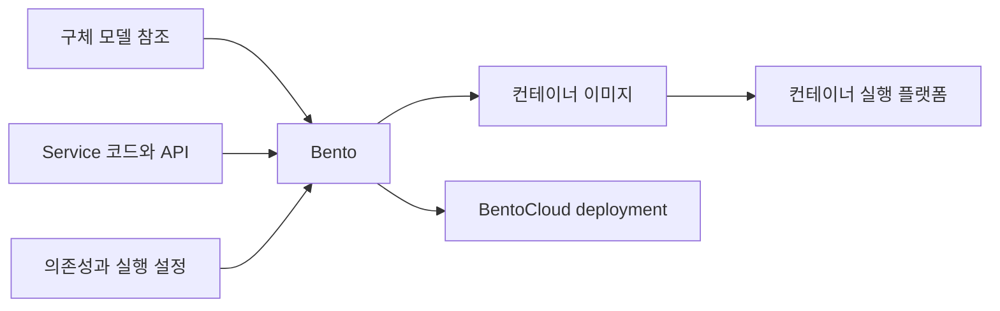

BentoML은 모델 API, 요청 처리, 모델 조합, 환경과 패키징을 다룬다.

이 글은 최신 공식 문서의 기능 안내다. AML 실습 환경에 BentoML을 추가하지 않으며, 예전 Service, Runner와 최신 클래스 기반 API를 버전별로 구분한다.

## 기본 구성 단위

| 단위 | 의미 | 다른 단위와의 관계 |
| --- | --- | --- |
| 모델과 모델 참조 | 서비스에서 사용할 학습 결과 | 로컬 Model Store나 외부 모델 출처에서 로딩 |
| Service | 모델을 사용하는 처리와 API의 구현 | 모델 로딩, 전처리, 예측과 후처리를 구성 |
| API | 외부에 노출할 호출 계약 | 입력과 출력, 경로와 처리 방식을 정의 |
| Bento | 배포할 서비스의 패키지 | 코드, 의존성, 모델 관련 정보와 설정을 연결 |
| 컨테이너 이미지 | Bento를 실행할 수 있게 구성한 배포 형식 | 컨테이너 플랫폼에서 실행 |
| Deployment | 실제 실행하는 서비스와 자원 설정 | BentoCloud나 직접 운영하는 플랫폼에서 관리 |

모델 버전과 Bento, deployment 버전은 다르다. 코드나 의존성이 바뀌면 모델이 같아도 패키지가 달라진다.

## 기능 지도

| 기능군 | 다루는 내용 | 확인할 결과 |
| --- | --- | --- |
| 모델 로딩과 관리 | 저장, 참조, 가져오기와 내보내기 | 사용할 모델 파일과 구체 버전 |
| Service와 API | 전처리, 추론과 후처리의 서비스화 | 외부 호출이 가능한 API |
| 입력과 출력 타입 | Python, Pydantic과 ML 데이터 타입 | 요청 검증과 응답 계약 |
| 여러 모델의 조합 | 순차 및 병렬 호출, 서비스 간 의존성 | 여러 모델을 연결한 추론 흐름 |
| Workers와 동시 처리 | 프로세스, 요청 처리와 자원 사용 | 처리량, 지연과 메모리 사용 |
| Adaptive batching | 요청을 모아 묶음 추론 | 배치 크기와 대기 시간의 균형 |
| Async task | 오래 걸리는 추론을 제출하고 나중에 조회 | 작업 ID, 상태와 결과 |
| Streaming과 ASGI 연동 | 점진적 응답과 다른 웹 기능의 결합 | 스트리밍 응답이나 WebSocket 등의 접점 |
| 환경과 패키징 | Python 및 시스템 의존성, Bento와 이미지 | 배포할 코드와 환경의 조합 |
| 관측 | 서비스 메트릭과 trace 등 | 요청 지연, 오류와 단계별 동작 |
| 관리형 배포 | BentoCloud의 배포와 확장 | 실행 자원과 replica, 큐 및 배포 설정 |

자원 배치와 자동 확장은 플랫폼 책임이다. 로컬, BentoCloud와 자체 운영은 다르다.

## 기능과 인터페이스의 연결

| 다룰 작업 | 문서에서 만나는 대표 이름 |
| --- | --- |
| 서비스와 API 정의 | `bentoml.service`, `bentoml.api` |
| 모델 참조 | `BentoModel`, `HuggingFaceModel` |
| 서비스 의존성 | `bentoml.depends` |
| 오래 걸리는 작업 | `bentoml.task`와 작업 상태 및 결과 조회 |
| 추론 데이터 수집 | `bentoml.monitor` |
| 로컬 서비스 실행 | `bentoml serve` |
| 패키징과 컨테이너 | `bentoml build`, `bentoml containerize` |
| BentoCloud 배포 | `bentoml deploy`와 deployment 관리 |

API 인자와 구성은 SDK 버전별로 다르다.

## 모델 로딩과 Model Store

Model Store는 모델 저장, 가져오기와 tag 기반 참조를 제공한다. 파일 import/export와 BentoCloud push/pull도 지원한다.

Hugging Face 등 외부 모델도 참조할 수 있지만 선언만으로 추론 파일을 읽지는 않는다. 가중치, tokenizer, 전처리 정보와 의존성을 맞춰야 한다.

최신 문서는 `BentoModel`, `HuggingFaceModel`을 Service 클래스에 선언해 의존성을 식별한다. 임의 경로 파일이 자동 패키징된다고 가정하지 않는다.

모델 출처의 인증, 다운로드, 라이선스, 사용 범위를 확인한다. 저장소에 있다는 사실이 운영 사용 권한을 뜻하지는 않는다.

## Service와 API

Service는 모델 코드를 외부 요청에 연결한다. 최신 API는 클래스에 Service를, 공개 메서드에 API를 정의한다.

이미지 분류 Service는 이미지 로딩, 크기 조정, 예측, 클래스명 변환을 한 호출로 묶는다. 각 처리를 모델 패키지와 서비스 코드 중 어디에 둘지는 설계에 달렸다.

| 결정할 항목 | 예 |
| --- | --- |
| 입력 | JSON, 표 데이터, 이미지와 파일 |
| 처리 | 전처리, 하나 또는 여러 모델 호출, 후처리 |
| 출력 | 클래스, 확률, 생성 텍스트나 파일 |
| 실행 조건 | 시간 제한, 동시 처리와 필요한 자원 |
| 실패 계약 | 잘못된 입력, 모델 로딩 실패와 처리 시간 초과 |

Python, Pydantic, NumPy, DataFrame 타입으로 입출력을 표현해 검증, API 문서와 클라이언트 계약에 연결한다.

타입 외에 이미지 크기, 허용 범위, 요청 크기와 업무 규칙을 검증한다.

## 여러 모델과 서비스의 조합

| 구성 | 사용할 상황 | 함께 볼 비용 |
| --- | --- | --- |
| 한 Service에 여러 모델 | 같은 자원에서 단순한 호출 흐름 구성 | 메모리 합계와 공유 자원의 병목 |
| 순차 Service 호출 | 앞 결과를 다음 처리에 사용 | 단계별 지연과 실패 전파 |
| 병렬 Service 호출 | 독립 결과를 모아 응답 | 동시 자원 사용과 결과 대기 |
| 서로 다른 CPU 및 GPU 배치 | 단계별 자원 요구가 다름 | 플랫폼의 배치와 확장 설정 |

문서 임베딩과 검색 결과 기반 답변 생성도 서비스로 묶을 수 있지만, 데이터 준비, 학습, 승인을 포함한 MLOps 파이프라인을 대체하지 않는다.

## 동시 처리와 자원 사용

Worker는 Service 실행 프로세스다. Worker, 동시 요청과 replica 수는 서로 다른 값이다.

| 값 | 다루는 범위 | 늘릴 때 확인할 것 |
| --- | --- | --- |
| Worker 수 | Service 안의 실행 프로세스 | 모델의 중복 로딩과 메모리 |
| 동시 요청 설정 | 처리하거나 수용할 요청의 양 | 포화 지점, 대기와 요청 제한 |
| Replica 수 | 플랫폼에서 실행하는 서비스 복제본 | 총용량, 배치 자원과 비용 |
| GPU와 메모리 요구 | 모델과 실행에 필요한 자원 | 실제 장치 할당과 여러 프로세스의 경합 |

Worker 증가는 프로세스별 모델 로딩으로 메모리를 늘릴 수 있다. `async`는 CPU, GPU 연산을 자동 가속하지 않는다.

코드의 자원 표시는 인프라 제한이 아니므로 배포 설정도 확인한다.

## 배칭과 비동기 작업

| 방식 | 동작 | 사용자가 받는 것 |
| --- | --- | --- |
| 일반 동기 API | 호출 처리 후 응답 | 추론 결과 |
| 비동기 함수 | 대기 작업 동안 다른 요청 처리가 가능하도록 구현 | API 계약에 따른 응답 |
| Adaptive batching | 여러 요청을 서버에서 모아 한 묶음으로 추론 | 각 요청의 결과 |
| Async task | 작업을 제출하고 상태와 결과를 나중에 조회 | 작업 ID와 이후 조회 결과 |
| 오프라인 배치 Job | 데이터 묶음을 작업으로 처리 | Job 상태와 결과 파일 등 |

Adaptive batching은 모델의 묶음 입력 처리가 필요하다. 최대 크기와 지연에 따라 처리량과 대기 시간이 절충되며 입력, 출력 순서도 확인한다.

Async task는 장기 추론을 제출하고 ID로 상태, 결과를 조회한다. 결과 보존, 취소와 재시도 조건을 정한다.

로컬 task 큐와 임시 저장소는 개발용 메모리 기반이며 재시작 후 유지되지 않는다.

AML batch endpoint와 BentoCloud 배치 작업은 adaptive batching과 다르다. 런타임 요청 묶음과 데이터 묶음 비동기 실행은 별개다.

## Streaming과 웹 기능 연동

Streaming은 텍스트, 오디오 결과를 순차 전달한다. LLM 토큰을 점진적으로 보내거나 ASGI와 결합해 WebSocket을 구성할 수 있다.

첫 응답 시간, 연결 종료, 취소와 중간 오류도 정의한다. 전송 시작 후 오류는 단일 JSON 오류와 다르게 처리할 수 있다.

서비스 연결만으로 스트리밍이 자동 조합되지는 않으므로 입출력 계약을 확인한다.

## 실행 환경, Bento와 컨테이너

런타임은 Python 버전, 패키지, 운영체제, 시스템 패키지와 빌드 작업을 포함한다. 공식 문서는 Python SDK의 Image와 기존 `bentofile.yaml` 구성을 구분한다.

Python, 시스템 라이브러리 차이는 결과와 로딩에 영향을 준다. 모델뿐 아니라 서비스 코드, 환경, 패키지 버전 조합도 기록한다.

필요한 파일만 패키징하고 `.bentoignore`와 빌드 범위를 확인한다. 자격 증명, 고객 데이터는 이미지에서 제외하고 비밀은 배포 환경의 비밀 관리로 전달한다.

## 운영 관측

BentoML은 메트릭과 OpenTelemetry tracing을 구성할 수 있지만 수집 지점과 저장, 분석 시스템은 별개다.

| 관측 | 확인할 질문 |
| --- | --- |
| 요청 수와 상태 코드 | 어떤 요청이 얼마나 실패하는가 |
| 요청 시간과 진행 중 요청 | 처리 지연이나 포화가 생겼는가 |
| 실제 배치 크기 | Adaptive batching이 기대한 방식으로 동작하는가 |
| Trace | 여러 서비스 중 어디에서 시간이 걸렸는가 |
| 개별 오류와 실행 정보 | 어떤 모델 및 서비스 버전에서 문제가 났는가 |

Prometheus와 Grafana로 메트릭을 분석하거나 trace를 별도 수집기에 보낼 수 있다. 제공 기능과 대상, sampling, 전송 경로 설정은 구분한다.

가용성과 속도는 예측 품질을 보장하지 않으므로 정답 평가, 데이터 변화, 업무 성과를 별도로 본다.

`bentoml.monitor`는 입력, 예측, 정답을 수집해 분석 저장소와 연결할 수 있다. API 추가만으로 드리프트 판단과 대응 정책이 검증되지는 않는다.

입출력 관측에서는 민감 정보의 수집 범위와 보존 기간을 정한다.

## BentoML과 BentoCloud의 경계

| 구분 | BentoML 중심의 구현 | BentoCloud의 관리형 운영 |
| --- | --- | --- |
| 서비스 작성 | API와 모델 로딩 및 처리 코드 | 작성한 서비스의 배포와 실행 |
| 패키징 | Bento와 컨테이너 구성 | 패키지와 모델의 공유 및 배포 연결 |
| 확장 | Worker와 처리 방식 정의 | Replica 자동 확장과 관리형 큐 설정 |
| 관측 | 메트릭과 trace 수집 지점 구성 | 플랫폼의 운영 기능과 연결 |
| 비용과 자원 | 직접 운영하는 플랫폼의 책임 | 관리형 서비스의 배포 및 컴퓨팅 정책 |

BentoCloud는 최소, 최대 replica, scale-to-zero, 동시 요청 기반 확장과 외부 큐를 제공한다. 다른 환경에 이 동작이 자동 적용되지는 않는다.

요청 대기, 콜드 스타트, 최대 replica를 함께 고려한다. Replica 0이 모든 비용이나 데이터를 없애지는 않는다.

## MLflow와 연결할 때의 흐름

관리 단위가 다른 MLflow와 BentoML의 관계를 기록한다.

| 연결할 정보 | 설명하는 것 |
| --- | --- |
| MLflow run ID | 어떤 학습 실행에서 나왔는가 |
| MLflow 모델 이름과 버전 | 어떤 후보를 관리 대상으로 선택했는가 |
| BentoML 모델 참조 | 서비스에서 어느 모델을 읽는가 |
| Bento tag와 서비스 코드 | 모델을 어떤 코드와 환경으로 패키징했는가 |
| 실제 deployment | 어느 패키지를 어떤 자원과 설정으로 실행하는가 |

공식 예제는 MLflow 모델을 BentoML Model Store와 Service에서 사용한다. AML 모델 연결에는 인증, 접근, 버전 선택을 별도 구성한다.

01~06편은 AML 관리형 추론 경로이며 최신 BentoML이나 다른 MLflow 버전을 추가 설치하지 않는다.

## 기능을 연결해 볼 사례

| 상황 | 살펴볼 기능 | 남길 확인 |
| --- | --- | --- |
| 여러 모델이 필요한 API | Service 조합과 순차 또는 병렬 호출 | 단계별 입력, 지연과 실패 경계 |
| 높은 요청량에서 처리량 부족 | Worker, 동시 요청과 배칭 | 메모리, 요청 대기와 처리량 |
| 긴 생성 작업 | Async task 또는 streaming | 작업 보존과 재시도, 연결 종료의 동작 |
| 로컬에서는 되지만 배포 후 실패 | 모델 참조, 환경과 패키징 | 빠진 파일, 의존성, 인증과 자원 차이 |
| 같은 모델인데 응답이 달라짐 | 서비스 코드와 Bento 및 deployment 이력 | 전처리, 후처리와 환경의 변경 |

서빙 프레임워크를 써도 서비스 계약과 운영 책임은 남는다. 모델, 패키지, 실행의 관계를 설명할 수 있어야 한다.

## 참고 자료

- [Service와 API](https://docs.bentoml.com/en/latest/build-with-bentoml/services.html)
- [모델 로딩과 관리](https://docs.bentoml.com/en/latest/build-with-bentoml/model-loading-and-management.html)
- [입력과 출력 타입](https://docs.bentoml.com/en/latest/build-with-bentoml/iotypes.html)
- [여러 모델의 조합](https://docs.bentoml.com/en/latest/get-started/model-composition.html)
- [Worker와 요청 처리](https://docs.bentoml.com/en/latest/build-with-bentoml/parallelize-requests.html)
- [Adaptive batching](https://docs.bentoml.com/en/latest/get-started/adaptive-batching.html)
- [Async task](https://docs.bentoml.com/en/latest/get-started/async-task-queues.html)
- [Streaming](https://docs.bentoml.com/en/latest/build-with-bentoml/streaming.html)
- [런타임 환경](https://docs.bentoml.com/en/latest/build-with-bentoml/runtime-environment.html)
- [패키징과 컨테이너](https://docs.bentoml.com/en/latest/get-started/packaging-for-deployment.html)
- [서비스 메트릭](https://docs.bentoml.com/en/latest/build-with-bentoml/observability/metrics.html)
- [모니터링과 추론 데이터 수집](https://docs.bentoml.com/en/latest/build-with-bentoml/observability/monitoring-and-data-collection.html)
- [Tracing](https://docs.bentoml.com/en/latest/build-with-bentoml/observability/tracing.html)
- [BentoCloud의 동시 처리와 자동 확장](https://docs.bentoml.com/en/latest/scale-with-bentocloud/scaling/autoscaling.html)
- [MLflow 연동](https://docs.bentoml.com/en/latest/examples/mlflow.html)
- [BentoCloud 배포](https://docs.bentoml.com/en/latest/get-started/cloud-deployment.html)

[MLflow 기능과 구성](/docs/tech/ops/mlops/labs/mlflow-capabilities/), [시리즈 목차](/docs/tech/ops/mlops/labs/), [01. 로컬 실습 시작](/docs/tech/ops/mlops/labs/01-local-tracking/)
