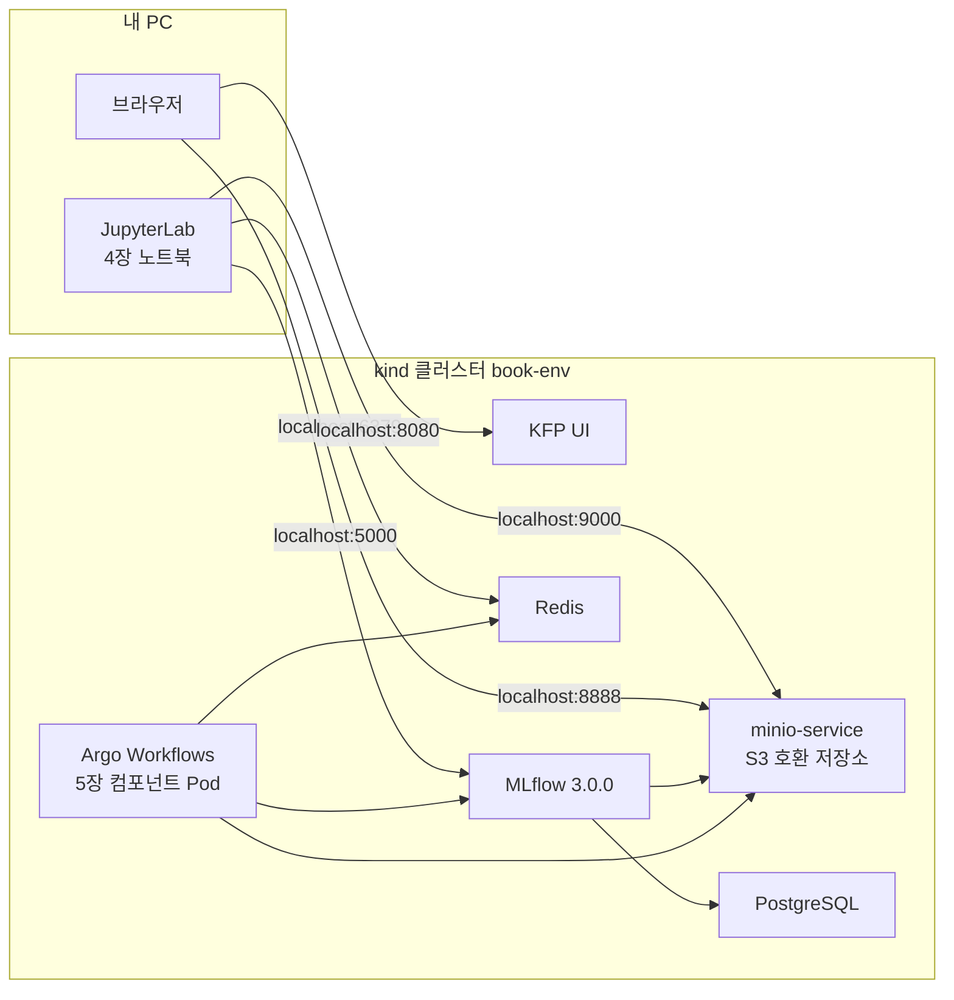

책 4~5장은 "MinIO에 `minio` / `minio123`으로 접속해 `mlflow-datasets` 버킷을 만든다" 같은 한 문장으로 실습을 지나가고, Kubeflow, MinIO, PostgreSQL, Redis, MLflow 서버가 이미 깔린 클러스터를 전제로 해서 처음 따라 하면 시작부터 막힌다. 그래서 그 환경을 명령 하나로 만드는 공개 저장소 [ml-platform-book-env](https://github.com/johklo/ml-platform-book-env)를 만들고, 책의 실습을 번호 순서대로 다시 적었다. 출력과 화면은 클러스터를 지운 상태에서 이 순서대로 다시 실행해 얻은 것이다. 개념과 아키텍처는 [04. 실험, 피처, 파이프라인 연결하기](/docs/tech/machine-learning-platform-engineering/04-experiments-features-pipelines/)에, 도구별 기초는 [도구 기초 가이드](/docs/tech/ops/mlops/basics/)에 정리했다.

## 구성



| 책의 전제 | 이 환경 | 주소 |
|---|---|---|
| Kubeflow Pipelines | KFP 2.4.1 standalone (Argo Workflows, MySQL 포함) | http://localhost:8080 |
| MinIO (`minio` / `minio123`) | 같은 이름과 계정의 S3 호환 저장소 | S3 API `localhost:9000`, 웹 UI http://localhost:8888 |
| MLflow 추적 서버 | MLflow 3.0.0, PostgreSQL 백엔드, 아티팩트는 `mlflow-artifacts` 버킷 | http://localhost:5000 |
| PostgreSQL, Redis Helm 릴리스 | 같은 서비스 이름의 매니페스트 (Redis 비밀번호 `redis123`) | Redis `localhost:6379` |

## 준비물

Docker(메모리 8GB 이상 할당), kind 0.27, kubectl, git, Python 3.11, uv, 디스크 여유 40GB가 필요하다. Windows 11 PowerShell에서 확인했고, macOS와 Linux는 가상환경 활성화 명령만 다르다. 명령은 저장소 최상위 폴더에서 실행한다고 가정하며, 터미널은 명령용 하나와 포트포워딩을 켜 두는 용도 하나를 쓴다.

---

## A. 환경 세팅

### A-1. 도구 확인

1. 저장소를 받고 도구가 모두 있는지 확인한다.
   ```powershell
   git clone https://github.com/johklo/ml-platform-book-env.git
   cd ml-platform-book-env
   python bookenv.py check
   ```
2. 마지막 줄이 `All required tools are available.`이면 된다. PATH에 없는 도구는 `$env:KIND = "C:\tools\kind.exe"`처럼 경로를 직접 지정할 수 있다(`KUBECTL`, `DOCKER`, `GIT`도 같다).

### A-2. 클러스터 설치

1. 다음 명령으로 kind 클러스터를 만들고 KFP, PostgreSQL, Redis, MLflow 서버를 설치한다.
   ```powershell
   python bookenv.py up
   ```
2. 이미지가 캐시돼 있으면 8분 정도, 처음이면 20분 넘게 걸린다. `The environment is ready. Next: python bookenv.py forward`가 나오면 끝난 것이다.

설치 중 `metadata-grpc-deployment`, `ml-pipeline`이 몇 번 재시작하는 건 MySQL이 늦게 떠서 생기는 정상 동작이다. 시간 초과가 나면 `python bookenv.py status`로 준비되지 않은 Pod를 확인하고 같은 명령을 다시 실행하면 기존 클러스터를 재사용해 이어서 설치한다.

### A-3. 포트포워딩과 화면 확인

1. 두 번째 터미널에서 다음을 실행하고 실습이 끝날 때까지 켜 둔다.
   ```powershell
   python bookenv.py forward
   ```
2. 브라우저에서 세 화면이 열리는지 확인한다.
   1. http://localhost:8080 : Pipelines, Experiments, Runs 메뉴가 있는 KFP 화면
   2. http://localhost:5000 : 왼쪽 위에 `mlflow 3.0.0`이 표시되는 MLflow 화면
   3. http://localhost:8888/buckets/ : `mlpipeline` 폴더 하나만 있는 저장소 화면

   

포트가 이미 쓰이고 있다는 오류가 나면 로컬 MLflow나 이전 forward 창을 먼저 종료한다. 실행 중 `Reconnecting ...`이 보이는 건 Pod가 재시작돼 터널을 다시 연 것이라 신경 쓰지 않아도 된다.

> 책은 MinIO 웹 콘솔에 로그인하지만, KFP 2.4.1에 들어 있는 MinIO 이미지는 더 이상 받을 수 없어서 같은 Deployment와 서비스 이름을 유지한 채 SeaweedFS로 바꿨다(KFP도 2.15부터 기본 저장소가 SeaweedFS다). S3 주소와 계정은 책과 같고 웹 화면만 로그인 없는 Filer다. `/buckets` 아래 폴더 하나가 버킷 하나다.

### A-4. 버킷 만들기

책은 "MinIO에 버킷을 만든다"고만 적고, 5장 결과가 저장되는 `inference-datasets`는 만들라는 말이 아예 없다. 실습에 필요한 버킷은 다섯 개다.

| 버킷 | 용도 |
|---|---|
| `mlflow-datasets` | 4장 노트북이 저장하는 학습, 테스트 CSV |
| `mlflow-artifacts` | MLflow 서버의 모델과 그림 파일 |
| `feature-data-sets` | Feast 원천 parquet, 5장 `entity_df.parquet` |
| `feature-registry` | Feast 레지스트리와 `feature_store.yaml` |
| `inference-datasets` | 5장 예측 결과 |

1. http://localhost:8888/buckets/ 를 연다. 끝의 `/buckets/`까지 입력해야 한다.
2. 오른쪽 위 **New Folder**를 누르고 `mlflow-datasets`를 입력한 뒤 **확인**을 누른다.

   

3. 같은 방법으로 `mlflow-artifacts`, `feature-data-sets`, `feature-registry`, `inference-datasets`를 차례로 만든다.
4. `/buckets/` 목록에 다섯 개와 `mlpipeline`이 보이면 된다.

   

책 본문 일부에 나오는 `feature_data_sets`(밑줄)는 S3 버킷 이름으로 쓸 수 없으므로, 저자 코드와 같은 `feature-data-sets`를 쓴다. 화면 작업 대신 `python bookenv.py buckets`로 한 번에 만들어도 결과는 같다.

### A-5. 책 코드와 가상환경

1. 저자 코드를 `upstream/`에 받는다. 노트북과 5장 스크립트가 이 위치를 기준으로 파일을 읽는다.
   ```powershell
   git clone https://github.com/practical-mlops/chapter-4.git upstream/chapter-4
   git clone https://github.com/practical-mlops/chapter-5.git upstream/chapter-5
   ```
   이 문서는 chapter-4 `b67a822`, chapter-5 `332915b`(둘 다 2025-07-23)로 확인했다.
2. 가상환경을 만들고 활성화한다.
   ```powershell
   uv venv .venv-book --python 3.11
   uv pip install --python .venv-book -r book/requirements.txt
   .\.venv-book\Scripts\Activate.ps1        # macOS/Linux: source .venv-book/bin/activate
   ```
3. 버전을 확인한다.
   ```powershell
   python -c "import mlflow, feast, kfp, sklearn; print(mlflow.__version__, feast.__version__, kfp.__version__, sklearn.__version__)"
   ```
   `3.0.0 0.40.1 2.9.0 1.5.2`가 나오면 된다. 책 본문은 `mlflow==2.6.0`을 쓰지만 저자 저장소와 부록은 3.0.0이고, 클라이언트는 서버와 주 버전을 맞춰야 한다.

### A-6. JupyterLab

1. 8888 포트는 저장소 화면이 쓰고 있으니 8890으로 띄운다.
   ```powershell
   jupyter lab --notebook-dir book --port 8890
   ```
2. 출력된 `http://127.0.0.1:8890/lab?token=...` 주소를 열고 `ch04` 폴더에 노트북 두 개가 있는지 확인한다. 이후 터미널 명령은 새 터미널에서 가상환경을 다시 활성화하고 실행한다.

---

## B. 4장 MLflow 실험 추적

`book/ch04/01_mlflow_tracking.ipynb`는 저자의 `chapter-4/mlflow/data_exploration_and_model_training.ipynb`를 셀 순서 그대로 옮긴 것이고, 이 환경 때문에 추가한 셀에는 위에 `[환경]` 표시를 달았다.


### B-1. 준비 셀

1. `ch04/01_mlflow_tracking.ipynb`를 열고 커널이 `Python 3 (ipykernel)`인지 확인한다.
2. 맨 위부터 `import pandas as pd ...` 셀까지 네 셀을 `Shift+Enter`로 실행한다. 데이터 경로, MLflow가 저장소에 접근할 주소와 계정을 지정하는 셀이다.

첫 셀이 `AssertionError`를 내면 A-5의 코드 내려받기를 하지 않았거나 다른 위치에 받은 것이다.

### B-2. 데이터 탐색과 첫 run (책 4.1.1~4.1.2)

1. `2. 데이터 탐색` 아래 셀 세 개를 실행한다. `df.info()`에 `RangeIndex: 30162 entries`와 `Data columns (total 9 columns)`가 나오고, 변수별 그래프가 `categorical_variable_plots/`에 저장된다.
2. `3. MLflow 연결` 아래 셀 세 개를 실행한다. 실험 `income-classifier`가 만들어지고 `artifact_location='s3://mlflow-artifacts/1'`이 출력된다.
3. MLflow 화면을 새로 고쳐 `income-classifier` 실험에 `eda-`로 시작하는 run이 있고, Artifacts 탭에 PNG가 있는지 본다.

연결 오류가 나면 forward 창이 꺼진 것이고, `NoSuchBucket`이 나오면 `mlflow-artifacts` 버킷이 없는 것이다.

### B-3. 모델 세 개 학습 (책 리스팅 4.5)

1. `4. 학습 데이터 분할`과 `5. MinIO 버킷 확인` 아래 셀을 실행한다. `mlflow-datasets bucket found`가 나와야 한다.
2. `6. Decision Tree`, `7. Random Forest`, `8. XGBoost` 셀을 차례로 실행한다. 각각 1분 정도 걸린다.

분할이 무작위라 값은 조금씩 다르지만, 이번 실행의 테스트 ROC AUC는 Decision Tree 0.817, Random Forest 0.855, XGBoost 0.714였다. MLflow 화면에 run 네 개(eda 1개, 모델 3개)가 보이면 된다.


### B-4. 모델 등록 (책 리스팅 4.7)

1. `9. 가장 좋은 run을 찾아 모델 레지스트리에 등록` 셀을 실행한다.
2. 바로 아래 `[환경]` 셀을 실행해 등록한 버전을 `Production`으로 지정한다. 책에는 이 절차가 없지만 5장 파이프라인이 `model_stage`로 이 값을 찾는다.
   ```text
   bold-moose-377 0.8552045821993023 random-forest-classifier 1
   1 Production 30627206bc81449bad0da833f4e8d210
   ```
3. MLflow 화면의 **Models**에서 `random-forest-classifier`를 열어 확인한다.

   

stage 지정 셀의 `FutureWarning`은 MLflow 3에서 stage가 deprecated라는 안내일 뿐 동작에는 문제가 없다.

---

## C. 4장 Feast 피처 스토어

`book/ch04/02_feast_feature_store.ipynb`는 저자의 `chapter-4/Readme.md` Feast 절차를 그대로 옮기고, 원래 터미널에서 치는 `feast` 명령을 셀에서 실행하게 했다. B를 먼저 하지 않아도 된다.

### C-1. 준비와 원천 파일 업로드

1. 노트북을 열고 `[환경] 경로와 명령 실행 도우미`, `1. 환경 변수` 셀을 실행한다.
2. `2. 피처 원천 파일을 feature-data-sets 버킷으로 옮기기` 셀을 실행하면 parquet 세 개가 올라간다.
   ```text
   ['demographic_features.parquet', 'occupational_features.parquet', 'relationship_features.parquet']
   ```
3. `3. 피처 저장소 폴더 준비` 셀 두 개를 실행한다. 저자의 `entity.py`, `features.py`, `feature_store.yaml`을 `feature_repo/`로 복사하면서, 저자 환경의 Redis 비밀번호를 `redis123`으로 바꾼다.

### C-2. `feast apply` (책 4.2.1)

`4. feast apply` 셀을 실행하면 정의가 `s3://feature-registry/registry_local.db`에 기록되고 Redis가 준비된다. 피처 값은 아직 들어가지 않는다.

```text
Deploying infrastructure for relationship
Deploying infrastructure for demographic
Deploying infrastructure for occupation
```

`NoSuchBucket`이면 `feature-registry` 버킷이, Redis 인증 오류면 C-1의 비밀번호 치환이나 6379 터널이 문제다.

### C-3. 과거 시점 피처 조회 (책 4.2.2)

`5. 과거 시점 피처 조회` 셀은 엔티티의 시각을 기준으로 그때 유효했던 피처 값을 붙인다. 학습 데이터를 만들 때 쓰는 방식이다.

```text
                                user_id           event_timestamp    Sex
0  9f2ac416-06e1-44a0-87bd-d4787c85bf66 2023-01-30 10:59:42+00:00   Male
```

### C-4. 온라인 저장소 적재와 조회

1. `6. 온라인 저장소로 적재` 셀이 `feast materialize`로 최신 피처 값을 Redis에 복사한다. 세 FeatureView 이름이 출력되면 된다.
2. `7. 온라인 피처 조회` 셀로 Redis에서 바로 읽어 본다. `Sex` 값이 `None`이면 1번을 건너뛴 것이다.

### C-5. 설정 파일 업로드

`8. feature_store.yaml을 feature-registry 버킷에 올리기` 셀을 실행한다. `feature-registry`에 `feature_store.yaml`, `registry_local.db` 두 파일이 있으면 4장이 끝난다.

---

## D. 5장 Kubeflow Pipelines 배치 추론


컴포넌트는 클러스터 안의 Pod로 돌기 때문에 `localhost` 대신 서비스 주소를 쓰고, 그래서 4장과 별도로 클러스터용 Feast 레지스트리(`registry.db`)와 설정 파일(`feature_store_k8s.yaml`)을 준비한다. 여기부터는 가상환경을 활성화한 터미널에서 진행한다.

### D-1. 책 코드를 환경에 맞추기

저자 README가 직접 고치라고 하는 두 곳, 컴포넌트 이미지 이름(`varunmallya/...`)과 `scripts/feast/feature_store.yaml`의 Redis 비밀번호를 바꾼다.

```powershell
python book/ch05/prepare.py
```

컴포넌트 네 개의 이미지가 `book-ch5/components:0.1`로 바뀌었다는 줄과 `Redis password set`이 나오면 된다.

### D-2. 이미지 빌드와 적재

책은 이미지를 Docker Hub에 push하지만 여기서는 로컬에서 빌드해 kind 노드에 바로 넣는다. 저자 Dockerfile과 같고, `python:3.10-slim-buster`가 404를 내서 bookworm으로 바꿨으며 컴포넌트 이미지는 scikit-learn을 노트북과 같은 1.5.2로 맞췄다.

1. 두 이미지를 빌드한다. 처음에는 합쳐서 10분 넘게 걸린다.
   ```powershell
   docker build -t book-ch5/feast-job:0.1 -f book/ch05/Dockerfile.feast-job upstream/chapter-5/scripts/feast
   docker build -t book-ch5/components:0.1 -f book/ch05/Dockerfile.components upstream/chapter-5
   ```
2. 클러스터에 적재한다. 이미지를 다시 빌드하면 이 단계도 다시 해야 한다.
   ```powershell
   python bookenv.py load book-ch5/feast-job:0.1
   python bookenv.py load book-ch5/components:0.1
   ```

### D-3. 클러스터에서 `feast apply`

저자의 `scripts/feast/k8s/job.yaml`에서 이미지 이름과 네임스페이스만 바꾼 Job을 실행해 클러스터 주소용 레지스트리를 만든다.

```powershell
kubectl apply -f book/ch05/feast-job.yaml
kubectl -n kubeflow wait --for=condition=complete --timeout=300s job/feast-job
kubectl -n kubeflow logs job/feast-job
```

로그에 `Deploying infrastructure` 세 줄이 있으면 된다. `entity_key_serialization_version` 경고는 저자 설정 그대로라 나오는 것이고, Pod가 `ErrImageNeverPull`이면 D-2의 적재를 빠뜨린 것이다. 다시 돌리려면 `kubectl -n kubeflow delete job feast-job`으로 지우고 실행한다.

### D-4. 입력 파일 업로드와 컴파일

1. 파이프라인이 실행 중에 내려받는 두 파일을 올린다. 클러스터용 설정은 4장의 localhost용 파일을 덮어쓰지 않도록 `feature_store_k8s.yaml`이라는 이름으로 올린다.
   ```powershell
   python book/ch05/upload_inputs.py
   ```
   ```text
   feature-registry ['feature_store.yaml', 'feature_store_k8s.yaml', 'registry.db', 'registry_local.db']
   feature-data-sets ['demographic_features.parquet', 'entity_df.parquet', 'occupational_features.parquet', 'relationship_features.parquet']
   ```
2. 파이프라인을 컴파일한다.
   ```powershell
   cd upstream/chapter-5
   python inference_pipeline.py
   cd ../..
   Select-String -Path upstream/chapter-5/income_classifier_pipeline.yaml -Pattern "image:"
   ```
   모든 줄이 `image: book-ch5/components:0.1`이어야 한다. `varunmallya/...`가 보이면 D-1 전에 컴파일한 것이니 다시 컴파일한다.

### D-5. 파이프라인 업로드

1. http://localhost:8080 에서 왼쪽 **Pipelines**를 누르고 오른쪽 위 **+ Upload pipeline**을 누른다.

   

2. **Pipeline Name**에 `income-classifier-pipeline`, **Pipeline Description**에 `Chapter 5 income classifier batch inference`를 입력한다.
3. **Upload a file** 라디오 버튼을 먼저 누르고 **Choose file**로 `upstream/chapter-5/income_classifier_pipeline.yaml`을 고른다. 라디오 버튼을 누르지 않으면 `Package URL is empty` 오류와 함께 빈 파이프라인이 남는다.

   

4. **Create**를 누르면 컴포넌트 네 개가 이어진 그래프가 나온다.

   

### D-6. 실험 만들고 실행하기

1. 왼쪽 **Experiments**에서 **+ Create experiment**를 누르고, 이름 `income-classifier`, 설명 `Chapter 5 batch inference runs`를 입력한 뒤 **Next**를 누른다. MLflow 실험과 이름만 같고 별개다.

   

2. 실행 화면에서 **Pipeline**의 **Choose**로 `income-classifier-pipeline`을 고르고 **Use this pipeline**을 누른다.
3. **Run name**에 `income-classifier-run-1`을 입력하고 파라미터 14개를 채운다. 책 본문에 값이 모여 있지 않아 `book/ch05/run-parameters.json`에 정리했다.

   | 파라미터 | 값 |
   |---|---|
   | access_key / secret_key | `minio` / `minio123` |
   | entity_df_bucket / entity_df_filename | `feature-data-sets` / `entity_df.parquet` |
   | feature_list | `demographic:Sex,demographic:Race,demographic:Native_country,relationship:Relationship,relationship:Marital-Status,occupation:Workclass,occupation:Education,occupation:Occupation` |
   | feature_store_bucket_name / feature_store_config_file_name | `feature-registry` / `feature_store_k8s.yaml` |
   | minio_host | `minio-service.kubeflow.svc.cluster.local:9000` |
   | mlflow_host | `http://mlflow-service.mlflow.svc.cluster.local:5000` |
   | model_name / model_stage / model_type | `random-forest-classifier` / `Production` / `sklearn` |
   | output_bucket / output_file_name | `inference-datasets` / `income_predictions.parquet` |

   

4. **Start**를 누르면 상자들이 차례로 초록색 체크로 바뀐다. 이번 실행은 2분 정도 걸렸다.

   

실패한 상자는 눌러서 **Logs** 탭을 보면 된다. 자주 만나는 원인은 다음과 같다.

| 실패 위치 | 원인 |
|---|---|
| read-data-from-minio `NoSuchKey` | D-4 업로드 누락 |
| retrieve-features-from-feast 레지스트리 오류 | D-3 누락, 또는 설정 파일 이름을 `feature_store.yaml`로 입력 |
| model-inference 모델 없음 | B-4의 Production 지정 누락 |
| write-data-to-minio `NoSuchBucket` | `inference-datasets` 버킷 없음 |
| Pod `ErrImagePull` | D-2 적재 누락, 또는 D-1 전에 컴파일 |

### D-7. 결과 확인

1. 그래프에서 **model-inference**의 **Logs**, **write-data-to-minio**의 **Input/Output**을 본다. 아티팩트 주소가 `minio://`로 표시되는 건 KFP가 저장소 종류와 상관없이 붙이는 표기다.

   

   

2. http://localhost:8888/buckets/inference-datasets/ 에 `income_predictions.parquet`가 있는지 본다.

   

3. 파일을 직접 읽어 본다.
   ```powershell
   python book/ch05/show_predictions.py
   ```
   ```text
   rows, columns: (30162, 92)
   user_id in output: False
   ```

결과에 `user_id`가 없는 건 저자의 추론 코드가 원-핫 인코딩 전에 이 열을 지우기 때문이다. 실제 서비스라면 예측이 누구의 것인지 알 수 있게 식별자를 함께 저장해야 한다.

---

## E. 정리

실습을 멈출 때는 JupyterLab과 forward 창을 `Ctrl+C`로 끄면 되고, 다시 시작할 때는 `python bookenv.py status`로 Pod 상태를 본 뒤 A-3부터 하면 된다. 재부팅 후 Pod가 계속 재시작되면 지우고 다시 설치하는 편이 빠르다. 모두 지우려면 다음을 실행한다.

```powershell
python bookenv.py down
docker rmi book-ch5/components:0.1 book-ch5/feast-job:0.1 book-env/mlflow:3.0.0 book-env/runtime:0.1
```

## 책과 다른 점

| 항목 | 책 | 이 환경 |
|---|---|---|
| Kubeflow | Argo CD로 전체 설치 | Pipelines만 설치 (4~5장은 Pipelines만 씀) |
| MinIO | MinIO 콘솔 로그인 | 같은 이름과 계정의 SeaweedFS, Filer 화면 |
| PostgreSQL, Redis | Bitnami Helm 차트 | 같은 서비스 이름의 매니페스트 |
| MLflow | 본문 2.6.0, PC의 `mlflow ui` | 3.0.0 서버를 클러스터에 두고 `localhost:5000`으로 연결 |
| 버킷 | "버킷을 만든다" 한 문장, `inference-datasets` 안내 없음 | 다섯 개를 A-4에서 생성 |
| 컴포넌트 이미지 | Docker Hub push | 로컬 빌드 후 `kind load`, 기본 이미지 bookworm |
| 모델 stage | 지정 절차 없음 | B-4에서 `Production` 지정 |
| 5장 Feast 설정 | `feature_store.yaml` | `feature_store_k8s.yaml`로 따로 업로드 |

## 문제 해결

- **MLflow Pod가 `FallbackAsyncAdaptedQueuePool` ImportError로 재시작**: MLflow 3.0.0이 SQLAlchemy 2.1과 맞지 않아서다. `images/mlflow/requirements.txt`에서 `sqlalchemy<2.1`, `alembic<1.17`로 고정해 두었다.
- **S3 요청이 `InternalError`**: 저장소 볼륨이 부족한 경우로, `manifests/kfp/object-store-patch.yaml`의 `-volume.max=100`이 적용됐는지 확인한다.
- **추론 단계의 scikit-learn 경고나 `AttributeError`**: 모델을 저장한 노트북과 컴포넌트 이미지의 scikit-learn 버전이 다른 경우다.

## 부록: 빠른 동작 확인

책 코드와 별개로 환경 전체가 도는지 몇 분 안에 확인하는 예제가 `examples/`에 있다. 버킷이 없으면 알아서 만들고, 마지막에 `All steps passed.`가 나오면 성공이다.

```powershell
uv venv .venv --python 3.11
uv pip install --python .venv -r examples/requirements.txt
.\.venv\Scripts\python.exe examples/run_all.py
```
