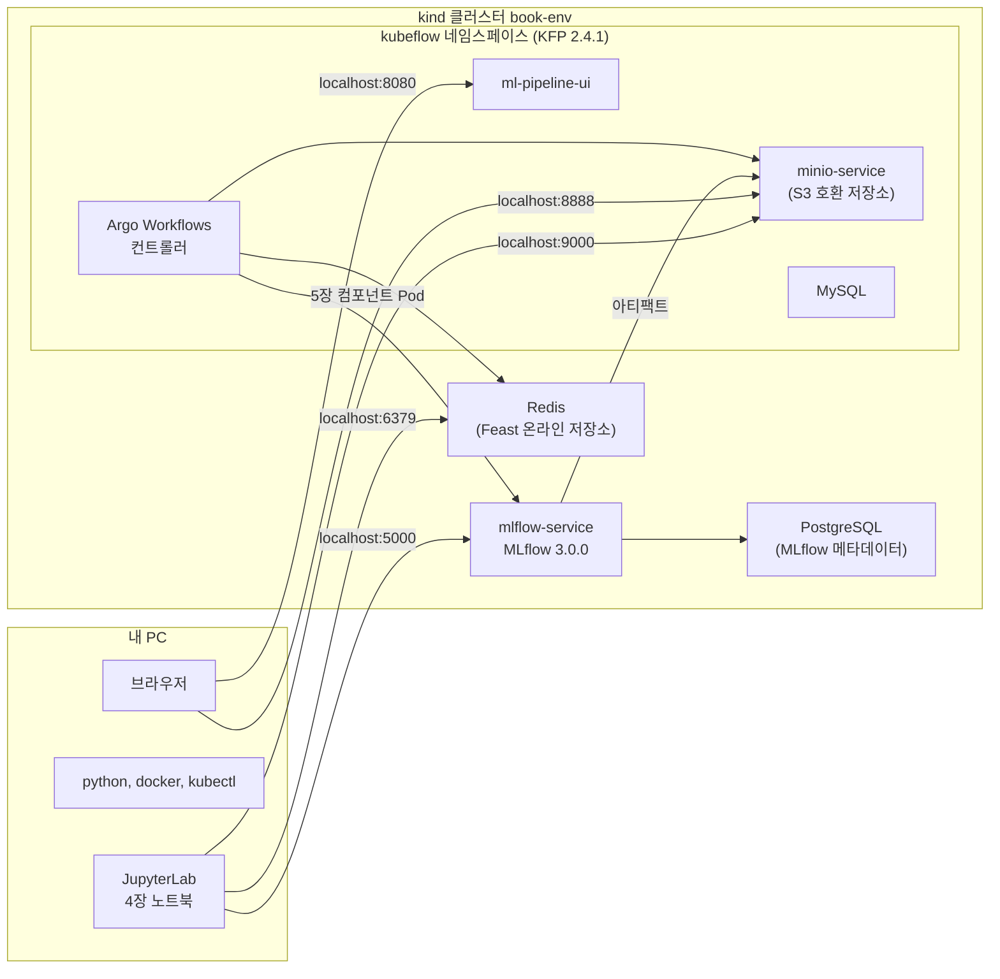
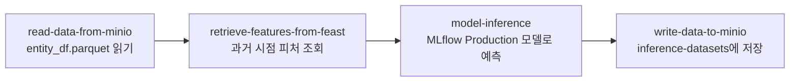

『Machine Learning Platform Engineering』 4장과 5장은 실습 절차를 짧게 적습니다. "MinIO에 `minio` / `minio123`으로 접속해 `mlflow-datasets` 버킷을 만든다"는 한 문장 뒤에는 콘솔 주소, 포트포워딩, 버킷 이름 규칙, 확인 방법이 모두 빠져 있습니다. Kubeflow, MinIO, PostgreSQL, Redis, MLflow 서버가 이미 설치된 클러스터를 전제로 하므로 처음 따라 하는 사람은 시작 지점부터 막힙니다.

그래서 책이 전제하는 환경을 명령 하나로 만드는 공개 저장소 [ml-platform-book-env](https://github.com/johklo/ml-platform-book-env)를 만들고, 책의 실습을 번호가 붙은 절차로 다시 적었습니다. 모든 단계는 클러스터를 지운 상태에서 이 순서대로 다시 실행해 확인했고, 기대 결과의 출력과 화면은 그 실행에서 가져왔습니다. 개념과 아키텍처 설명은 [04. 실험, 피처, 파이프라인 연결하기](/docs/tech/machine-learning-platform-engineering/04-experiments-features-pipelines/)에, 도구별 기초 사용법은 [도구 기초 가이드](/docs/tech/ops/mlops/basics/)에 있습니다.

| 구분 | 내용 |
|---|---|
| 저장소 | https://github.com/johklo/ml-platform-book-env |
| 4장 | 책 노트북 코드를 그대로 옮긴 Jupyter 노트북 2개 (`book/ch04/`) |
| 5장 | 컴포넌트 이미지 빌드, 클러스터 Feast Job, KFP UI 업로드와 실행 (`book/ch05/`) |
| 소요 시간 | 환경 설치 약 8분(이미지 캐시 기준), 4장 약 10분, 5장 약 20분(이미지 첫 빌드 포함) |

## 전체 구성



| 책이 가정하는 구성 | 이 저장소에서 설치되는 것 | 접속 주소(포트포워딩 후) |
|---|---|---|
| Kubeflow Pipelines | KFP 2.4.1 standalone (Argo Workflows, MySQL 포함) | http://localhost:8080 |
| MinIO (minio / minio123) | KFP에 포함된 S3 호환 저장소. 이름과 계정은 같습니다 | S3 API http://localhost:9000, 웹 UI http://localhost:8888 |
| MLflow 추적 서버 | MLflow 3.0.0 (PostgreSQL 백엔드, 아티팩트는 `mlflow-artifacts` 버킷) | http://localhost:5000 |
| PostgreSQL Helm 릴리스 `postgres-release` | `postgres` 네임스페이스의 `postgres-release-postgresql` | 클러스터 내부 전용 |
| Redis Helm 릴리스 `redis-deployment` | `redis` 네임스페이스의 `redis-deployment-master` (비밀번호 `redis123`) | localhost:6379 |

## 준비물

| 항목 | 확인한 버전 | 비고 |
|---|---|---|
| Docker Desktop 또는 Docker Engine | 29.3.1 | 메모리 8GB 이상 할당. 실습 중 클러스터가 약 4.7GB를 씁니다 |
| kind | 0.27.0 | https://kind.sigs.k8s.io/docs/user/quick-start/#installation |
| kubectl | 1.34.1 | Docker Desktop에 포함된 것을 써도 됩니다 |
| git | 2.x | 책 코드와 KFP 매니페스트를 내려받습니다 |
| Python | 3.11 | `bookenv.py`는 표준 라이브러리만 씁니다 |
| uv | 0.12.3 | 가상환경 생성에 씁니다. `pip install uv`로도 설치됩니다 |
| 디스크 여유 공간 | 40GB 이상 | 이미지 4개가 각각 1.4~2GB입니다 |

확인한 OS는 Windows 11(PowerShell)입니다. macOS와 Linux는 가상환경 활성화 명령만 다르며, 해당 단계에 함께 적었습니다.

## 절차를 읽는 법

모든 단계는 같은 칸으로 되어 있습니다.

- **목적**: 이 단계가 왜 필요한지
- **전제**: 시작하기 전에 끝나 있어야 하는 단계
- **실행**: 입력할 명령 또는 누를 버튼 (번호 순서대로)
- **기대 결과**: 실제 실행에서 나온 출력
- **실패 시 확인**: 자주 만나는 오류와 확인할 곳
- **완료 기준**: 다음 단계로 넘어가도 되는 조건

명령은 저장소의 최상위 폴더(`ml-platform-book-env`)에서 실행한다고 가정합니다. 다른 폴더에서 실행해야 하는 명령은 따로 적었습니다.

터미널은 두 개를 씁니다.

- **터미널 1**: 명령을 입력하는 창
- **터미널 2**: `python bookenv.py forward`를 켜 두는 창. 실습이 끝날 때까지 닫지 않습니다

---

## A. 실습 환경 세팅

### A-1. 도구 설치 확인

**목적**: 이후 단계가 쓰는 도구가 모두 PATH에 있는지 먼저 확인합니다.

**전제**: Docker가 실행 중이어야 합니다.

**실행**

1. 터미널 1을 엽니다.
2. 이 저장소를 내려받고 폴더로 들어갑니다.
   ```powershell
   git clone https://github.com/johklo/ml-platform-book-env.git
   cd ml-platform-book-env
   ```
3. 도구를 확인합니다.
   ```powershell
   python bookenv.py check
   ```

**기대 결과**

```text
docker   C:\Program Files\Docker\Docker\resources\bin\docker.EXE
kind     C:\tools\kind\kind.exe
kubectl  C:\Program Files\Docker\Docker\resources\bin\kubectl.EXE
git      C:\Program Files\Git\cmd\git.EXE
$ ... docker info --format Docker {{.ServerVersion}}
Docker 29.3.1
All required tools are available.
```

**실패 시 확인**

1. `'kind' was not found on PATH`: kind 실행 파일 위치를 PATH에 넣거나, 환경 변수로 경로를 직접 지정합니다.
   ```powershell
   $env:KIND = "C:\tools\kind.exe"      # macOS/Linux: export KIND=/usr/local/bin/kind
   ```
   kubectl, docker, git도 같은 방식(`KUBECTL`, `DOCKER`, `GIT`)으로 지정할 수 있습니다.
2. `docker info`에서 멈추거나 오류가 나면 Docker Desktop이 완전히 시작됐는지 확인합니다.

**완료 기준**: 마지막 줄에 `All required tools are available.`이 나옵니다.

### A-2. 클러스터와 서비스 설치

**목적**: 책이 전제하는 Kubeflow Pipelines, S3 저장소, PostgreSQL, Redis, MLflow 서버를 kind 클러스터 하나에 설치합니다.

**전제**: A-1 완료.

**실행**

1. 다음 명령을 실행합니다.
   ```powershell
   python bookenv.py up
   ```
2. 명령이 끝날 때까지 기다립니다. 내부에서 다음 순서로 진행됩니다.
   1. kind 클러스터 `book-env` 생성 (`cluster/kind.yaml`)
   2. KFP 2.4.1 매니페스트 내려받기(`.cache/`)와 설치
   3. KFP의 저장소 Pod 설정 조정 (`manifests/kfp/*.yaml`)
   4. PostgreSQL, Redis 설치 (`manifests/services/`)
   5. MLflow 3.0.0 서버 이미지와 실행용 이미지 빌드 후 클러스터에 적재
   6. MLflow 서버 배포
   7. 모든 Deployment가 준비될 때까지 대기

**기대 결과**: 이미지가 캐시된 상태에서 약 8분, 처음에는 이미지 내려받기 때문에 20분 이상 걸릴 수 있습니다. 마지막 출력은 다음과 같습니다.

```text
deployment "redis-deployment-master" successfully rolled out
$ ... -n mlflow rollout status deployment/mlflow-deployment --timeout=900s
deployment "mlflow-deployment" successfully rolled out

The environment is ready. Next: python bookenv.py forward
```

**실패 시 확인**

1. 매니페스트를 내려받다 실패하면 같은 명령을 다시 실행합니다. 이미 만든 클러스터는 재사용합니다(`Cluster 'book-env' already exists; reusing it.`).
2. `rollout status`에서 시간 초과가 나면 `python bookenv.py status`로 어떤 Pod가 준비되지 않았는지 봅니다. `metadata-grpc-deployment`, `ml-pipeline`은 MySQL이 뜨기 전 몇 번 재시작하는 것이 정상입니다.
3. 메모리가 부족하면 Pod가 `Pending` 또는 `OOMKilled`가 됩니다. Docker에 할당한 메모리를 늘립니다.

**완료 기준**

1. `The environment is ready.`가 출력됩니다.
2. `kubectl config current-context`가 `kind-book-env`를 출력합니다.

### A-3. 포트포워딩 켜기

**목적**: 클러스터 안의 서비스를 `localhost` 주소로 엽니다. 책의 코드가 `localhost:9000`, `localhost:5000`, `localhost:6379`를 쓰므로 이 터널이 있어야 코드를 고치지 않고 실행할 수 있습니다.

**전제**: A-2 완료.

**실행**

1. 터미널 2를 새로 열고 이 저장소 폴더로 이동합니다.
2. 다음 명령을 실행하고 창을 그대로 둡니다.
   ```powershell
   python bookenv.py forward
   ```

**기대 결과**

```text
S3 API (MinIO 호환)           http://localhost:9000
저장소 웹 UI (SeaweedFS Filer)  http://localhost:8888
MLflow                       http://localhost:5000
Redis                        http://localhost:6379
KFP UI                       http://localhost:8080

Port-forwarding is active. Press Ctrl+C to stop.
```

**실패 시 확인**

1. `bind: address already in use` 또는 `Only one usage of each socket address`: 같은 포트를 쓰는 프로그램(로컬 MLflow, 다른 Redis, 이전 forward 창)을 종료합니다.
2. `Reconnecting svc/...`가 가끔 보이는 것은 정상입니다. Pod가 재시작되면 터널을 다시 엽니다.

**완료 기준**: 아래 A-4의 주소가 모두 열립니다.

### A-4. 각 화면 접속 확인

**목적**: 이후 단계에서 쓰는 세 개의 웹 화면이 열리는지 확인합니다.

**전제**: A-3의 터미널 2가 실행 중.

**실행**

1. 브라우저에서 http://localhost:8080 을 엽니다. 왼쪽에 Pipelines, Experiments, Runs 메뉴가 있는 Kubeflow Pipelines 화면이 나옵니다.
2. http://localhost:5000 을 엽니다. 왼쪽 위에 `mlflow 3.0.0`이 표시되고 Experiments 목록에 `Default`만 있습니다.
3. http://localhost:8888/buckets/ 를 엽니다. `SeaweedFS Filer` 화면에 `mlpipeline` 폴더 하나만 있습니다.

   

**실패 시 확인**

1. 페이지가 열리지 않으면 터미널 2가 살아 있는지 확인합니다.
2. KFP 화면이 비어 있거나 오류가 나면 1~2분 기다린 뒤 새로 고칩니다. `ml-pipeline` Pod가 막 재시작된 경우입니다.

**완료 기준**: 세 화면이 모두 열립니다.

> 책은 MinIO 웹 콘솔에 `minio` / `minio123`으로 로그인합니다. KFP 2.4.1에 들어 있는 MinIO 이미지는 더 이상 내려받을 수 없어서, 이 환경은 같은 `minio` Deployment와 `minio-service` 이름을 유지한 채 이미지를 SeaweedFS로 바꿉니다(`manifests/kfp/object-store-patch.yaml`). KFP도 2.15부터 기본 저장소를 SeaweedFS로 바꿨습니다. S3 API의 주소, 계정(`minio` / `minio123`), 버킷 개념은 책과 같고, 웹 화면만 로그인 없는 Filer 화면입니다. Filer의 `/buckets` 아래 폴더 하나가 S3 버킷 하나입니다.

### A-5. 버킷 만들기

**목적**: 책의 코드가 쓰는 버킷 다섯 개를 만듭니다. 책은 이 작업을 "MinIO에 버킷을 만든다"는 문장으로만 안내하고, `inference-datasets`는 5장 결과를 쓰는 곳인데도 만들라는 안내가 없습니다.

| 버킷 | 쓰는 곳 | 책 위치 |
|---|---|---|
| `mlflow-datasets` | 4장 노트북이 학습, 테스트 데이터를 CSV로 저장 | 4.1 |
| `mlflow-artifacts` | MLflow 서버가 모델과 그림 파일을 저장 | 부록 A의 MLflow 설치 |
| `feature-data-sets` | Feast 원천 parquet 파일, 5장의 `entity_df.parquet` | 4.2, 5장 |
| `feature-registry` | Feast 레지스트리 파일과 `feature_store.yaml` | 4.2, 5장 |
| `inference-datasets` | 5장 파이프라인의 예측 결과 | 5장 |

**전제**: A-4 완료.

**실행**

1. 브라우저에서 http://localhost:8888/buckets/ 를 엽니다. 주소 끝의 `/buckets/`까지 입력해야 합니다.
2. 오른쪽 위의 **New Folder** 버튼을 누릅니다.
3. 입력 창에 `mlflow-datasets`를 입력하고 **확인**을 누릅니다.
4. 목록에 `mlflow-datasets`가 생겼는지 확인합니다.

   

5. 2~4를 반복해 `mlflow-artifacts`를 만듭니다.
6. 2~4를 반복해 `feature-data-sets`를 만듭니다.
7. 2~4를 반복해 `feature-registry`를 만듭니다.
8. 2~4를 반복해 `inference-datasets`를 만듭니다.
9. 주소 표시줄의 `/buckets/`를 눌러 목록 화면으로 돌아갑니다.

**기대 결과**


**실패 시 확인**

1. 이름을 잘못 입력했다면 폴더 이름 오른쪽에 마우스를 올려 삭제한 뒤 다시 만듭니다. 이름은 소문자와 하이픈만 씁니다. 책 본문의 `feature_data_sets`(밑줄)는 S3 버킷 이름 규칙에 맞지 않으므로, 책 저장소 README와 코드가 쓰는 `feature-data-sets`를 씁니다.
2. 화면 작업이 번거롭다면 같은 결과를 만드는 명령이 있습니다: `python bookenv.py buckets`.

**완료 기준**: `/buckets/` 목록에 위 다섯 개와 `mlpipeline`이 보입니다.

### A-6. 책 코드 내려받기

**목적**: 저자의 공식 코드(`practical-mlops/chapter-4`, `chapter-5`)를 `upstream/` 폴더에 내려받습니다. 노트북과 5장 절차가 이 위치를 기준으로 파일을 읽습니다. 이 폴더는 git에 올라가지 않습니다.

**전제**: 없음.

**실행**

1. 다음을 실행합니다.
   ```powershell
   git clone https://github.com/practical-mlops/chapter-4.git upstream/chapter-4
   git clone https://github.com/practical-mlops/chapter-5.git upstream/chapter-5
   ```
2. 확인한 커밋을 봅니다.
   ```powershell
   git -C upstream/chapter-4 log -1 --format="%h %cs %s"
   git -C upstream/chapter-5 log -1 --format="%h %cs %s"
   ```

**기대 결과**

```text
b67a822 2025-07-23 Update requirements.txt
332915b 2025-07-23 Update requirements.txt
```

다른 커밋이 나오면 저자가 코드를 고친 것입니다. 이 문서는 위 커밋으로 확인했습니다. 같은 상태로 맞추려면 `git -C upstream/chapter-4 checkout b67a822`처럼 지정합니다.

**완료 기준**: `upstream/chapter-4/data/income_data.csv`와 `upstream/chapter-5/inference_pipeline.py`가 있습니다.

### A-7. 파이썬 가상환경 만들기

**목적**: 4장 노트북과 5장 컴파일에 쓸 패키지를 설치합니다. 버전은 `book/requirements.txt`에 고정되어 있습니다.

**전제**: 없음.

**실행**

1. 가상환경을 만듭니다.
   ```powershell
   uv venv .venv-book --python 3.11
   ```
2. 패키지를 설치합니다.
   ```powershell
   uv pip install --python .venv-book -r book/requirements.txt
   ```
3. 가상환경을 활성화합니다. 이후 단계의 `python`은 모두 이 가상환경의 python입니다.
   ```powershell
   .\.venv-book\Scripts\Activate.ps1        # macOS/Linux: source .venv-book/bin/activate
   ```
4. 핵심 패키지 버전을 확인합니다.
   ```powershell
   python -c "import mlflow, feast, kfp, sklearn; print(mlflow.__version__, feast.__version__, kfp.__version__, sklearn.__version__)"
   ```

**기대 결과**

```text
3.0.0 0.40.1 2.9.0 1.5.2
```

**실패 시 확인**

1. PowerShell에서 `Activate.ps1`이 막히면 `Set-ExecutionPolicy -Scope Process Bypass`를 먼저 실행합니다.
2. MLflow 클라이언트는 서버와 같은 주 버전(3.x)을 써야 합니다. 책 본문의 `mlflow==2.6.0`을 따로 설치하면 3.0.0 서버와 맞지 않는 API가 생깁니다.

**완료 기준**: 버전 네 개가 위와 같이 출력됩니다.

### A-8. JupyterLab 실행

**목적**: 4장 노트북을 브라우저에서 열 준비를 합니다.

**전제**: A-7 완료(가상환경 활성화 상태).

**실행**

1. 터미널 1에서 다음을 실행합니다. JupyterLab의 기본 포트 8888은 A-3의 저장소 화면이 쓰고 있으므로 8890을 지정합니다. 이 창은 JupyterLab이 차지하므로, 이후 명령은 새 터미널(터미널 3)에서 가상환경을 다시 활성화하고 실행합니다.
   ```powershell
   jupyter lab --notebook-dir book --port 8890
   ```
2. 출력에서 `http://127.0.0.1:8890/lab?token=...`으로 시작하는 주소를 복사해 브라우저에서 엽니다.
3. 왼쪽 파일 목록에서 `ch04` 폴더를 엽니다.

**기대 결과**: `01_mlflow_tracking.ipynb`, `02_feast_feature_store.ipynb`가 보입니다.

**실패 시 확인**: 브라우저에 저장소 화면(SeaweedFS Filer)이 나오면 8888 포트로 접속한 것입니다. 주소의 포트가 8890인지 확인합니다.

**완료 기준**: 노트북 목록이 보입니다.

---

## B. 4장 MLflow 실험 추적

노트북 `book/ch04/01_mlflow_tracking.ipynb`는 저자 저장소의 `chapter-4/mlflow/data_exploration_and_model_training.ipynb` 셀을 순서대로 옮긴 것입니다. 이 환경을 위해 추가한 셀은 바로 위 설명에 `[환경]`이 붙어 있습니다.


### B-1. 노트북 열고 커널 확인

**목적**: 노트북이 `.venv-book`의 패키지로 실행되게 합니다.

**전제**: A-3(포트포워딩), A-5(`mlflow-datasets`, `mlflow-artifacts` 버킷), A-6, A-8 완료.

**실행**

1. `ch04/01_mlflow_tracking.ipynb`를 더블클릭해 엽니다.
2. 오른쪽 위 커널 이름이 `Python 3 (ipykernel)`인지 확인합니다. JupyterLab을 `.venv-book`에서 실행했으므로 이 커널이 `.venv-book`입니다.

**완료 기준**: 노트북이 열리고 커널 상태가 `Idle`입니다.

### B-2. 데이터 경로와 환경 변수 셀 실행

**목적**: 책 코드가 읽을 CSV 위치와, MLflow가 S3 저장소에 접근할 주소와 계정을 지정합니다.

**실행**

1. 첫 코드 셀(`[환경] 데이터 경로`)을 선택하고 `Shift+Enter`를 누릅니다.
2. `1. MLflow가 아티팩트 저장소에 접근할 환경 변수` 아래 셀 두 개를 차례로 `Shift+Enter`로 실행합니다.
3. 그 아래 `import pandas as pd ...` 셀을 실행합니다.

**기대 결과**: 첫 셀이 `upstream\chapter-4\data\income_data.csv`로 끝나는 경로를 출력하고, 나머지 셀은 출력 없이 끝납니다.

**실패 시 확인**: `AssertionError: ... 가 없습니다`가 나오면 A-6을 실행하지 않았거나 다른 폴더에 내려받은 것입니다.

**완료 기준**: 네 셀 왼쪽에 실행 번호 `[1]`~`[4]`가 붙습니다.

### B-3. 데이터 탐색 셀 실행 (책 4.1.1)

**목적**: 소득 데이터의 구조와 범주형 변수 분포를 확인하고, 변수별 막대그래프를 `categorical_variable_plots/`에 저장합니다.

**실행**

1. `2. 데이터 탐색` 아래 셀 세 개를 차례로 실행합니다.

**기대 결과**

1. `df.info()` 출력에 `RangeIndex: 30162 entries, 0 to 30161`과 `Data columns (total 9 columns)`가 보입니다.
2. `Variable Workclass` 같은 제목 아래 값별 개수가 출력됩니다.
3. `book/ch04/categorical_variable_plots/` 폴더에 PNG 파일이 생깁니다.

**완료 기준**: 세 셀이 오류 없이 끝납니다.

### B-4. MLflow 연결과 첫 run 기록 (책 4.1.2)

**목적**: 노트북을 MLflow 서버에 연결하고, 탐색 그래프를 아티팩트로 남기는 첫 run을 만듭니다.

**실행**

1. `3. MLflow 연결` 아래 셀 세 개를 차례로 실행합니다.
2. 브라우저에서 http://localhost:5000 을 새로 고칩니다.
3. 왼쪽 Experiments 목록에서 `income-classifier`를 누릅니다.

**기대 결과**

1. `mlflow.set_experiment` 셀이 `<Experiment: artifact_location='s3://mlflow-artifacts/1', ... name='income-classifier' ...>`를 출력합니다.
2. 세 번째 셀이 `🏃 View run eda-...`와 `🧪 View experiment at: http://localhost:5000/#/experiments/1`을 출력합니다.
3. MLflow 화면에 `eda-`로 시작하는 run 하나가 보입니다.

**실패 시 확인**

1. `ConnectionError ... localhost:5000`: 터미널 2의 forward가 꺼져 있습니다.
2. 아티팩트 업로드에서 `NoSuchBucket`: A-5의 `mlflow-artifacts` 버킷이 없습니다.

**완료 기준**: MLflow 화면에서 eda run을 누르고 Artifacts 탭에 PNG 파일이 보입니다.

### B-5. 학습 데이터 분할과 버킷 확인

**목적**: 범주형 변수를 원-핫 인코딩해 학습, 테스트 데이터로 나누고, 모델과 함께 저장할 열 목록(`column_list.pkl`)을 만듭니다. 그다음 `mlflow-datasets` 버킷이 있는지 확인합니다.

**실행**

1. `4. 학습 데이터 분할` 아래 셀을 실행합니다.
2. `5. MinIO 버킷 확인과 업로드 함수` 아래 셀 두 개를 실행합니다.

**기대 결과**: 버킷 확인 셀이 `mlflow-datasets bucket found`를 출력합니다.

**실패 시 확인**: `PLEASE CREATE BUCKET IN MINIO BEFORE PROCEEDING`이 나오면 A-5의 1~4를 `mlflow-datasets`로 실행한 뒤 이 셀을 다시 실행합니다.

**완료 기준**: `mlflow-datasets bucket found`가 출력됩니다.

### B-6. 모델 세 개 학습 (책 리스팅 4.5 등)

**목적**: Decision Tree, Random Forest, XGBoost를 각각 하나의 run으로 학습하고, 데이터셋, 지표, 파라미터, 모델을 MLflow에 기록합니다.

**실행**

1. `6. Decision Tree` 아래 셀을 실행합니다. 약 1분 걸립니다.
2. `7. Random Forest` 아래 셀을 실행합니다. 약 1분 걸립니다.
3. `8. XGBoost와 자동 기록` 아래 셀을 실행합니다. 약 1분 걸립니다.

**기대 결과** (데이터 분할이 무작위라 소수점 값은 실행마다 조금씩 다릅니다)

```text
Roc Auc Score train: 0.9320855657600056
Roc Auc Score test: 0.8166241569461326
Accuracy train : 0.8651829748435492
Accuracy test : 0.8054036134593071
🏃 View run peaceful-cat-550 at: http://localhost:5000/#/experiments/1/runs/4cc83dd1...

Roc Auc Score train: 0.9285117506697536
Roc Auc Score test: 0.8552045821993023
Accuracy train : 0.8651829748435492
Accuracy test : 0.8141886292060335
🏃 View run bold-moose-377 at: http://localhost:5000/#/experiments/1/runs/30627206...

Roc Auc Score train: 0.7590368302810565
Roc Auc Score test: 0.7141059457423947
Accuracy train : 0.8496415102159227
Accuracy test : 0.8112050389524283
🏃 View run traveling-duck-191 at: http://localhost:5000/#/experiments/1/runs/fd851d69...
```

**실패 시 확인**: `log_model` 단계에서 S3 오류가 나면 A-3 forward 창에 `Reconnecting svc/minio-service`가 찍혔는지 보고 셀을 다시 실행합니다.

**완료 기준**: MLflow 화면의 `income-classifier` 실험에 run이 네 개(eda 1개, 모델 3개) 보입니다.


### B-7. 가장 좋은 run을 모델 레지스트리에 등록 (책 리스팅 4.7)

**목적**: 테스트 ROC AUC가 가장 높은 run의 모델을 `random-forest-classifier`라는 이름으로 등록하고, 5장 파이프라인이 찾을 수 있도록 `Production` stage로 지정합니다.

**실행**

1. `9. 가장 좋은 run을 찾아 모델 레지스트리에 등록` 아래 셀을 실행합니다.
2. 그 아래 `[환경]` 셀(stage 지정)을 실행합니다.
3. MLflow 화면 위쪽의 **Models** 메뉴를 누르고 `random-forest-classifier`를 엽니다.

**기대 결과**

```text
bold-moose-377 0.8552045821993023 random-forest-classifier 1
1 Production 30627206bc81449bad0da833f4e8d210
```


**실패 시 확인**

1. `IndexError: list index out of range`: ROC AUC가 0.8을 넘는 run이 없습니다. B-6을 다시 실행합니다.
2. stage 지정 셀의 `FutureWarning`은 MLflow 3에서 stage가 deprecated라는 안내이며 동작에는 문제가 없습니다. 책은 stage를 지정하는 절차를 적지 않았지만 5장 파이프라인의 `model_stage` 파라미터가 이 값을 찾습니다.

**완료 기준**: 마지막 출력이 `1 Production <run_id>`입니다.

---

## C. 4장 Feast 피처 스토어

노트북 `book/ch04/02_feast_feature_store.ipynb`는 저자 저장소 `chapter-4/Readme.md`의 Feast 절차를 순서대로 옮긴 것입니다. 원래 터미널에서 입력하는 `feast` 명령을 셀에서 실행합니다.

### C-1. 노트북 열고 준비 셀 실행

**목적**: 경로와 명령 실행 도우미를 만들고, Feast와 boto3가 MinIO 주소로 접속하도록 환경 변수 네 개를 지정합니다(README의 `export` 네 줄).

**전제**: A-3, A-5(`feature-data-sets`, `feature-registry` 버킷), A-6 완료. B를 먼저 하지 않아도 됩니다.

**실행**

1. `ch04/02_feast_feature_store.ipynb`를 엽니다.
2. `[환경] 경로와 명령 실행 도우미` 아래 셀을 실행합니다.
3. `1. 환경 변수` 아래 셀을 실행합니다.

**완료 기준**: 두 셀이 출력 없이 끝납니다.

### C-2. 피처 원천 파일 올리기

**목적**: Feast의 오프라인 원천인 parquet 파일 세 개를 `feature-data-sets` 버킷에 올립니다. README의 "move the datasets in feast/feature_data to minio bucket feature-data-sets" 단계입니다.

**실행**

1. `2. 피처 원천 파일을 feature-data-sets 버킷으로 옮기기` 아래 셀을 실행합니다.
2. (선택) http://localhost:8888/buckets/feature-data-sets/ 에서 파일을 확인합니다.

**기대 결과**

```text
uploaded demographic_features.parquet
uploaded occupational_features.parquet
uploaded relationship_features.parquet
['demographic_features.parquet', 'occupational_features.parquet', 'relationship_features.parquet']
```

**실패 시 확인**: `AssertionError: feature-data-sets 버킷을 먼저 만드세요.`가 나오면 A-5로 돌아갑니다. 화면의 **Upload** 버튼으로 세 파일을 직접 올려도 결과는 같습니다.

**완료 기준**: 파일 세 개가 목록에 나옵니다.

### C-3. 피처 저장소 폴더 준비 (책 리스팅 4.8~4.11)

**목적**: 저자의 `entity.py`, `features.py`, `feature_store.yaml`을 `book/ch04/feature_repo/`로 복사하고, README 안내대로 Redis 비밀번호를 이 환경의 값(`redis123`)으로 바꿉니다.

**실행**

1. `3. 피처 저장소 폴더 준비` 아래 셀 두 개를 실행합니다.

**기대 결과**

```text
project: my_feature_repo
registry: s3://feature-registry/registry_local.db
provider: local
offline_store:
  type: file
online_store:
  type: redis
  connection_string: "localhost:6379,password=redis123"
```

두 번째 셀은 `FileSource(... path="s3://feature-data-sets/relationship_features.parquet", s3_endpoint_override="http://localhost:9000")` 같은 정의를 보여 줍니다.

**완료 기준**: `book/ch04/feature_repo/`에 파일 세 개가 있습니다.

### C-4. `feast apply` (책 4.2.1)

**목적**: 엔티티와 FeatureView 정의를 `s3://feature-registry/registry_local.db`에 기록하고 Redis 온라인 저장소를 준비합니다. 이 단계에서는 피처 값이 아직 Redis에 들어가지 않습니다.

**실행**

1. `4. feast apply` 아래 셀을 실행합니다.

**기대 결과**

```text
$ feast apply
Deploying infrastructure for relationship
Deploying infrastructure for demographic
Deploying infrastructure for occupation
```

**실패 시 확인**

1. `NoSuchBucket`: `feature-registry` 버킷이 없습니다.
2. Redis 인증 오류: C-3의 비밀번호 치환이 되지 않았거나 forward의 6379 터널이 끊겼습니다.

**완료 기준**: 세 FeatureView의 `Deploying infrastructure` 줄이 나옵니다.

### C-5. 과거 시점 피처 조회 (책 4.2.2)

**목적**: 학습 데이터를 만들 때 쓰는 `get_historical_features`를 실행합니다. 엔티티의 시각을 기준으로 그 시점에 유효했던 피처 값을 붙입니다.

**실행**

1. `5. 과거 시점 피처 조회` 아래 셀을 실행합니다.

**기대 결과**

```text
----- Example features -----

                                user_id           event_timestamp    Sex
0  9f2ac416-06e1-44a0-87bd-d4787c85bf66 2023-01-30 10:59:42+00:00   Male
```

**완료 기준**: 사용자 한 명의 `Sex` 값이 출력됩니다.

### C-6. 온라인 저장소로 적재 (`feast materialize`)

**목적**: 오프라인 원천의 최신 피처 값을 Redis로 복사해, 추론 시점에 밀리초 단위로 조회할 수 있게 합니다.

**실행**

1. `6. 온라인 저장소로 적재` 아래 셀을 실행합니다.

**기대 결과**

```text
$ feast materialize 2022-09-16T00:00:00 2023-09-17T00:00:00
Materializing 3 feature views from 2022-09-16 09:00:00+09:00 to 2023-09-17 09:00:00+09:00 into the redis online store.

relationship:
demographic:
occupation:
```

시각은 PC의 시간대로 표시됩니다.

**완료 기준**: 세 FeatureView 이름이 출력됩니다.

### C-7. 온라인 피처 조회

**목적**: Redis에서 사용자 한 명의 피처를 바로 읽어 C-6이 제대로 됐는지 확인합니다.

**실행**

1. `7. 온라인 피처 조회` 아래 셀을 실행합니다.

**기대 결과**

```text
----- Example features -----

                                user_id    Sex
0  74b0638a-5742-4d1a-a03f-483794d7aa7c   Male
```

**실패 시 확인**: `Sex` 값이 `None`이면 C-6을 실행하지 않은 것입니다.

**완료 기준**: `Sex` 값이 비어 있지 않습니다.

### C-8. `feature_store.yaml`을 버킷에 올리기

**목적**: README 마지막 단계입니다. 설정 파일을 `feature-registry` 버킷에 올려 다른 프로그램이 같은 피처 저장소 설정을 내려받을 수 있게 합니다.

**실행**

1. `8. feature_store.yaml을 feature-registry 버킷에 올리기` 아래 셀을 실행합니다.

**기대 결과**

```text
Successfully uploaded feature_store.yaml to bucket feature-registry

['feature_store.yaml', 'registry_local.db']
```

**완료 기준**: `feature-registry` 버킷에 파일 두 개가 있습니다.

---

## D. 5장 Kubeflow Pipelines 배치 추론

5장 파이프라인은 컴포넌트 네 개로 되어 있습니다.



각 컴포넌트는 클러스터 안의 Pod로 실행되므로 `localhost`가 아니라 서비스 주소(`minio-service.kubeflow.svc.cluster.local:9000` 등)를 씁니다. 그래서 4장과 별도로 클러스터용 Feast 레지스트리(`registry.db`)와 설정 파일(`feature_store_k8s.yaml`)을 준비합니다.

여기부터는 JupyterLab이 아닌 터미널 3에서 진행합니다. 가상환경을 활성화해 둡니다.

```powershell
.\.venv-book\Scripts\Activate.ps1        # macOS/Linux: source .venv-book/bin/activate
```

### D-1. 책 코드를 이 환경에 맞추기

**목적**: 저자 README가 직접 고치라고 안내하는 두 곳을 바꿉니다.

1. 컴포넌트 정의(`components/*/component.yaml`)의 이미지 이름 `varunmallya/...`를 로컬에서 빌드할 이미지 `book-ch5/components:0.1`로 바꿉니다.
2. `scripts/feast/feature_store.yaml`의 Redis 비밀번호를 `redis123`으로 바꿉니다.

**전제**: A-6, A-7 완료.

**실행**

1. 다음을 실행합니다.
   ```powershell
   python book/ch05/prepare.py
   ```
2. 바뀐 파일을 확인합니다.
   ```powershell
   git -C upstream/chapter-5 status --short
   ```

**기대 결과**

```text
upstream\chapter-5\components\read_data\component.yaml: image -> book-ch5/components:0.1
upstream\chapter-5\components\retrieve_features\component.yaml: image -> book-ch5/components:0.1
upstream\chapter-5\components\run_inference\component.yaml: image -> book-ch5/components:0.1
upstream\chapter-5\components\write_data\component.yaml: image -> book-ch5/components:0.1
upstream\chapter-5\scripts\feast\feature_store.yaml: Redis password set
```

`git status`에는 위 다섯 파일이 ` M`으로 표시됩니다.

**완료 기준**: 다섯 파일이 수정됐습니다.

### D-2. Feast 작업 이미지 빌드

**목적**: 클러스터 안에서 `feast apply`를 실행할 이미지를 만듭니다. 저자의 `scripts/feast/Dockerfile`과 같고, 기본 이미지만 `python:3.10-slim-buster`에서 `bookworm`으로 바꿨습니다(buster 패키지 저장소가 404를 반환합니다).

**전제**: D-1 완료. 이미지 안에 D-1에서 고친 `feature_store.yaml`이 들어갑니다.

**실행**

1. 다음을 실행합니다. 처음에는 5분 이상 걸립니다.
   ```powershell
   docker build -t book-ch5/feast-job:0.1 -f book/ch05/Dockerfile.feast-job upstream/chapter-5/scripts/feast
   ```

**기대 결과**: 마지막 줄에 `naming to docker.io/book-ch5/feast-job:0.1`이 나옵니다.

**완료 기준**: `docker images book-ch5/feast-job`에 태그 `0.1`이 보입니다.

### D-3. 파이프라인 컴포넌트 이미지 빌드

**목적**: 네 컴포넌트가 함께 쓰는 이미지를 만듭니다. 저자의 `chapter-5/Dockerfile`과 같고, 기본 이미지를 bookworm으로 바꾸고 scikit-learn을 4장 노트북과 같은 1.5.2로 맞췄습니다. 모델을 저장한 버전과 불러오는 버전이 다르면 추론 단계에서 경고나 오류가 납니다.

**전제**: D-1 완료.

**실행**

1. 다음을 실행합니다. 처음에는 5~10분 걸립니다.
   ```powershell
   docker build -t book-ch5/components:0.1 -f book/ch05/Dockerfile.components upstream/chapter-5
   ```

**기대 결과**: 마지막 줄에 `naming to docker.io/book-ch5/components:0.1`이 나옵니다.

**완료 기준**: `docker images book-ch5/components`에 태그 `0.1`이 보입니다.

### D-4. 이미지를 클러스터에 적재

**목적**: 책은 이미지를 Docker Hub에 push하고 클러스터가 내려받게 합니다. 이 환경은 레지스트리 없이 kind 노드에 직접 넣습니다.

**전제**: D-2, D-3 완료.

**실행**

1. 다음 두 명령을 실행합니다.
   ```powershell
   python bookenv.py load book-ch5/feast-job:0.1
   python bookenv.py load book-ch5/components:0.1
   ```

**기대 결과**

```text
Image: "book-ch5/feast-job:0.1" with ID "sha256:9ca1f196..." not yet present on node "book-env-control-plane", loading...
Image: "book-ch5/components:0.1" with ID "sha256:2a77c565..." not yet present on node "book-env-control-plane", loading...
```

**실패 시 확인**: 이미지를 다시 빌드했다면 이 단계도 다시 해야 클러스터가 새 이미지를 씁니다.

**완료 기준**: 두 명령이 오류 없이 끝납니다.

### D-5. 클러스터에서 `feast apply` 실행

**목적**: 클러스터 주소를 쓰는 Feast 레지스트리(`s3://feature-registry/registry.db`)를 만듭니다. 저자의 `scripts/feast/k8s/job.yaml`을 실행하는 단계이며, 이 환경의 이미지 이름과 네임스페이스만 바꾼 `book/ch05/feast-job.yaml`을 씁니다.

**전제**: D-4 완료. C-2의 parquet 파일이 `feature-data-sets` 버킷에 있어야 합니다.

**실행**

1. Job을 만듭니다.
   ```powershell
   kubectl apply -f book/ch05/feast-job.yaml
   ```
2. 끝날 때까지 기다립니다.
   ```powershell
   kubectl -n kubeflow wait --for=condition=complete --timeout=300s job/feast-job
   ```
3. 로그를 봅니다.
   ```powershell
   kubectl -n kubeflow logs job/feast-job
   ```

**기대 결과**

```text
job.batch/feast-job created
job.batch/feast-job condition met
...RuntimeWarning: `entity_key_serialization_version` is either not specified ...
Deploying infrastructure for demographic
Deploying infrastructure for relationship
Deploying infrastructure for occupation
```

`entity_key_serialization_version` 경고는 저자의 설정 파일 그대로라서 나오며 결과에 영향이 없습니다.

**실패 시 확인**

1. Pod가 `ErrImageNeverPull`이면 D-4를 하지 않은 것입니다.
2. Job을 다시 실행하려면 먼저 지웁니다: `kubectl -n kubeflow delete job feast-job`.

**완료 기준**: 로그에 `Deploying infrastructure` 세 줄이 있습니다.

### D-6. 파이프라인 입력 파일 올리기

**목적**: 파이프라인이 실행 중에 내려받는 두 파일을 올립니다.

| 올릴 파일 | 버킷과 이름 | 쓰는 컴포넌트 |
|---|---|---|
| `upstream/chapter-5/scripts/feast/feature_store.yaml` (클러스터 주소) | `feature-registry/feature_store_k8s.yaml` | retrieve-features-from-feast |
| `upstream/chapter-4/feast/data/entity_df.parquet` (예측할 사용자와 시각) | `feature-data-sets/entity_df.parquet` | read-data-from-minio |

4장에서 올린 `feature_store.yaml`(localhost 주소)을 덮어쓰지 않도록 다른 이름으로 올립니다.

**전제**: D-1, D-5 완료.

**실행**

1. 다음을 실행합니다.
   ```powershell
   python book/ch05/upload_inputs.py
   ```
2. (선택) 화면에서 올리고 싶다면 http://localhost:8888/buckets/feature-registry/ 에서 **Upload**를 누르고 파일을 고릅니다. 이 경우 파일 이름을 미리 `feature_store_k8s.yaml`로 바꿔 둡니다.

**기대 결과**

```text
uploaded upstream\chapter-5\scripts\feast\feature_store.yaml -> s3://feature-registry/feature_store_k8s.yaml
uploaded upstream\chapter-4\feast\data\entity_df.parquet -> s3://feature-data-sets/entity_df.parquet
feature-registry ['feature_store.yaml', 'feature_store_k8s.yaml', 'registry.db', 'registry_local.db']
feature-data-sets ['demographic_features.parquet', 'entity_df.parquet', 'occupational_features.parquet', 'relationship_features.parquet']
```

**완료 기준**: `feature-registry`에 `registry.db`와 `feature_store_k8s.yaml`이, `feature-data-sets`에 `entity_df.parquet`가 있습니다.

### D-7. 파이프라인 컴파일

**목적**: `inference_pipeline.py`를 실행해 KFP에 올릴 `income_classifier_pipeline.yaml`을 만듭니다. D-1에서 바꾼 이미지 이름이 이 파일에 들어갑니다.

**전제**: D-1 완료.

**실행**

1. 책 코드 폴더로 이동해 컴파일하고 돌아옵니다.
   ```powershell
   cd upstream/chapter-5
   python inference_pipeline.py
   cd ../..
   ```
2. 이미지 이름을 확인합니다.
   ```powershell
   Select-String -Path upstream/chapter-5/income_classifier_pipeline.yaml -Pattern "image:"     # macOS/Linux: grep image: upstream/chapter-5/income_classifier_pipeline.yaml
   ```

**기대 결과**: 출력의 모든 줄이 `image: book-ch5/components:0.1`입니다.

**실패 시 확인**: `varunmallya/...`가 보이면 D-1을 실행하지 않고 컴파일한 것입니다. D-1 후 다시 컴파일합니다.

**완료 기준**: `upstream/chapter-5/income_classifier_pipeline.yaml`이 새로 만들어졌습니다.

### D-8. KFP UI에 파이프라인 올리기

**목적**: 컴파일한 파이프라인을 KFP에 등록합니다.

**전제**: D-7 완료, A-3 forward 실행 중.

**실행**

1. 브라우저에서 http://localhost:8080 을 엽니다.
2. 왼쪽 메뉴에서 **Pipelines**를 누릅니다.

   

3. 오른쪽 위 **+ Upload pipeline**을 누릅니다.
4. **Pipeline Name**에 `income-classifier-pipeline`을 입력합니다.
5. **Pipeline Description**에 `Chapter 5 income classifier batch inference`를 입력합니다.
6. **Upload a file** 라디오 버튼을 먼저 누릅니다. 이 버튼을 누르지 않고 파일만 고르면 `Package URL is empty` 오류가 나고 빈 파이프라인이 남습니다.
7. **Choose file**을 누르고 `upstream/chapter-5/income_classifier_pipeline.yaml`을 고릅니다.

   

8. **Create**를 누릅니다.

**기대 결과**: 컴포넌트 네 개가 세로로 이어진 그래프가 보입니다.


**실패 시 확인**: 빈 파이프라인이 남았다면 Pipelines 목록에서 체크 후 **Delete**로 지우고 3번부터 다시 합니다.

**완료 기준**: Pipelines 목록에 `income-classifier-pipeline`이 있습니다.

### D-9. 실험(Experiment) 만들기

**목적**: 실행 기록을 모아 둘 KFP 실험을 만듭니다. MLflow 실험과 이름이 같지만 별개입니다.

**실행**

1. 왼쪽 메뉴에서 **Experiments**를 누릅니다.
2. **+ Create experiment**를 누릅니다.
3. **Experiment name**에 `income-classifier`를 입력합니다.
4. **Description**에 `Chapter 5 batch inference runs`를 입력합니다.

   

5. **Next**를 누릅니다. 실행 만들기 화면으로 넘어가면 D-10을 이어서 합니다.

**완료 기준**: Experiments 목록에 `income-classifier`가 있습니다.

### D-10. 실행(Run) 시작

**목적**: 파이프라인 파라미터 14개를 입력해 배치 추론을 실행합니다. 책은 파라미터 값을 본문에 모아 두지 않았으므로, 이 환경의 값을 `book/ch05/run-parameters.json`에 정리했습니다.

**실행**

1. `income-classifier` 실험 화면에서 **+ Create run**을 누릅니다. (D-9의 Next로 넘어왔다면 이미 이 화면입니다.)
2. **Pipeline** 칸의 **Choose**를 누르고 `income-classifier-pipeline`을 고른 뒤 **Use this pipeline**을 누릅니다.
3. **Run name**에 `income-classifier-run-1`을 입력합니다.
4. **Run parameters**에 아래 값을 하나씩 입력합니다.

   | 번호 | 파라미터 | 값 |
   |---|---|---|
   | 1 | access_key | `minio` |
   | 2 | entity_df_bucket | `feature-data-sets` |
   | 3 | entity_df_filename | `entity_df.parquet` |
   | 4 | feature_list | `demographic:Sex,demographic:Race,demographic:Native_country,relationship:Relationship,relationship:Marital-Status,occupation:Workclass,occupation:Education,occupation:Occupation` |
   | 5 | feature_store_bucket_name | `feature-registry` |
   | 6 | feature_store_config_file_name | `feature_store_k8s.yaml` |
   | 7 | minio_host | `minio-service.kubeflow.svc.cluster.local:9000` |
   | 8 | mlflow_host | `http://mlflow-service.mlflow.svc.cluster.local:5000` |
   | 9 | model_name | `random-forest-classifier` |
   | 10 | model_stage | `Production` |
   | 11 | model_type | `sklearn` |
   | 12 | output_bucket | `inference-datasets` |
   | 13 | output_file_name | `income_predictions.parquet` |
   | 14 | secret_key | `minio123` |

   

5. **Start**를 누릅니다.

**기대 결과**: 실행 상세 화면으로 이동하고, 상자들이 차례로 초록색 체크로 바뀝니다. 이 환경에서는 약 2분 걸렸습니다.


**실패 시 확인**

1. 상자가 빨간색이면 그 상자를 누르고 **Logs** 탭을 봅니다.
2. `read-data-from-minio`에서 `NoSuchKey`: D-6을 하지 않았습니다.
3. `retrieve-features-from-feast`에서 레지스트리 오류: D-5를 하지 않았거나 `feature_store_config_file_name`을 `feature_store.yaml`로 입력한 경우입니다(4장용 localhost 설정).
4. `model-inference`에서 모델을 찾지 못하는 오류: B-7의 Production 지정을 하지 않았습니다.
5. `write-data-to-minio`에서 `NoSuchBucket`: `inference-datasets` 버킷이 없습니다.
6. Pod가 `ErrImagePull`: D-4를 하지 않았거나 D-7 컴파일 전에 D-1을 하지 않았습니다.

**완료 기준**: 실행 이름 왼쪽에 초록색 체크가 표시됩니다.

### D-11. 실행 결과 확인

**목적**: 각 단계가 무엇을 했는지 화면에서 확인하고, 예측 파일을 직접 읽어 봅니다.

**실행**

1. 그래프에서 **model-inference**를 누르고 **Logs** 탭을 봅니다.

   

2. **write-data-to-minio**를 누르고 **Input/Output** 탭을 봅니다. 입력 아티팩트 주소가 `minio://mlpipeline/...`로 표시됩니다. KFP가 저장소 종류와 상관없이 붙이는 표기입니다.

   

3. 브라우저에서 http://localhost:8888/buckets/inference-datasets/ 를 엽니다.

   

4. 터미널 3에서 예측 파일을 읽습니다.
   ```powershell
   python book/ch05/show_predictions.py
   ```

**기대 결과**

```text
rows, columns: (30162, 92)
user_id in output: False
count    30162.0000
mean         0.2463
std          0.2877
min          0.0000
25%          0.0000
50%          0.1140
75%          0.4281
max          1.0000
```

결과에 `user_id`가 없는 것은 저자의 추론 코드가 원-핫 인코딩 전에 이 열을 지우기 때문입니다. 실제 서비스라면 예측값을 누구의 것인지 알 수 있도록 식별자를 함께 저장해야 합니다.

**완료 기준**: `rows, columns: (30162, 92)`가 출력됩니다.

---

## E. 정리

### E-1. 실습 중단과 재개

1. JupyterLab 터미널에서 `Ctrl+C`를 두 번 눌러 종료합니다.
2. 터미널 2에서 `Ctrl+C`로 포트포워딩을 끕니다.
3. 클러스터 컨테이너는 그대로 남아 있습니다. 다시 시작할 때는 `python bookenv.py status`로 Pod가 모두 `Running`인지 확인하고 A-3(forward)부터 합니다. PC를 재부팅한 뒤 Pod가 계속 재시작되면 E-2로 지우고 A-2부터 다시 설치하는 편이 빠릅니다.

### E-2. 전체 삭제

1. 클러스터를 지웁니다. 버킷, MLflow 기록, KFP 실행 기록이 모두 사라집니다.
   ```powershell
   python bookenv.py down
   ```
2. 빌드한 이미지를 지웁니다.
   ```powershell
   docker rmi book-ch5/components:0.1 book-ch5/feast-job:0.1 book-env/mlflow:3.0.0 book-env/runtime:0.1
   ```
3. 4장 노트북이 만든 파일을 지웁니다.
   ```powershell
   Remove-Item -Recurse -Force book/ch04/feature_repo, book/ch04/categorical_variable_plots, book/ch04/column_list.pkl     # macOS/Linux: rm -rf ...
   ```

**완료 기준**: `kind get clusters`에 `book-env`가 없습니다.

---

## 책과 이 환경의 차이

| 항목 | 책 | 이 환경 | 이유 |
|---|---|---|---|
| Kubeflow 설치 | Argo CD로 Kubeflow 전체 설치(부록 A) | KFP 2.4.1 standalone만 설치 | 4~5장은 Pipelines만 씁니다. 전체 Kubeflow는 PC에서 무겁습니다 |
| MinIO | KFP에 포함된 MinIO, 웹 콘솔 로그인 | 같은 이름(`minio-service`)과 계정의 SeaweedFS, Filer 웹 화면 | MinIO 공식 이미지 배포 중단. KFP 2.15부터는 기본 저장소가 SeaweedFS입니다 |
| PostgreSQL, Redis | Bitnami Helm 차트 | 같은 서비스 이름의 단순 매니페스트 | Bitnami 이미지 배포 정책 변경 |
| MLflow 버전 | 본문 `mlflow==2.6.0`, `mlflow ui` | 서버, 클라이언트 모두 3.0.0 | 저자 저장소 `requirements.txt`와 부록이 3.0.0입니다 |
| MLflow 서버 | 4장은 PC의 `mlflow ui` | 클러스터의 MLflow 서버를 `localhost:5000`으로 연결 | 5장 파이프라인이 같은 서버를 써야 합니다 |
| 버킷 | "MinIO에 버킷을 만든다" | 다섯 개를 번호 순서대로 생성(A-5) | `inference-datasets`는 책에 안내가 없습니다 |
| 버킷 이름 | 본문 일부에 `feature_data_sets` | `feature-data-sets` | 밑줄은 S3 버킷 이름에 쓸 수 없습니다. 저자 코드도 하이픈입니다 |
| 컴포넌트 이미지 | Docker Hub의 `varunmallya/...` 또는 직접 빌드 후 push | 로컬 빌드 후 `kind load` | 공개 이미지의 패키지 버전이 저장소와 다르고, feast-job 이미지는 공개되어 있지 않습니다 |
| 기본 이미지 | `python:3.10-slim-buster` | `python:3.10-slim-bookworm` | buster 패키지 저장소가 404 |
| 모델 stage | 지정 절차 없음 | B-7에서 `Production` 지정 | 5장 `model_stage` 파라미터가 필요로 합니다 |
| 5장 Feast 설정 파일 | `feature_store.yaml` | `feature_store_k8s.yaml`로 업로드 | 4장의 localhost용 파일을 덮어쓰지 않기 위해서입니다 |

## 문제 해결

1. **MLflow 서버 Pod가 `ImportError: cannot import name 'FallbackAsyncAdaptedQueuePool'`로 재시작**
   MLflow 3.0.0은 SQLAlchemy 2.1과 맞지 않습니다. `images/mlflow/requirements.txt`가 `sqlalchemy<2.1`, `alembic<1.17`로 고정합니다. 직접 이미지를 만들 때도 같은 고정이 필요합니다.
2. **S3 요청이 `InternalError`로 실패**
   SeaweedFS의 볼륨 수가 부족한 경우입니다. `manifests/kfp/object-store-patch.yaml`이 `-volume.max=100`으로 설정합니다. 패치가 적용됐는지 `kubectl -n kubeflow get deploy minio -o yaml | Select-String volume.max`로 확인합니다.
3. **`apt-get update`가 404로 실패**
   저자 Dockerfile의 `python:3.10-slim-buster`를 그대로 쓴 경우입니다. `book/ch05/Dockerfile.*`을 씁니다.
4. **Feast가 Redis에 인증하지 못함**
   저자 저장소의 `feature_store.yaml`에는 저자 환경의 Redis 비밀번호가 들어 있습니다. 4장은 노트북 C-3이, 5장은 `prepare.py`가 `redis123`으로 바꿉니다.
5. **노트북 셀이 `localhost:9000`에 연결하지 못함**
   포트포워딩이 꺼졌습니다. 터미널 2를 확인하고 `python bookenv.py forward`를 다시 실행합니다.
6. **추론 단계에서 scikit-learn 버전 경고나 `AttributeError`**
   모델을 저장한 노트북(1.5.2)과 컴포넌트 이미지의 scikit-learn 버전이 다른 경우입니다. `Dockerfile.components`의 고정을 확인합니다.

## 부록: 빠른 동작 확인용 예제

책 코드와 별도로, 환경 전체가 동작하는지 몇 분 만에 확인하는 예제가 `examples/`에 있습니다. 버킷이 없으면 스스로 만듭니다.

```powershell
uv venv .venv --python 3.11
uv pip install --python .venv -r examples/requirements.txt
.\.venv\Scripts\python.exe examples/run_all.py      # macOS/Linux: .venv/bin/python examples/run_all.py
```

1. `01_prepare_data.py`: 데이터를 버킷에 올립니다.
2. `02_register_features.py`: Feast 피처 정의를 등록하고 Redis에 적재합니다.
3. `03_train.py`: Feast에서 학습 데이터를 조회해 MLflow에 기록하고 모델 `income-book-env`를 등록합니다.
4. `04_batch_inference.py`: KFP 파이프라인으로 배치 추론을 실행합니다.

마지막 줄에 `All steps passed.`가 나오면 성공입니다.

## 폴더 구조

```text
bookenv.py                 환경 설치, 포트포워딩, 버킷, 이미지 적재, 삭제 명령
cluster/kind.yaml          kind 클러스터 설정 (Kubernetes 1.31)
manifests/kfp/             KFP 저장소 Pod와 실행기 설정 조정
manifests/services/        PostgreSQL, Redis, MLflow, 버킷 생성 Job
images/mlflow/             MLflow 3.0.0 서버 이미지
images/runtime/            examples/ 파이프라인 실행 이미지
book/requirements.txt      4~5장 실습용 파이썬 패키지
book/ch04/                 4장 노트북과 노트북 생성 스크립트
book/ch05/                 5장 Dockerfile, Job, 준비, 업로드, 결과 확인 스크립트와 실행 파라미터
examples/                  빠른 동작 확인용 예제
docs/images/               이 문서의 화면
upstream/                  A-6에서 내려받는 저자 코드 (git에 올라가지 않음)
```
