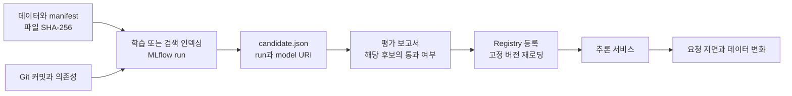

MLflow run은 코드, 데이터, 환경과 결과를 연결한다.

먼저 결과의 데이터와 설정을 추적한다.

## 준비와 환경

README 설치 후 저장소 루트에서 실행한다. Python 3.13은 지원하지 않는다. 환경 재구성에는 `uv sync --locked --extra dev`를 쓴다. `uv.lock`이 선택 도구 버전도 고정하지만 충돌하는 extras를 함께 설치할 수 있다는 뜻은 아니다.

Windows의 기본 CPU 과정은 PowerShell에서 실행한다. Kubernetes와 컨테이너 빌드에는 Docker Desktop의 Linux 컨테이너 환경이나 Linux 호스트가 필요하며 Python 환경과 Docker 엔진은 별개다.

데이터 준비는 비어 있지 않은 출력 폴더를 덮어쓰지 않아 이전 이미지 혼입과 출처 변경을 막는다. 재실행에는 새 데이터 경로나 `--work` 경로를 지정한다.

```powershell
uv run ml-labs --help
uv run ml-labs smoke --work .ml-labs/first-run
Get-Content .ml-labs/first-run/runs/movies/candidate.json
Get-Content .ml-labs/first-run/reports/movies.json
```




`manifest.json`은 파일 지문이고 `candidate.json`은 모델 주소와 평가 전 정보를 담는 명세다. 보고서는 후보에 연결되므로 다른 실행의 통과 결과로 등록할 수 없다.

## MLflow 화면에서 확인하기

```powershell
$db = (Resolve-Path .ml-labs/first-run/tracking/tracking.db).Path.Replace('\', '/')
uv run mlflow ui --backend-store-uri "sqlite:///$db" --host 127.0.0.1 --port 5000
```

`http://127.0.0.1:5000`에서 `ml-platform-labs` 실험의 세 프로젝트 run을 확인한다. 파라미터, 검증 지표, `lineage/dataset.json`, `model/MLmodel`, 평가 보고서의 역할을 구분한다.

실험 화면을 닫으려면 터미널에서 Ctrl+C를 누른다. SQLite와 `mlruns` 모델 파일은 별개이므로 DB만 복사해선 부족하다. 학습 저장소 전체를 보존한다.

## 환경을 바꿀 때 주의할 점

`MLFLOW_TRACKING_URI`가 설정되면 로컬 SQLite 대신 해당 서버를 쓴다. 의도한 대상인지 확인한다.

```powershell
Get-Item Env:MLFLOW_TRACKING_URI -ErrorAction SilentlyContinue
```

불필요한 값은 현재 PowerShell 세션에서만 제거한다.

```powershell
Remove-Item Env:MLFLOW_TRACKING_URI -ErrorAction SilentlyContinue
```

Git 커밋을 읽지 못하는 환경에서는 정확한 커밋을 `ML_LABS_CODE_REVISION`으로 전달한다. 출처를 추정하지 말고 dirty working tree와 데이터도 보존한다.

## 실행별 식별자와 거절 조건

재학습마다 run ID와 등록 버전은 달라진다. 미통과 후보는 등록할 수 없고 CSV 지문이 바뀌면 평가가 중단된다.


[다음: 영화 추천](/docs/tech/ops/mlops/labs/ml-platform-labs-01-movies/) / [전체 과정](/docs/tech/ops/mlops/labs/)


실행 코드는 [실습 저장소](https://github.com/johklo/ml-platform-engineering-labs)에서 내려받는다. [원본 가이드](https://github.com/johklo/ml-platform-engineering-labs/blob/main/docs/00-foundation.md)
