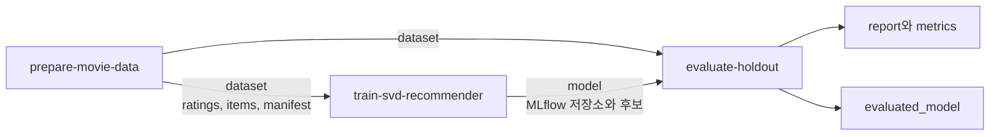

한 Python 프로세스에서는 함수끼리 메모리를 공유할 수 있습니다. 하지만 다른 컨테이너에서 실행하면 앞 단계의 변수나 개인 PC의 파일을 그대로 볼 수 없습니다. 파이프라인에서는 어떤 파일을 입력받고 어떤 결과를 내보내는지가 계약입니다.

이번 과정은 앞의 영화 추천 코드를 실제 Kubeflow Pipelines 컴포넌트로 연결합니다. 별도의 장난감 회귀 모델로 바꾸지 않고 데이터 준비, SVD 학습과 검증 후 테스트를 그대로 사용합니다.

## 클러스터 없이 컴파일하기

먼저 실행할 소스를 커밋합니다. 소스 커밋을 이미지에 기록하고, 동일한 값을 파이프라인에 넘겨야 합니다.

```powershell
$revision = git rev-parse HEAD
uv run --extra pipeline ml-labs tools kfp compile --source-revision $revision --output integrations/kfp/movie-pipeline.yaml
```

이미지를 지정하지 않으면 출력에 자리표시자라는 경고가 나옵니다. 이 YAML은 구조 확인용이며 그대로 클러스터에 제출해서는 안 됩니다.

컴파일된 YAML에서 세 컴포넌트와 아티팩트 연결을 확인합니다.



| 단계 | 받는 것 | 내보내는 것 |
| --- | --- | --- |
| 준비 | 데이터 생성 파라미터와 코드 revision | `Dataset` 디렉터리와 지문 |
| 학습 | 준비 단계의 `Dataset` | MLflow 기록과 모델을 담은 `Model` |
| 평가 | 같은 `Dataset`과 학습 단계의 `Model` | 보고서, `Metrics`, 평가를 포함한 모델 bundle |

모델 등록이나 endpoint 배포까지 자동 실행하지 않습니다. 평가가 실패하면 함수가 예외를 내고 KFP 단계도 실패합니다. 실패한 단계의 보고서 파일은 KFP가 업로드하지 못할 수 있으므로 task 로그도 확인해야 합니다.

## MLflow 기록을 전달하는 방식

이 실습은 별도의 공용 MLflow 서버 없이 동작하도록 구성했습니다. 학습 컨테이너의 `/workspace/mlflow`에 SQLite DB와 `mlruns`, 후보 명세를 만들고 전체를 model output으로 복사합니다.

평가 컨테이너는 비어 있는 같은 절대 경로에 bundle을 복원합니다. SQLite의 아티팩트 주소에 절대 경로가 들어 있기 때문에 경로를 맞춰야 합니다. 후보 명세의 URI를 임의로 바꾸는 방식은 아닙니다.

이는 독립된 컨테이너 사이의 아티팩트 전달을 배우기 위한 구성입니다. 다중 작업이 동시에 쓰는 운영용 Tracking Server나 공용 Model Registry의 대체가 아닙니다. 규모가 커지면 중앙 tracking server와 object store를 사용하고, 평가 작업의 기록 권한도 분리하는 편이 적절합니다.

## 컨테이너 이미지를 만들 때

Docker 엔진이 실행 중인지 먼저 확인합니다. Windows에서는 Linux 컨테이너 모드가 필요합니다.

```powershell
docker info
$revision = git rev-parse HEAD
docker build --platform linux/amd64 --build-arg SOURCE_REVISION=$revision -t <registry>/ml-platform-engineering-labs:<tag> .
docker push <registry>/ml-platform-engineering-labs:<tag>
```

Dockerfile은 저장소 코드와 고정한 의존성, KFP SDK를 포함합니다. 각 task가 실행될 때 패키지를 새로 설치하는 방식은 아닙니다. `.dockerignore`는 가상환경, 데이터와 자격 증명을 빌드 문맥에서 제외합니다.

빌드한 이미지를 digest로 고정한 뒤 다시 컴파일합니다.

```powershell
uv run --extra pipeline ml-labs tools kfp compile --source-revision $revision --image "<registry>/ml-platform-engineering-labs@sha256:<digest>" --output integrations/kfp/movie-pipeline.yaml
```

이미지 태그만 재사용하면 같은 파이프라인 명세가 나중에 다른 코드를 실행할 수 있습니다. 코드 revision과 이미지 digest는 서로 다른 근거이므로 함께 기록합니다.

## 기존 KFP에 제출하기

실행 중인 KFP 서비스, 인증과 artifact 저장소가 필요합니다. 다음은 제출 예시이며 클러스터 설치 명령이 아닙니다.

```python
import kfp

client = kfp.Client(host="<authenticated-kfp-endpoint>")
run = client.create_run_from_pipeline_package(
    "integrations/kfp/movie-pipeline.yaml",
    arguments={"rank": 4},
    experiment_name="ml-platform-labs",
    enable_caching=False,
)
print(run.run_id)
```

실제 인증은 설치 방식에 맞게 추가해야 합니다. 컴파일된 명세에 image pull secret은 들어 있지 않습니다. 공개 이미지, AKS와 연결한 ACR 또는 pipeline runner service account의 pull secret 등으로 클러스터가 이미지를 가져올 수 있어야 합니다.

결과물은 KFP가 설정한 기본 pipeline root의 MinIO, S3 또는 GCS 등에 저장합니다. 이 예제는 공유 PVC를 요구하지 않지만 artifact 저장소 설정과 접근 권한은 필요합니다.

## 실패와 캐시 실험

동일한 파라미터에서 두 번 실행하고 캐시 사용 여부를 비교합니다. 깨끗한 새 실행을 원하면 위 예시처럼 캐시를 끕니다. 캐시 적중이 데이터의 최신성을 보증하지는 않습니다.

다음으로 검증 임계치를 엄격하게 바꾸는 확장 실험을 만듭니다. 평가가 거절되었을 때 그 뒤의 출시 단계가 실행되지 않는지 확인하세요. 현재 graph는 평가에서 끝나므로 자동 출시를 차단하는 운영 승인 시스템까지 구현했다고 해석하면 안 됩니다.

모델 output을 다른 데이터셋과 연결하는 잘못된 graph를 만들어 보면 데이터 지문 검사가 왜 필요한지도 확인할 수 있습니다.

## Azure ML과 비교하기

[Azure 과정](/docs/tech/ops/mlops/labs/ml-platform-labs-07-azure/)은 세 프로젝트를 SDK v2 component YAML로 연결합니다. KFP에서는 `Input[Dataset]`, `Output[Model]`로 나타낸 계약을 AML에서는 `uri_folder`와 component input/output으로 표현합니다.

관리형 서비스를 사용하더라도 다른 task의 메모리나 로컬 경로를 공유한다고 가정하면 안 됩니다. Azure ML 작업이 성공했다고 KFP 클러스터를 운영할 수 있게 되는 것은 아니므로 두 경로를 따로 학습합니다.

파이프라인의 핵심은 함수를 나누는 것이 아니라 다른 환경에서도 유지되는 입력, 출력과 실패 경계를 만드는 것입니다.

[이전: Feast](/docs/tech/ops/mlops/labs/ml-platform-labs-03-feast/) / [다음: 서빙과 관측](/docs/tech/ops/mlops/labs/ml-platform-labs-05-serving-monitoring/)


실행 코드는 [실습 저장소](https://github.com/johklo/ml-platform-engineering-labs)에서 내려받습니다. [원본 가이드](https://github.com/johklo/ml-platform-engineering-labs/blob/main/docs/04-pipelines.md)
