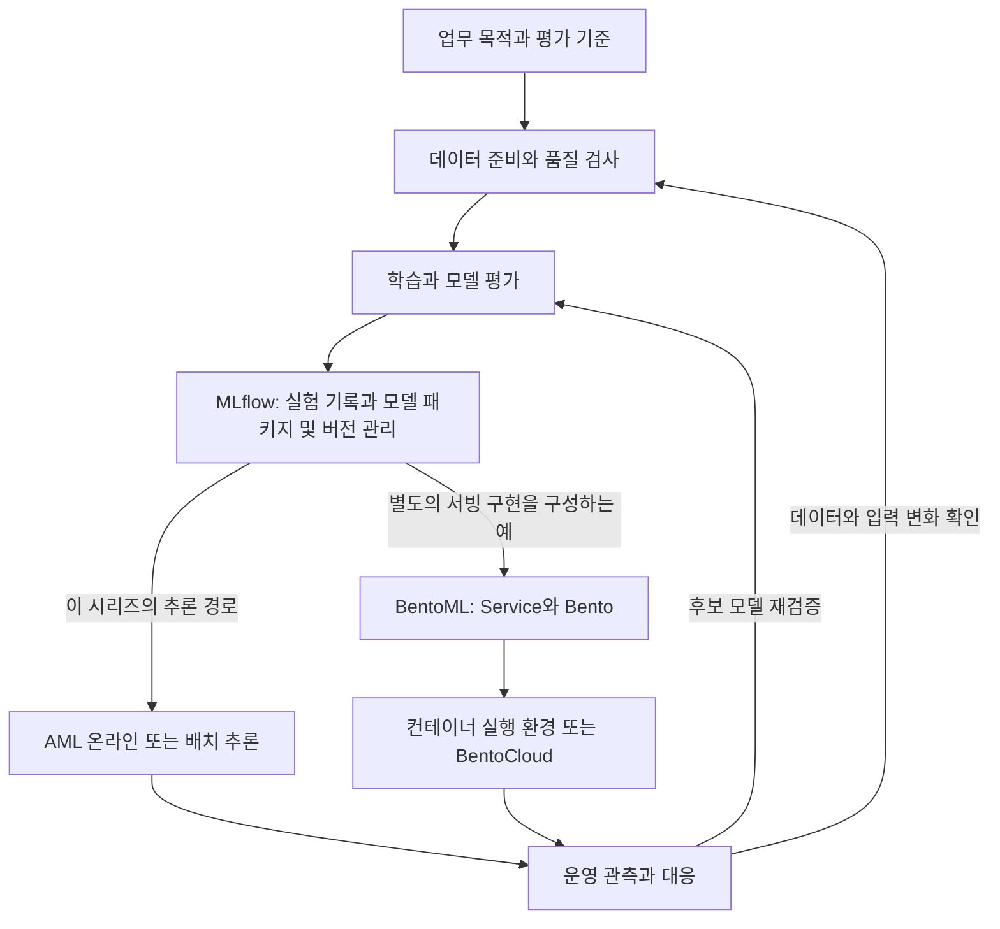
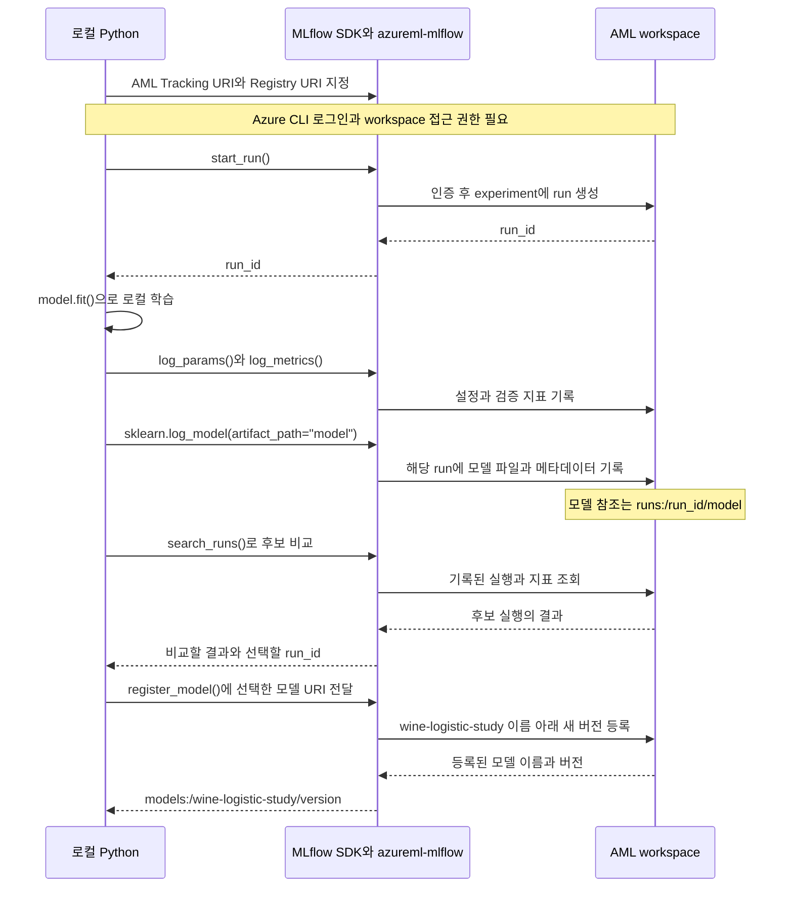

책에서 읽은 MLflow를 실행한 뒤 같은 코드를 Azure Machine Learning(AML)에 연결한다. 이 목차가 전체 흐름을, 여섯 편이 개념과 실습을 다룬다.

여섯 편은 같은 Wine 분류 예제를 이어가며, 하나의 `mlflow-aml-lab` 폴더에 파일과 실행 기록을 쌓는다.

기초 과정 뒤에는 [ML 플랫폼 실습 00~10](/docs/tech/ops/mlops/labs/ml-platform-labs-00-foundation/)에서 영화 추천, 카드 탐지, RAG, Feast와 Kubeflow Pipelines로 확장한다.

[MLflow 기능과 구성](/docs/tech/ops/mlops/labs/mlflow-capabilities/)과 [BentoML 기능과 구성](/docs/tech/ops/mlops/labs/bentoml-capabilities/)은 도구 소개이고, 01~06편은 같은 코드를 잇는 실습이다. 최신 기능과 AML 실습의 고정 버전도 구분한다.

## MLflow와 BentoML의 의미

### MLflow

MLflow는 실험 추적, 모델 평가, 패키징, 버전 관리와 배포를 제공하는 오픈소스 프로젝트다. [공식 ML 문서](https://mlflow.org/docs/latest/ml/)는 이를 모델 개발 생애주기로 다룬다.

이 시리즈는 데이터와 설정, 결과를 남기는 Tracking, 모델 형식, 선택 모델을 관리하는 Registry에 초점을 둔다. 학습은 scikit-learn이, 과정과 결과 기록은 MLflow가 맡는다.

같은 데이터에서 규제 설정을 세 번 바꾸면 run 세 개가 생긴다. 모델 하나에 이름과 버전을 부여하면 배포 모델의 원천 실험을 추적할 수 있다.

MLflow에는 자체 모델 서빙과 배포 연동도 있지만, API 사용만으로 학습 컴퓨팅이나 운영 인프라가 준비되지는 않는다.

### BentoML

BentoML은 추론 서비스의 코드, 입출력과 환경을 정의하고 배포하는 오픈소스 프레임워크다. [Service 문서](https://docs.bentoml.com/en/latest/build-with-bentoml/services.html)는 모델 처리 흐름을 API로 노출하는 단위로 Service를 설명한다.

모델의 `predict()`가 메모리 안의 함수라면, Service는 외부 요청을 받아 실행하고 응답한다. 입력, 전처리, 다중 모델 호출, 시간 제한과 자원도 정의한다.

Bento는 서비스 코드, Python 의존성, 모델 파일과 설정을 묶는 배포 패키지다([패키징 문서](https://docs.bentoml.com/en/latest/get-started/packaging-for-deployment.html)). 이를 바탕으로 컨테이너 이미지를 만들 수 있다.

BentoML은 서비스를 만들고 컨테이너에서 실행하는 프레임워크이며, BentoCloud는 배포와 컴퓨팅을 관리하는 플랫폼이다. BentoML 사용이 BentoCloud 사용을 뜻하지는 않는다.

### 두 도구를 구분할 기준

| 관점 | MLflow | BentoML |
| --- | --- | --- |
| 이 학습에서의 중심 질문 | 어떤 조건으로 만든 모델이며 왜 선택했는가 | 선택한 모델을 어떤 서비스로 실행할 것인가 |
| 대표 기록이나 결과물 | run, 메트릭, 모델 패키지와 등록 버전 | Service 코드, Bento와 컨테이너 이미지 |
| 모델을 다루는 방식 | 실험 출처와 모델 버전을 연결 | 서비스에서 사용할 모델을 읽고 배포 구성에 연결 |
| 실행 시 확인할 것 | 기록 대상, 비교 조건, 모델과 환경의 재현성 | 요청 처리, 입출력, 자원과 서비스 동작 |

기능은 겹친다. MLflow에도 서빙이, BentoML에도 모델 저장과 관리가 있다. 표는 기능 유무보다 역할을 구분한다.

## 전체 MLOps에서의 역할

MLOps는 업무 목적, 데이터, 검증, 출시, 관측과 개선을 반복 가능하게 연결한다.



도식은 단계별 기록과 전달 계약에 따른 역할 구분이며 두 도구를 모두 써야 한다는 뜻은 아니다.

| MLOps 구간 | MLflow를 연결할 부분 | BentoML을 연결할 부분 |
| --- | --- | --- |
| 데이터 준비와 품질 확인 | 사용한 데이터의 정보와 검사 결과를 실행 기록에 연결 | 추론 요청의 입력 검사와 전처리 구현 |
| 학습과 평가 | 설정, 지표, 보고서와 모델을 run에 기록 | 학습 루프보다 학습된 모델의 서비스 구현에 초점 |
| 모델 선택과 관리 | 선택 근거와 모델 버전, 원천 run의 관계 보관 | 서비스가 사용할 모델과 패키지 버전의 관계 관리 |
| 배포와 추론 | 모델의 로딩 계약과 배포 연동 제공 | API 처리와 실행 환경을 서비스 단위로 패키징 |
| 운영과 개선 | 평가와 재학습 결과를 새 실행 및 모델 이력에 연결 | 서빙 동작과 관측 지점을 구성하고 서비스 변경 반영 |

두 도구는 데이터 품질 기준, 출시 승인, 접근 제어와 장애 대응을 결정하지 않는다. 관측에서는 지연, 오류, 입력 변화, 정답 기반 품질을 구분한다.

## 이 시리즈에서 사용하는 경로

AML에 MLflow 모델을 등록해 온라인, 배치 추론에 쓴다. MLflow no-code 배포가 모델 계약에 맞춰 코드와 환경을 구성하므로 BentoML은 필요 없다.

별도 앱에서 입출력과 다중 모델 호출을 구성한다면 BentoML을 검토한다. [연동 예제](https://docs.bentoml.com/en/latest/examples/mlflow.html)는 MLflow 모델을 Model Store와 Service에서 사용한다.

MLflow 모델과 Bento 버전은 별개이므로 모델, 서비스 코드, 환경의 관계를 기록한다. AML 등록은 BentoML 서비스나 인증, 모델 접근을 구성하지 않는다.

BentoML은 비교 대상이며 실습에 설치하지 않는다. MLflow와 AML 학습 후 별도 서빙이 필요할 때 살펴본다.

## 학습 순서

기능 소개 두 편을 참고하고 01~06편을 순서대로 실행한다.

| 편 | 글 |
| --- | --- |
| 01 | [MLflow 기본과 로컬 실험 기록](/docs/tech/ops/mlops/labs/01-local-tracking/) |
| 02 | [실행 비교와 메트릭 및 아티팩트 조회](/docs/tech/ops/mlops/labs/02-query-and-compare/) |
| 03 | [모델 형식과 재사용](/docs/tech/ops/mlops/labs/03-model-format-and-loading/) |
| 04 | [AML 연결과 원격 학습 Job](/docs/tech/ops/mlops/labs/04-azureml-tracking-and-jobs/) |
| 05 | [모델 등록과 버전 관리](/docs/tech/ops/mlops/labs/05-model-registration/) |
| 06 | [온라인 및 배치 추론과 모델 교체](/docs/tech/ops/mlops/labs/06-online-and-batch-inference/) |

| 순서 | 준비 조건 | 남길 결과 |
| --- | --- | --- |
| 01 | Python 3.11과 로컬 작업 폴더 | 세 번의 학습 run과 보고서 및 모델 |
| 02 | 01편의 실행 기록 | 비교 결과와 `selected-run.json` |
| 03 | 02편에서 선택한 run | 모델 계약과 재로딩 및 입력 검사 결과 |
| 04 | 01~03편의 코드와 AML workspace | AML에 남은 로컬 학습 기록과 원격 Job |
| 05 | 04편의 AML 기록과 선택 파일 | 모델 이름과 구체 버전 |
| 06 | 등록한 모델과 배포를 검토할 환경 | 추론 요청 파일과 배포 및 전환의 확인 기준 |

## 전체 흐름: 로컬 학습 결과를 AML 모델로 등록하기

MLflow는 로컬 Python 코드가 호출하는 라이브러리다. 로컬 MLflow 서버를 거치지 않고 `azureml-mlflow`를 설치해 AML workspace를 지정하면 같은 호출로 실행 정보와 모델을 기록한다.

`model.fit()`은 학습, `log_model()`은 모델을 run에 기록, `register_model()`은 모델 이름 아래 버전 등록을 수행한다. 학습만으로 기록과 등록이 자동 수행되지는 않는다.

### 로컬 Python과 AML 사이의 호출 순서

04편은 AML 연결, 05편은 등록 흐름이다. 학습, 비교는 로컬에서 실행하고 기록, 등록은 같은 workspace에 보낸다. SDK와 플러그인은 로컬 라이브러리이지 별도 서버가 아니다.



AML은 실행 메타데이터를, workspace 아티팩트 저장소는 모델과 보고서를 관리한다. `log_model()`은 모델 파일을 기록하고 `register_model()`은 이름과 버전을 별도 등록한다.

### 각 호출이 만드는 결과

| 순서 | 코드나 설정 | 남는 결과 |
| --- | --- | --- |
| 1. 대상 지정 | 두 URI를 AML workspace로 설정 | 이후 기록과 등록을 보낼 대상이 정해짐. 아직 학습이나 모델 등록은 없음 |
| 2. 실행 시작 | `mlflow.start_run()` | experiment 아래에 run이 생기고 `run_id`를 받음 |
| 3. 학습과 평가 | `model.fit()`, 검증 코드 | 로컬 메모리에 학습한 모델과 평가 결과가 생김 |
| 4. 결과 기록 | `log_params()`, `log_metrics()`, `sklearn.log_model()` | AML에 설정, 지표, 모델이 해당 run의 결과로 남음 |
| 5. 후보 선택 | `compare.py`의 `search_runs()` | 검증 결과로 선택한 `run_id`를 `selected-run.json`에 남김 |
| 6. 버전 등록 | `finalize.py`의 `register_model()` | `wine-logistic-study`라는 모델 이름 아래 새 버전이 생김 |

05편의 `finalize.py`에서 등록에 사용하는 호출은 다음 부분이다. 아래는 전체 파일에서 등록 요청만 뽑은 코드이며, `run_id`는 같은 AML workspace에서 선택한 실행의 ID다.

```python
registered = mlflow.register_model(
    model_uri=f"runs:/{run_id}/model",
    name="wine-logistic-study",
)
```

`runs:/<run_id>/model`은 로컬 폴더 경로가 아니다. 현재 Tracking URI가 가리키는 저장소에서 특정 run에 기록한 `model`을 참조한다. Registry URI도 같은 AML workspace로 맞췄으므로 그 모델이 같은 workspace의 모델 버전으로 등록된다.

AML studio의 Jobs에서 실행, 지표를, Models에서 등록 이름, 버전을 확인한다. 로컬 학습도 Jobs에 보일 수 있지만 AML 클러스터가 실행한 것은 아니다.

## 라이브러리와 서비스의 역할

[MLflow 개요](https://learn.microsoft.com/en-us/azure/machine-learning/concept-mlflow?view=azureml-api-2)는 AML이 오픈소스 MLflow 서버 인스턴스를 호스팅하는 것이 아니라 호환 API를 제공한다고 설명한다. 서버 프로세스의 설치와 AML workspace 연결을 같은 작업으로 보지 않았다.

| 구성 요소 | 맡는 일 | 이 시리즈의 사용 위치 |
| --- | --- | --- |
| `mlflow` | 실행 기록, 조회, 모델 패키징과 로딩 | 학습 및 비교 스크립트 |
| `azureml-mlflow` | `azureml://` 대상과의 연동, 인증과 아티팩트 처리 | AML에 연결하는 Python 환경 |
| `azure-ai-ml`의 `MLClient` 또는 Azure CLI의 `ml` 확장 | workspace, compute, Job, 모델 자산과 배포 관리 | CLI로 URI 조회와 Job 제출 |
| AML workspace | 실험과 실행, 모델 자산을 관리하는 서비스 범위 | 기록과 등록의 대상 |
| 아티팩트 저장소 | 모델과 보고서 등의 실제 파일 보관 | workspace에 연결된 저장소 |

`MLClient`는 메트릭을 자동 기록하지 않는다. CLI, SDK v2는 리소스와 Job, MLflow는 학습 결과를 관리한다. CLI 사용으로 로컬 `azure-ai-ml` 설치는 불필요하다.

## 로컬 연습과 AML 연결의 구분

01~03편에서는 로컬 SQLite와 파일 저장소를 사용한다. 이 단계의 모델은 AML에 등록된 것이 아니다. 04편에서 기록 대상을 AML workspace로 바꾸고, 05편에서 선택한 모델을 이름과 버전으로 등록한다. 06편의 추론 서비스 배포는 등록과 별개의 작업이다.

Tracking URI를 바꾸는 것만으로 이전 로컬 run이 AML로 복사되지는 않는다. 예제에서는 같은 학습 코드를 다시 실행해 원격에 새 기록을 만든다. 이미 가진 모델을 다시 학습하지 않고 가져오는 경로는 05편에서 따로 다룬다.

## 실습 폴더와 파일의 연결

| 파일 | 처음 만드는 편 | 사용하는 단계 |
| --- | --- | --- |
| `requirements.txt`, `src\train.py` | 01 | 학습과 모델 기록 |
| `compare.py`, `inspect_run.py` | 02 | 후보 선택과 기록 조회 |
| `check_model.py` | 03 | 모델 재로딩과 signature 확인 |
| `requirements-azure.txt`, `conda.yml`, `job.yml` | 04 | AML 연결과 원격 실행 |
| `finalize.py` | 05 | 선택한 모델의 평가와 버전 등록 |
| `make_request.py` | 06 | AML 온라인 추론용 입력 작성 |

코드는 해당 편에 파일명과 함께 제시했다. 명령은 Windows PowerShell을 기준으로 하며 가상환경을 활성화하지 않고 `.venv` 안의 실행 파일을 직접 호출한다. 각 편의 명령은 같은 실습 폴더의 루트에서 실행한다.

## 실행 범위와 비용

로컬 확인 범위는 학습, 비교, 모델 재로딩, 등록, 자동 기록, 요청 파일 생성이다. AML 연결, 원격 학습과 배포는 구독 권한, 네트워크, 컴퓨팅에 달려 있다.

04편부터 AML 리소스와 비용이 발생한다. 06편은 등록 모델의 온라인, 배치 추론을 다루며 학습 코드만으로 endpoint가 생성되지는 않는다. 공유 리소스는 임의로 삭제하지 않는다.

## 다른 Azure 실행 환경으로 확장

기록과 등록 대상을 구분한 뒤 실행 환경을 Databricks나 Synapse로 옮길 수 있다. 학습 환경과 모델 관리, 배포 제품은 달라도 된다.

| 확장 경로 | 문서에서 구분하는 것 | 앞의 실습과 다른 준비 |
| --- | --- | --- |
| Azure Databricks | 양쪽 workspace에 기록하는 dual tracking과 AML 전용 기록, 별도로 선택하는 모델 Registry | Databricks 실행 환경, 라이브러리와 인증, 두 추적 대상의 관계 |
| Azure Synapse Analytics | Spark 환경에서 AML로 기록한 뒤 AML 배포나 Spark 추론으로 소비하는 경로 | Spark pool의 패키지, 추적 URI, 인증과 데이터 접근 |
| 기본 flavor가 없는 모델 | 원래 모델의 로딩과 `predict()`를 감싸는 PyFunc 패키지 | 전처리와 후처리, 추가 파일과 의존성, 입출력 동등성 |

Databricks dual tracking은 Registry의 이중 등록을 뜻하지 않으므로 기록, 등록 대상을 따로 확인한다. 문서는 Private Link AML workspace의 제약도 설명하므로 네트워크별 설정을 검토한다.

Synapse Spark 세션은 로컬 패키지 설치와 별개다. Pool의 의존성과 인증을 확인하고 Spark UDF 실행과 AML endpoint 배포를 구분한다.

## 참고 자료와 학습 후 확인할 결과

공식 문서 확인 기준일은 2026-10-21이다.

### 도구의 의미와 역할 비교

| 공식 문서 | 이 목차에서 확인한 부분 |
| --- | --- |
| [MLflow의 ML 기능 개요](https://mlflow.org/docs/latest/ml/) | 실험 추적, 평가, 모델 Registry와 배포의 범위 |
| [BentoML 개요](https://docs.bentoml.com/en/latest/) | 서빙 프레임워크와 추론 플랫폼의 관계 |
| [BentoML Service](https://docs.bentoml.com/en/latest/build-with-bentoml/services.html) | 모델 로딩과 예측 코드를 API로 노출하는 구현 단위 |
| [Bento 패키징](https://docs.bentoml.com/en/latest/get-started/packaging-for-deployment.html) | 코드, 모델과 환경을 배포 단위로 구성하는 방식 |
| [MLflow 모델의 BentoML 연동](https://docs.bentoml.com/en/latest/examples/mlflow.html) | MLflow 모델 가져오기와 BentoML Service의 연결 |
| [BentoCloud 배포](https://docs.bentoml.com/en/latest/get-started/cloud-deployment.html) | 오픈소스 프레임워크와 관리형 배포 플랫폼의 구분 |

### 개념과 기본 학습 경로

| 공식 문서 | 정리한 논점 | 학습 후 확인할 것 |
| --- | --- | --- |
| [MLflow와 Azure Machine Learning](https://learn.microsoft.com/en-us/azure/machine-learning/concept-mlflow?view=azureml-api-2) | 호환 API와 도구별 책임, Tracking과 Jobs의 관계 | MLflow 서버 설치와 AML 연결을 구분할 수 있는지 |
| [아티팩트와 모델](https://learn.microsoft.com/en-us/azure/machine-learning/concept-mlflow-models?view=azureml-api-2) | `MLmodel`, flavor, signature, 모델 환경과 로딩 방식 | 저장한 폴더를 보고 실행 계약을 설명할 수 있는지 |
| [실험과 실행 추적](https://learn.microsoft.com/en-us/azure/machine-learning/how-to-use-mlflow-cli-runs?view=azureml-api-2&tabs=interactive%2Ccli) | 대화형 실행과 AML Job의 experiment 및 run 설정 | 실행 주체가 달라도 같은 학습 기록을 남길 수 있는지 |
| [MLflow 연결 설정](https://learn.microsoft.com/en-us/azure/machine-learning/how-to-use-mlflow-configure-tracking?view=azureml-api-2) | Tracking URI, 인증, 자동 설정되는 실행 문맥 | 대상 workspace와 실제 실행 환경을 확인할 수 있는지 |
| [메트릭, 파라미터, 파일 기록](https://learn.microsoft.com/en-us/azure/machine-learning/how-to-log-view-metrics?view=azureml-api-2) | 수동 기록, 자동 기록, 파일과 메트릭, 비동기 기록 | stdout와 구조화된 기록, 최신 값과 이력을 구분하는지 |
| [MLflow 모델 로깅](https://learn.microsoft.com/en-us/azure/machine-learning/how-to-log-mlflow-models?view=azureml-api-2) | 모델 형식, signature와 의존성, 버전 조건, 사용자 정의 모델 | 원시 파일 업로드와 모델 기록이 왜 다른지 |
| [실행 조회와 비교](https://learn.microsoft.com/en-us/azure/machine-learning/how-to-track-experiments-mlflow?view=azureml-api-2) | 검색, 필터, 메트릭 이력, 아티팩트 조회와 지원 표 | 비교 조건을 고정하고 필요한 파일을 다시 읽을 수 있는지 |
| [모델 Registry 관리](https://learn.microsoft.com/en-us/azure/machine-learning/how-to-manage-models-mlflow?view=azureml-api-2) | run 또는 로컬 폴더의 등록, 버전과 stage, workspace 경계 | 등록할 모델의 원천과 대상, 구체 버전을 설명할 수 있는지 |

### 모델 소비와 후속 확장

| 공식 문서 | 정리한 논점 | 학습 후 확인할 것 |
| --- | --- | --- |
| [MLflow 모델 배포 지침](https://learn.microsoft.com/en-us/azure/machine-learning/how-to-deploy-mlflow-models?view=azureml-api-2) | No-code 범위, 환경과 입력 계약, 배포 도구의 차이 | 모델 등록과 실행 서비스를 구분할 수 있는지 |
| [온라인 endpoint 배포](https://learn.microsoft.com/en-us/azure/machine-learning/how-to-deploy-mlflow-models-online-endpoints?view=azureml-api-2) | 모델 선택, endpoint와 deployment 생성, 요청과 트래픽 | 같은 입력의 로컬 및 원격 결과를 비교할 수 있는지 |
| [배치 endpoint 배포](https://learn.microsoft.com/en-us/azure/machine-learning/how-to-mlflow-batch?view=azureml-api-2) | 입력 데이터, 비동기 scoring Job, 파일 단위 분산과 결과 | 호출 성공과 Job 완료, 결과 파일을 구분하는지 |
| [온라인 배포의 점진적 전환](https://learn.microsoft.com/en-us/azure/machine-learning/how-to-deploy-mlflow-models-online-progressive?view=azureml-api-2) | 복수 deployment의 직접 테스트와 트래픽 이동 | 모델 버전 변경과 트래픽 전환, 복구를 구분하는지 |
| [기존 모델을 MLflow로 변환](https://learn.microsoft.com/en-us/azure/machine-learning/how-to-convert-custom-model-to-mlflow?view=azureml-api-2) | 기존 모델 파일을 PyFunc, 환경과 signature로 패키징 | 변환 전후 같은 입력에서 예측이 유지되는지 |
| [Azure Databricks 연결](https://learn.microsoft.com/en-us/azure/machine-learning/how-to-use-mlflow-azure-databricks?view=azureml-api-2) | Dual tracking, AML 전용 기록, 별도의 Registry 대상 | 어느 쪽에 기록하고 등록했는지 설명할 수 있는지 |
| [Azure Synapse Analytics 연결](https://learn.microsoft.com/en-us/azure/machine-learning/how-to-use-mlflow-azure-synapse?view=azureml-api-2) | Spark 환경의 패키지와 인증, AML 기록과 모델 소비 | Spark 실행과 AML 모델 관리의 경계를 확인하는지 |

### 리소스와 실행 준비

| 공식 문서 | 이 실습에서 확인한 부분 |
| --- | --- |
| [Workspace와 초기 리소스](https://learn.microsoft.com/en-us/azure/machine-learning/quickstart-create-resources?view=azureml-api-2) | workspace 준비와 compute instance의 역할, 생성 비용과 정리 |
| [Compute cluster 만들기](https://learn.microsoft.com/en-us/azure/machine-learning/how-to-create-attach-compute-cluster?view=azureml-api-2) | 학습 실행 자원, 최소 및 최대 노드 수, 유휴 시 축소 |
| [Workspace 권한](https://learn.microsoft.com/en-us/azure/machine-learning/how-to-assign-roles?view=azureml-api-2) | 실험과 Job, 모델 관리, compute와 배포 권한의 구분 |
| [Command Job YAML 명세](https://learn.microsoft.com/en-us/azure/machine-learning/reference-yaml-job-command?view=azureml-api-2) | 코드 업로드 범위, inputs, 환경, compute와 Job 이름 |

API, AML 지원과 플러그인 의존성은 바뀔 수 있으므로 고정 버전과 문서 조건을 확인한다.
