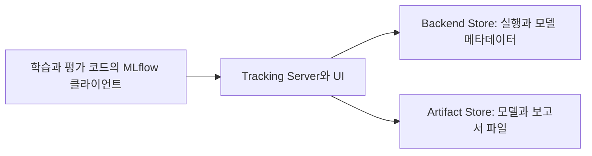

MLflow는 실험 기록뿐 아니라 모델 형식, 버전, 평가와 배포도 다룬다. 이 기능은 실행 기록, 모델 재사용과 서비스 관측으로 연결된다.

01~06편은 MLflow 2.16.2 기준이며 최신 MLflow 3.x, GenAI 기능과 구분한다.

## 기능 지도

| 기능군 | 다루는 내용 | 남는 정보나 결과물 |
| --- | --- | --- |
| Tracking | 실행, 설정, 지표, 파일과 코드 정보 기록 | experiment, run, 메트릭 이력과 아티팩트 |
| Dataset Tracking | 사용한 데이터의 식별 정보와 출처 연결 | 이름, digest, source, schema와 사용 문맥 |
| Models | 모델의 로딩과 추론 계약을 패키징 | `MLmodel`, flavor, signature와 환경 파일 |
| Model Registry | 관리할 모델의 이름과 버전, 참조와 설명 | 등록 모델, 버전, alias, tag와 계보 |
| Evaluation | 평가 데이터와 기준에 따라 결과 산출 | 평가 메트릭, 결과 표와 시각화 |
| Projects | 코드를 어떤 입력과 환경으로 실행할지 정의 | entry point, 파라미터와 실행 환경 |
| Serving과 배포 연동 | 저장한 모델을 추론 프로세스나 서비스로 실행 | 추론 서버, 컨테이너와 배포 설정 |
| Tracking Server와 저장소 | 여러 클라이언트의 기록과 조회를 제공 | API와 UI, 메타데이터 DB와 파일 저장소 |
| GenAI 기능 | LLM과 에이전트의 실행, 평가와 프롬프트 관리 | trace, 평가 결과와 프롬프트 버전 |
| AI Gateway | 여러 모델 제공자에 대한 호출 경로 관리 | 제공자 연결, 라우팅과 사용량 정보 |

모든 기능을 도입할 필요는 없다. 부족한 의사결정 기록과 모델 소비 방식을 기준으로 기능을 선택한다.

## 기능과 인터페이스의 연결

| 다룰 작업 | 문서에서 만나는 대표 이름 |
| --- | --- |
| 실행 시작과 기록 | `start_run()`, `log_params()`, `log_metrics()`, `autolog()` |
| 데이터 정보 연결 | `mlflow.data`, `log_input()` |
| 모델 저장과 로딩 | `save_model()`, `log_model()`, `load_model()` |
| 실행 조회와 등록 | `search_runs()`, `MlflowClient`, `register_model()` |
| 평가 | `mlflow.models.evaluate()`, `mlflow.genai.evaluate()` |
| 프로젝트 실행 | `MLproject`, `mlflow run` |
| 모델 서빙 | `mlflow models serve`, 배포 대상별 연동 |
| LLM 실행과 프롬프트 | `mlflow.trace`, Prompt Registry와 GenAI API |

API는 버전과 AML backend에 따라 제공 범위가 다르다.

## 실험 기록과 비교

Tracking 단위는 run이다. experiment로 실행을 묶고 run에 parameter, metric, tag와 artifact를 기록한다.

| 기록 | 질문 | Wine 실습의 예 |
| --- | --- | --- |
| Parameter | 무엇을 바꾸었는가 | `C`, 분할 시드 |
| Metric | 어떤 결과가 나왔는가 | 검증 정확도, log loss |
| Artifact | 숫자 외에 무엇을 남겼는가 | 검증 보고서, 학습 코드와 모델 |
| Tag | 어떤 실행끼리 묶을 것인가 | 학습 주제와 모델 유형 |

여러 step의 metric은 학습 곡선을 만든다. 마지막 값은 전체 이력과 다르며 하위 run은 작업과 시도를 연결한다.

Autologging은 프레임워크 학습 호출에서 파라미터, 지표, 모델 등을 기록하지만 항목은 라이브러리와 버전에 따라 다르다. 데이터 이용 조건과 모델 선택 근거는 별도 기록한다.

UI는 비교, 탐색에, API는 반복 조회, 자동화에 쓴다. 후보 선택 기준을 코드로 남기는 실습은 [02편](/docs/tech/ops/mlops/labs/02-query-and-compare/)에 있다.

## 데이터 추적

Dataset Tracking은 데이터 이름, 출처, digest, schema, profile과 학습, 평가 문맥을 run에 연결한다.

정확도 변화의 원인을 찾으려면 모델 설정과 함께 데이터셋, 분할 변경도 확인해야 한다. run과 데이터의 연결이 출발점이다.

이 기능은 원본 보존이나 변환 이력을 대신하지 않는다. 같은 경로의 파일을 덮어쓰면 이전 입력을 잃을 수 있으므로 스냅샷, 권한, 보존 기간은 저장소에서 관리한다.

01편은 개념 학습용으로 표 데이터 지문을 직접 기록하며 `mlflow.data` Dataset과 `log_input()`은 구현하지 않는다.

## 모델 패키징과 공통 추론 인터페이스

MLflow Model은 모델 파일, 로딩 방식, 입출력 signature와 의존성을 포함한다.

| 구성 | 역할 |
| --- | --- |
| Flavor | 해당 프레임워크의 모델을 저장하고 읽는 방법 |
| PyFunc | 공통 `predict()` 인터페이스로 모델을 소비하는 방식 |
| Signature | 입력과 출력의 열, 타입 또는 tensor 형태에 대한 계약 |
| 입력 예시 | 실제로 어떤 모양의 데이터를 넘길지 보여 주는 자료 |
| 환경 정보 | 모델을 로딩하고 추론할 때 필요한 의존성 |

프레임워크 객체는 자체 인터페이스로, PyFunc는 공통 `predict()`로 읽는다. 클래스 예측을 확률로 바꾸지는 않는다.

기본 flavor로 표현하기 어려운 모델은 사용자 정의 PyFunc로 감싸 전처리, 후처리와 파일 로딩을 포함할 수 있다. 입출력은 직접 정의한다.

[03편](/docs/tech/ops/mlops/labs/03-model-format-and-loading/)에서 signature와 환경을 확인한다.

## Logged Model과 등록 모델

최신 문서에서는 run, logged model과 등록 버전을 구분한다.

| 단위 | 의미 |
| --- | --- |
| Run | 학습이나 평가 코드의 실행 |
| Logged Model | 기록한 모델 자체. MLflow 3에서는 모델 ID를 중심으로 추적하는 경로도 제공 |
| Registered Model Version | 관리할 모델 이름 아래에 등록한 구체 버전 |

MLflow 3은 한 run의 여러 체크포인트와 모델별 데이터셋 메트릭을 추적하므로 run당 모델 하나로 가정하면 안 된다.

Registry는 모델 이름, 버전, 버전별 설명, tag, 원천 실행을 관리하고 alias로 버전을 참조한다.

Alias는 변경 가능한 참조다. `champion`이 가리키는 실제 버전을 기록해야 하며 alias 변경이 실행 중 서비스의 모델 교체를 뜻하지는 않는다.

[05편](/docs/tech/ops/mlops/labs/05-model-registration/)은 AML workspace의 run에서 모델을 골라 구체 버전으로 등록한다.

## 평가와 검증

Tracking은 결과를 기록하고 Evaluation은 지정 데이터와 기준으로 결과를 계산해 run, 모델에 연결한다.

분류, 회귀 평가는 지표, 혼동행렬, 곡선과 결과 표를 남기며 업무별 기준도 추가할 수 있다. 임계치 검증에는 기준선, 평가셋, 승인 조건의 책임자가 필요하다.

| 평가 경로 | 중심 대상 | 구분할 인터페이스 |
| --- | --- | --- |
| 전통적인 ML 평가 | 분류, 회귀, 모델 또는 미리 계산한 예측 | `mlflow.models.evaluate()`와 평가 메트릭 |
| 최신 GenAI 평가 | LLM 답변, 에이전트의 실행 결과와 기대 조건 | `mlflow.genai.evaluate()`와 scorer |

두 평가 체계의 메트릭 객체를 서로 교환하지 않는다.

LLM 평가는 모델 scorer나 사람 피드백을 쓰지만 평가 오류, 질문 대표성, 반복 변동이 남고 높은 점수가 정확성이나 보안을 보증하지 않는다.

## 실행 환경과 MLflow Projects

Projects는 코드의 entry point, 파라미터와 환경을 정의해 실행 명령과 입력을 공유한다.

프로젝트 환경은 학습 코드용, 모델 환경은 모델 로딩용이다.

[AML 공식 개요](https://learn.microsoft.com/en-us/azure/machine-learning/concept-mlflow?view=azureml-api-2#training-with-mlflow-projects-preview)는 `MLproject` 기반 AML 제출 지원이 2026년 9월 종료되고 Jobs로 전환된다고 안내한다. 오픈소스 Projects 전체나 Tracking의 종료를 뜻하지 않는다.

이 시리즈의 원격 학습은 [04편](/docs/tech/ops/mlops/labs/04-azureml-tracking-and-jobs/)의 AML command Job으로 제출한다.

## 서버와 저장소

클라이언트, 메타데이터 저장소와 파일 저장소는 역할이 다르다.

| 구성 | 보관하거나 제공하는 것 | 운영할 때 확인할 것 |
| --- | --- | --- |
| Tracking Server | API와 UI, 저장소 접근 경로 | 인증, 접근 경로, 동시 사용과 서비스 운영 |
| Backend Store | 실행, 메트릭, 모델 등의 메타데이터 | DB의 백업, 변경과 복구 |
| Artifact Store | 모델 가중치, 이미지와 보고서 | 파일 접근 권한, 보존과 실제 용량 |

로컬 DB는 서버 없이 쓸 수 있고, AML은 내부 DB 대신 관리형 호환 API로 연결한다.

MLflow workspace와 Azure AML workspace는 별개이므로 권한, 자산 범위를 혼동하지 않는다.

Self-hosting 문서는 HTTP 인증, SSO와 사용자 정의 플러그인을 다루지만 실제 서버 설정은 별도다. API, 저장소 접근 제어와 백업, 복구를 확인한다.

## 서빙과 배포 연동

MLflow는 저장 모델의 추론 서버와 컨테이너 이미지, 관리형 서비스 배포 연동을 제공한다.

같은 모델 패키지도 배포별 요청 형식, 인증, 컴퓨팅, 자원 관리가 다르다. 로컬 서버와 AML endpoint의 요청 본문도 구분한다.

BentoML과 모델 로딩, 서빙 기능이 겹친다. MLflow 계약을 소비할지 별도 서비스 코드로 다중 모델, 전후처리를 구성할지 선택한다. [06편](/docs/tech/ops/mlops/labs/06-online-and-batch-inference/)은 AML 온라인, 배치 추론을 다룬다.

## LLM과 에이전트 기능

최신 MLflow는 LLM, 에이전트의 관측, 평가, 프롬프트 관리도 지원한다.

| 기능 | 확인하려는 것 | 남는 정보 |
| --- | --- | --- |
| Tracing | 한 요청의 어느 단계에서 문제가 생겼는가 | 모델 호출, 검색, 도구 실행 등의 span과 입출력 |
| Evaluation | 변경 전후에 답변과 실행 품질이 어떻게 달라졌는가 | 평가 데이터, scorer와 결과 |
| Prompt Registry | 어떤 지침을 사용했는가 | 프롬프트 버전, alias와 사용 관계 |
| AI Gateway | 어떤 제공자와 모델로 요청을 보낼 것인가 | 연결과 라우팅 설정, 사용 정보 |

Tracing은 OpenTelemetry로 검색, 모델 호출, 도구 실행 단계를 추적한다.

Prompt Registry는 프롬프트를 코드와 분리해 버전 관리한다. 재현에는 모델 설정, 검색 자료, 실행 문맥도 필요하다.

AI Gateway는 제공자 호출 경로와 라우팅, 대체 경로를 관리한다. 앱 입력 검증과 제공자별 데이터 처리 조건은 별도다.

Trace에 프롬프트, 검색, 응답을 남기면 민감 정보가 저장될 수 있다. 수집 범위, 마스킹, 권한, 보존 기간과 평가 비용을 정한다.

## 기능 소개와 AML 실습의 경계

| 구분 | 이 시리즈에서의 취급 |
| --- | --- |
| 실행 추적, 모델 패키징과 Registry | 01~05편의 기본 학습 경로 |
| AML 학습과 모델 소비 | 04~06편의 CLI와 관리형 서비스 경로 |
| MLflow 3의 모델 ID 중심 추적 | 기능을 이해하되 2.16.2 예제와 API를 섞지 않음 |
| 최신 Prompt Registry와 GenAI 평가 및 Gateway | 후속 학습 범위이며 현재 Wine 실습에 추가하지 않음 |
| Registry의 alias와 관리 기능 | AML 지원 표와 설치 버전을 확인하며 구체 버전 참조는 유지 |

저장 기본값도 버전별로 다르다. 최신 self-hosting 문서는 MLflow 3.7부터 새 서버의 기본 backend가 SQLite라고 안내한다. 01편은 SQLite URI를 명시한다.

## 기능을 연결해 볼 사례

| 상황 | 연결할 기능 | 남겨야 할 확인 |
| --- | --- | --- |
| 같은 코드의 점수가 달라짐 | Tracking과 Dataset Tracking | 설정, 데이터와 환경 중 달라진 것 |
| 선택 모델을 다른 팀에 전달 | Models와 Registry | 구체 버전, 입력 계약, 의존성과 원천 실행 |
| RAG 답변 품질이 나빠짐 | Tracing과 GenAI 평가 | 검색과 생성 단계의 원인, 질문 집합과 평가 기준 |
| 팀이 같은 결과를 함께 사용 | 서버와 저장소, API | 접근 권한, 파일 보존과 재조회 가능성 |

## 참고 자료

- [Tracking](https://mlflow.org/docs/latest/ml/tracking/)
- [Dataset Tracking](https://mlflow.org/docs/latest/ml/dataset/)
- [Models](https://mlflow.org/docs/latest/ml/model/)
- [Model Registry](https://mlflow.org/docs/latest/ml/model-registry/)
- [전통적인 ML 평가](https://mlflow.org/docs/latest/ml/evaluation/)
- [Projects](https://mlflow.org/docs/latest/ml/projects/)
- [Self-hosting과 구성 요소](https://mlflow.org/docs/latest/self-hosting/)
- [서빙과 배포](https://mlflow.org/docs/latest/ml/deployment/)
- [LLM 및 에이전트 기능](https://mlflow.org/docs/latest/genai/)
- [Tracing](https://mlflow.org/docs/latest/genai/tracing/)
- [GenAI 평가](https://mlflow.org/docs/latest/genai/eval-monitor/)
- [Prompt Registry](https://mlflow.org/docs/latest/genai/prompt-registry/)
- [AI Gateway](https://mlflow.org/docs/latest/genai/governance/ai-gateway/)

[시리즈 목차](/docs/tech/ops/mlops/labs/), [BentoML 기능과 구성](/docs/tech/ops/mlops/labs/bentoml-capabilities/), [01. 로컬 실습 시작](/docs/tech/ops/mlops/labs/01-local-tracking/)
