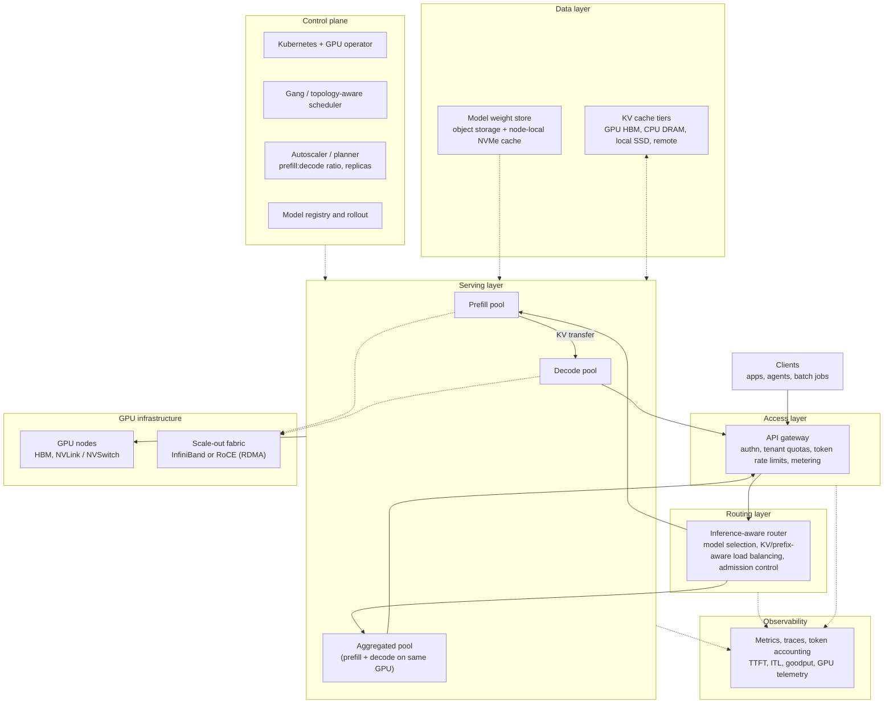
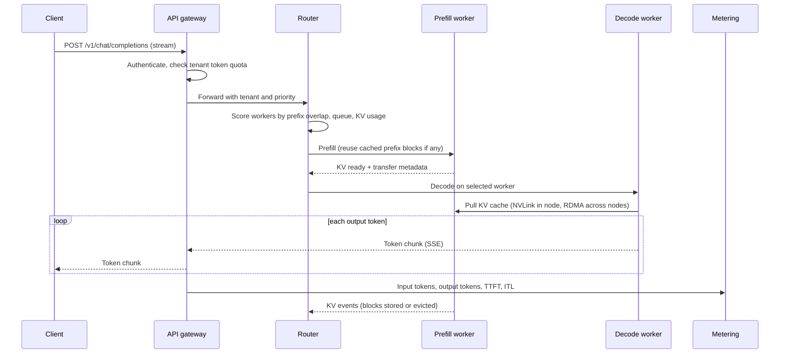
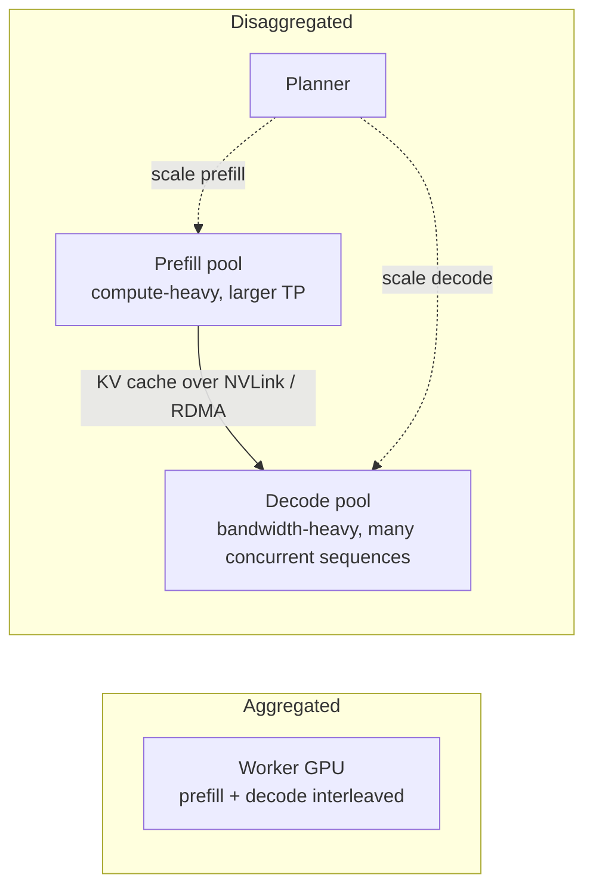
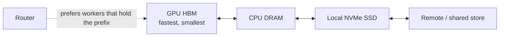
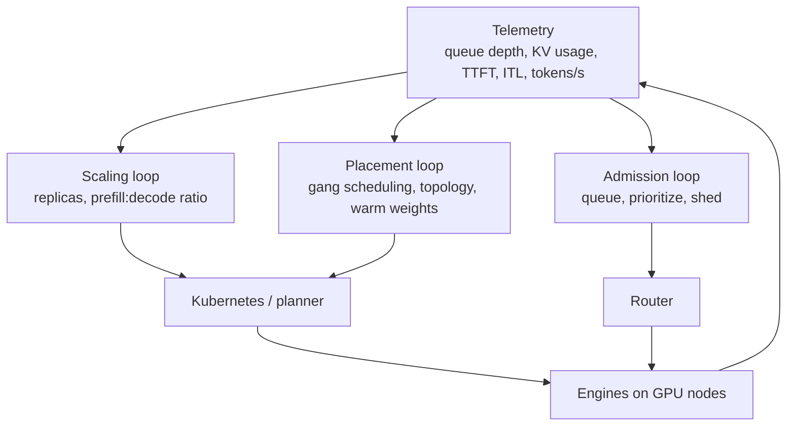
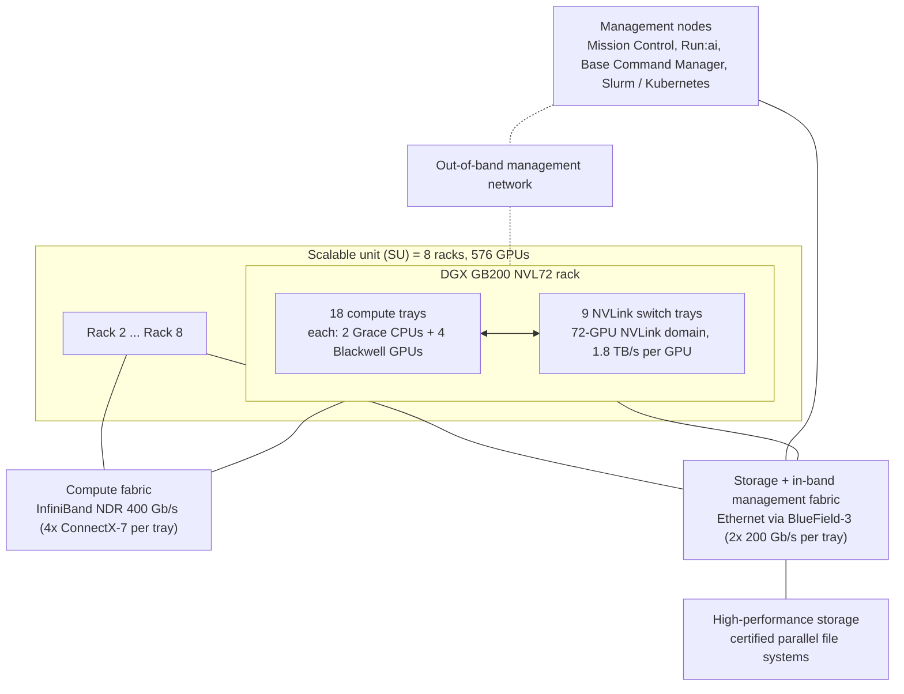
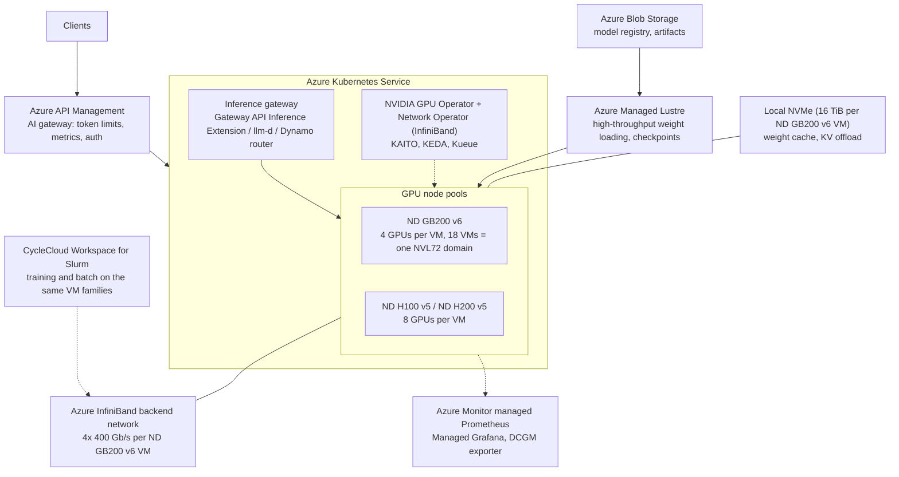

A **token factory** is an inference platform whose product is generated tokens. Raw inputs are power, GPUs, and model weights. The output is a stream of tokens sold or consumed at a target latency and cost. The term describes a shift in how inference platforms are designed: instead of "hosting a model", the goal is to maximize **useful tokens per second per dollar** while meeting latency targets for every tenant.

This post describes a vendor-neutral reference architecture, the role of each layer, the open source and commercial components that commonly fill each role, and the design decisions that matter most.

## 1. What the factory optimizes

Every design choice trades off three numbers.

| Metric | Definition | Why it matters |
| --- | --- | --- |
| **TTFT** (time to first token) | Time from request arrival to the first output token | Perceived responsiveness. Dominated by queueing and prefill |
| **ITL / TPOT** (inter-token latency, time per output token) | Average gap between output tokens | Reading speed for chat, total time for long outputs. Dominated by decode |
| **Throughput** | Output tokens per second per GPU (or per node) | Directly sets cost per million tokens |
| **Goodput** | Throughput that still meets the TTFT and ITL targets | The number that actually matters. Raw throughput at broken latency is waste |
| **Cost per 1M tokens** | (GPU hour cost + overhead) / tokens produced per hour | The business metric |

The two phases of generation behave very differently, and most of the architecture follows from this.

| Phase | Work | Bottleneck |
| --- | --- | --- |
| **Prefill** | Process the whole prompt in parallel and build the KV cache | Compute bound. Long prompts take long |
| **Decode** | Generate one token at a time, reading the full KV cache each step | Memory bandwidth bound. Scales with concurrency and context length |

The **KV cache** (attention keys and values for every token in flight) is the central resource of the factory. It decides how many requests fit on a GPU, whether a repeated prompt prefix can be reused, and how much data must move when work is split across GPUs.

## 2. Reference architecture

### Layer roles and common technology

| Layer | Role | Typical components |
| --- | --- | --- |
| Access | Single API surface (often OpenAI compatible), authentication, per-tenant quotas, **token-based** rate limits, usage metering for billing | Envoy-based gateways, Envoy AI Gateway, LiteLLM, Kong, cloud API management |
| Routing | Pick the model pool and the replica. Use queue depth, KV cache utilization, and prefix overlap instead of round robin. Shed or queue load when the fleet is saturated | Gateway API Inference Extension (InferencePool, endpoint picker), llm-d inference scheduler, NVIDIA Dynamo router, SGLang router |
| Serving engine | Continuous batching, paged KV cache, prefix caching, quantized kernels, speculative decoding, tensor/pipeline/expert parallelism | vLLM, SGLang, TensorRT-LLM, NVIDIA Triton, Hugging Face TGI |
| Distributed serving | Disaggregate prefill and decode, move KV cache between GPUs, manage KV across memory tiers | NVIDIA Dynamo (NIXL, KVBM, Planner), llm-d, LMCache, Mooncake |
| Infrastructure | GPUs with large HBM, NVLink within a node or rack, RDMA fabric between nodes | NVIDIA H100/H200/B200/GB200, AMD MI300 series, InfiniBand, RoCE |
| Control plane | Place multi-GPU workloads as a unit, respect topology, scale pools, roll out models | Kubernetes, NVIDIA GPU Operator, Kueue, Volcano, KEDA, Grove, KServe, KAITO |
| Data | Load tens to hundreds of GB of weights fast, keep hot weights local, extend KV cache beyond HBM | Object storage, parallel file systems (Lustre), node-local NVMe, model streaming loaders |
| Observability | Per-request latency, per-tenant token counts, GPU health | Prometheus, OpenTelemetry, NVIDIA DCGM exporter, Grafana |

## 3. Request flow

The flow below shows a disaggregated deployment, where prefill and decode run on separate GPU pools. This matches the design documented for NVIDIA Dynamo and is similar to llm-d.

In an **aggregated** deployment, one worker does both phases. It is simpler and is the right default for small models, short prompts, or low traffic. Disaggregation pays off when prompts are long, traffic is high, and the two phases need different scaling and parallelism.

## 4. Disaggregated prefill and decode

| Aspect | Aggregated | Disaggregated |
| --- | --- | --- |
| Interference | A long prefill pauses decode for every request in the batch, causing ITL spikes | Decode runs without prefill interruptions |
| Scaling | One replica count | Prefill and decode scale separately as the input/output length mix changes |
| Parallelism | One setting for both phases | Different tensor parallelism per phase |
| Cost | No KV transfer | KV transfer needs fast interconnect. Over plain TCP across nodes, transfer can dominate TTFT |
| Operational complexity | Low | Higher: two pools, transfer layer, planner |

## 5. KV cache management

Because KV cache decides both capacity and latency, mature factories treat it as a managed, tiered resource.

- **Paged attention** stores KV in fixed-size blocks so memory is not wasted on padding.
- **Prefix caching** reuses blocks for identical prompt prefixes (system prompts, few-shot examples, RAG context, multi-turn chat history). A high prefix hit rate lowers TTFT and prefill compute.
- **Prefix-aware routing** sends a request to the worker that already holds its prefix. Random load balancing destroys cache reuse.
- **Offloading** moves cold blocks to cheaper tiers instead of dropping them, so long multi-turn sessions do not recompute the prompt.

## 6. Control loops

A token factory is driven by feedback loops more than static configuration.

- **Admission:** when TTFT targets are about to be missed, queue low-priority traffic or reject it early rather than letting every request get slow. Priority classes (interactive versus batch) are common.
- **Scaling:** scale on inference signals (queue length, KV utilization, TTFT), not CPU or raw GPU utilization. GPU utilization from basic telemetry only says a kernel was running, not how much useful work was done.
- **Placement:** a multi-GPU replica must start all of its pods together (gang scheduling) on GPUs connected by NVLink. Partial placement wastes GPUs.
- **Cold start:** loading weights is often the slowest part of scaling. Node-local caches, streaming loaders, and keeping a warm pool decide how fast the factory can absorb a burst.

## 7. Metering and multi-tenancy

Tokens are the unit of cost, so the platform meters tokens, not requests.

| Concern | Approach |
| --- | --- |
| Quotas | Tokens per minute and tokens per day per tenant, enforced at the gateway. Input and output tokens counted separately because their cost differs |
| Fairness | Per-tenant queues or weighted fair scheduling in the router so one tenant's long prompts cannot starve others |
| Isolation | Separate pools for regulated tenants or fine-tuned models. LoRA adapters let many tenants share one base model pool |
| Billing | Token counts from the serving engine (the source of truth), emitted per request with tenant, model, and latency |

## 8. What matters most

1. **Design for goodput, not peak throughput.** Pick TTFT and ITL targets per workload first, then tune batch size and concurrency to the highest throughput that still meets them.
2. **Treat KV cache as the primary resource.** Prefix-aware routing, prefix caching, and tiered offload usually return more than adding GPUs.
3. **Match the interconnect to the topology.** Disaggregation and multi-node parallelism need NVLink within a node or rack and RDMA between nodes. Without RDMA, keep KV transfer inside a node.
4. **Use inference-aware routing.** Round robin load balancing ignores queue depth and cache state and is a common cause of tail latency.
5. **Start aggregated, disaggregate when the data says so.** Long prompts, high concurrency, and ITL spikes from prefill interference are the signals.
6. **Reduce cost per token in the engine.** FP8 or FP4 quantization, speculative decoding, and right-sized tensor parallelism are the largest levers after utilization.
7. **Make scaling fast.** Weight loading and gang scheduling decide how quickly capacity follows demand.
8. **Measure per request.** TTFT, ITL, token counts, and cache hits per request and per tenant. Averages hide the tail that users notice.

## 9. The hardware blueprint: NVIDIA DGX SuperPOD

The architecture above assumes GPU nodes with fast scale-up and scale-out links. NVIDIA's **DGX SuperPOD** is the reference design for building that floor of the factory on premises. The current generation is built from DGX GB200 NVL72 racks.

| Element | What it is | Why it matters for a token factory |
| --- | --- | --- |
| Scalable unit (SU) | 8 DGX GB200 NVL72 racks (576 GPUs), about 1.2 MW per SU. SuperPOD scales to 128 racks and 9,216 GPUs | The unit of capacity planning, power, cooling, and cabling |
| NVL72 rack | 18 compute trays (2 GB200 Superchips each, so 4 Blackwell GPUs per tray) and 9 NVLink switch trays. All 72 GPUs share one NVLink domain at 1.8 TB/s per GPU | Large models and wide tensor or expert parallelism fit inside one rack. Prefill-to-decode KV transfer can stay on NVLink |
| Compute fabric | InfiniBand NDR 400 Gb/s, four ConnectX-7 NICs per tray | Cross-rack collectives, multi-rack model parallelism, cross-rack KV transfer over RDMA |
| Storage and in-band fabric | Ethernet through BlueField-3 DPUs | Weight loading, checkpoints, datasets, without interfering with GPU traffic |
| Out-of-band network | BMC and switch management | Hardware lifecycle, power, health |
| Software | NVIDIA Mission Control (including Run:ai orchestration), Base Command Manager, Slurm or Kubernetes, NVIDIA AI Enterprise software such as NIM and Dynamo | Cluster provisioning, health, scheduling, and the serving stack from sections 2 to 6 |

The design principle is **separation of traffic by purpose**: NVLink for scale-up inside a rack, InfiniBand for GPU traffic between racks, Ethernet for storage and management. A token factory depends on the first two for parallelism and KV transfer, and on the third for fast weight loading.

## 10. Building the same thing on Azure

On Azure, the hardware layer is delivered as virtual machines on the same class of systems, and the customer builds the control plane, serving stack, and gateway on top.

| SuperPOD element | Azure equivalent |
| --- | --- |
| DGX GB200 NVL72 rack | 18 ND GB200 v6 VMs. Each VM maps to one compute tray: 2 Grace CPUs, 4 Blackwell GPUs (192 GiB each), 900 GiB memory, 16 TiB local NVMe. The 72 GPUs share one NVLink domain |
| H100-generation DGX nodes | ND H100 v5 and ND H200 v5 VMs with 8 GPUs each |
| InfiniBand compute fabric | Azure InfiniBand backend network: 4x 400 Gb/s Quantum-2 ConnectX-7 per ND GB200 v6 VM, used by NCCL and RDMA KV transfer |
| Storage fabric and certified storage | Azure Managed Lustre for throughput, Azure Blob Storage for durable artifacts, local NVMe for caching |
| Mission Control, Base Command Manager | AKS with GPU node pools for serving, or CycleCloud Workspace for Slurm for training and batch. Azure operates the hardware, power, cooling, and out-of-band management |
| Run:ai style scheduling | Kueue or Volcano on AKS for quotas, priorities, and gang scheduling |
| NVIDIA AI Enterprise serving | vLLM, SGLang, TensorRT-LLM, or Dynamo on AKS, or NVIDIA NIM containers. KAITO automates model deployment on AKS |
| Monitoring | Azure Monitor managed Prometheus, Managed Grafana, NVIDIA DCGM exporter |
| API front door | Azure API Management AI gateway policies for token limits, token metrics, and load balancing across backends |

Points to plan for on Azure:

- **Capacity and quota first.** Large GPU VM families are allocated by region and quota. Reserve capacity for the base load and plan burst capacity separately.
- **Keep NVLink-domain work inside one domain.** For ND GB200 v6, place a model replica that needs wide parallelism within the 18 VMs of one NVL72 domain. Use InfiniBand for traffic between domains.
- **Enable RDMA in Kubernetes deliberately.** Disaggregated serving and multi-node parallelism need the InfiniBand devices exposed to pods, for example through the NVIDIA Network Operator. Without it, KV transfer falls back to TCP.
- **Stage weights close to the GPUs.** Blob to Managed Lustre to local NVMe is the usual path. Cold-start time is usually bounded by this pipeline, not by the engine.
- **Split responsibilities.** Azure runs the physical layer that a SuperPOD owner would run. The customer still owns the serving stack, routing, autoscaling, and metering described in sections 2 to 8.

## References

- [NVIDIA Dynamo: Overall architecture](https://docs.nvidia.com/dynamo/v1.0.0/design-docs/overall-architecture)
- [NVIDIA Dynamo: Disaggregated serving](https://docs.nvidia.com/dynamo/kubernetes/disaggregated-serving/overview)
- [vLLM documentation](https://docs.vllm.ai/)
- [llm-d](https://llm-d.ai/)
- [Gateway API Inference Extension](https://gateway-api-inference-extension.sigs.k8s.io/)
- [NVIDIA DGX SuperPOD reference architecture (DGX GB200)](https://docs.nvidia.com/dgx-superpod/reference-architecture-scalable-infrastructure-gb200/latest/dgx-superpod-components.html)
- [Azure ND GB200 v6 series](https://learn.microsoft.com/azure/virtual-machines/sizes/gpu-accelerated/nd-gb200-v6-series)
- [Azure Managed Lustre](https://learn.microsoft.com/azure/azure-managed-lustre/)
- [CycleCloud Workspace for Slurm](https://learn.microsoft.com/azure/cyclecloud/overview-ccws)
- [SGLang](https://docs.sglang.ai/)
- [Efficient Memory Management for Large Language Model Serving with PagedAttention (Kwon et al., 2023)](https://arxiv.org/abs/2309.06180)
- [DistServe: Disaggregating Prefill and Decoding for Goodput-optimized LLM Serving (Zhong et al., 2024)](https://arxiv.org/abs/2401.09670)
